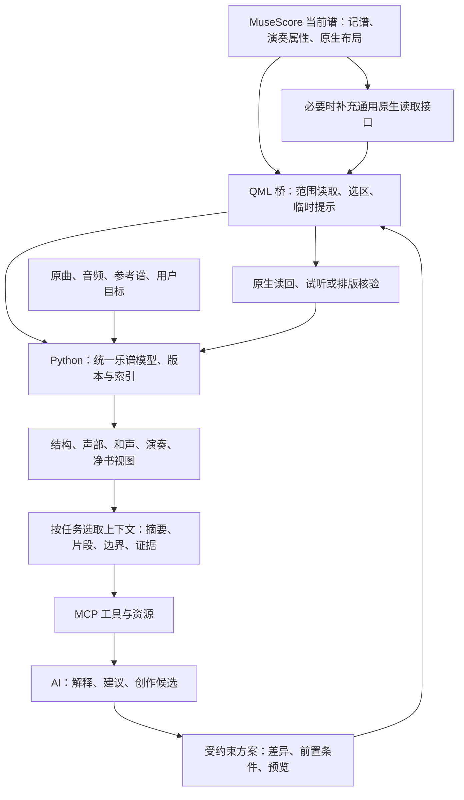

# 乐谱数据与 AI 上下文设计

日期：2026-10-09。状态：**架构规划，尚未实现本文的新接口与数据模型。**

面向 Freddd13 的 MuseScore 3 Evolution / Kumo 分支：钢琴写作、编曲、音乐分析、演奏润色、提示与净书。本文与 [现有桥接原理](ARCHITECTURE_AND_PIANO.md)、[净书研究](ENGRAVING_PLAN.md) 配合使用；不替代净书规则库，不改变现有工具的行为。

## 1. 总体决定

建议建立**本地完整乐谱模型 + 多种音乐视图 + 按任务组装的上下文包 + 可核验的修改方案**。

MuseScore 是正在编辑的谱的事实来源；插件负责从宿主读取、定位、预览与执行；Python 负责归一化、索引、音乐算法和上下文组织；MCP 提供明确的调用入口；AI 负责理解目标、比较解释、提出创作方案。分析结果、用户意图和参考资料另存，不回填成未经确认的乐谱事实。

同一小节至少有四种不同问题：写了哪些记谱对象，按当前参数会怎样播放，人可能如何理解它，实际谱面如何呈现。数据应允许分别回答，再通过对象引用关联起来。



完整模型保留本地并可分页读取，不要求每次发给 AI。最有效的上下文通常是“知道全曲在哪、看清当前乐句、知道跨边界的关系、必要时能再查”。

## 2. 已核查的基础与缺口

本次两仓库均先 `git pull --ff-only`，均已同步。MCP 基线为 `7584651`；关联软件 HEAD 为 `059ddd720`，个人版本 0.18.0。本机原生源码只读核查；此前 MCP 宿主测试覆盖的是 0.10/0.11，本文不把 0.18 源码存在等同于桥接运行验收。

| 部分 | 当前事实 | 本设计的处理 |
| --- | --- | --- |
| MCP `get_score_data` | 读标题、小节起点、谱表、四声部、音高/TPC、时值、逐音 tie、存储力度、tuning；先读全谱，再由 Python 筛小节 | 改为宿主范围提取，保留原工具兼容；新接口返回覆盖范围、版本与缺失字段 |
| QML `getScoreSummary` | 逐谱表遍历谱段，每段用小节边界过滤定位 | 单遍/索引定位小节，避免每个谱段重复扫描全体小节；复杂度与耗时要测量 |
| `ScoreObserver` | 有 snapshot、contextSnapshot、analysisFrames、临时颜色/标签与谱面预览；analysisFrames 每页最多 128 帧 | 优先接入已有能力，frame 分页留在本地处理，输出有意义的和声区间 |
| 观察器上下文 | analysisNotes 按 MIDI 音高去重，提供窗口/踏板语境；窗口参数上限 1920 tick；fingerprint 只覆盖部分音符/时长/调号/踏板等 | 仅作和声候选输入；不替代声部模型、长期记忆、完整内容 hash 或最终播放数据 |
| 观察器定位 | tick/track/index 加 pitch/TPC 校验；不是跨任意修改稳定的音符 UUID | 首版采用 snapshot 作用域引用；修改后重新解析，禁止把旧索引当永久身份 |
| 原生 Plugin API | 可读 notes/graceNotes、tuplets、annotations、部分 spanner 属性、style、pagePos/canvasPos/bbox；有 scoreStateChanged | 逐项核验遍历完整性、单位、撤销与事件覆盖；属性存在不等于端到端可用 |
| 原生个人演奏扩展 | 0.14 琶音时序，0.15 小音符解释，0.16 自由踏板，0.17 重音倍率，0.18 rit./a tempo | 保存语义和派生播放分开读；新增属性目前未在 elements.h 完整提供 QML 属性包装 |
| 净书资料 | 已有 `docs/engraving` 案例、规则卡、来源与实现研究 | 复用 ruleId/caseId 与验收条件，几何、规则证据按需取 |
| 当前预览 | VexFlow/LilyPond 是替代呈现，未覆盖完整原生布局 | 净书验收使用同版本 MuseScore 原生输出 |

`Score.mscoreRevision` 是上次保存所用的软件 revision，不是“这份谱当前编辑到第几版”。Plugin API 的 `ScoreElement::get/set(Pid)` 是 C++ 内部方法，不能假定 QML 能任意读取新的 Pid。不能把旧代码里的 `writtenPitch` 字段名直接当成标准定义：需实测 MS3 的 pitch、tpc1/tpc2、移调乐器、八度线和小音符，统一到下文明确的音高口径。

主要定位：本项目 `musescore-mcp-websocket.qml`、`src/tools/connection.py`、`src/client/websocket_client.py`；软件 `mscore/plugin/api/scoreobserver.{h,cpp}`、`qmlpluginapi.h`、`elements.h`、`score.h`，以及 `personal/docs/15-piano-expression.md`。

## 3. 五层内容：哪些是事实，哪些是理解

| 层 | 内容 | 示例 | 权威性 |
| --- | --- | --- | --- |
| 乐谱事实 | 对象、时间、音高拼写、声部、标记范围、反复等 | m12 第二拍的 E♭4；一条跨两小节的踏板线 | 当前宿主/指定文件 |
| 演奏解释 | 渲染时序、力度、速度积分、反复出现、踏板控制器 | 琶音提前 65 ms；rit. 实际速度图 | 原生派生结果，或明确标注的模拟 |
| 音乐分析 | 旋律候选、乐句、调性区域、功能、动机、织体 | 可能是属延长，也可能是转向关系小调 | 算法/AI 假设或用户确认 |
| 任务与意图 | 当前目标、保护对象、允许修改、审美与难度 | 保留原曲旋律，左手减难，副歌更有推进感 | 用户输入/确认 |
| 参考与历史 | 原曲身份、来源片段、录音、此前候选与评价 | 原录音 00:42–00:58 对应此版 m17–24 | 带来源与版本的外部证据 |

几何与视觉作为乐谱事实的独立按需视图，而不是所有音符必带的大量坐标。原始事实不会被 AI 的一句“这段是 A 小调”覆盖。分析可并存，用户可以纠正或保留多个解释。

每项分析携带 `source/algorithmVersion/evidenceRefs/dependencies/status`。数值评分不冒充准确概率；只有经过校准才使用概率型 confidence。否则用候选排名、支持理由、反例与 unknown。人工覆盖是显式的解释层，不是偷偷改数据。

## 4. 本地统一乐谱模型

### 4.1 身份、版本与覆盖范围

建议顶层包含：

```text
schemaVersion / extractorVersion
documentId / scoreSessionId / viewId / snapshotId
contentRevision / performanceRevision / layoutRevision / interactionRevision
appVersion / personalVersion / bridgeVersion / capabilities
coverage / missingFeatures / warnings / provenance
metadata / parts / staves / measures
events / notes / relations / markings / formNavigation
performanceSpec / analyses / taskState / references
```

`documentId` 指此编曲工程，`scoreSessionId` 是一次打开/桥接会话，`viewId` 区分总谱与分谱；`snapshotId` 是实际冻结的提取结果。作品身份不等于工程身份；同曲不同编曲有不同 documentId，同一工程重开有不同 session。复制出的草稿通过 `derivedFrom` 记录亲缘；另存为不能只靠文件名判断是新工程还是原工程延续。

首版不必实现精细四种 revision：可先保守维护一个失效代数，加 snapshot 内容 hash。后续再分音乐/演奏/排版/交互，以减少不必要重算。选择改变只使任务焦点失效，排版改变只使几何失效。无法证明某事件只改选择时，宁可保守失效，不能丢掉同一事件里的音乐变化。

coverage 要表述“请求什么、实际返回什么、完整到什么程度”。踏板未读到分成“不存在”“未提取”“不支持”“截断”“未知”不同状态；不能都返回空数组。未导出的默认值同样不能视为零。导出或离线读的保存文件可能滞后于当前编辑谱，必须注明。

### 4.2 时间：兼容拍子与所有复杂边界

- 原生地址保留整数 tick 及动态读取的 ticksPerQuarter，不把 480 写死进新模型。
- 跨格式、算法用约分的四分音符单位有理数 `[numerator, denominator]`；例如第 3 个三连八分音的起点为 `[2,3]`。必须显式记录 tick 量化与误差；有理数不能恢复宿主已丢失的精度。
- 同时保存书面时值、附点、连音比例/嵌套关系、实际节奏时长；全小节休止不是简单的全音符。
- 小节用结构 ordinal 与显示编号分开，保存实际起止、名义拍号、有效拍组、弱起/不规则小节。弱起可以显示为 0，结构仍为第一个小节。
- 自由踏板和文字线可以结束于没有音符的时刻；时间锚点与对象锚点分开建模。
- 定位范围统一用 `[start,end)`；对用户的“第 1–8 小节”保留含末小节含义，入口转换。谱表/声部沿用现有 0 基索引；用户显示声部 1–4，转换处必须明确。
- “第几拍”带 beatUnit 和拍组：6/8 的两个附点四分大拍，不等于六个八分计数单位。beatStrength 是派生解释，不能只由 tick % 480 得到。
- 播放另设 occurrenceId/passIndex：同一记谱音在反复、房子、D.S./D.C./Coda 后可多次发声。绝对秒数由所选播放路径及速度图计算，谱面 tick 不直接等于播放时间。

### 4.3 音符、和弦、休止与关系

| 对象 | 必要信息 |
| --- | --- |
| Part / Staff | 乐器身份、移调、谱表组、谱表顺序与可见性；不要从“上谱表”直接推断“右手” |
| Measure / Segment | 实际边界、显示编号、拍号与有效上下文、节拍组、重复导航、非音符段 |
| Chord / Rest | 起点、书面/实际时长、声部、谱表归属/跨谱表显示、连音、连梁、休止类型、隐藏/播放状态 |
| Note | 记谱音名/升降/八度、语义拼写、可见变音记号、concertPitch、playbackPitch/tuning、逐音 tie、演奏存储属性、指法 |
| Grace group | 主音引用、小音符序列/先后、外观、节奏写法；独立的播放位置/持续模式，不用 duration=0 糊掉全部语义 |
| Relations | tie、slur、beam、tuplet、graceTo、crossStaff、linkedPart、annotationTarget；端点/成员对象引用 |
| Markings / Spans | 力度、hairpin、踏板、八度线、奏法、和弦符号、歌词、文本、速度/rit.；时间/对象范围、PART/STAFF/SYSTEM 等原生作用域、可见性 |

“同刻多个音”有记谱和弦身份，但不因此等于一个和声和弦；同 MIDI 音高出现在两个声部也必须保留两个对象。tie 是延音关系，slur 是另一种跨度关系；不能合成一个 `connected=true`。八度线/移调/演奏事件改变发声音高时，不反向改写纸上音名。

没有谱面指法，不能由音符自动断言用某根手指；没有手分配，不能把谱表当成双手。保存 `handAssignment` 的来源和覆盖范围，可为 user、explicitMarking、inferred、unknown，支持共享或换手。逻辑旋律可以跨谱表、换记谱声部、处于和弦内声。

### 4.4 踏板、力度与速度尤其需要分开

踏板至少保存 `kind / partScope / start / end / changes / notation / playbackModel`。首批支持现有原生 Pedal 的 CC64 区间和自由 tick；为半踏、换踏、CC66、CC67 预留 typed extension，但不虚构它们已经被当前分支支持。

按任务提供三种音集合：

1. attackEvents：实际新起音；tie 的续接不计新起音。
2. heldByNotation：按时值/延音仍持续的音。
3. pedalContext：模型认为踏板保留的音，附原始起音和持留原因。

踏板持续不是音频振幅永不衰减；某音源是否支持半踏、共鸣或制音器行为需另记。Seq 当前活动 Note-on 集合也不能保证表示 Note-off 后全部踏板共鸣。和声候选可看 pedalContext，手的运动应看 attack/hold 与换手方案，不能把踏板里的全部音同时算手跨度。

力度保存谱面 `mf` 等、hairpin 及作用域，另存音符的 `veloType/veloOffset` 和重音倍率；有效 MIDI 力度用原生计算/渲染结果单列。不能把全谱的 mf 无差别分配到每声部，也不能把 veloOffset 当最终 velocity。

速度保存文本外观与明确语义：BPM 节拍单位、节点、rit. 起终点/曲率/播放开关、a tempo 恢复模式；另提供派生速度图、停顿、relativeTempo、播放出现及预备时间。不能仅从字符串“rit.”猜测播放行为。0.18 的原生派生图优先复用，不在 Python 复制一套稍有差别的积分器作为权威。

### 4.5 净书视图

仅在诊断/预览时带：有效 style 与局部 override、字体/SMuFL metadata 版本和指纹、page/system/displayStaff 映射、对象坐标及 bbox/必要曲线形状、sp 单位与到页面 mm/图片 px 的变换、裁图范围、手动 offset/autoplace/break/spacer/锁定、原生输出 hash 与 layoutRevision。

矩形交叠只是候选问题，不能等于错误。标记属于谁、延伸到哪里、声部如何读，必须从模型取得；图片用于阅读效果和真实几何补充。曲线、符干、连梁本就可能相接，bbox 会过度报错。只看一张裁图也不能确定页末翻页条件。

## 5. 音乐理解视图：帮助 AI 听懂结构

### 5.1 横向、纵向、层级三个视角

- **横向线条**：每条记谱声部的序列，以及跨声部/谱表的逻辑旋律候选；音程轮廓、节奏动机、停顿、句尾、歌词重音与指向。
- **纵向时间切片**：新起音、持音、踏板语境、低音、局部拼写、候选和声/转位/功能、非和声音的去向。切片在起止音、踏板改变、关键标记处生成，再合并为有音乐意义的区间，不逐毫秒送 AI。
- **层级结构**：全曲 → 段落 → 乐句/乐句组 → 动机/织体单元 → 事件。人工 rehearsal mark 与结构解释分开，二者可能不一致。既支持树状分段，也允许动机回现、重叠乐句和嵌套关系。

调号只是谱面事实；局部主音、调式、暂时离调与持续转调是不同推断。功能分析保留 tonalRegion 引用与候选，例如“在 C 大调中的 V/vi”与“进入 A 小调后的 V”，需要周围终止、低音、旋律和时长证据，不从单个和弦决定。

用确定性算法生成可检查特征/候选：音程、节拍、音域、持续时长、候选和弦拼写、声部运动、节奏密度、音区/手分配限制、重复动机。AI 做跨段解释和目标权衡；“旋律必须最高音”“并行五度必错”“和声越复杂越好”不成为通用规则。

### 5.2 角色、动机、织体与信息压缩

`roleAssignments` 指向具体 note/event/timeSpan，可多标签：旋律、低音、内声、对旋律、填充、节奏骨架。保存来源与不确定项，允许用户锁定“这几音是旋律”。音色/声部号仅是证据之一。

动机记录原型、实际出现对象、音程/节奏表示、变形（移调、倒影、增减值、截断）、相似度与例外。编曲纹理记录 pattern 及每次 occurrence 的局部变化。原始音符仍保留；展示时可写“m5–8 延续 m1–4 音型，m8 低音变化…”，附可展开引用，不丢掉那一个改变功能的音。

### 5.3 和原曲名字、谱本、录音相对应

为 `workIdentity`、`arrangementIdentity`、`sourceEdition`、`recordingIdentity` 分开记录：题名/别名、作曲/词/编曲者、版本/移调、来源、用户确认状态。文件名和标题是线索；AI 对曲名的记忆不能当成当前谱实际内容。

建议三级路径：

1. **首版人工可靠关联**：用户指定原曲与录音，标出“此版 m17–24 对应录音 00:42–00:58 / 原谱副歌”；不必等待识曲模型。
2. **本地符号匹配**：对已取得的参考谱用音程+节奏+动机索引做移调容忍检索，再以实际细节排序/核验；能指出匹配与差异。多声部、删节、重复与节奏改编要允许非一一映射。
3. **录音对齐/来源检索**：增加 onset/chroma 等特征对齐、变速/反复路径处理，自动转写仅作可纠正的观测。检索返回作品候选和来源；熟悉旋律片段不保证唯一识别，更不保证版本相同。

alignment 记录 from/to 片段、顺序关系、时间变换、可信程度和依据。不允许把参考谱第 24 小节直接等同当前第 24 小节。未获得原谱/录音时可以分析眼前谱，并明确无法核对的内容。分析参考资料的取得与模型传输由用户任务决定，不能仅凭填了题名就暗中上传全工程或联网取得所有资料。

## 6. 上下文包如何组装

### 6.1 先给地图，再给问题现场

| 级别 | 内容 | 常见用途 |
| --- | --- | --- |
| L0 工程卡 | 身份、结构总览、乐器、调/拍变化、用户目标、当前焦点、能力/缺失 | 每项任务开始，纠正错误前提 |
| L1 段落卡 | 乐句/动机、织体、局部调性候选、段落关系、关键事件与证据索引 | 全曲结构、缺乏思路、发展方向 |
| L2 精确片段 | 焦点范围所有必要事件/声部/标记，以及边界闭包 | 局部和声、改写、转调、难度 |
| L3 专题细节 | 原生演奏、几何/裁图、原曲对应、选中对象完整属性 | 演奏润色、净书、疑难核验 |

这是数据访问层级，不是让每次对话机械走四轮。一次 get_task_context 可组装足够的 L0/L1/L2；需要详细依据时再取对象。全曲完整模型留在本地，一次任务可能跨多次分页分析；不能声称 AI 从摘要已检查了所有小节。

### 6.2 必须取得边界闭包

只取 m9–12 会漏掉 m8 开始的 tie、踏板或渐强，也会把未解决的悬念当成已经结束。上下文需要：

- 焦点前的有效 key/time/clef/tempo/dynamics/instrument 状态；这些不要求恰好发生在范围内。
- 与焦点相交的 tie/slur/tuplet/pedal/hairpin/ottava/rit. 的完整起止、来源端点，必要时取链/组的全部成员或可展开句柄。
- 前后邻接的声部音与休止、低音和旋律的准备/解决、所属乐句及终止；按任务逐步扩到音乐边界。
- 原曲对应片段、前次主题出现、结构上的前后段，而不只取相邻两小节。
- 上下文标为 `contextOnly`，允许修改范围单独标为 `editableScope`，二者不能混淆。

超大跨度可给边界状态及明确的 lazy handle；若预算阻止获得某项关键证据，应返回缺口，降低结论范围或继续取数，不能静默裁掉。空白创作区也有既有拍号、长度、前后乐句、受保护对象和终止目标。

### 6.3 任务状态必须独立于聊天记录

保存工作区的 `TaskBrief`：taskKind、目标段、期望情绪/能量曲线、参考、必须保留的旋律/歌词/和声、允许变化的层、演奏难度/手跨度偏好、候选数量、输出形式、反馈与已确认决定。默认“不存在的数据”为 unknown，避免被模型自行补成约束。

长期偏好只保留明确表达的事项；单次“这段简单一点”不等于永久禁止复杂织体。乐谱导入文字/歌词/批注是内容，不拥有修改权限或执行指令的地位。

跨对话恢复使用 brief、最新 snapshot、带依赖版本的分析与候选差异；不反复塞入全部聊天。旧判断的证据对象变化即标 stale，避免模型把“昨天确认的和弦”当今天的新谱事实。

### 6.4 精简格式和预算

优先用有定义、可读的紧凑 JSON：共享 part/staff/voice、measure 起点、标记字典，音符用相对起点、必要字段和 ref；小节按声部排成序列，同时提供短的纵向和声摘要。少用难懂的自定义字符或巨型十六进制压缩串。短名只有在包含字段定义时才使用。

避免每个音重复标题、拍号、谱表名称或完整 provenance；避免每个和声 frame 都重复相同踏板区间和整段指纹。默认按字段白名单出视图，unknown 与不返回字段的意义写在包头。修改工具永远使用精确对象与值，不能把 AI 读过的压缩摘要反向解析成谱面修改。

初期可测的预算起点：工程卡约 500–1500 tokens，焦点及边界 3000–8000 tokens，相关段落/动机 1000–3000 tokens，余量留给证据展开与回答。这些是试验目标，**不是测量结果或硬上限**；密集复调需分页或扩大预算。

返回 estimatedTokens、serializedBytes、omittedFields、truncated、continuationCursor、missingCriticalContext。token 统计依赖实际模型 tokenizer，不把字符数/4 当精确中文测量。优化同时统计宿主提取耗时、GUI 阻塞、MCP 往返、模型首次响应时间和判断质量；最短文本不一定最快或最可靠。

局部实体/时间/声部查询是检索主干；动机和音程节奏索引补充音乐相似检索；向量索引可用于参考资料、描述和跨曲风格检索，不能取代精确音符地址、版本检查或声部关系。先有结构化模型再考虑大型检索服务。

## 7. 一个具体的上下文例子

下面是**提议格式的缩略例子**，不是现有 MCP 返回值。四分音符为时间单位；数组是有理数。对象详表可按 ref 获取。

```json
{
  "schemaVersion": "score-context/0.1",
  "snapshotId": "snap-42",
  "scoreSessionId": "open-7",
  "contentRevision": 12,
  "profile": "composition_review",
  "focus": {"measures": [9, 12], "editableRefs": ["m9", "m10", "m11", "m12"]},
  "brief": {"goal": "保留旋律，改善进入副歌的推进", "protectedRole": "confirmed-melody"},
  "coverage": {"notes": "complete", "pedal": "complete", "renderedAudio": "notRequested"},
  "inheritedState": {"meter": "4/4", "keySignature": 0, "tempoQuarterBpm": 88},
  "context": {"phrase": "p3", "relatedMotif": "motif-A", "contextOnlyMeasures": [8, 13]},
  "events": [
    {"ref": "e91", "measure": 9, "staff": 0, "voice": 0,
     "offsetQ": [0, 1], "durationQ": [1, 1], "noteRefs": ["n91"]}
  ],
  "notes": [
    {"ref": "n91", "eventRef": "e91", "written": "E5", "concertMidi": 76,
     "tieFrom": "n88", "roles": ["confirmed-melody"]}
  ],
  "crossingRelations": [
    {"ref": "pedal4", "kind": "pedal", "part": "piano", "fromMeasure": 8, "toMeasure": 10}
  ],
  "hypotheses": [
    {"kind": "tonalRegion", "value": "C major", "status": "candidate", "evidenceRefs": ["p3"]}
  ],
  "warnings": ["旋律续接音不能当成新起音", "踏板保留音不等于同刻手跨度"],
  "more": {"objectRefs": ["n88", "pedal4", "p3", "motif-A"]}
}
```

真实包须让 tie 与 pedal 端点、乐句/动机及各标记完整可查；例子省去多数事件，不能据此作整段分析。模型可读的 ref 不直接意味着可写，写前需检查 snapshot 与目标完整性。

## 8. 未来任务与对应的数据配方

| 任务 | 最需要的上下文 | 可实现的输出与路径 |
| --- | --- | --- |
| “目前这段怎么样，怎么改” | 用户希望的效果、旋律/低音/内声、节奏与句末、前后乐句、已有主题、受保护音 | 找实际位置与听感依据；保留原稿，提出 2–3 种改法和代价，局部试听/差异 |
| 整段无思路 | 已有动机、段落能量、前后调性/终止、长度与难度、参考织体 | 先出段落/和声/织体蓝图，再为选中的路线补音符；避免一开始填满随机音 |
| 旋律发展与对旋律 | 逻辑旋律候选、音程节奏动机、呼吸/歌词、和声与受限音域 | 延展、对答、变奏、序进等候选，并指出与原主题关系；旋律保护可逐音锁定 |
| 和声、级数、调性/转调分析 | 拼写、低音、持音与踏板、节拍、前后终止、调性候选 | 多解释功能图，区别暂时离调/持续转调与非和声音；证据可点选 |
| 重配和声/写转调连接 | 目标调、目标音区/能量、旋律保护、起终和弦、允许长度 | 公共和弦、共同音、属准备等多路线；算法验音，AI 比较风格与推进 |
| 整段移调 | concert/written 口径、拼写、调号、移调乐器、八度线、指法/音域、原曲对应 | 音高与拼写明确转换，检查音域和可弹性；原生移调与读回优先 |
| 钢琴编曲/难度适配 | 角色分层、手分配、跨度/换位、同时持音、跳跃、踏板、演奏速度 | 旋律/低音保留，给减音/换手/音区/织体候选；同刻跨度只能筛风险，不能证明不可弹 |
| 指法与练习建议 | 明确手分配、连贯运动、实际时序、速度、重复/音区、用户手型 | 多种指法与转换位置；可编辑确认，不把启发式当唯一正确答案 |
| 力度/速度/踏板润色 | 声部角色、乐句/呼吸、原生存储与有效播放、rit./a tempo/琶音/倚音、音源 | 参数草稿、A/B 试听、原生安全停播提交；模型不能凭 JSON 声称已听到实际音色 |
| 净书 | 精确语义+作用范围、有效样式/几何、原生裁图、规则卡、整页结构 | 事实→问题→候选→副本原生核验；保护演奏与记谱语义，遵循已有净书计划 |
| 翻页/断行 | 乐句、段落、长跨度、密度、系统宽度、双手活动/踏板、页尺寸 | 少量候选与阅读代价；没有手分配不保证翻页时有空手，屏幕看图不能替代打印验收 |
| 和原曲比较/忠实度 | 已确认来源版本与 alignment、旋律/歌词/和声/段落映射 | 列保留、改变、删节、重配；“更像原曲”与“更适合独奏”可并列权衡 |
| 录音/演奏对照 | 原生播放图、录音时轴、起音/速度/踏板观测、对应可信度 | 节奏/力度差异、练习定位；转写错误单列，不能据低质量识别改谱 |
| 导入后校对/记谱修复 | 导入来源、对象属性、声部/连音/tie/隐藏休止、截图、默认值 | 给缺失/歧义诊断；OMR/MIDI 导入结构可能不可信，先确认再修 |
| 乐理学习/分析报告 | 选区与上下文、算法证据、替代解释、参考定义 | 临时颜色和可点选报告；用户确认后才写固定分析文字 |
| 专题搜索 | 动机、节奏、调性/功能、奏法、跨谱表、指法/踏板范围 | 查“主题换到左手的地方”“所有相似终止”；结构索引定位，AI 解释结果 |

还可延伸到多版本创作比较、伴奏型库、主旋律与歌词重音适配、声部平衡诊断、局部学习任务与排练标记建议。共同基础仍是对象、时间、关系、版本和目标，新增任务主要增加视图与约束，而非每项另造一套乐谱格式。

## 9. 软件本体、插件、Python、MCP、skill 的分工

| 层 | 应承担 | 实现边界 |
| --- | --- | --- |
| MuseScore 本体 | 原生对象/派生播放/排版、安全编辑与 Undo；必要的只读通用 API | 不内置大模型、提示词、曲风判断与联网检索；新增接口有实测缺口才做 |
| QML 插件 | GUI 线程范围提取、选区/播放位置、对象寻址、事件通知、临时提示、小范围原生写入 | 不做每音一次网络往返，不阻塞音频线程；网络/AI 不逐播放帧调用 |
| Python 服务 | 验证 schema、归一化、缓存索引、片段/闭包、规则算法、候选与上下文包 | 大计算在宿主外；JSON 是有损投影，原谱仍权威 |
| MCP | 少量明确的工具、分页/专题资源、错误/覆盖信息、候选操作 | 不把全部乐谱默认塞初始化；不能假定所有客户端自动读资源/订阅变化 |
| skill / agent | 选择任务视图、按证据补取数据、解释不确定性、先蓝图后音符、提案与读回 | 指导使用接口，不复制动态乐谱到 SKILL.md；长期音乐状态放工作区 |

MCP 是提供数据/动作的协议，不提供旋律理解本身。该模型与某一家 AI 无关，可以被 Codex、其他客户端或本地分析 UI 复用。后续若插件内直接接入 AI，可调用同一 Python 上下文服务，API 凭据在服务的本地配置中，避免写进乐谱/QML；请求、取消、候选仍沿同一模型。

### 9.1 模块与存储的具体组织

提议在现有目录之外增加专用 `src/score_context`，避免将不同任务逻辑塞满单个 QML 文件：

```text
schema.py            版本化类型、单位、覆盖范围、事实/分析分离
adapters/live.py      宿主范围读取、字段能力、快照冻结
adapters/file.py      只读 MSCX/MusicXML/参考谱与来源版本
normalize.py         时值/音高/默认值/原生地址到统一模型
index.py             时间区间、对象、声部、关系与动机检索
views/               structure / voices / harmony / performance / engraving
context_builder.py   任务配方、边界闭包、预算与可展开证据
store.py             工程身份、brief、分析依赖与候选历史
patches.py           约束、旧值检查、差异与原生操作映射
```

先把 schema、live adapter 与 context_builder 做小；每个 views 模块按真实任务逐步补齐，不一次建设所有空模块。现有 src/tools 只封装调用，音乐函数可独立运行/测试，QML 对宿主 API 的细节留在桥接端。

持久数据用独立工作区而不是把 AI 长文本塞进 MSCX：保存工程 manifest、明确用户 brief、来源/对齐、人工确认角色、版本化分析、patch 与工件索引；snapshot/索引/原生渲染是可重建缓存。首版可用版本化 JSON sidecar，规模变大再转 SQLite。存储根目录由配置指定，可为每个工程建立独立目录；此功能实施前不创建或上传真实工程副本。

跨电脑同步工程元数据与用户确认决定；临时 sessionId、绝对本机路径、对象指针、过期 ref 和可重建缓存不充当可移植事实。文件 hash 用于识别来源和失效，隐私敏感的原谱/音频默认不进代码仓库。缓存支持体积限额及独立清理，不影响原谱/确认的分析记录；具体自动清理须遵守项目不擅自删除文件的规则。

### 9.2 推荐的提议接口（尚未注册）

| 接口 | 参数/返回重点 |
| --- | --- |
| `get_score_manifest` | 能力、版本、工程卡、结构地图、选区摘要、支持/缺失字段 |
| `get_task_context` | taskKind、focus、预算、profile；返回一个完整任务包与可展开引用 |
| `read_score_region` | snapshotId、tick/measure 范围、staff/voice、fields、includeCrossingRelations、cursor；范围实际在宿主执行 |
| `read_score_objects` | snapshotId 与 refs；用于完整属性/边界证据展开 |
| `query_score` | 有类型的结构/动机/特征查询，返回证据引用；不开放任意代码执行 |
| `get_performance_context` | 原生语义、实际渲染或明确模拟、播放 occurrence、音源/暂存状态 |
| `get_engraving_context` | layoutRevision、规则需要的语义与几何/原生图像 |
| `propose_score_patch` | 当前 snapshot、目标/约束、候选音符/参数草稿；只验证和创建提案 |
| `preview_score_patch` | 独立副本或临时层、结构差异、原生视觉/试听工件，不污染当前谱 |
| `apply_score_patch` | patchId、baseRevision、expectedOldValues、editableScope；受限原生事务、应用清单和读回 |

首版重点是前四个；既有 `get_score/get_score_data` 继续可用，通过兼容适配器复用新提取器，旧消费者不突然收到新的不兼容 schema。capabilities 逐项声明，不用应用版本号猜功能。

资源可按 document/snapshot/profile/region 定位，例如 `score://doc-1/snap-42/region/m9-m12`；分页、订阅与缓存策略由服务声明。**资源 URI 本身不会自动让模型知道资源正文**，核心工作流仍由工具显式返回任务包，资源为展开/共享补充。读资源不是自行解引用任意外部文件路径。

### 9.3 最可能需要的小本体接口

优先核验插件能否可靠得到 spanner全集、有效上下文、总/分谱映射和 range 枚举；做不到才增加通用读取接口。个人扩展 Pid 可加少量只读包装，覆盖琶音/倚音/重音/rit./恢复模式；不必顺带暴露随意写所有属性。

对于最终力度、完整渲染事件、派生速度和重复出现，首选复用原生计算，并提供带版本和状态的只读 snapshot。区分“已保存属性”“播放中暂存”“当前已渲染结果”；不能从播放中的半成品状态取出看似一致的数据。原生线程/对象指针不传到 Python，GUI 线程复制出值对象，后台只处理副本。

最终几何与曲线提取按净书案例需要扩展，不先写全能的排版导出器。原生稳定 ID 是后期选项：只有快照引用成为实测瓶颈时，再考虑内存 registry 或持久化 UUID；后者须定义复制、粘贴、链接分谱、Undo、导入导出语义，不能草率向全部 Note 塞永久 ID。

## 10. 一致性、增量与修改闭环

### 10.1 读谱一致性

QML 单次同步读取可在 GUI 线程的一次调用中复制当前值。多页/异步读取则使用冻结 snapshot：每页来自同一快照；若仅支持现场分页，前后核对 epoch/hash，变化时使整轮过期而非拼接新旧谱。JSON-RPC/桥接以后加入 requestId、snapshotId、errorCode、coverage；与现有串行协议用握手版本过渡。

首版通过 scoreStateChanged、换谱/关闭事件和哈希保守失效。该事件被源码标为实验性，不能假定覆盖所有个人演奏暂存和所有变化；需用改音、插小节、全局 style、指法、踏板、Undo/Redo、总分谱、播放暂存逐项测试。通知只发送轻量 invalidation；AI 不必每次拖动重新分析。

音乐算法采用依赖图：改一个旋律音，更新所属 voice/motif/phrase、相关和声窗口；改踏板可能影响其后持留区间；改速度使秒数/可弹性计算失效；移调/插小节/改段落可能需要更广重算。首版保守全区失效，正确后再做精细 delta。持续时间和音高的局部 hash不能验证不在其覆盖中的布局/力度。

### 10.2 可定位的提案与安全写回

每项建议包含 `targetRefs / sourceSnapshot / observation / evidence / intent / proposedChange / alternatives / tradeoffs / invariantChecks / status`。点击建议定位原生对象或临时颜色，不改永久音符颜色来冒充分析标注。

音乐写作可改音高/节奏/声部，但要列明；纯净书 patch 保护音高、拼写、时间、声部、逐音 tie、标记作用范围和演奏语义。转调、难度适配与风格润色各自定义不同 invariant，不能共用一个“音符数没变”的验证。

首版对象 ref 只在 snapshot 范围有效，寻址包含 tick/track/type/noteIndex/预期 pitch/TPC/必要属性。新增音重排、插小节、用户并发修改会使它过期，需重新解析；不通过“找最近的音”悄悄迁移写操作。

先完整预检所有动作、范围、能力和旧值，再执行有定义的原生操作；一次 Undo 的机制需独立验证。现有 process_sequence **逐项提交且非原子**，不能包装名称后宣称整体回滚。原生 Undo 分组也不自动等于异常时回滚；复杂结构操作优先在副本中验证，再实现有清晰失败策略的事务入口。

每个 patch 有 operationId，响应丢失先读 operation 状态和乐谱，不能自动重放。服务器重启后幂等记录可能丢失，必须回读验证；这个方案也不承诺网络层“恰好一次”。返回实际已应用项、新快照、前后差异、失败项，停止后不擅自 undo 用户其他并发动作。

### 10.3 预览与创作草稿

一般分析先文字/临时标注；写作候选生成结构化草稿，在独立副本让原生节奏规范、音域和保存读回验证；复杂净书候选在副本原生渲染。记录副本的 parentSnapshot、字体/软件版本与试听参数。取消候选不需要触碰原谱，应用仍检查原谱是否改变。

试听分“模拟音符/MIDI”“原生当前音源输出”“用户实际听后反馈”，没有音频观察不能宣称已听出糊/亮/自然。拍前音的首拍偏移、反复和速度变化纳入试听对齐，不把导出预备时间认作谱面多了一小节。

## 11. 分阶段落地

### P0：数据契约与可信读取，优先开发

1. 建立 `src/score_context`（提议目录）的 schema、适配器与覆盖语义，准备真实 fixture。
2. 宿主按范围提取：实际小节起止、拍/调/谱号状态、音符拼写、逐音 tie、休止、连音/倚音、跨谱表及主要标记/spanner。
3. 接入选区/焦点、保守版本失效和 snapshot 引用；禁止 read 改选区/Undo/保存状态。
4. 接入 ScoreObserver，确认 frame 与音符事实互不替代；把和声帧处理留本地。
5. 提供 manifest、region、objects、taskContext 及已有工具兼容；至少能正确分析一段带踏板/延音/变拍的钢琴谱。

P0 不必等待模型 API、向量数据库或原生稳定 UUID。当前缺乏的原生读取包装如果是 P0 必需，可形成小而独立的本体提交，按项目要求更新日志/用户指南/版本并验收。

### P1：音乐视图与局部建议

加入用户可修正的旋律/低音角色，基础乐句/动机/和声候选和手分配；建立 L0–L2 包、跨边界闭包、brief/分析 sidecar。先验收“这段怎样、保留旋律怎么改”和“这段是什么调、是否转调”。与 HarmonyAssistant 临时预览复用，不抢占其用户配置或永久颜色。

### P2：受约束写作、演奏与净书候选

生成多路线蓝图和独立副本草稿，验证后开放小范围 patch。补齐个人演奏属性读取/原生有效值；停播安全写入独立验收。净书从已有规则卡所需的数据开始，与 `ENGRAVING_PLAN.md` 的只读诊断/副本预览阶段对齐，避免重复引擎。

### P3：全曲与原曲、多模态

全曲逐段分析并保存证据图、关联动机、发展/调性路线；增量重算与缓存指标。人工原曲/录音 alignment 先行，再增加符号匹配与音频对齐。此时再根据真实规模决定 SQLite 持久化、向量检索与原生批量读取性能扩展。

不先承诺工期：P0 的 spanner 遍历和音高口径测试是依赖点；几何与最终播放暴露是另两个风险点。每个阶段可以独立提供实用价值。

## 12. 验收条件与评估集

未来实现需要针对数据语义的测试；本轮只规划，未执行新功能测试。

| 组 | 必测案例与通过条件 |
| --- | --- |
| 时间 | 弱起、7/8 分组、变拍、不规则小节、嵌套连音、跨小节 tie；真实起止一致，拍解释明确 |
| 身份/声部 | 同刻同音高不同声部、和弦增音后索引变化、跨谱表/换手、内声旋律、总/分谱；不合并对象、不写错音 |
| 边界 | 焦点前开始的踏板/hairpin/slur/ottava/rit.、跨页/跨段、非音符端点；闭包和 editableScope 正确 |
| 音高 | 移调乐器、C♯/D♭ 拼写、八度线、调律、倚音/演奏事件；记谱/实音口径可复查 |
| 演奏 | tie 无重复起音、琶音/倚音提前、自由踏板、相对/绝对力度与重音、rit./a tempo、反复/首拍偏移；对照原生结果 |
| 版本 | 人工编辑、Undo/Redo、换谱、分页中插小节、播放暂存、style/字体改变；旧包可识别并使对应证据失效 |
| 读取副作用 | 选择、输入状态、播放位置、Undo 栈与保存状态均保留；临时标注不落谱 |
| 净书 | E08/E09/E13 与四谱表 E14 等规则案例；作用范围和实际输出可对应，不从 bbox 或局部休止作错误断言 |
| 写回 | 超时/断线、用户并发编辑、失败中断、撤销、自动规范输入分裂为 tie 链；实际变化与方案一致 |
| 上下文质量 | 对同一任务比较全量 XML、紧凑事件、分层包；按证据正确率、漏边界/漏对象、定位、tokens、耗时评估 |

为音乐质量建立小型人工评审集，区分事实正确、音乐解释合理、目标满足、可弹性、主观偏好。创作允许多个合理结果，不能以“命中唯一和弦标签”代表整体成功。对摘要未涵盖的段落，报告为未审查；允许 AI 请求更多证据。

## 13. 标准格式的使用方式与核查来源

建议 MusicXML 作跨软件交换/参考谱导入，MSCX/MSCZ 作原生存档与个人扩展保真依据，紧凑 JSON 作当前任务上下文；三者各有适用范围。MusicXML、MIDI 或 LilyPond 不单独承担工程版本、任务目标、临时分析、所有个人播放属性与原生最终几何。离线文件解析是测试/参考/批处理的重要适配器，不能冒充未保存的当前 GUI 谱。

MusicXML 自身已区分声音与记谱的信息，例如 tie/tied，并记录 attack/release 等演奏字段；其 pedal 还区分不同踏板方向/呈现。这支持分开数据语义，但不证明 Evolution 导出器会完整写出每一种个人扩展。见 [MusicXML note](https://www.w3.org/2021/06/musicxml40/musicxml-reference/elements/note/) 与 [pedal](https://www.w3.org/2021/06/musicxml40/musicxml-reference/elements/pedal/)。

MEI 提供逻辑、视觉、演奏和分析等表达的区分，以及按用途裁剪的 profile 思路。本文借鉴这种区分，没有计划首版把全部 MEI schema 引入运行模型。见 [MEI 基本概念与 profiles](https://music-encoding.org/guidelines/v5/content/introduction.html)。

MCP 规范的 resources 提供 URI、模板、分页与可选订阅；实际客户端如何把它们纳入上下文需另行验证。见 [MCP Resources](https://modelcontextprotocol.io/specification/2025-11-25/server/resources)。

以上是已查阅标准及本地源码后的设计建议；本文的分层包、任务工具名、预算、缓存和 patch 契约是本项目提案，不是这些标准已规定的乐谱 AI 架构。
