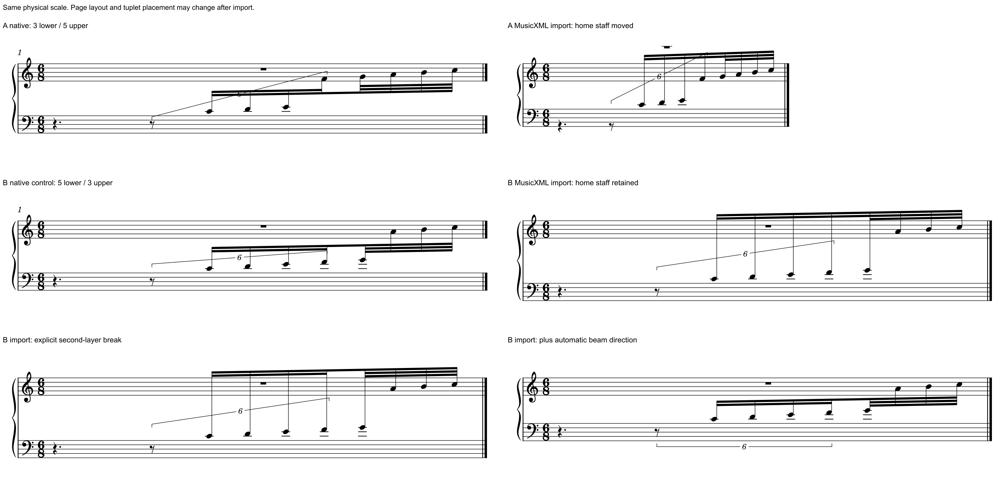

# 跨表梁的交换反例与组内换号：保住读法需要哪些信息

2026-10-31。**原生局部修改与MusicXML往返要分开验。** 本批完成6/6个原创条件，证实同一组的音高、实际时值和起音保持时，交换仍可改变声部所属谱表、干向和第二层梁断口。单变量输入分别恢复了断口与两向干，指出后续需保护的具体信息；没有修改软件、插件、MCP或用户原件。

这是[实曲m97](BEAM_SCOPE_TRANSFER.md)疑问的小样本复现，使用新写的C大调八音，不复制用户音乐。**没有将用户整谱导回，不能据此断言m97完整Part会发生相同的声部重分配。** 原定两条件，发现失败后扩为四条件隔离声部归属，再扩为六条件分别验证断梁与干向，理由先于新增试验记入私有scope。六个条件是实验范围，包含失败结果，不是六次净书成功或独立审美准确率。[证据](beam_exchange_clef_evidence.json)保留范围、文件指纹、调用和实际差异。

## 1. 要保住的音乐与读者任务

原创6/8单小节：q0–1.5为下部附点四分休止；q1.5–2.5是6:4十六分单位，成员为八分休止及C4、D4、E4、F4四个十六分；q2.5–3为G4、A4、B4、C5四个普通三十二分。八个有声音共主梁，连音范围包括前面的休止，普通尾部在外。

读者需要追一条跨两表的上行线，在6结束处恢复普通细分。两向干把梁留在两表之间；主梁保持整体动作，内梁显出时值和分段；短括号限定真正受6支配的成员。只验八个音都还在，会漏掉这些读法。

## 2. 六条件怎样把问题分开

| 条件 | 只改变什么／用途 | 实际结果与判断 |
| --- | --- | --- |
| A原生 | 前三音在下表、后五音在上表；全部逻辑属于下表声部 | 三上干／五下干，4块梁多边形：主梁1、第二层2段、第三层1。自动连音括号仍有穿梁问题，保留为原始结果，不能当出版示范 |
| A交换 | 将A导出的MusicXML原样导回，并加载同一实验样式 | 声部归到上表第二层，三低音以staffMove下移；全部干向上、第二层变连续，梁多边形减为3。另生一个隐藏的下表整休止；拒绝作为原生排版保持 |
| B原生对照 | 与A同八个音高／时值，只让F4、G4也留在下表，即五下／三上 | 五上干／三下干，仍4块梁；用于检验归属是否解释全部失败，不作为更优分手建议 |
| B交换 | 将B的MusicXML原样导回 | 声部仍属下表，三个休止记录保持；仍全上干、仅3块梁。说明干向与断口损失在本例中独立于声部归属变化 |
| B显式第二层 | 在B导出文件的最后连音F4把第二层continue改end，普通尾音G4的第二层continue改begin | 恢复4块梁，干仍全部向上；只恢复第二层断口，没有解决两向干 |
| B再用自动梁向 | 基于上一输入，只删除第一音C4的stem=up，保留其它每音干向及所有音乐字段 | 恢复五上／三下干及4块梁。只证明本控制组可由自动跨表梁恢复，不是全谱删stem的方案；括号、表距和整行仍未恢复为原生原样 |

图按200dpi、相同物理比例显示，未把不同长度的系统拉成同宽。交换后的系统宽度、纵向预算、连音括号位置与小节号也有差别；本批没有宣称整页几何保持。最后一格恢复梁的角色，也不等于完成整张谱的净书。

## 3. 为什么会这样：三个独立机制

### 声部归属按整个Part重新推定

MusicXML的[voice](https://www.w3.org/2021/06/musicxml40/musicxml-reference/elements/voice/)表示线性进行的事件层，[staff](https://www.w3.org/2021/06/musicxml40/musicxml-reference/elements/staff/)标明谱表编号；不能把voice数字5当作必须属于MuseScore下表的规定。

本机源码`VoiceDesc::preferredStaff()`选择事件计数最多的谱表，同数时保留先遇到的表。统计和分配在整个Part内进行。A运行层在下表有三个音及两个休止，共5个事件；上表五音也是5，落入同数取上表的条件。B则为下表7、上表3，实际保住下表归属。这与两次原生结构读回一致，不是只从最终图反推内部voice。

须再分可见位置：A交换后的两个休止逻辑属上表，但原生对象具有`staffMove=1`，仍画在下表；新增的下表整休止是`visible=0`。不能把导出staff标签、逻辑归属、可见休止数量混为一件事，或把该例说成两个休止字形都移到了上表。

### 第一音干向被用于整根梁

MusicXML的[stem](https://www.w3.org/2021/06/musicxml40/musicxml-reference/elements/stem/)是note的子元素。本例导出确实有上／下两向，信息并非原文件没写。

本机`handleBeamAndStemDir()`在建梁时用第一音的干向设置Beam方向；梁内后续音没有再逐个按各自stem设方向。B保住归属后仍全上干，而只取消首音强制方向即可恢复五上／三下，支持这个机制。自动与强制梁向是要保护的状态；不能把首音的视觉干向直接当整组作者意图。

### 自动可见断口没有写成第二层起止

MusicXML的[beam](https://www.w3.org/2021/06/musicxml40/musicxml-reference/elements/beam/)按层编号，每层可分别表示begin、continue、end。A／B的原生第二层都有两段，原导出标签却在该层连续。导入会把明确第三层begin转为BEGIN64，没有得到第二层起点。显式补第二层end／begin后，当前已有BEGIN32处理能够恢复断口。

这与旧[仅第四层断点丢失](BEAM_STEM_STUDY.md#6-新的具体限制第四层断点在导入时丢失)是不同情境。本例第二层断口可以表达，缺口发生在自动可见分段、导出标签和导入模式的衔接；不能据此要求新增一个已存在的层级模式。

只读源码定位：`importxml.cpp:348–357`、`importmxmlpass1.cpp:63–91／133–147／3688–3698`、`importmxmlpass2.cpp:2521–2578／6208–6227`。精确路径、提交与文件SHA在证据中。三份源码无未提交修改；固定宿主的行为与所读逻辑相合，但未证明二进制由该源码提交构建。本批没有改软件仓库。

## 4. 音乐检查实际通过了什么

独立配方核六条件共**48/48个有声音符对象**：音高、实际起点／时长、前四音6:4与后四普通值均符合。合并轨道后，全部**48次MIDI NoteOn**的时点、音高、通道和力度相同。A交换的八音还从下表MIDI轨改到上表轨，单比合并事件会漏掉归属变化，故另保留逐轨计数。

**完整MIDI和NoteOff没有保持。** 源原生输入采用简化乐器定义，没有默认Articulation；导入的钢琴模板有95% gate。480 PPQ下，四个连音NoteOff各早4 ticks，四个普通32各早3 ticks，与模板门限吻合。原生源与B控制的MIDI逐字节相同；四份交换结果的NoteOn／Off事件彼此相同，完整文件字节仍有差别。本批不把释放差异归入书面时值错误，也不把它隐去后宣称播放无损。

全部音休止记录为11／12／11／11／11／11，共67条；A交换新增的隐藏整休止单列。干向、voice／归属、梁段和休止显示差异都保留，未扩大字段忽略范围来获得“全保持”。

本批**19次原生导出＋1次帮助查询**，含一次导回原生MSCX供读取内部状态。没有做原生另存前后图形稳定性测试、用户整谱导回或实际打印／试奏。原生SVG由同一冻结宿主生成，配置目录均在调用前存在。

## 5. 组内换号的待办怎样收束

复读Gould印刷p23的完整页：组内换号时按实际谱面位置定梁向，并给新谱号留出梁／干净空。实际MIDI音高的上行，不要求这根梁也向上。

已有[换号专题](CLEF_READING.md#5-原创原生例加线更少仍可能更难读)的m1最后两个八分是E4→G4，声音上行；先F号后G号使两个头的谱面位置向下，梁相应向下。该练习前面有八分休止，可在整组开始前换号，所以优先保留[原边界版](fixtures/clef-boundaries.mscx)，拒绝无必要地拆开二音组的[延后版](fixtures/clef-late-in-group-rejected.mscx)。

本批复看该旧图与可编辑源，没有重跑旧四版或将其计成新原生条件；旧配置核查边界保持。梁干专题此前笼统写“组内换号待补”，现明确为：基础反例已有，复杂／不可避免的正面情境仍待补。不能把反例推广为所有梁内换号都错。

## 6. 当前能用什么，后续才开发什么

现在的审谱与副本候选优先保留原生对象关系。需要外部交换时，另核逻辑归属与显示谱表、每音干向与自动／强制梁向、逐层可见断口、休止显隐及播放门限。不能用MusicXML八音相同或MIDI起音相同代替净书保持。

此处没有给导入器打补丁。后续适配可据这份最小情境分别审计：保留原生声部归属；对混合干向决定何时保持自动梁；把需要保留的自动分段明确传递到逐层标签。先核现有属性与插件能做什么，再决定最小本体修改。

原创输入可直接打开：A[原生源](fixtures/mixed-beam-exchange-source.mscx)、B[归属对照](fixtures/mixed-beam-exchange-owner-control.mscx)、[显式层级XML](fixtures/mixed-beam-exchange-explicit-layers.musicxml)、[自动梁向XML](fixtures/mixed-beam-exchange-auto-direction.musicxml)；[样式](fixtures/mixed-beam-exchange-style.mss)仅固定实验字体与单位，不作为个人净书样式推荐。它们与图均为本项目原创CC0；原书、官谱及用户谱不随Git分发。

下一步独立研究跨表连音括号的自动通道及可控局部端点，再补不可避免组内换号的实际正面情境；剩余九项资料继续按原范围补读。本轮浏览器清单确认已有公开预览标签，正文两次观察超时，未另建／替换标签，也未新增R10谱例阅读。官谱146/146、1135/1135页，Gould696/696查阅覆盖、资料16/25余9、用户组合1/1保持；本阶段适配0，完整计划见[进度报告](STATUS_AND_ROADMAP.md)。
