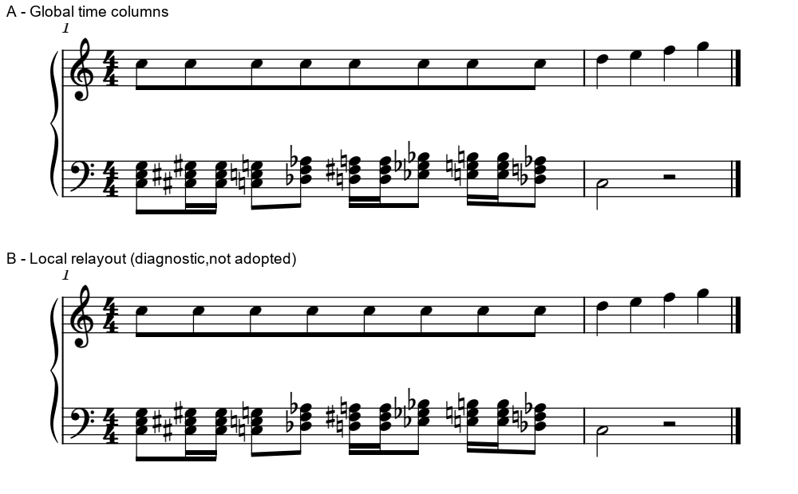

# 连梁操作与间距：先保护两手共同起音

2026-11-02。**本次拒绝用 Local relayout 修复这组钢琴间距：它让上表更匀，却把六处共同起音错开，最大约1.655sp。** 这给后续自动净书加了一项实际检查：既看一层的节奏轮廓，也看其它层与它的同步关系。完整MIDI保持，仍不足以证明谱面合格。

## 本轮读了什么、做了什么

- MuseScore 3官方[Beams正文](https://musescore.org/en/print/book/export/html/278600) **1/1篇**；定向配图**5/8幅**实际看过，三幅请求超时。已看拍号分组对话框、梁模式面板、跨小节梁、梁角度及Local relayout；最后一图属于R20旧图复读。没有把下载、图注或新Studio手册算成3版阅读。
- 只读当前软件源码的六个相关文件片段，核对象、模式名和重排范围；不记成六个完整文件阅读。
- 原创钢琴诊断条件**4/4版**：同起点控制组两版，混合细分组两版；保存重载**1/1版**，实际原生CLI **14次**。最初计划两版，发现控制组已匀且无变化后保留结果，再明确扩为四版。
- 本批没有新增Gould页或官谱覆盖。R11完整视频／声音仍未读完，固定资料保持**16/25项，余R07–R15九项**。相关拍组与共同时间列解释接续[间距判断](SPACING_DECISIONS.md)、[内梁层级](INNER_BEAM_HIERARCHY_STUDY.md)。

## 1. 为什么局部变匀反而难读

自制两小节4/4：第一小节上表八个同音C5八分音符，连成一组便于观察；下表有三音和弦和不同临时变音。第二小节为未参与重排的控制材料。全小节共梁只是诊断构型，不作为普通4/4分组推荐。

先让下表和上表八次起音完全重合：原生结果已经近等距，开启Local relayout也不改变这些位置。**变音多，不一定就会造成同值间距波动。** 随后把下表三个和弦八分位置各拆成两个十六分，增加三个中间起音；两版的音高、时值、分组、干向、纸幅与空间预算相同，唯一非空白输入差异是上表第一组Beam的`distribute=1`。

图A为默认共同时间列；图B为仅上表Local relayout的拒绝诊断。两段来自原生PDF，按相同物理比例裁同一区域，标签在谱面外；没有移动或缩放单个音乐符号。

| 条件 | 上表相邻头距最大／最小 | 两表八处共同起音的最大横差 | 判断 |
| --- | ---: | ---: | --- |
| 同起点控制组，关闭 | 1.00008 | 0sp | 已匀，保留 |
| 同起点控制组，开启 | 1.00008 | 0sp | 没有收益 |
| 下表增加细分，关闭：图A | 1.40569 | 0sp | 保住共同起音，局部宽窄继续按实际占位判断 |
| 下表增加细分，开启：图B | 1.00003 | 1.65468sp | 拒绝：六个内部共同起音失去对齐 |

测量取同一黑头字形、同侧符干的原点，按原生五线间距换算；这里没有二度和弦左右翻头的混淆。混合组开启后的八个共同起音横差依次为`0、+0.897、−0.139、+0.758、+1.655、+0.315、+1.212、0sp`。两个端点保持、下表全部音头及第二小节上表保持，因而无法靠“只是全行被拉宽”解释变化。

图A的宽格给下表新十六分及其变音留位置。上表孤立看有波动，两手合读却能直接找到一起奏的和弦。图B把上表内部拉匀，读者容易把原本同时的音读成先后；本例应保图A。这个反例没有证明图A每个间距都最优：若要继续改善，应联合移动共同时间列，保必要净空，再比较主要脉冲完整轮廓。

接续Gould已读p40、43、490：同类时值的稳定、真实符号所需空间、每拍较复杂的读法需要一起权衡。本批沿用旧阅读依据，未增加教材复读成绩。它也没有形成“全曲必须等距”的用户偏好。

## 2. 机制：选中的是一组梁

当前只读源码中，Inspector的`DISTRIBUTE`进入`Beam::layout2`，再调用`Score::respace`。后者按这一组ChordRest的时值和字形重分内部位置，保两端；它修改该组内部对象的横坐标，没有同时移动另一表相同时间的音符。上面的原生结果与这一范围吻合。

因此，使用前先问：此组是否有必须对齐的其它声部、谱表或标记？只有没有破坏阅读关系、且实图确有收益时，才比较采用。手工drag单头也有同类风险。对钢琴两表，优先查共同列、实际变音／谱号净空及行宽预算；不要把这个复选框当作整曲“匀间距”开关。

这次定位的是既有操作的适用范围，没有修改排版引擎，也没有据此决定开发接口。未来若做共同列优化，可将本例作为回归情境：保共同起音，同时减轻主要脉冲的失衡；还需密集和弦、反向符干与其它拍型验证。

## 3. 连梁操作先选对对象和范围

以下名称来自3版手册与本地模式映射核查；判断条件结合已有规范和谱例。设置默认拍组、改变某个连接、调整整组外形，影响范围不同。

| 操作层 | 选择／入口 | 适合解决的问题与要保的内容 |
| --- | --- | --- |
| 默认拍组 | 拍号的Note Groups | 按拍型设本谱／本表的常规分组；局部例外另做。对话框Reset撤回本次打开后的编辑，不等于恢复所有原始默认 |
| 单个连接 | 选音符／休止，应用梁模式 | 通常控制进入该对象的连接；先明确要显示的拍组，再选动作，不以每组外形相同为目标 |
| 整组外形 | 选Beam，Inspector或端点 | 调梁坡、位置和其它梁属性；复查最短干、梁层、数字及上下标记通道，参见[m97组界案例](M97_GROUP_BOUNDARY_TRANSFER.md) |
| 局部重排 | 选Beam，Local relayout | 只重分这组内部横位置；先查共同起音，采用前比较整行 |

本地`Beam::Mode`与用户标签的映射容易误读：

| 用户模式／符号 | 本地模式 | 边界效果与使用理由 |
| --- | --- | --- |
| Auto | `AUTO` | 按有效拍号和分组处理；作为起点，再判断局部例外 |
| Beam start | `BEGIN` | 在所选音前开新组，显出这里的分组起点 |
| Beam middle | `MID` | 接前一成员，用于确需延续的组，包括有理由的梁内休止或跨小节连接 |
| No beam | `NONE` | 所选成员不参加相邻梁；会同时影响两侧，不能和只断入梁混用 |
| Beam 16th sub | `BEGIN32` | 保主梁、断内层，既保大组又让细分层级可见 |
| Beam 32nd sub | `BEGIN64` | 保两层、断第三层及更内层；适用实际短时值，不按英文枚举数值猜标签 |

源码没有`BEGIN16`枚举；`BEGIN32`并不表示在这里另起一条三十二分主梁。[已有内梁原生研究](INNER_BEAM_HIERARCHY_STUDY.md)已覆盖这类差别，本批没有重复导出充数。

休止和跨小节梁要先证明同一音乐组的延续；梁内休止不自动成为新起音，连续主梁也不能掩盖必须辨认的拍端或连音边界。跨小节时实际选择是小节线后的首个成员。羽状梁另核渐快／渐慢含义；其外观不自动带来播放速度变化。手册所述Force horizontal受自定义位置状态影响，不能仅凭复选框文字推定当前梁外形。

## 4. 可直接使用的输入与核查范围

四份原创CC0可编辑输入：

- [同起点默认](fixtures/local-relayout-uniform-baseline.mscx)／[同起点开启](fixtures/local-relayout-uniform-on.mscx)。
- [混合细分默认](fixtures/local-relayout-mixed-baseline.mscx)／[混合细分开启，拒绝诊断](fixtures/local-relayout-mixed-on.mscx)。

本机实际音乐字体为Leland，MusicXML已核；输入未显式覆盖所有默认字体，不把它们当跨版本的像素基准。冻结运行时1936文件前后核对，宿主指纹见[证据](beam_operations_evidence.json)。运行时的构建对应没有据当前软件源码HEAD反推。

混合两版各**47条音符／休止记录**与独立分数时间配方一致，共94条；音高、拼写、书面类型、时值、谱表及干向已核。完整MIDI **441字节**相同，另核**46个起音**。开启版保存重载后，SVG除文件名生成的`title`外全部内容相同，几何记录也相同；不能写成SVG逐字节相同。原始用户PDF／MSCZ及Gould三份指纹保持。没有打印／试奏或用户采用成绩。

当前源码观察HEAD为`f0c330926aedc7fd4367b237473e1ddb30d0f2d3`；定向位置：`libmscore/beam.h:73–76`、`beam.cpp:1543–1544,1816–1817`、`layout.cpp:2142–2202`、`chordrest.cpp:599–614`、`mscore/shortcut.cpp:2055–2110`、`mscore/inspector/inspectorBeam.cpp:29`。六文件SHA和真实原生调用在证据中分别保存。

下一步继续九项资料的清晰实际教程与可读谱例；R11完整流程仍缺，不用本篇官方操作补课替代。已经确认的共同起音检查立即用于后续诊断，知识库与skill可直接检索本例。
