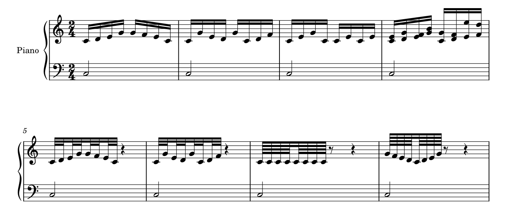

# 符梁、符干与加线：出版观感为什么不能只靠换字体

2026-10-31补[五处实曲迁移](BEAM_WIDTH_TRANSFER.md)：**5/5情境，四保留／一局部候选**。m57小字号仍占时，m103两小16后接六连；m130取靠梁头并计入可见play=0成员，解释首组平、次组斜。m81普通两音可比较半谱间，3次原生调用、8页图元和3203音休止记录核对、完整MIDI字节保持。未改原件；私有候选与打印／审美采用分开。和弦条的确切页码补正为Gould p24。

2026-10-31补[行宽与局部梁坡](BEAM_WIDTH_STUDY.md)：**5/5条件、13次CLI、60/60音符记录、1/1候选重载**。同向两音双梁在约1.888sp横距仍保1sp高差，约27.9°；局部半谱间降至14.8°，短端保持3sp、四根长端各加0.5sp，本例倾向此候选。中／宽行保自动，40mm容量溢出保失败诊断；不能由此推成全局平梁或跨表规则。原生图、范围与代价见专题，原件只读，无适配。

2026-10-23[Giorno整曲](INTEGRATED_READING_GIORNO.md)把平缓重复型与上／下行六连放回同曲比较：梁组织组形，跨组长slur另说明较长联系；白头保持与内层切分也不能按单一干向抹平。复看p21–23等旧页，不新增覆盖；未量本谱全部干长／线重或生成全局坡度预设。

2026-10-20补[跨表原生情境](CROSS_STAFF_STUDY.md#10-原创原生例加表距与平梁是两种不同代价)：本例近中部音区在6.5sp表距时最短参考长度2sp，同距平梁可达2.5sp；保坡度加到8sp则2.75sp，但增加高度。26个音符逐一匹配音头参考点，区别绘制干全长；副梁已有合理换侧，应保留。本短例的平梁选择不能推成全曲Style预设，复杂附加层／单向梁等仍待补，不新增软件开发。

2026-10-18。根据官谱A012、A013、A014等的新阅读，并完整看过《Behind Bars》印刷p17–26（主PDF p37–46）的10页文字及图例。原图在项目`tmp/engraving/book-2026-10-18/beam-pdf-*.png`。教材给出具体传统做法；本文按本项目需要归纳条件与取舍，不能把某一套比例视为所有出版风格的唯一标准。

## 为什么“把符头做好看”仍不够

同一串音头，换梁的方向/坡度、符干长度、梁与谱线的关系，就会改变整组的黑色轮廓。读者通常先看组与走向，然后辨音；太陡的梁与谱线交成格子，过窄白缝又可能在缩小或打印后糊成黑块。字体提供头型、字宽、连接点，排版器决定这些头如何与干、梁、谱线组合。

已读本体代码证据见[IMPLEMENTATION](IMPLEMENTATION.md)：MuseScore的梁主体由引擎按样式生成，不是把一枚字体字形放大拉长。下文第5／6节补上2026-10-19原生对照与导入限制；未修改本体，尚未核实本机当前二进制与源码提交完全对应。梁分组的节奏含义另见[节拍阅读](RHYTHM_READING.md)，不要把几何试验当成重分拍组授权。

## 1. 先保证黑白关系，再微调坡度

Gould p17以梁厚约0.5sp、梁间白缝约0.25sp作为传统设计，并讨论二至四条梁怎样与谱线相接。关键理由不是迷信数值：梁落在谱间中央时，上下留下的细白缝可能糊掉，妨碍辨认谱线和梁数；斜梁端点形成过薄楔形也有相同问题。

p18–21允许为这些关系微调符干长度；增加梁数时则须给内层梁与音头留空间。四条梁或某些三条斜梁还有调整梁间距的折中。由此得出的判断：

- 梁厚、白缝、干长、头型、谱线粗细和实际谱表大小要一起看。
- 不能先把所有符干强制等长，再指望梁刚好落到合适位置。
- 不能因细节放大图有一丝白缝，就认为实际尺寸也一定清楚；本阶段先分析，准备采用时再做实际尺寸核查。
- 上述传统比例是候选基准。当前未测出每份官谱的精确梁厚，也没有据此改用户样式。

## 2. 梁不照抄音高折线，也不全设水平

p19–21倾向平缓的梁，短组比长组更须防陡；相同音程在更紧的横向空间里需要更平的处理。高低都在加线外的组也有较缓坡度的建议。因此坡度不是仅由首尾音高差决定，还与横向宽度、谱内/谱外位置、梁数和最短干长有关。

p22–24进一步区分（下表和弦条在p24）：

| 情境 | 书中选择及可理解的作用 | 应保留的例外 |
| --- | --- | --- |
| 普通多音组 | 通常参考首尾的谱面位置，而非全部音的最高低差 | 内部音比端点更靠近梁时，要另查平梁条件 |
| 首尾同音或内部重复音型 | 常用平梁，形成稳定组形 | 不据此将全曲所有梁设水平 |
| 内部音伸向梁的组形 | 平梁避免内部音将某根干挤得太短 | 必须按实际干向理解“靠近梁”，不能只分上凹/下凹 |
| 仅两种音高、数量与位置不同 | 单个不同音靠梁还是远梁，会影响是否斜；两边等量时可有选择 | 重复织体可优先保持轮廓一致 |
| 组内换谱号 | 按谱面位置处理梁，并避开新谱号 | 音高数值的上升，不一定是谱面位置的上升 |
| 和弦组 | 参考每个和弦靠梁一侧的音 | 不能只取所有和弦的最高音或平均MIDI音高 |

官谱联系：A012 p5 J的重复十六分、A014 p3 F/p5 J的下降内声部，使用相似且较平缓的组形，外层长音另有符干。A013 p5末行跨谱表六连则需要联合考虑两个谱表与梁；不能直接套单谱表的一条坡度公式。定位与完整上下文见[逐谱三](corpus/READING_003.md)。

以上是外观和阅读机制的解释，没有眼动/读谱速度实验，也没有出版者访谈。不能用“教材说可平”宣称已找到用户最喜欢的坡度。

## 3. 符干方向有上下文，不能逐音投票

p24–25对单一音组有按音域多数、极端音和相邻组来选择干向的做法；若少数音离中线特别远，机械按多数会造成许多过长干。两方向均可时，相邻组的轮廓和标记通道可参与选择。

这是音组的几何判断。独立声部的干向承担身份，跨谱表又有其它规则；不能让美化器把旋律和伴奏全按音高中线重新分干向。p25也反对仅为减少占高而破坏拍分组；省空间不能丢掉节奏轮廓。

p26介绍同一谱表内的双向干共梁，条件包括短干不能短于约2.5sp、外侧谱线仍清楚；跨两谱表则指向钢琴章p315。两种情境要分别验证，不能拿同谱表图直接要求跨谱表所有干等长。

## 4. 加线也参与黑度与间距

p26建议加线比谱线明显粗，以便快速数出音区；紧密相邻音的加线可以适度缩短，避免连成一长条。装饰音的加线又随较小音头缩小。不能只把线全部变细求“清爽”，也不能让换宽音头后的加线相接而不检查。

字体线应提供实际头宽和连接点；净书线检查音头—干—梁—加线的组合。每次对照只改一组因素，先固定字体研究梁，再固定几何比较字形。

## 5. 原生检验：保留已有平梁，拒绝全局抹平

新增原创八小节2/4自制谱，双谱表，上部故意固定上干，以隔离干向与坡度；这不是建议真实乐曲都用上干。m1普通上／下行，m2内音高于两端及另一四音轮廓，m3首尾同音／重复型，m4和弦；m5–8补三／四层梁。固定Leland／Leland Text、1.57mm谱间、同一版心和两系统，只改`Style/beamNoSlope` 0→1。

原生自动版：

全局平梁对照：

| 位置与情境 | 当前宿主自动结果 | 全局平梁的结果与判断 |
| --- | --- | --- |
| m1上／下行组 | 保留约1.27sp的两端高差 | 最短干到靠梁音头的参考长度均为3sp，最长由3.75变5sp；拉长另一端的代价没有消失，保留自动走势更有理由 |
| m2第1组内音靠梁 | 已水平 | 不需要额外修正；不能把默认自动梁一概说成过陡 |
| m2第2组另一四音轮廓 | 也已水平 | 与上一组不是同一凹形条件；只读`Beam::slopeZero`另有四音模式分支，不能把所有平梁都归因于凹形 |
| m3首尾同音／重复型 | 已水平 | 全局设置没有新增收益；稳定组形可以由引擎原有规则提供 |
| m4第1组和弦 | 有较缓上行走势 | 最长“靠梁音头中心→干线末端”由约4.08变5sp；音头保持不动，只让梁水平不会使各干等长 |

上表说明取舍，不是通过计时证明自动版更好读。M4第2组跨较大音域，且上干是人为固定的输入，不能据其长干报默认干向错误；真实织体须先判断声部／手／谱表再选方向。**绘制干线全长也不等于从靠梁音头算的有效长度**：和弦中的干还穿过多颗头。证据将这两种测量分开，不能拿整个Stem外框与教材最短干条件直接比较。

线宽也要量对方向：m1斜梁同X处的竖向厚度约0.505sp，垂直于梁方向的厚度仍约0.500sp；平梁两种测量均约0.500sp。此练习所有所查主梁均符合这个结果。斜梁投影较厚不能直接被报成线宽不一致，当前宿主已有相应几何处理，不是待重新实现的功能。

本例12个主梁组中9个原已水平；该数量仅描述本练习，不代表通用质量统计。两个原生输入除上述Style值外完整XML一致，86个事件和原生导出MusicXML非布局内容一致，所有beam层级标签相同；Note、Rest、BarLine、StaffLines的SVG几何相同。Stem／Beam按设置变化，未做打印、用户偏好或保存重载验收。可编辑输入、设置与限定核查见[fixture说明](fixtures/README.md)及[beam_rhythm_evidence.json](beam_rhythm_evidence.json)。

## 6. 新的具体限制：第四层断点在导入时丢失

这与上一节的“自动版对全局平梁版”是两项不同检查。原始MusicXML在m7／8的64分组要求：第1／2层连续，第3层按四音分组，第4层再按两音分组。导入再导出后，m7／8第2、3、6、7个起音的第四层end／begin均变成continue，第三层及其它层不变。预期44个梁多边形，原生实际40个，少的是第四层断点形成的分段；两原生版本都已经丢失它，故二者相同不能证明导入保留完整记法。

音高、拼写、起点、时值、谱表、类型和附点保持。另明确记录正常的导入解析：本例下谱表单线MusicXML voice标签2改成导出标签5，未指定的下部干向落实为up；检查只允许这两个已列明变化，不能称源文件逐字段原样。原生自动／平梁两版之间则连voice、干向和每层beam标签也一致。没有用“播放相同”掩盖梁断点丢失。

只读当前源码提供一致的解释：`libmscore/beam.h`的Mode只有BEGIN32、BEGIN64等有限模式；`importexport/musicxml/importmxmlpass2.cpp`的`computeBeamMode`专门识别从第二、第三层开始的断点，未识别仅第四层开始的情形；`libmscore/beam.cpp`与`exportxml.cpp`按相应级别处理。它是宿主实测加源码定位，不声称已证明安装二进制由此提交构建，也不从本例推断所有短梁方向或所有MusicXML导入都失败。

后续适配的具体需求是：保存和读取每个起点究竟从第几层开始断梁，在重排、保存、导入导出后仍保持。是否通过插件、增加模式或更一般的属性实现，留给以后能力审计；本轮没有改接口／本体。常规音阶允许不断内梁的规范例外，也不授权导入器忽略输入明示的断点。

## 从现在可调，到开发目标

**现在可做的判断：** 按音组检查梁是否过陡、某端干异常长/短、内层梁与谱线是否糊成块、同类重复组是否忽高忽低、加线是否相连；先指出具体位置和阅读代价。全局梁厚/梁间距影响所有组，局部坡度/位置影响单组，两类候选分开。

**已做与下一步：** 同音首尾、重复型、内音靠梁、和弦和三／四梁已有上述基础原生对照，且发现一项具体导入限制；横宽已补同向两音双梁的窄／中／宽及局部端点保存，跨谱表也有独立短例。组内换谱号、其它组形／梁层的宽度变化、复杂手调及实际重排仍须分别验证。用同字体、同宽度比较默认与局部参数，不用官谱像素直接充当坐标目标。先确认失败机制，再记录软件局限；不因有了自制图就声称全专题已掌握。

**插件优先：** 先审计现有API能否读取beam组、干向、实际谱面位置、局部手调状态，并局部设置已有属性。自动化可先报可疑组和解释，不必先具备自动写入。字段不足时保留具体需求，不能为研究便利扩成任意执行接口。

**可能的引擎方向：** 若参数/插件不能在重排后稳定处理，可研究候选梁位置/坡度的联合选择，考虑最短干、谱线净空、内梁位置、重复组的一致性和跨谱表约束。它是待验证方案，不是已确认要改本体的项目；按AGENTS要求保持改动最小并另留用户指南/日志。

用户之后评价少量完整原生谱例的读感；规范核查、正反例和技术验证由本线完成。眼下不要求用户逐项审查这张条件表。

2026-10-20[震音续学](NOTATION_DETAILS.md)第11节补另一种相似墨迹：单音斜划、两音连接和普通细分梁的时值／线重不同；两音第二头放逻辑半程，长连接可比较对称缩短。原创原生例保住时间列，拒绝为居中错移头；这不是一般beamNoSlope或普通梁分组的延伸，不按同一个整理器处理。

## 基础符干、旗尾与线重补读

2026-10-21[符号阅读](SYMBOL_READING.md)补看Gould p13–16完整图文：普通干长、双部外侧缩短、更多旗／梁所需空间及加线外缘分别读；grace／cue不照搬普通值。书中符干较谱线细、小节线又应突出，说明黑度有结构层次。当前自制例实际符干／谱线均约0.110sp、普通小节线约0.180sp，仅是该输入／固定宿主的观察；没有据此认定用户工程同值或制定调细预设。

## 2026-10-24：Sincerely把组形放回密度变化

[Sincerely九页整曲](INTEGRATED_READING_SINCERELY.md)的C／F／L连续双梁十六分采用平／浅斜组合，D短高组与慢旋律的干向／弧线分层。C首组有更靠上梁的内音，平梁有Gould p22条件支持；完整复看旧p21–23，不新增覆盖。J的三条震音连接另承担重复背景，不能按同一梁坡策略整理。m200运行同时用更多小节宽度和表距，说明局部梁形也要放回空间预算。本批未生成新原生候选。

## 2026-10-27：四音梁与6＋6＋4重音并存

[Eien p4首行](INTEGRATED_READING_LAZY_EIEN.md#2-梁帮助数拍重音提示另一种律动)16个普通十六分按4＋4＋4＋4连梁，重音在1／7／13起音，即6＋6＋4个十六分。保梁的四分拍定位及重音的八分3＋3＋2，两者不必重合。Gould p22–23的端点／内部靠梁音条件也要保留，不能以重复音为由全局平梁。

## 2026-10-27：平梁避谱线可以优先于两向干长相等

[Fate／Frieren](INTEGRATED_READING_FATE_FRIEREN.md)：A045 T无整体音高趋势，平梁利于交替跟读。外露直干到最近梁边6.50／2.52sp，若上移梁拉齐，顶梁进入上表末线；保留不等长。Gould p315明确此例外，p316内梁又防突角／伪多梁；线重、谱表距、梁高联动。

## 2026-10-27：四音梁与六音短弧各给一条线索

[Gurenge／Hacking](INTEGRATED_READING_GURENGE_HACKING.md)：A053 F普通16按4＋4＋4＋4给拍位，短弧多按6＋6＋4给轮廓。保两种分组并读；附点8震音中的悬线又不属于普通副梁，不能按黑条数量统一整理。

## 2026-10-28：头位变化不必改梁

A064 A11三个下表／五个上表／三个下表，首组11干轴近稳；两条完整梁确认十六分基值。头距不均不能单独触发均匀化，候选须同时看干向、头位、梁层和净空。 见[完整两首案例](INTEGRATED_READING_IMAGINATION_POOL.md)。

## 2026-10-28：八音32的内梁有候选

A068 C每拍八音的三条梁完整贯通，已核三组九条完整梁。p156建议在八分单位分隔内梁；保主梁，在4／5头间断开第二与第三层，列原生对照候选。未渲染，不记改善；保存／交换须逐层核断点。 见[整曲案例](INTEGRATED_READING_TANJIRO_KANTAI.md)。

## 2026-10-29：内梁层级三版已原生验证

[原创三版](INNER_BEAM_HIERARCHY_STUDY.md)补齐先前C候选：主梁8、第二层4、第三层2作为普通细分首选候选，四加四保留备选。七个begin32及十四个begin64均能由当前宿主表达，保存／MusicXML导回逐层保持；此前仅第四层断点丢失仍是另一情境。三版非Beam绘图相同，收益来自计数层级；未作用户偏好或实曲采用。

## 2026-10-29：稳定组形不替代完整时值

[Kura H](INTEGRATED_READING_KURA_KUUSOU.md)8／7／8／5／5快头有实际双梁，第二8连续跨小节；常规组内稳定，但非标准长度仍须核比例与跨线后对位。Kuusou 6对5保各层梁与共同拍点；不为统一干长或每步头距破坏归属。

## 2026-10-29：短次梁和普通大小音头共同核

[K／P及Hero末](INTEGRATED_READING_DEAREST_HERO.md)K首三音次梁后有一条仅7.53pt的两音次梁；宽度>8探针会漏。P上三梁／下两梁有不同时值，Hero5组三梁／3组两梁分别读。矢量阈值是提取线索，不能凭长梁轮廓或漏检判全部同值。

## 2026-10-29：嵌套括号分层的原生结果

[原创三版](NESTED_TUPLET_SCOPE_STUDY.md)主梁连六音、次梁3＋2＋1，内部已有正确嵌套。只显内3的B自动同高重叠；C只上移外层端点1.25sp使总组远、小组近。3/3条件、29音及保存重载已核；非全谱偏移预设，原Dearest编码仍待核。

## 2026-10-30：梁黑度先问值和角色

[Shinzou／Shirushi](INTEGRATED_READING_SHINZOU_SHIRUSHI.md)：Shirushi K三梁来自32普通32，Shinzou末7／6／5两梁均为16连音，不能按数字或外观密集猜梁层。梁按拍与短弧按音型可不同；多干与跨表最短干净空优先，字体与线重只是后续受控输入。

## 2026-10-30：首头在梁外框左侧不等于没连上

[Silhouette／Sirius](INTEGRATED_READING_SILHOUETTE_SIRIUS.md)：Sirius E五连向上干位于首头右侧，五音完整双梁、下一四音另梁；保裸5。Silhouette P空心头向下接快梁、向上慢干，不能为整齐统一干向或补黑头；跨表梁仍核最短干净空。

## 2026-10-30：主梁、内梁和真实细分各有任务

[Snow／Sparkle](INTEGRATED_READING_SNOW_SPARKLE.md)：Snow H前四组5:4三十二分以主梁十音、内两梁五音表现两层动作；逐组5使范围可追。Sparkle局部反复首bar是八普通32的三层梁，后两组七连16仅两层；不能为了黑度统一梁数或改值。跨表快音、慢干和共同和弦另核。

## 2026-10-30：连梁与震音线要分清

[SPECIALZ／Ghibli](INTEGRATED_READING_SPECIALZ_GHIBLI.md)：Ghibli F7／6两层梁，9／11三层，不能因黑度统一音值；V三条浮动线连接两书面成员，共享标称时段，p12s5还有两对各一拍。完整小节纠正局部裁图的单音震音假说。邻接写出32不能独自排除定量／非定量歧义，首处说明须先核意图。

## 2026-10-30：跨表符干轴保先后顺序

[STYX／Sugar](INTEGRATED_READING_STYX_SUGAR.md)：Sugar p5s6每拍六个八度和弦按下／上交替，近邻上下符头看似对齐，梁接点却按六条独立符干依次排列；保干侧与时间顺序，不能并成三次同时。部分9主梁至峰顶，次梁只至第九成员；末两音震音的三笔则连接共享时段的两成员。

## 2026-10-30：梁接点比头距更能显示交替

[Suzume／Swordland](INTEGRATED_READING_SUZUME_SWORDLAND.md)：Swordland D每组六个八度按下上交替，共同两层梁连六条干；首组六轴间距9.540–9.756pt，头距可4.77–14.526pt。Suzume部分6／5是三层梁32，Swordland部分3是两层梁16，普通峰顶只有主梁；先核层级再定范围。

## 2026-10-30：主梁连续与内梁范围

[Tabi／Tamashii](INTEGRATED_READING_TABI_TAMASHII.md)：Tabi F三连两梁连四头、第三梁只前三；K主梁保大拍，次梁分中间3和末普通2。Tamashii跨表F两实际干轴366.066／374.418pt，头365.850／369.396pt依次发声；完整7／7／5／5保已有梁范围。

## 2026-10-30：跨表接手与净空

[Everlasting／Heroes](INTEGRATED_READING_EVERLASTING_HEROES.md)：Heroes C前两六音组各五下＋一上，最后四音下表；近接手两干轴98.8029／101.5016，相差2.699pt，仍为先后普通16。梁保轮廓和加线空间，不拉平或按近干吸齐。

## 2026-10-30：层数停止处仍决定末音时值

[Rumbling／Aether](INTEGRATED_READING_RUMBLING_AETHER.md)：Rumbling F末普通七头为六32＋末16，第三层梁提前停止；前三三连又只占同主梁一部分。Aether小音跨表共同梁保六音上行轮廓，不统一干长或拆表内两个独立片段。

## 2026-10-30：先找梁端，别因相邻快速组误报

[WORLD／Reason](INTEGRATED_READING_WORLD_REASON.md)：WORLD四普通16／五连16分梁、Reason K两个三连分梁；不统一补括号。Reason p3s6后三连二级梁止于第三头、主梁多接一个普通8，短括号只圈前三。快层与内慢线的干长差帮助分层，不强制等长。

## 2026-10-30：梁端与内外慢线分工

[This Game两版](INTEGRATED_READING_THIS_GAME.md)：2014p5s1／s2末五头仅前四有第三梁，最后普通8；两组六连各独立。p4s5／p6s4长短干差帮助读快层内慢线，跨表梁保轮廓与最短干净空。2021三音高循环不自动按3重连4/4拍梁。

## 2026-10-30：拍梁与跨拍短弧共存

[Beginning／To You](INTEGRATED_READING_BEGINNING_TO_YOU.md)：To You H每拍8＋16＋16分梁，短弧从后半拍高音连下一拍低音，不据弧重连梁；D音阶内梁可保连贯，重新对齐困难时再比较8／4／2。Beginning6组中途换号不截断梁。

## 2026-10-30：两层梁与组的真实范围

[Tokimeki／Uchiage](INTEGRATED_READING_TOKIMEKI_UCHIAGE.md)：Uchiage F八分休止＋14普通16为4拍，密度不能代梁数判断。Tokimeki p4s1第二组含梁外单干，短括号已包齐；K跨表梁仍一组。白头／黑头独立干向不能按几何重叠合并。

## 2026-10-30：连续主梁有两类不同情境

[unlasting／unravel](INTEGRATED_READING_UNLASTING_UNRAVEL_CLOSEOUT.md)：三连连续主梁而内梁已分组，不能一概要求重复括号；部分5／12共梁则核各层梁终点和普通尾巴。跨表第一双音算一个时位，头数不能替代组内时间。

## 2026-10-30：梁层与干轴分别核

[Uragirimono／Vogel](INTEGRATED_READING_URAGIRI_VOGEL.md)：Vogel p6s3五快32后接两个普通16，主梁不断、三层梁提前终止、尾部有短次梁；5只管前五音。D上下表相反干向改变头原点，比较干轴后再判断间距。

## 2026-10-30：三层梁与普通尾巴

[We Are!／Weight](INTEGRATED_READING_WEARE_WEIGHT.md)：Weight p1末五快32与普通8共主梁，另外两梁提前终止；p1s2前普通附点16＋32与后5同主梁。比较局部短括号，不缩放普通部分；We Are!完整5两层梁已清楚，保裸数。

## 2026-10-30：连音成员和普通尾巴按梁分清

[WILL／BIGGIRL](INTEGRATED_READING_WILL_BIGGIRL.md)：WILL p2s1五个32后普通8共主梁，另两梁提前终止；p4s3两个5分别与普通前缀／尾巴共梁，比较只包五音的短括号。BIGGIRL完整9上三下六共三层梁保裸数，部分3则排除普通8。

## 2026-10-30：梁端决定普通尾音是否在连音内

[残响／红莲](INTEGRATED_READING_ZANKYOU_GUREN.md)：红莲完整6双梁在第六头止，最高quarter脱梁；混合5主梁覆盖四攻击、内梁只盖三个six。残响部分7主梁连到普通8尾，内梁早止；部分3同样只包实际三音。完整5／9保裸数，部分范围列短括号比较。

## 2026-10-30：部分五连与完整六连对照

[廻廻奇譚／残酷天使](INTEGRATED_READING_KAIKAI_CRUEL_CLOSEOUT.md)：残酷天使rubato的5为三梁32，主梁延到普通8tail，两内梁止于第五音，可比短括号；p6s5的6为双梁16，两梁都止第六音，保裸数。N与D已核双梁，不按密度猜32。

## 2026-10-30：完整三连与部分三连分判

[Again／Akuma](INTEGRATED_READING_AGAIN_AKUMA_CLOSEOUT.md)：Again末页部分3三梁为32，主梁连接普通前缀；Akuma C第二bar部分3还有普通16尾音。只比较实际三音短括号；首bar下部3双梁独立，保裸数。N快慢层干向和重复梁形保留。

## 2026-10-30：内梁分界保留动作组

[青之栖所／Attack](INTEGRATED_READING_AO_ATTACK.md)：Attack H两对3＋3不自动改6；p6s5三十二个普通32不因密就读连音。Ao完整5／6保简洁，仅共主梁的后三连16比较短括号，普通8尾音在外。

## 2026-10-31：内梁显示切分与部分组

[Bauklötze／Before](INTEGRATED_READING_BAUKLOTZE_BEFORE.md)：Before D保3＋3＋2，不一律改4＋4；Bau preM普通32三层梁、完整九连32及末四分分别读。部分3of16／5of32与普通8尾共主梁，仅比较实际连音短括号。

## 2026-10-31：部分三连与完整五连

[Black／Blue](INTEGRATED_READING_BLACK_BLUE.md)：Blue J3只罩实际三个16，普通8前缀与之共主梁，比较短括号；Black Coda5及Blue H5均完整双梁16，保裸5。O长干跨表连接下部主梁，源字形位置不等于beam成员全在同表。
