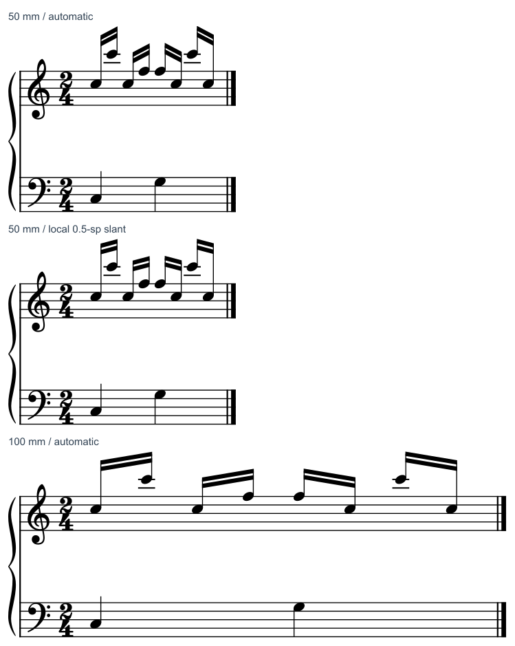

# 换行后梁为什么变陡：跨度、坡差与干长联动

2026-10-31后续[实曲迁移](BEAM_WIDTH_TRANSFER.md)已核五处：m57／m103／m130及官谱所选组保留，用户m81形成一个私有局部候选。小字号、占时、靠梁和弦头及可见play=0成员先于套用宽度参数；3次新原生调用中，8页仅目标一根干／两块梁改变，3203音休止记录及完整MIDI保持。本页五份CC0练习与固定0.20发布仍各保原范围。

2026-10-31。**本例窄行倾向局部减小梁的两端高差；中、宽行保留自动结果。** 同样一谱间的高差，在短跨度里会形成陡坡。把所有梁都设平会进一步拉长另一端符干，代价更大。本次补齐的是两音、双梁、同向干的宽度条件，不能直接推广到跨表、内音靠梁、换号或三四梁。

图由原生SVG统一到200dpi物理比例，再分别裁去外围空白；标签在音乐外。没有逐符号移动、拉伸或重绘。谱例为独立原创CC0，固定上干和两音分组用于隔离变量，不建议真实钢琴谱照此统一干向。用户尚未选择本例。

## 1. 规范为什么让短跨度更平

实际复读用户本地Gould印刷p19–20（PDF39–40），完整文字与图例：p19讨论梁层与干长、加线区和浅斜轮廓；p20具体比较长短组及紧、宽间距。很近的两音（横距不足3sp）建议只用约1/4或1/2sp高差，以免短跨度形成陡坡。

背后的阅读理由有三层：

- 音组的横向延续帮助读者估计持续、方向和组界；陡梁会抢走这条线索，让短组像尖角。
- 梁进入谱内时，陡线与谱线可能形成格子；梁端停在谱间又可能留下难以复制的细楔形白缝。端点要与谱线和副梁一起处理。
- 变缓通常需要增加远离梁一端的干长，或改变整组高度；不能只优化角度而把另一端压短。

前两条的谱内交线／楔形问题由教材图例说明；本fixture梁在谱外，**没有把这些碰撞后果当作本次实测结果**。本次直接验证的是跨度、角度、干长及共同起点。

## 2. 控制条件与实际容量

一个2/4钢琴小节，上表八个十六分、四组两音双梁，音高为C5–C6、C5–F5、F5–C5、C6–C5；下表C3／G3各一四分。固定Leland／Leland Text、1.57mm谱间、全部上部上干、其余样式与音乐结构。前三份输入只差页面宽和可打印宽；补50mm版及局部梁候选后，共**5/5条件**，其中40mm是失败诊断。

用既有冻结宿主（SHA前缀7b4e6fbf）顺序导出；复用完整资产，无GUI原谱操作。页面中的可打印宽还包括首系统约10.05mm的左部空间，所以须量真正的谱线和音组跨度，不能把样式字段当作可容纳音乐的实际宽度。

| 条件 | 实际谱线宽约mm | 每组干轴跨度约sp | 主梁高差绝对值sp | 梁角约 | 判断 |
| --- | ---: | ---: | ---: | ---: | --- |
| 40mm自动 | 29.95 | 1.50–1.85 | 1 | 28.4–33.7° | 容量不足；末端小节线超出五线末端约4.08sp，拒绝作为可用布局 |
| 50mm自动 | 39.95 | 1.888 | 1 | 27.9° | 内容可容纳，短组仍显尖；比较局部变缓 |
| 70mm自动 | 59.95 | 3.594 | 1 | 15.5° | 保留；本例无须为了统一数值另改 |
| 100mm自动 | 89.95 | 5.983 | 1 | 9.5° | 保留；较宽跨度已经给出浅斜轮廓 |
| 50mm局部候选 | 39.95 | 1.888 | 0.5 | 14.8° | 本线倾向此版；增加少量干长，保持最短端与组的方向 |

这些是本小节和固定宿主的数值，不是建议把用户纸幅设成这些尺寸。40mm的窄版保留可复现输入用于诊断，不用“成功导出”证明布局有效。

## 3. 减小高差付出了什么

局部候选保每组较短端不动，仅把高差1sp减至0.5sp。按音头谱位参考点到主梁中心计算：

| 音组 | 自动两端长度sp | 局部候选两端长度sp |
| --- | --- | --- |
| C5–C6 | 5.5／3 | 6／3 |
| C5–F5 | 3.5／3 | 4／3 |
| F5–C5 | 3／3.5 | 3／4 |
| C6–C5 | 3／5.5 | 3／6 |

因此选择半谱间有明确代价：四根长干各加0.5sp，短端仍3sp，音头／时间列不动。本例窄行的坡度明显缓和，这项代价可接受。全平还会让长端更长，不作为默认处理；若真实织体的长干已妨碍阅读，应重新评估声部干向、谱表安排或整行容量。

这里量的是“音头谱位参考点→主梁中心”，不拿可见干线的外框高度直接套教材条件，也没有声称测到所有内梁／线条的最小净空。

## 4. 为什么会这样，以及能怎样应用

原生结果显示，四个自动宽度条件都保留约1sp高差；缩短横距主要增大角度。只读当前工作树的`libmscore/beam.cpp`：`computeStemLen`按谱位与梁层选取量化的梁度量，随后用所选高差除以水平距离求斜率。本例短跨度没有自动减至0.5sp。

这是固定二进制的实测，配当前源码的解释线索；没有证明冻结宿主恰由当前提交构建，也不据此断言所有梁、所有MuseScore版本都忽略横宽。`BEAM_POS`式手调可在本例保持局部高差；今后再次换行、压缩、改变字体／谱表时仍须复核它。

后续自主审谱遇到相似情境，依次判断：

1. 先核实际容量、共同起点和连梁成员；像40mm版那样溢出时，先解决容纳问题。
2. 量音组实际干轴跨度和两端高差，辨认“高差没变但角度变陡”；不要只读页宽或把角度问题归咎于字体。
3. 对短组比较保留、局部浅斜和必要的平梁，连同最短干、长端、谱线／副梁及相邻组看。
4. 宽行结果已合理时保留。局部改善不等于全曲需要相同坡差；跨表与内部音靠梁另查[梁干](BEAM_STEM_STUDY.md)和[跨表](CROSS_STAFF_STUDY.md)。

软件改进候选由此具体化为：在已有谱位／梁层规则后，按实际横向跨度考虑较小的量化高差，并联合检查干长、谱线端点、内梁和重复组一致性；水平重排后重新评价。下一阶段先查现有局部属性／插件能否完成，仅在反复出现且不足时讨论最小本体改动。本批没有修改插件、MCP或软件本体。

## 5. 原生与保护核查

**13次CLI；5/5条件；局部候选1/1保存重载。** 五份输入除两项宽度及候选四个局部Beam节点外一致；五次MusicXML导出与一次重载导出，共**60/60音符记录**符合独立10音配方，时点、时值、音高、干向和两层连梁分组保持，两手q0／q1共同起点保持。

50mm候选相对自动版，除Beam／Stem外SVG图元完全相同；保存重载后四组局部端点保持。重载的55个图元数／结构保持，坐标最大差约0.002 SVG单位（约0.00009sp），不能称像素或文件完全一致。未检验MIDI、MusicXML导回、实际打印、试奏或用户采用。

可编辑输入、对照图与命令见[fixture说明](fixtures/README.md#行宽与局部梁坡)，[证据](beam_width_evidence.json)列实际哈希、几何、调用、读图与来源边界。私有批次194,929字节，低于192KiB预算；没有新增参考PDF／书页／运行时副本或栅格缓存。现有全缓存清点有一处旧目录拒绝访问，不能报成准确全量。原件只读，无删除。

本次是原生应用学习：官谱146/146、1135/1135页、Gould696/696查阅覆盖及资料16/25、余9项保持。复读2页不重算首次覆盖；固定0.20标签／证据保留。当前下一步是把这个判断用于真实短组，并补内梁、跨表及实际重排的反例；后续完整计划见[进度报告](STATUS_AND_ROADMAP.md)。
