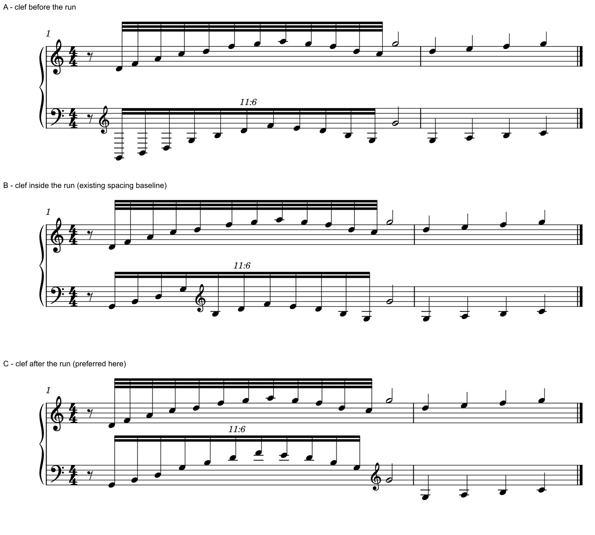

# 梁内换号：宽音域保留，窄音域可以等整组读完

2026-10-31。**保留《My Dearest》p8／P首小节十一连组内的换号；已有原创窄音域练习则倾向组后再换。** 两例都有完整连续梁，差别在整段音区和其它活动层的占位。由此补齐一个复杂组内换号的正面阅读情境，同时保留不宜照搬的原生反例。[证据](clef_in_group_evidence.json)记录来源、实际视图、音乐与原生图核查。

本批完成真实复杂情境**1/1**、边界对照**2/2**、原创位置比较**3/3**（两新、一复用）。这里的正面情境表示有充分理由保留，尚未证明换号只能落在这一音前。此前待办中“不可避免”的措辞过强，现明确这个判断边界，分母仍为一项。

## 1. 先确认是不是真的在同一条梁里

《aLIEz》A012 p3／F、m49，首个正常十六分C3有自己的符尾，随后高音谱号下的快组另起梁。它仍是有用的音区分配例，但**不能拿它证明梁内换号的必要性**。本次复看完整p3及第四、第五系统，旧[整曲解释](SKILL_TRANSFER_CLEFS.md)的低入口／高区取舍保留。

《My Dearest》A092 p8最后系统P首小节，下表十一颗填充头确实共用完整双层梁，G号插在第三、第四颗之间。另有一条覆盖运行的slur、组末高区8va、开头的低部全音保持；上表同时有十二颗普通32分及自己的长和弦。不能把下表的高音直接当成上表快线的成员。完整p9也已回看：相应织体延续，但各小节换号位置仍按本小节读，不机械复制首组。

## 2. P首组为什么值得在梁内换

按当时可见谱号，前三颗书面参照音为C3–E3–A3，换G后先从C4进入，后段达到书面A5。这里描述纸面音位；8va的实际移八度范围继续按原谱读，未读取原工程的音符或八度对象。

| 方案 | 阅读收益 | 代价与本例判断 |
| --- | --- | --- |
| 保留第三颗后换G | 低入口留在F号内，后续快组大部分在G号表内；低起点与高区运行各有易认参照 | 梁中更换参照，实际上行的纸面位置会向下重置；仍有充分保留理由 |
| 利用组前八分休止提前换G | 整组参照一致，上行轮廓不在谱号处重置 | 首三音分别需4、3、2条下加线；这是可比较方案，未证明优于当前排法 |
| 保持F号读完整组 | 少一个组内符号，纸面音程连续 | 选定高点A5需7条上加线；高区并非一个偶发短点，识别和墨迹负担明显增大 |
| 将后半移到上表 | 可能减少下表高区加线／换号 | 上方已有独立12音运行与持续层，要同时维持两组节奏、梁和手的归属；不能仅按音高吸到上表 |
| 更早使用8va或重新分配音区 | 可能提供其它可行参照 | 需重新比较转置入口、已有8va、长保持及两条快线；本批未试排，不能称已排除所有替代 |

前三音恰好完成一次C–E–A循环，随后在下一八度重现这一形状。这给当前换点一个可理解的音型边界。乐句在这里仍连续；这个音型边界与普通半拍边界有不同的作用。十一连内部的分组应按本型读取，作者选择这一位置的实际理由仍待说明核实。

Gould p7鼓励尽可能保住同一参照、容许若干加线；p303–304又要求照顾钢琴的手分配、整体形状和实际音区。两方面合看，当前排法的取舍成立。三条加线不是自动换号阈值，七条加线也不是脱离完整音乐的单音判决。

## 3. 为什么平梁和局部较宽的间隔有道理

换号处纸面位置向下重置，不代表音乐下行。Gould p23要求梁依据实际书面音位安排，并留出谱号净空；本组内部A5比两个端头更靠梁，平梁使整个快组保持清楚的轮廓。不能按真实音高一路上升便强画一条上斜梁，也不能为了让梁顺眼而暗换音区。

当前首三头横差约7.441、7.267 PDF pt，第三至第四头为13.471pt；同页谱间4.254pt。换G实际占了组内空间。Gould p43优先压实附加谱号周围多余空白，同时承认必要占位；它不要求把这一个间隔硬缩到普通头距。两手异分和共同到达仍应另核，详见[整曲间距判断](INTEGRATED_READING_MY_DEAREST.md)及[原生间距机制](POLYRHYTHM_SPACING_STUDY.md)。

这解释了本处较宽间隔的阅读作用；P首处二分汇合的旧局部疑点继续保留，两者分别判断。

## 4. 原创窄音域比较：多两条加线，也可以更好跟读

复用[既有原创12对11练习](fixtures/poly12-11-auto.mscx)和同哈希宿主，固定Leland、1.57mm sp、A4两小节。只移动下表同一个G号：组前八分休止后、原组内第五音前、十一连结束后。原生音符及其它字段相同；旧基线输入与当前公开输入已核一致，基线输出直接复用。

| 条件 | 十一快音的加线总数／单头最多（理论书写） | 判断 |
| --- | ---: | --- |
| A：[组前换G](fixtures/poly12-11-clef-before-run.mscx) | 21／6 | 首个G2要6条下加线，提前换号的代价过大 |
| B：[旧组内基线](fixtures/poly12-11-auto.mscx) | 4／2 | 加线总数最少，但G3→B3实际上行在纸面向下重置，打断较窄音域的连续形状 |
| C：[组后换G](fixtures/poly12-11-clef-after-run.mscx) | 6／2 | 本组最高仅F4，F号下最多2条加线；多两条总加线，换来完整可跟读的上行／返回，当前倾向此版 |

计数用来描述各版负担，阅读收益还取决于轮廓和识别。C与B的单头最大加线相同；本例选择C，说明“总加线最少”也不能替代判断。两版需要的整架间隙分别约8.534sp与8.500sp，**没有把C误说成节省竖向空间**。换号位置也改变整行水平分配，三图固定总版心，未固定每条快组的宽度。

这修正的是旧练习在本问题中的采用范围。旧[间距研究](POLYRHYTHM_SPACING_STUDY.md)选择auto，是在当时四种空间控制中保留其共同到达和正确谱号；它没有证明该谱号位置本身最佳。三个新位置比较不推翻其非线性间距机制证据。

## 5. 从规范到自主判断

Gould p8先照顾乐句边界，再考虑拍间；拍内无法避免时选较清楚的细分位置，休止与持续音还各有条件。p9提醒避免在tie中途换号。p23进一步解释发生组内换号后怎样安排梁。这些规则共同提供候选顺序，不支持“梁内一律错”或“只要加线少就换”。

以后遇到同类片段，先确认完整梁组、当前有效谱号、八度及其它层；比较整组音域与有意义的材料边界，再给出少量组前／组内／组后或跨表候选。若现排有清楚收益，说明为什么保留；建议改变参照时，单列为记法提议，并检查完整音乐和整行代价。

本例也给软件诊断一个具体要求：同一类梁内换号，宽音域官谱与窄音域练习应得到不同建议。只按谱号是否落在梁内、音头距离方差或加线总量打分，都容易误报。本阶段只积累案例和判断，不实现新接口或自动换号。

## 6. 本批范围、可用状态和剩余目标

实际复看官谱3个完整页、2处系统细节，Gould p7–9、23、43、303–304七个不同完整技术页；不增加历史覆盖数。六次成功新CLI（两SVG、两MusicXML、两MIDI），另有一次因输入生成脚本语法错误、文件尚未生成的失败调用，已记录并修正，不能归为排版引擎故障。

公开两份MSCX仅将Windows换行规范为LF；它们与保留的实际渲染输入XML树完全一致，原有音乐／图形核查继续适用，无需重复导出。

三个条件的33音、2休止、拼写、起点、实际时长、voice／staff、stem、梁与连音字段相同，完整MIDI逐字节相同；所有音头的实际纵位已按有效谱号复核，共同二分到达仍对齐。没有新保存重载、交换导回、试听、打印或用户偏好。第二小节沿用旧G号，未在本批优化，不称整份练习记法已最优。

两份新CC0输入和一张原生对照已接入skill工作分支，固定发布仍为0.22.0；不另复制发布包。新增公开资产189,003字节，私有批次169,786字节／384KiB预算，复用旧基线与宿主；所有PDF视图在内存读取，无原件／运行时副本或删除。三份参考PDF哈希与登记值一致。

复杂正面情境已1/1；精确换点的最优性和其它记法仍开放。官谱146/146、1135/1135页，Gould696/696查阅覆盖，资料16/25、余R07–R15九项保持。R10公开页面本轮仍未读到实际谱面，故不增加资源完成数；后续先补实际材料和跨作品条件冲突，完整路线见[进度与计划](STATUS_AND_ROADMAP.md)。
