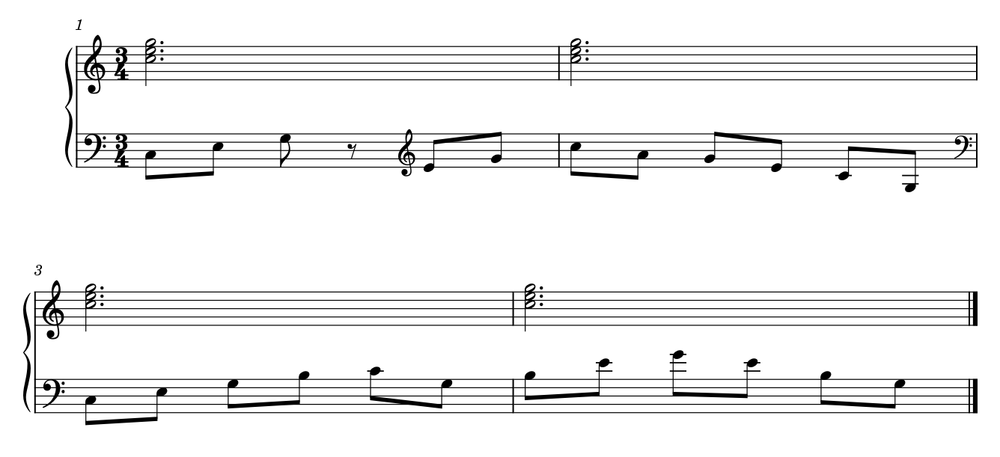
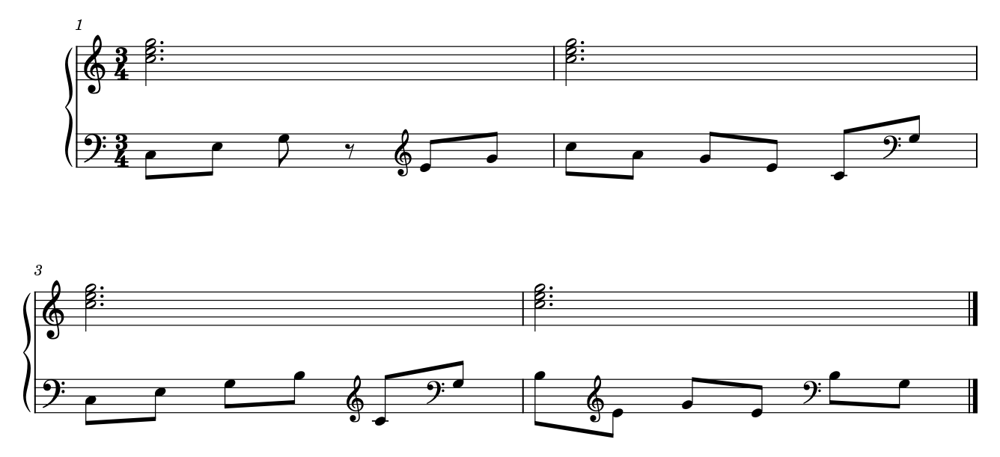

# 换谱号：保住音程轮廓，再减少加线负担

2026-10-27[Legato拉威尔案例](LEGATO_RAVEL_READING.md)：Borodine m17–26下表反复换号处理音区往返，当前保留；减少换号要连新增加线与整句音程轮廓比较。Chabrier m28／30另置括起低音号不可直接改成全表新有效谱号，底本定义仍待校。

2026-10-24补[T04／aLIEz](SKILL_TRANSFER_CLEFS.md)：F/m49先用低音谱号写正常十六分C3，后15个快头在一个高音参照中读完，末尾再返回。全低音会让反复B4写四条上加线，全高音则加重低入口；上表已有旋律八度，保留当前分配。初判未锁定的小音身份已核清，不把换号次数或单音阈值当自动改写标准。

2026-10-20。完整读图Gould印刷p5–9，复看p43、303–304；结合三份官谱和用户p2／3／8，补齐原来散落在织体、八度和变音专题中的判断。原创四小节提供保留版及三种拒绝例，均由固定MuseScore原生渲染；原谱、教材、当前GUI和软件均未改动。[证据](clef_reading_evidence.json)保留来源、实际音乐配方、失败输入、原生重载及限定检查。

## 1. 换号解决什么，又让读者付出什么

谱号重新定义了谱线与音高的对应。少几条加线可以减轻识别负担，但同一条旋律在换号两侧的位置未必继续按实际音程升降；读者必须先读新谱号，再重新理解音程。把“加线最少”作为唯一目标，会让连续音型频繁改变坐标参照。

Gould p7建议在可行范围内保持谱号，容许至少三条加线，以保住音型轮廓；这不是“超过三条立即换号”的门槛。p303–304又强调钢琴的手分配和音乐形状：上表可用低音谱号，下表也可用高音谱号。既不能只按高低分表，也不能把每一次手部动作都翻成换表／换号；有时保持一个合适布局比描摹细碎动作更清楚。

因此要同时比较：当前手／声部是否可追、连续音型是否完整、加线的持续程度、其它层是否占用目标谱表，以及换号是否打断拍组或重要入口。八度线另有作用范围和混写成本，不能当作无条件替代品，见[八度阅读](OCTAVE_READING.md)和[ninelie的同表反例](INTEGRATED_READING_NINELIE.md)。

## 2. 放在哪里：不是单凭最近小节线决定

以下为Gould p7–9的条件摘要，按本书的演奏材料语境使用；段落／乐句边界的判断仍要看实际音乐。

| 情境 | 书中建议及阅读理由 | 不能机械推广的地方 |
| --- | --- | --- |
| 新系统开始即换号 | 前系统末小节线前给预告，新行直接用有效谱号；不在行首先印惯用谱号，再马上换另一个 | 预告、实际改变和下一行表头是不同可见实例，不能按字形重复去重 |
| 普通小节起点换号 | 小谱号放在前一小节线前，即使新小节先休止，也可提前交代参照 | cue、反复后的换号有例外；不能统一把全部谱号移到小节线前 |
| 小节中有停顿 | 在休止之后、下一材料之前换号，避免休止处无意义地提前吸引注意 | 与“小节起点先休止”的情境不同；“都放休止之后”不是通则 |
| 连续活动中需要换号 | 优先在乐句之间；这项可以优先于整拍／小节边界，让完整音程轮廓留在同一参照中 | 不是根据PDF中每条Slur自动识别乐句；长句、层叠和有限空间可能另有取舍 |
| 没有可用乐句边界 | 尽量在拍间；不可避免时用半拍或其它明确细分边界 | 这不是把所有拍内换号报错的依据 |
| tie中途换号 | 尽量避免使同音弧两端看起来大跳；不得不用时可利用系统边界 | 同表另一层持续时，活动层仍可能需要换号，须联合看接收端与层次，不能只移动一个对象 |
| 多系统休止后的恢复 | 恢复惯用谱号与下一次需要特殊谱号的进入，放置目的不同；后者应靠近实际进入，避免提前数行被忘记 | 本书例子含乐队分谱；不把其全套恢复惯例直接套给不断活动的钢琴大谱表 |

p43还提醒：谱号、变音会挤占节奏空间；有时应先收紧符号周围的空隙，而非大幅拉开时间列。书中的半sp是该局部条件的建议，不是全谱最小距离。小谱号的比例也是出版体例输入：p7采用约起始谱号的2/3，当前源码另有`smallClefMag`；没有据此选定用户全曲数值。

## 3. 官谱中的取舍：不能只数换号次数

**A067《Kakyoin’s Theme》p2的C→D。** C段上谱表直接使用低音谱号，沿较低音区组织材料；D起的长音仍沿用它。随后小节线前出现高音谱号，下一小节进入新位置。读者在入口附近得到新的音高参照，不需要把整页上表强制恢复为高音谱号。两表共同的大括号也没有让下表跟着一起换号。p1／2完整上下文与较新整页分析相接，见[独立试读](INTEGRATED_READING_KAKYOIN.md)。

**A006《lit》p2末至p3前三系统。** 最初快速分解组可跨到上表，而p3上部逐渐叠加长音和延续和弦，低部快速组则使用局部高／低音谱号。完整两手可见：把所有高点都搬上表，会与既有持续层争用区域；把所有音都留低音谱号，又会增加高点的加线。这里频繁换号有可解释的空间和分层价值，不能套用“频繁即错”。反过来，它也不证明每一次换号都优于保留加线；具体拍组、分句和其它层要逐处比较。

**A146《Zen Zen Zense》p8。** 低部短八度区、loco、稍后的谱号变化和高部长八度区分别限定自己的材料。恢复实际音区与换谱号是两种动作：前者改变读者对书写音的八度解释，后者改变谱线参照。不能把它们合成一个“恢复默认”的全局开关，也不能只为少画符号而去掉局部提醒。已有相关原生范围研究见[OCTAVE_READING](OCTAVE_READING.md)。

上述都是从可见效果和规范推导的阅读解释，不是出版者亲述的制作过程。没有官谱原工程，不推断内部voice、自动／手动换号或播放实现。本次重读不改写历史379页近读数。

## 4. 用户工程：当前先保留，不按单一音高阈值改写

用户p2可见m41末→m42、m49末→m50的换号；m53在活动中改高音谱号，m55末再回低音谱号。m41后的进入、D段的低部音型和m53附近的音区各不同，不能合成“同类位置须统一”的问题。当前工程只读确认Staff id4内五个Clef记录，Measure序号为41、49、53、55、148；位置与可见PDF作情境对应，未把两份材料说成逐对象完全一致。

p8 m148的活动层在原生跨表运行中换号，另两条背景谱表继续提供持续音。某个活动谱表换成高音谱号，不要求所有低表或背景声部一起恢复；也不能为了减少换号而把四表压成两表。当前没有足以替换这些排法的原生比较，故先保留，未从“加线多／换号多”直接给用户改谱。

## 5. 原创原生例：加线更少仍可能更难读

四小节3/4钢琴练习，固定Leland／Leland Text、1.57mm sp及版心。上表每小节为持续三音和弦，下表23个起音和一个八分休止，共35次起音；m2后换行，全部版本同为一页、两系统。和声只服务于识谱试验，不是实际作品的最佳编配范例。

**保留版。** m1在休止后的新二音组前改高音谱号；m2下行结束后，在行末预告低音谱号，下一行直接低音谱号。m4保留短暂加线，不为三个高点再插两次换号。它让两个连续区段各自保持参照。

**频繁换号拒绝例。** 只按单音是否达到C4切换高／低音谱号。两个起始谱号以外，换号由2次增到6次；SVG的LedgerLine路径11→2，虽然加线少了，m2末实际下行却因换号在纸面上突然向上，m3／4也反复重设参照。本短例没有另一个持续层迫使这样写，故不采用。LedgerLine路径数只是本次绘制统计，不是审美评分，也不是可跨字体比较的“加线负担”。

**延后一个八分的拒绝例。** [原生谱](fixtures/clef-late-in-group-rejected.mscx)／[图](fixtures/clef-late-in-group-rejected.png)把m1的换号推到二音梁组中间。实际E4→G4仍上行，但两个头在各自谱号下的位置反向跳变，梁也大斜跨过换号；原本休止后可整组读取的动作被拆开。本例有更清楚的边界，故保留原排，不把“所有梁内换号都错”作为通则。

**隐藏换号拒绝例。** [原生谱](fixtures/clef-hidden-change-rejected.mscx)／[图](fixtures/clef-hidden-change-rejected.png)只将m1高音Clef设为不可见；其后音头仍按高音谱号定位，读者却只看到低音谱号。完整MIDI、音高字段和实际时值均与保留版相同，仍丢失正确读法。MusicXML也记录`print-object="no"`，不能据格式忠实保存这个隐藏状态就认定净书成功。

## 6. 实际验证与一次输入构造错误

四版原生XML除Clef节点外完全相同；MusicXML的音休止、起点、实际时长、所属staff／voice及梁标签相同。另以独立配方核36条音休止记录，及35个实际MIDI起音的时间与音高，完整MIDI四版逐字节相同。保留版保存重载后，SVG除标题、原始RGBA尺寸／字节、MusicXML音乐与谱号次序／可见性、完整MIDI保持。没有导回MusicXML、实际试听、打印或用户审美采用。

初版手工MSCX把dots放在durationType之后，图上有附点，实际时长却仍为二分，宿主补了休止；LayoutBreak误放voice内也没有形成预期换行。该版被否决，留在私有native目录；修正输入顺序和Measure下换行后才发布native-v2结果。它暴露的是本次输入构造／校验不足，不能借此指责排版引擎。只查印出的type／dot、起音数、各版本相同和退出码，都漏掉了这个实际错误。

该短例还确认了边界表示的区别：原生F换号位于m2结尾，图上同时有行末预告与下行起始谱号，MusicXML则在m3起点记录有效F。不能用一个Clef的文件父Measure、SVG字形数或交换文件位置，直接等同读者看见的换号次数和音乐生效时点。

## 7. 当前可调项与后续准备

本例的换号、显隐、行末预告和新行有效谱号可由现有原生对象表达，无需开发适配。只读源码中，`Clef::mag()`使用staff缩放及`smallClefMag`，style.cpp当前列0.8；另有`clefBarlineDistance`与`showCourtesyClef`。这些是已有控制的线索，未作完整插件／MCP可写性验收，也未证明源码提交就是固定二进制的构建来源。

后续自主净书先诊断一段连续音乐的参照是否稳定，列出少量具有音乐边界的候选；把加线、换号、跨表与八度的不同代价一起比较。重写谱号位置／种类属于记法提议，必须单列；不按音高阈值批量改写，不隐藏必要参照，也不把出版谱中的高频换号一概报错。当前只积累方法、正反例与复现，不实现自动换号或软件接口。

2026-10-22验证环境限定：先前证据把新`-c`路径直接称为隔离配置，未确认目录事先存在，现已[更正](NATIVE_EXPORT_ENVIRONMENT.md)。本轮没有重跑换谱号四版或重载；上文是当时记录的音乐／图形比较，不能沿用为新建配置环境的复现证明。

2026-10-23[lit整曲回查](INTEGRATED_READING_LIT.md)将既有换号解释放回五变奏，补上部持续层改变后的运行路线和后来的六音组；保留频繁换号的条件，不增加本曲原生候选或盲评。
