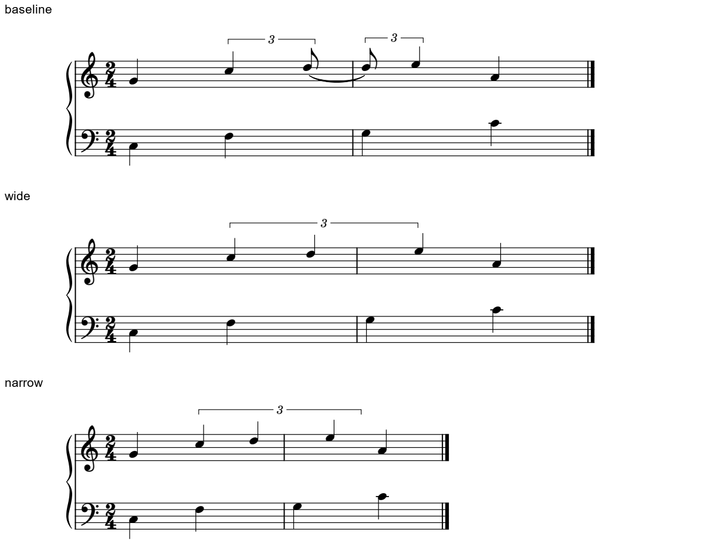
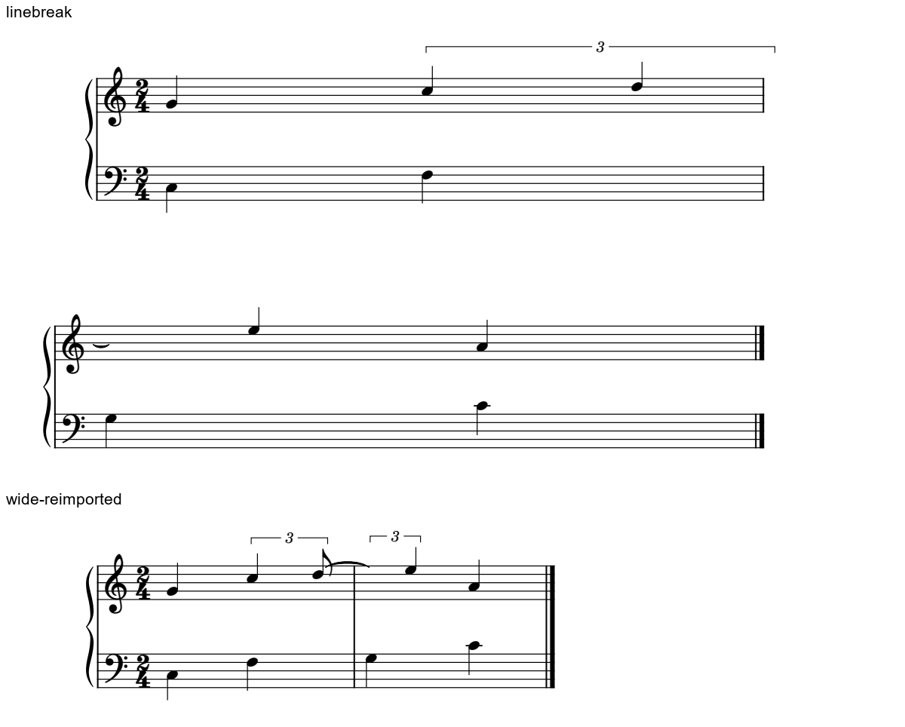

# 保真实小节的完整三连显示：组合能做到哪一步

2026-11-02。**现有原生对象可以做出保留两个真实2/4小节的单行三音外形，固定版面候选1/1成立。** 它仍由两个局部Tuplet和持音片段组成；换行、MusicXML导回会破坏显示，自动重排／交换可用方案仍0/1。上一批优先显拍版的判断保持，这个组合只在确需整组流动外形时供局部比较。

本批承接[三连原生研究](CROSSBAR_TUPLET_NATIVE_STUDY.md)，三种版面情境**3/3**、最终另存重载**1/1**、MusicXML导回核查**1/1**，另有普通基线与gate对照。30次CLI＝最终22＋前置5＋控制3；全部成功。Gould p196–198三个完整页复读，原书／用户PDF／MSCZ只读，没有改字体、插件、MCP或软件本体。[证据](crossbar_display_composition_evidence.json)分开音乐结构、可见图形和实际播放。

## 这个组合为什么能读成完整三音

音乐沿用CC0原创例：C5、D5、E5在q1–q3内各占2/3个四分，D5从q5/3持续到q7/3，跨过两个2/4小节的q2边界。底部普通四分提供拍点，E5仍晚于新小节低音三分之一拍。

内部保留D5的两段八分三连和真实tie，合计持续2/3；图面隐藏第一段符尾、第二段音头／干／符尾及tie绘制段，使两段合读为一个四分三连音。第一个局部Tuplet的括号延到E5，第二个局部Tuplet的数字／括号隐藏。**这是有音乐依据的显示合并**，须先确认同音、同层、真实持音关系与完整比例；不能把独立起音或不同声部照这样隐藏。

中排是135mm候选：两个真实小节及2/4 MIDI拍号保留，9次起音与基线完整210字节MIDI相同。可见为三个四分头及一条3括号；C5／A4与下部共同起点保持，E5留在正确的稍后列。它以较少的头、旗、tie和数字呈现一条连续线，代价是显示和内部计量片段不再一一对应，后续编辑要维护这层关系。

因此不能将它称为一个原生跨小节Tuplet对象；改音高、时值或换行时，局部片段和整组外形仍需一起复查。公开输入在文件开头写明实验用途。

## 窄版仍能读，但旧偏移失去了原来的参照

135mm时右钩在E5头原点右约0.500sp，数字几乎位于两个外侧可见头之间。仅把可打印宽改成100mm，保留同一手工端点偏移，右钩变成E5右约5.398sp，括号中点相对同样参照偏右约2.449sp。它仍没有包到普通A4，不能据此判比例或音符出错。

Gould p196允许为了同类组的对齐，或各层细分不同而延长括号；端点并非只有一个合法坐标。本例没有这种额外延长的读拍需求，重新按当前C5／E5定位会更直接。学习到的是固定偏移失去参照后要重新判断，不能用“端点不是0.5sp”当通用错误规则。

p196–197也允许无梁组按音高方向浅斜，或用水平括号减少视觉起伏；有梁时另考虑平行和避免落入谱线。本例保留水平体例，只考察范围和显示依赖，不推出用户对所有括号坡度的偏好。

## 换行和导回分别怎样失败

**换行版：** 两个真实小节、9次实际起音及完整MIDI仍保持；长括号留在第一行并伸出音乐区，E5已经在下一行，却没有完整组的续接提示。隐藏tie还产生了一个新的可见绘制段，在第二行留下悬空小弧。第一行的两个可见头与第二行的E5无法直接按原样跟读，本版拒绝。

这次XML表示中，给Chord写visible不会自动隐藏所有子元素；需要分别处理Note、Stem和Hook。tie的一个隐藏绘制段也没有覆盖重排新建的段。它们是具体输入／宿主的结果，不能概括为GUI或所有插件设置都同样失效。自动处理若只查父对象字段或沿用旧段索引，就可能漏过这些现象。

**MusicXML导回版：** 导出的计量仍是两个局部3组，首个D5类型为eighth；符尾隐藏及整组端点没有形成同等的跨线显示语法。导回后可见符尾、tie和两个局部3括号，续接D5仍无头，原先的完整三音外形失效。图保留各自原生导回状态；未统一其导入页面／字体设置，因此不据整体尺寸差评价美观。

该结论针对本次导出导回路径，其他表达方式留待有实际需要时研究。最终135mm版的原生另存重载则稳定：可见数量保持，SVG绘图数值最大差0.001单位，完整MIDI相同，不称逐像素完全相同。

## 显示组合的导回：用普通基线与gate对照归因

显示组合的gate对照先查普通基线：两小节计量、音高与9次起音在导回后仍正确，音符结束却提前，普通四分提前24 MIDI tick，三个连音提前16 tick，PPQ480。普通显拍基线也作相同导回，生成的205字节MIDI与组合版导回完全相同，这项变化也发生在普通基线的交换过程中。

两份导回工程均出现默认Articulation的gateTime95。只在诊断副本改为100，9次音符起止、力度、通道与时间／调号等元事件恢复到本例基线，支持5%门限是这组结束差的原因。完整MIDI仍非同字节：CC10声像由64变63，基线的CC2＝80事件未保留，控制事件核对没有把它们忽略成文件排列差异。

**100只用于这份基线的因果对照，不是新的演奏预设。** 实际乐谱要保护作者原有gate、声像和控制，不能为得到绿色等价检查统一覆盖。显示隐藏、原生保存和交换播放分别检查，才不会误判问题来源。

## 现在可以怎样用，下一步学什么

| 情境 | 当前判断 |
| --- | --- |
| 已冻结的单行版面，希望比较完整组的流动外形 | 可比较135mm组合；确认同音tie合并的读法，核真实时点、其它层及最终输出，不自动采用 |
| 正在改行宽、分行、移调、改音符或需要交换工程 | 继续优先结构清楚的显拍表示；组合必须随这些变化重新校核 |
| 怀疑软件缺少基本表达能力 | 先区分现有对象能否画出、是否保真实小节、是否能维护重排／交换；本例已证明单行组合可行，后两项仍缺 |

可编辑原创输入：[135mm组合](fixtures/crossbar-display-wide-experimental.mscx)、[100mm沿用偏移诊断](fixtures/crossbar-display-narrow-experimental.mscx)、[换行拒绝例](fixtures/crossbar-display-linebreak-experimental.mscx)。三输入与两图按CC0-1.0提供，解析后的音乐树与实际测试输入相同，仅增加用途注释。

对后续适配保存的要求是：保持整组与计量片段的关系，按真实作用范围跟随新行段，并在交换后核对；优先研究现有属性／插件能否维护，届时才决定最小本体需求。本学习阶段不实现这些接口。

本构型的技术边界已记录，接下来回到三类实谱判断**0/3**：完整组的阅读收益、显拍的实际必要性、标记跨行的归属。先冻结具体判断再查规范与旧笔记，不能当独立盲测准确率。资料16/25余9及全目录146/146、Gould696/696覆盖保持；[进度和完整路线](STATUS_AND_ROADMAP.md)继续维护。
