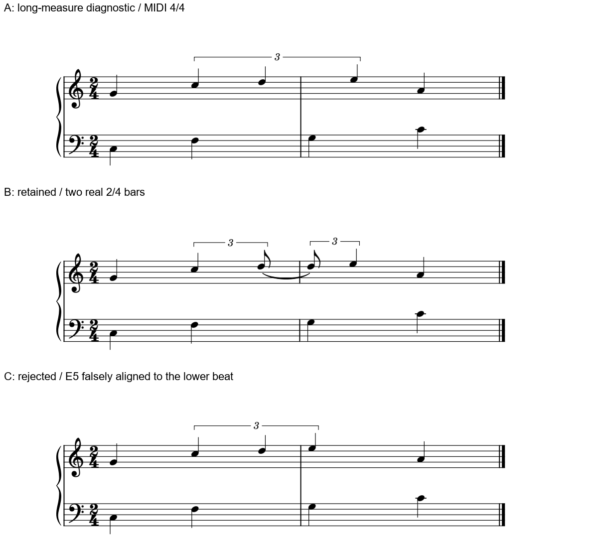
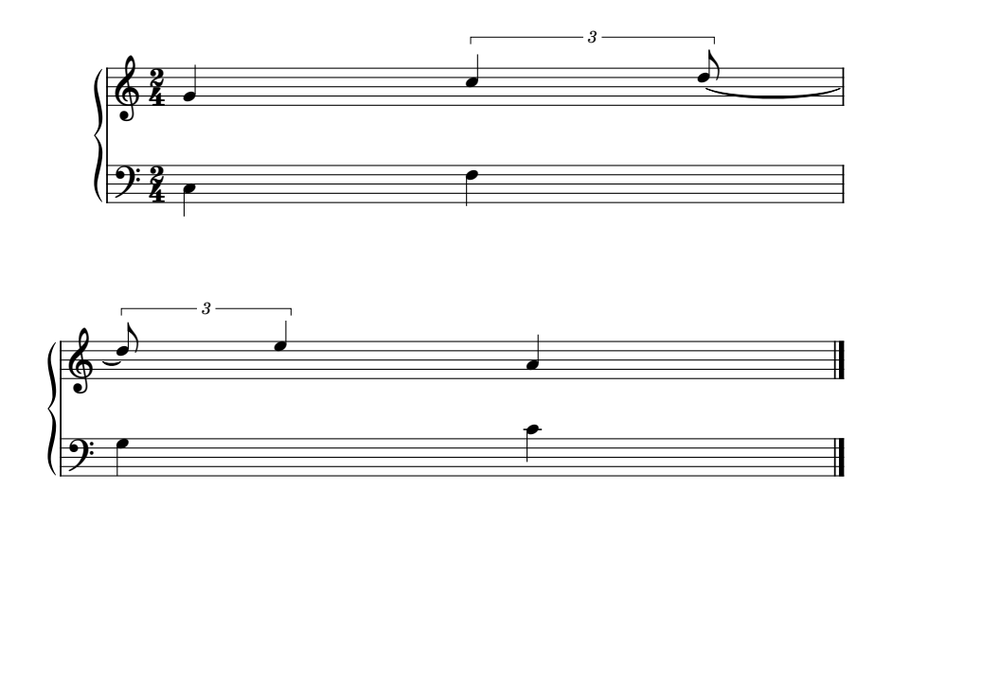

# 跨小节三连音：对齐、显拍与长小节补形的代价

后续[显示组合](CROSSBAR_DISPLAY_COMPOSITION.md)已取得受控单行候选1/1，保真实小节及完整基线MIDI；三情境3/3核查后，自动重排／交换的完整方案仍0/1。下文0.30研究范围及原显拍优先判断保留。

2026-11-02。**本原创例优先保留B：两个真实2/4小节，用tie显出跨线持音和首拍。** C把原本晚三分之一拍的E5画到低音首拍上，拒绝；A保留完整三音外形，却以一个长小节承载，导出的MIDI拍号成了4/4，只留作诊断。三条件已研究**3/3**；保真实两小节且显示完整跨线组的可用原生方案仍**0/1**。

这批落实[前轮跨线学习](BEAM_ACROSS_BAR_READING.md)，目标是学会识别读法及结构代价。没有开发插件、MCP、本体或字体，没有改用户原谱。Gould印刷p210–211／物理p230–231两整页复读，未增加全书696/696覆盖或外部资料16/25完成数。[证据](crossbar_tuplet_native_evidence.json)区分最终版、前置失败、播放音符与拍号。

## 三张图在比较什么

原创4个四分时长的钢琴片段，固定音乐符号字体Leland、musical Text设置Leland Text、spatium1.57mm及135mm可打印宽；原生PDF核到连音数字实际使用Edwin Italic。上部先G4普通四分，再C5、D5、E5四分三连音，最后A4普通四分；下部C3、F3、G3、C4普通四分。两表实际时点由独立配方给出，不从图片猜。

横坐标以四分为1，两个2/4小节的边界在q2：

| 上部事件 | 开始 | 持续 | 读者应理解的关系 |
| --- | ---: | ---: | --- |
| G4 | 0 | 1 | 与低音C3同时 |
| C5 | 1 | 2/3 | 与F3同时，开始完整三连组 |
| D5 | 5/3 | 2/3 | 在小节线前开始，跨过q2持续 |
| E5 | 7/3 | 2/3 | 比新小节低音G3晚1/3拍 |
| A4 | 3 | 1 | 与C4同时，已回普通时值 |

三版共有9次实际起音；B多一个书写头，因为D5在边界拆为两段并以tie相接。书写头数不能代替实际起音数。

## 为什么这处优先B，仍保留A的流动收益

本例低部四分明确提供拍点，读者需要看出q2在哪里，同时知道上部D5没有重新发音。B在小节线上显示D5的续接头及tie，两侧各用局部3组，E5仍在稍后进入。它把计数参照交代得更直接，尤其适合需要精确与低部对拍的任务。

代价是一个额外音头、tie、两个八分旗，以及第二个3；整组的视觉连贯性弱一些。A的三个普通四分头和一条长括号更容易看成一条连续线，这项收益应保留。Gould p210讨论的正是流动与显拍的取舍；不能由本例推出所有跨线连音都应拆。若速度很快、组形熟悉而计拍参照已经充分，完整组可能更合适。

B还做了**1/1换行条件**：第一小节结束换行，tie分别在前行尾和后行首续接。正常共同起点、持续及两个真实小节保持，完整MIDI与B同字节；最终版另存重载**1/1**，全部带class的SVG绘图对象完全相同。这里验证特定构型，不把长tie自动当成普通分句弧。

## C为什么更“齐”却读错了

C从A只给E5加入Chord横偏移约−7.545sp，使其音头原点与下部G3的q2原点完全对齐。其它八个头的最终原生原点保持，E5的真实开始仍为q7/3。Tuplet的数字与括线也随端点联动，不能说只动了一个可见头。

演奏者若依靠两手的垂直列判断同时，会把E5提前三分之一拍。C与A的完整210字节MIDI完全相同，这仍不能证明纸面安全；本例就是“播放保持、视觉时间关系被改坏”的反例。对自动间距整理，先核真实共同起音，再核几何；不能把新小节里的第一个可见头一律吸到首拍。

Gould p210–211允许连音跨线后第一个成员晚于新小节开始，并要求线两侧音数和位置正确。这里原本的空档有音乐理由，修整前必须识别。已有[Kura H](INTEGRATED_READING_KURA_KUUSOU.md)的完整比例仍未获权威确认，本例不替它决定8:6，也不移动原官谱。

## A看着像两个小节，实际承载只有一个

A使用一个实际4/4长度的小节、显示2/4，在q2为两表插入中间小节线。它可画出连续三连括号，却没有产生两个真正的Measure。原生MusicXML导出仍显示2/4，整段只有一个小节、实际包含4个四分；不能仅查拍号文字或每段音数就认定结构保持。

**MIDI元事件进一步揭示差别：A／C的Time Signature为4/4，B／重载／换行为2/4。** 五份MIDI均210字节，9次音符起止、力度及通道事件一致；A与B恰有一个字节不同：偏移26处为4与2，即拍号分子。不能将音符事件一致扩成完整MIDI或全部音乐语义一致。

因此A不作为本例的等价美化方案，不能自动合并真实小节来满足画面。它仍是有用的完整组外形诊断，公开输入开头已标用途。未验证A／C重载或MusicXML导回；本批的可靠保留方案为B，真正的两小节完整显示后继仍0/1。

## 已复现的软件边界，和仍可研究的路径

给冻结宿主输入一份有效的两小节MusicXML：中间D以tie跨线，Tuplet start／stop原本包两侧。实际读回保留两小节、tie及音符时序，形成**两个局部Tuplet**，没有保留单个跨线Tuplet对象。这是一次具体导入行为，不声称已经穷尽GUI、插件或所有序列化方式。

本机源码只读核对到HEAD `f0c330926aedc7fd4367b237473e1ddb30d0f2d3`：MusicXML导入在小节末重置tuplets；原生Measure读取中的Tuplet以当前Measure作父对象。冻结exe的SHA-256为`7b4e6fbfdee1863a4801f018535fa6b2082500d9a2b851dc79579b9ace95aa25`，与此源码构建关系未核。导入判断由实际exe读回证明。上游[跨小节Tuplet请求](https://github.com/musescore/MuseScore/issues/19234)亦保存相应需求；旧3版Tuplets网址本次跳至Studio手册，未用它证明3版能力。

后续仍先研究现有对象／图形能否保住真实小节与完整组的读法。Sibelius官网的[Tuplet Over Barlines插件说明](https://www.sibelius.com/download/plugins/index.html?plugin=597)描述了将局部sub-tuplets组合、用整体括号显示的办法，并提示后续修改时值的限制；本轮只读介绍，未安装或验证。它说明插件组合路线值得审查，不能据此承诺MuseScore已有同等能力。

Dorico 6.2的[官方条目检索摘要](https://www.steinberg.help/r/dorico-pro/6.2/en/dorico/topics/notation_reference/notation_reference_tuplets/notation_reference_tuplets_span_barline_allow_disallow_t.html)描述默认拆分及Spans barline选择；正文未成功取得，也未运行Dorico。它作为待补比较线索保留，不算一次Dorico排版实测。

将来若现有对象不足，再判断是否需要最小显示层支持：保留真实小节、比例及事件，单独控制完整组的可见范围和跨行段；不能用扩大实际小节或错误对齐代替。此处记录目标和复现，本阶段不开发适配。

## 可直接使用的材料与核查范围

- [B：真实两小节显拍](fixtures/crossbar-split-retained.mscx)，适用于本例的读拍任务。
- [A：长小节结构诊断](fixtures/crossbar-merged-diagnostic.mscx)，含MIDI拍号变化，勿作等价模板。
- [C：错误对齐反例](fixtures/crossbar-false-alignment-rejected.mscx)，保留失败供诊断。

三份独立原创输入与两张原生图按CC0-1.0提供；参考谱、原书及其图片未入Git。输入只加用途注释，解析后的音乐树与实际测试输入完全相同。

本批44次CLI中，最终三条件、最终另存及换行输出占21次；前置／校准23次含一次手写Tie数据不完整的45秒超时。另有前置版重载，不计最终1/1。初始缺上表中线、手写Tie相对位置／payload、导入空标题框及终止线体例均在最终比较前更正，旧文件保留且不冒充最终候选。没有将输入错误归因为软件不支持正常tie。

验收分开核：独立配方及XML时序、MIDI音符与拍号、实际两手图、保存重载和真实换行。下一步保真实小节的完整组显示0/1继续，已有两版有理由保留／拒绝的判断可先用于审谱；资料16/25余9与[完整路线](STATUS_AND_ROADMAP.md)保持。
