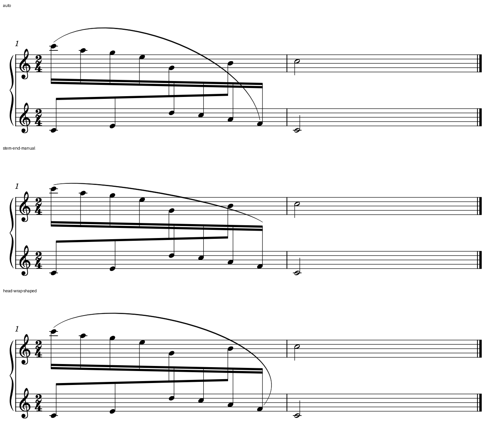

# 跨表弧避梁：保持连接，还要保持可见归属

2026-10-22。接[unlasting H前诊断](INTEGRATED_READING_UNLASTING.md#2-h前的弧穿梁官谱也应接受具体检查)，用原创短谱检验几何建议。参考谱的音乐和版面未复制／修改；本例是另一套音符、2/4、两小节，两条独立完整声部，不是该官谱的替代排版。规范依据沿用上一轮已核的Gould p321–322，本轮重点是实际宿主行为。

本例保留一个头到头外绕的原生候选；保存重载后成立。输入、宿主、其它尝试和检查边界见[证据](cross_staff_slur_routing_evidence.json)。

## 1. 问题不只是弧朝上还是朝下

一条八个十六分音符的下降线从上表移到下表；另一条四个八分音符的上行线从下表移到上表。它们各自连梁，下一小节各收一个二分音符。两条线都有完整时间，不通过隐藏休止或重分部来腾位置。

固定A4、Leland／Leland Text、1.57mm sp、同一系统和表距。初始原生自动弧朝上，尾部穿过下降组的两条梁；明确指定向上得到相同绘图，指定向下又穿过三条梁。上下方向只决定一类构型，不能自动保证路径绕过障碍。

### 三种实际读法

图中从上到下：

- `auto`：[自动输入](fixtures/cross-slur-auto.mscx)。连接清楚，但弧在梁处混入粗线，不能只凭“自动”保留。
- `stem-end-manual`：[干侧控制](fixtures/cross-slur-stem-control.mscx)。避开了梁，代价是靠近中部材料、低部音头离弧很远，读者更依赖共同梁认范围。本例不选它为主要候选；这不推翻教材在合适构型下允许干端位置的条件。
- `head-wrap-shaped`：[保留候选](fixtures/cross-slur-head-route.mscx)。保持弧首贴近起音，外侧绕过梁尾，再回到原末音附近；两表和另一部都不移动。需要一块可用的右侧／上方空间，不能将形状数值推广到没有这块空间的曲段。

本线在这份原创例中选择第三种，依据是既避免梁区混线，也保留首尾音的直接联系。没有由此新增用户线形偏好；有八度线、文字、连音括号或更紧行距的实曲仍须重做取舍。

## 2. 局部控制值，不等于最终有效形状

最初只给尾端或肩部偏移、仍保留自动避碰时，宿主还改变了弧首和中部。干侧那组的弧首比同点位的手动版额外抬高约1.39sp；最初外绕那组约2.72sp。它们是本例的有效几何差，不能从“只写了o4”推断其它位置不会变。

仅关闭这条弧段的自动避碰，又会失去原自动布局提供的肩部抬高：两版即便保有相同手动偏移，仍可明显变平、贴近中间音，外绕也仍穿梁。**关闭自动避碰不等于冻结当前外观。** 因此最终候选同时给出明确的肩部和尾端几何，仅该段`autoplace=0`；没有全谱关闭自动排版。

初步只向右移末端、只增加右肩、翻转方向等结果均保留在私有研究目录。未将它们算作改善；观察到端点连动后才补完整的手动形状，而不是扩大忽略范围让检查通过。

## 3. 验了什么，为什么还不能只看绿色数字

十个输入条件只在同一Slur的方向、绘制控制点和局部自动避碰字段上不同。所有音、拼写、实际时间、原逻辑谱表及`staffMove`保持；各版实际MusicXML的14音、显示谱表、梁与首尾连接也对上独立配方。完整MIDI逐字节相同，14次起音又与配方核对，不靠音数单项保护。

所有版本的非Slur SVG绘图逐项相同，包括14个音头、14条干、三条梁、谱线、谱号和小节线。保留候选使用的是原行内可用区域，没有改变共同时间列、梁形或小节宽度。

另只针对这一条弧与三条梁核实际填充路径及描边，不用外框相交代替碰撞。保留候选到最近梁的净空约0.55sp；计算用每条cubic边4096段近似，线性化误差上界不足0.000061 SVG单位，另留0.002单位的导出舍入容差。负的记录值只表示已相交，不是穿透深度。这个净空不是全谱最低距离规范，也不是全面碰撞检查。

干侧控制同样能取得零梁接触，仍因本例归属和轮廓代价不作主候选，说明几何检查不能替代净书判断。最终又实际读回完整两小节、两部及弧的两端；没有声称其它所有对象组合都已自动验收。

保留版经MuseScore原生保存，再导出：SlurSegment三个控制点与局部自动避碰状态仍在；全部带class的SVG绘图、PNG原始RGBA尺寸／字节、完整MIDI相同；MusicXML的14音、声部／谱表、实际时长、梁与连接保持。未做MusicXML导回、试听、打印或用户采用。

## 4. 运行环境与可复现范围

使用此前补齐资源的固定私有运行时，EXE SHA-256为`7b4e6fbfdee1863a4801f018535fa6b2082500d9a2b851dc79579b9ace95aa25`，实际导出标识MuseScore 3.7.0 Evolution。本次比较前后对既有1936文件清单逐一核大小和哈希；所有正式输出共用事先创建的私有配置目录，实际生成了其工作区菜单文件。环境做法见[NATIVE_EXPORT_ENVIRONMENT](NATIVE_EXPORT_ENVIRONMENT.md)。这不是当前源码HEAD与二进制精确对应的证明。

源码只读查了Slur／SlurTie的控制点读写与布局；最终结论以本轮原生输出为准，没有修改软件、插件、MCP或字体。公开三份原创MSCX和上图均属本项目CC0练习；参考图、教材及其它研究中间结果保留在忽略目录。

复现可按[原生参考](../../skills/piano-engraving/references/native-review.md)的现有CLI导出这些独立输入，重新记录当时宿主和有效设置。控制点数值在输入中供复现，不能照搬成另一个音型的预设。

## 5. 下一份谱怎样用这项经验

先定位具体弧的逻辑首尾、实际显示谱表和梁区，比较改方向、靠所属干端或外绕等方案。保住整组包含感，说明每个方案的空间代价；路径穿梁时，单纯全局抬弧或加表距未必是有效动作。

用手动控制形成候选时，把有效自动形状、已有偏移与最终印图一起看。局部关闭自动避碰需要补足形状和新障碍检查；不能只保留原偏移字段，也不以更大净空、相同MIDI或保存稳定直接判好看。

本例表明现有原生局部控制已能处理这一原创构型。后续开发可用它作为具体复现，继续按参数／插件优先的原则判断需要；本阶段未实现自动检测器或接口适配，也没有把候选迁移到官谱或用户工程。
