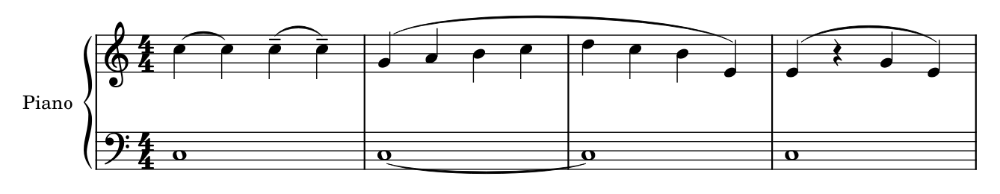
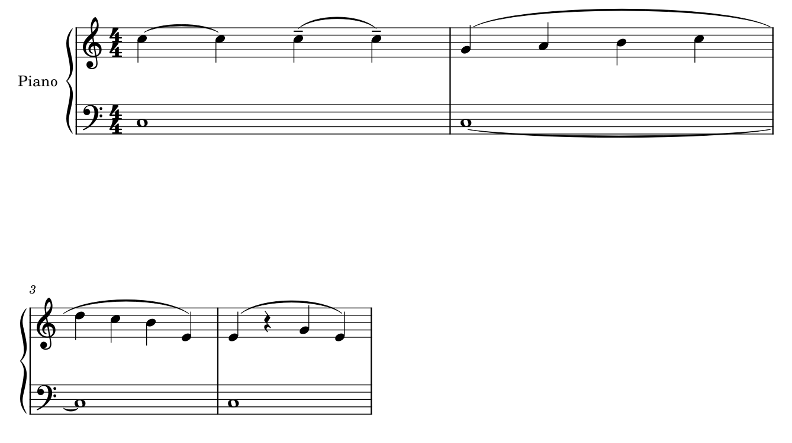

# 弧线为什么这样画：持续、分句、归属与续接

2026-10-20[输出续核](OUTPUT_READING.md)排除用户p6选定弧段的假断口：紧裁漏掉弧顶，提取框高度0也不代表路径平直；完整cubic实际约9.524pt高。原PDF／当前描边相同量级，同当前几何的Qt PNG／PDFium仍不同深浅，因此本例保留几何与线宽，不据截图生成补接／加粗候选。复看Gould p65、109、111–113及A062相邻页，不增加历史覆盖统计。

2026-10-20续学[力度与奏法](DYNAMICS_ARTICULATION.md)：补齐本章其余图文，区分动态连续通道与奏法贴音、谱线／加线与弧内外；原创四小节证明将断奏全拉平虽保全部MIDI，仍弱化对应。此处既有同音Slur／Tie辨读条件继续保留，不按统一外框或同高规则清理标记。

2026-10-19续学。完整读取并看图：Gould印刷p60–73、109–114、121–122，共22页；其中p72–73为复读。另复看A021 p4、A061 p2、A062 p2及p1末系统、用户PDF p6–7。原件只读，图页与摘录在`tmp/engraving/curves-2026-10-19/`；[curves_evidence.json](curves_evidence.json)记录来源、保护与自制谱验证。此文是新的判断依据，不表示所有弧线情境或软件行为已掌握。

## 1. 先确认它连接的是什么

延音线（tie）说明不重新发音；连奏／分句线（slur）的作用取决于音乐和乐器，可以表达奏法单位或较大的句法。相同音高之间也可能是slur，等音异名之间也可以是tie（Gould p60/109）。因此“两个头一样高→tie”“两个音名字不同→不是tie”都不是可靠判据。

| 情境 | 读者需要辨认什么 | 排法为什么影响意义 |
| --- | --- | --- |
| 同音持续 | 哪个音不重新奏出 | tie贴近所属头，通常较浅；离得过远、端点像指干端，容易读成slur |
| 同音重新发音、又属于同组 | 仍要重奏，并保持组的关系 | p122用弧内的tenuto/staccato等澄清；把奏法挪到弧外，可能让它看起来成为tie |
| 一根干上的和弦分句 | 整个和弦作为一个动作连接 | 通常一个slur；给每个音都加一条会显得像各音延音 |
| 同一和弦的部分音持续 | 哪些音保持、哪些音改变 | tie按音分别存在；不能因有一条外层slur就合并或删除内层tie |
| 两条独立声部 | 各自的持续和分句 | 按所属层识别弧向与端点；最少弧线数不是质量目标 |

**音乐保护也包括读者看到的含义。** 即使音高、时值及播放数据完全没变，若把奏法移过弧线、将tie拉远成slur的外观，印出的音乐仍可能被读错。后续验证不能只比较音符列表。

## 2. 延音线：贴头、较浅，但不套一个高度

Gould p60–64强调渐细的弧和清楚的头到头关系。p61的理想浅弧深度约1–1½sp是有条件的参考：很短的tie、多声部避让或长跨度需要不同处理。长tie应压平以避免长短弧高度悬殊；中心不要恰好融进谱线。不是把所有弧降到一条横线上。

端点可以在头中心附近、头边缘，或稍向内收，以容纳奏法和内层和弦（p62–64）。密集相邻头的tie应分别贴近所属头，不必把所有端点拉到整齐的一列。单音的时值附点一般包在tie内部；和弦内部若实在放不下，某些tie可从点后开始。这里要保护的是归属与辨识，不是统一X。

### 方向由声部与和弦结构共同决定

普通同向干的单音tie通常向干的反侧弯；双干多声部通常上部向上、下部向下。单干和弦又按音数与二度关系分向，邻音的避让可能优先于普通规则（p64–67）。移动和弦中，tie向远离新增音的一侧弯有助突出变化；相似经过保持方向一致，又能让保留音更易追踪（p70–71）。不能每对音孤立地按谱线中线计算弧向。

### “穿过”并不一律是错误

p63/67–68允许交叠声部的tie在必要时穿另一部的干，以免绕很远而像slur。但干端不要恰好终止在弧上，弧也不能平得像另一条梁。tie互相交叉、穿过另一部加线而模糊音高，是另一种问题。遇加线和重叠，书中有保留扁弧、调整端点甚至分断tie的例外；不可推广成一般的“拆断弧线省空间”。

p69–70还说明，双声部共头仍可能各需自己的tie；同音的视觉连接有特殊替代。图形上只有一个头，不能推断只存在一个逻辑音，或靠最邻近头自动重接所有弧。

## 3. 分句线：包住动作，又不要离动作太远

Gould p109允许长slur中间明显压平，以便靠近谱面；“圆得像半圆”不是普遍目标。端点高度不同，应让走向与音高关系协调。混合干向时通常在上方，但梁、力度和钢琴两手关系会改变选择；低部弧放下方可以给中间力度留通道（p110及钢琴章p321）。

端点不能只追求最近外框。干端一侧的弧可在条件允许时向头靠近，避免显得排除了某个音；但内含tenuto/staccato时必须保留它们的空间，弧仍应在梁外（p111）。二度和弦按正常侧的头定位，而不是整个双头外框中心（p114）。

内外两条slur可以分别表示局部奏法与较大分句，短弧靠音、长弧在外（p113）；书中对管弦乐器还提醒双层弧易混淆，不能把钢琴习惯推广给所有乐器。休止可以属于一个乐句，实线slur跨休止仍可成立（p114）。自动遇休止就切断，或把所有短弧当冗余，都可能改变分句。

p113允许某些尾音长tie链的slur较早结束，也给出极拥挤时的起点替代。它们是记法上的取舍，**不授权净书工具无声改变用户已有弧的逻辑起止**。先提出编辑建议；纯外观候选保留原有连接，仅调允许的几何位置。

## 4. 换行：同一个连接，画成不同片段

Gould p65/112要求结合跨行两侧看整条弧，不能每行独立重新选上下方向。行末与行首的开放形状应让读者看出仍需接续；slur一侧只有一个音时尤其需要方向提示，不能像该音的一条短tie。tie的开放续段则保留其对称弧形，避免像滑奏或分句线。

行首续弧位于谱号、调号、拍号之后；slur还须在必要变音之前开始，以表达正确接收。行末一般停在末小节线前。实际跨页还需要能看到上一页末、下一页首；不能仅因一页上只有短弧尾就自动判断裂。

### 官谱中的两类续接

- **A061《Ichiban no Takaramono》p2第一系统末→第二系统首：** 贴头的小弧与较外侧slur同时续接，第二行从谱号之后重新给出两种层次。短弧保持具体音的持续；外弧继续较大的动作。把短弧并入大弧、把第二行当新句，都会丢掉一层信息。连续上下文须看两个系统，不能只裁一个接收和弦。
- **A062《Idol》p1末→p2首，以及p2第一系统末→第二系统首：** 行末最后一个上部音已经出现开放slur，下一页／行的接收和弦带奏法提示；同页和弦间又有多条短tie。这是“短的可见弧不一定是独立短句”的实例。仅凭弧的长度、对称或相同头高进行PDF分类不够。

以上根据可见谱面与相邻页解释，不反推软件内部spanner对象或作者手工步骤。某些开放形状是否足够明确，仍可比较替代，但不能先补接或删除。

## 5. 开放弧尾不等于破损的延音线

复看A021《Bloody Stream》p4 F：和弦之后有朝休止区延伸的开放弧，随后又有跨谱表运行和长弧。Gould p72–73区分持续提示、l.v.自然余响和普通完整tie；踏板与手指保持又有钢琴章p337的例外。此处可见的是开放持续提示，不能仅由形状断言具体保持方式。

“补到最近同音”“每个开放尾都补l.v.”“踏板下把长时值全部缩短”都不属于可靠的纯净书动作。先确认完整上下文和工程类型，再判断是语义不明、续段遗漏，还是有意的开放记法。

## 6. 用户谱：长弧不一定要删，先问哪里失去层次

2026-10-20进一步定位并做[休止锚点试验](SUSTAIN_AND_RESTS.md)：m132两条异向Slur接到同一m135休止，不能因同端点认作重复。只将该休止改成整小节类型，逻辑连接与MIDI保持，接收段端点仍右移约17mm；隐藏休止则保留原弧形。两个诊断版均未采用。后续[整谱复核](WHOLE_SCORE_REVIEW.md)查到S.P.首处定义；用户现已明确本处以选择延音踏板保持A八度、两条长弧表示持续，故不按普通分句弧处理。精确释放、逐条对应及替代记法仍分查，不能以功能确认授权改休止或认为原形已获审美认可。

2026-10-20[综合应用](INTEGRATED_REVIEW.md)进一步分清m146干扰来自播放TextLine及原有rit.文字的重复，未改Slur即可处理；隐藏显示而保留完整MIDI得到实际验证。m135休止上的Slur接收又说明，改休止类型／居中也可能牵动弧尾，先列记法问题，不把整页的线一并重置。

此前只读复看《如果有来生》PDF p6–7，未打开原MSCZ或GUI。以下观察更新原E08/E10的诊断方向；随后补了下文独立工程副本的线宽试验，仍不宣称已完成整谱净书。

| 位置 | 可见组织与阅读任务 | 合理候选与代价 |
| --- | --- | --- |
| p6 m111–114 | 上方长弧、molto maestoso、多个tie及中间发夹同时存在；低部另有短组弧、gliss.和文字 | 固定连接后，比较长弧肩部／中段与文字通道；只把全部弧抬高会增大系统，统一压平可能削弱端点归属 |
| p6 m123附近→m126 | 低部上干旋律有外侧长弧，下干八分有多条短弧；文字和手分配另起作用 | 两层弧各有用途，不能按重复线条合并。先看主线与伴奏是否可追，再调局部净空 |
| p7 M、m132起 | 上部与内层有不同长弧，nostalgico e dolce及esausto mf lontano位于其间或附近 | 整个弧框包含文字不等于碰撞；查实际曲线与字形。若仅局部紧，先比文字小移或肩部调整；搬到最外层可能浪费高度并弱化文字归属 |

这几处“很长／很高”本身不是错误。需要分别评价：线是否仍指向所属层、外弧是否淹没内层、端点与奏法能否辨认、相邻系统是否受到牵连。当前尚未完整审计这些弧在MSCZ中的起止、人工控制点与有效样式，不从PDF直接决定改哪一个参数。

### 实曲副本：先查线条层次，不急着搬文字

2026-10-19后续，使用[间距应用](USER_SPACING_APPLICATION.md)记录的同一原件哈希与宿主，另建`ties-match-existing-slur.mscz`，不叠加间距候选。当前原生第6页m113–114的几条和弦tie明显比外层长slur粗；密集处同时有谱线、附点、重音和音头，粗弧会增加一小块区域的黑度。长slur与`molto maestoso`之间则可见净空，没有理由仅因文字落在弧的外接框中就搬动它。`(S.P.)`的名称已有本谱定义，捕捉／释放范围另查，线宽试验不迁移它。

工程Style明确保存`slurEndWidth=0.02`、`slurMidWidth=0.11`、`slurDottedWidth=0.11`，没有独立Tie宽度。当前宿主实际导出MusicXML中的tie中部／端部线宽为2.1／0.7 tenths，即0.21／0.07 sp；这与只读源码的独立Tie默认值一致，不把宿主版本字符串等同于源码提交。它说明视觉差异至少可以来自两组样式输入，而非必须换字体。尚未用旧版3.6.2宿主重跑，故不把缺省差异直接定性成版本兼容缺陷。

后续软件研究可据此提出一个具体问题：旧文件缺少新增的独立Tie样式时，是否应继承旧Slur粗细？先做旧／新宿主同文件对照，确认旧行为、兼容目标及反例，再讨论最小迁移策略；本次不实现或预先认定它是bug。

候选只增加三个Style值：`tieMidWidth=0.11`、`tieEndWidth=0.02`、`tieDottedWidth=0.11`，借现有Slur粗细作为一次比较输入，**不是规定tie必须与slur同粗**。原生XML其它内容和ZIP其它条目保持；整谱MusicXML除布局和明确预期的两项appearance线宽外一致。首次宽泛比较在appearance处报差异，确认其确为目标样式变化后，单独断言2.1／0.7→1.1／0.2，再比较其余内容；没有把差异一概忽略。

实际看同框m111–114及完整第1／6页：密集和弦的延音线黑度降低，音头、附点和重音的层次更容易分开；这个阅读解释来自本线视觉判断，未做用户偏好或读谱速度实验。代价是短tie和端部也一起变细，纸张、打印机及缩放后是否仍有足够线条强度尚未验证，不能自动采用全谱数值。八页总览仅用于检查整体分布，不冒充所有细节已近读。

三组结论须分开：音乐连接由原生输入保护；8页Note／Rest／Stem／Hook／Beam／BarLine／StaffLines／SlurSegment几何相同；第1–7页除TieSegment及文件标题外，全部SVG元素相同。但第8页有一处Fermata纵向约+0.034 pt、一条Ottava约−0.334 pt的连动，其余非Tie元素相同。幅度很小，却足以反驳“只改线宽必然不影响其它对象”。本例仍未做原生保存重载或打印验收，原件前后哈希相同，也未操作GUI。

知识上的进展是：先分清线的意义和层级，再查有效样式，最后才决定是否动曲线或文字；可以有理由保留原排法的一部分。此例没有改变弧的起止、方向、肩部或文本偏移，未解决所有弧线问题。证据见[curves_evidence.json](curves_evidence.json)的`real_score_weight_application`；私有副本／同框图仍在`tmp/engraving/user-spacing-2026-10-19/`，不将用户乐谱加入Git。

## 7. 自制原生谱：验证连接和显示片段的区别

自制[原始MusicXML](fixtures/curves-source.musicxml)与[跨行MSCX](fixtures/curves-and-break.mscx)不包含参考谱旋律。四小节、双谱表，分别安排同音tie、同音slur＋tenuto、跨小节长slur、跨行低音tie、跨休止slur。

当前宿主原生导出同一输入的连续版和只加一次换行的版本。内置Leland/Leland Text，谱表高度约7mm是本fixture导入设置，不代表用户已选的个人样式。宿主哈希与前一间距试验相同，精确路径见证据文件。

| 项目 | 连续版 | m2后换行版 |
| --- | --- | --- |
| 写出的音头／休止 | 19／1 | 19／1 |
| 逻辑tie／slur | 2／3 | 2／3 |
| SVG TieSegment／SlurSegment | 2／3 | 3／4 |

两份原生XML删除唯一LayoutBreak后完全一致。重新导出的MusicXML又与自制输入逐事件核对：书写音高、按四分音符归一化的起点／时长、tie、奏法及slur两端全部一致。此fixture每谱表只有一个声部，核对不声称解决任意多声部等价。

这验证了连接不应因绘制段数增加而被认作改变，短接收段也不能独立判断类型。图中跨休止slur仍完整存在。它不是本机所有弧线都排得理想的证明，也不是改善用户谱的候选；复杂交叠、加线、跨页与文字冲突还需各自验证。

## 8. 后续检查顺序

1. 明确tie、slur、开放持续、手／声部引导等角色，以及实际连接范围。
2. 看完整相关声部、邻近奏法、另一行／页的续接；先保护归属和演奏读法。
3. 检查真实墨迹、端点可辨、谱线／加线与梁的关系，区分允许交叉和遮挡。
4. 比较局部端点、肩部、中段、附近文字或竖向空间，说明各自代价；保留原样也是候选。
5. 在独立谱验证结构和实际读法，再将反复成立的方法写入知识。改变逻辑起止、时值或类型另列编辑建议。

本专题补的是判断条件与原生练习；尚未开发接口、自动修改或最终净书skill。下一步继续补严格声部／休止、指法与踏板等，并对当前仍未验证的曲线情境补反例。
