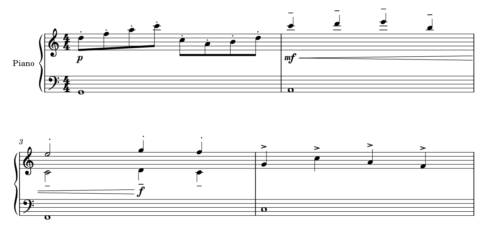

# 力度与奏法：通道可以连续，归属必须贴音

2026-10-26[Blumenkranz再现](INTEGRATED_READING_BOY_BLUMENKRANZ.md#4-blumenkranz同一动机返回为什么不能恢复同一套短奏法)：J接收前行持续，长低音tie与上层释放不同于without Pedal开头，不能按相似音型补回全套点／休止。D旁实际是tenuto横线与短slur，旧记“相邻点”已纠正；non legato与局部短slur亦可并存。

2026-10-24的[T05／Ashes](SKILL_TRANSFER_MARKINGS.md)补同高奏法的正例：G/m72三tenuto在干端侧同Y，头高却不同，保留；不以贴头规则全拉随音高。E/m61–62渐强到上表休止／下表低八度共同列，B/H的pp sub.及L前ff sub.又有各自入口，不吸到段号或最后上部攻击。

2026-10-21补[Connect整首](INTEGRATED_READING_CONNECT.md)：H前两小节发夹、后续simile而数字仍印，是按信息类别判断省写的具体实例。若simile指强弱起伏，便与Gould p109要求写明反复力度型不同；不能因官谱采用就变成推荐规则。D／G的快慢层pp／mp、J的f／mf反复转换及L的pp／ppp又说明，省字、统一基线和去重都须先保护角色与时间。本批只有只读解释，没有新原生候选或播放scope证明。

2026-10-20。完整读图Gould印刷p101–109、114–122／PDF p121–129、134–142，共18页，其中p109、114、121–122已在[弧线专题](CURVES_STUDY.md)看过。复看A066 p4、A017 p1、A143 p4，以原创原生四小节检验“把奏法统一到一条水平线”的代价。[证据](dynamics_articulation_evidence.json)保存输入、范围、图面、播放及重载核查；参考谱／教材只读、图页不入Git，不增加历史官谱近读计数。本轮没有修改用户乐谱、字体或软件接口。

## 1. 两种“整齐”不能混在一起

力度及发夹让读者追踪声音强弱如何变化；断奏、tenuto、重音首先让读者认出某个音／声部怎样发音。因此Gould p105希望连续力度形成较稳定的通道，p119却反对把不同音高的奏法全部排成一条远离低音的水平线。两者优化的阅读任务不同，不能都交给“取组内最高位置后全部吸齐”。

连续力度宜尽量同层并靠近相关音乐，有限空间下允许发夹适度倾斜，以连上实际起止力度；不追求所有文字或所有声部共用一个Y。奏法宜保持与所属音／干端的可读距离，具体位置又需避开谱线、加线及弧。局部重音放到谱表外，可比逐个挤进音间更醒目；单独断奏点与其它符号组合时，横向锚点也不一定相同。

## 2. 规范给出的具体判断条件

| 读者任务 | 条件与理由 | 不能直接推导的动作 |
| --- | --- | --- |
| 认出全体／独立层的力度，p101–102、钢琴章p323 | 钢琴共同力度通常放两表之间；同表独立声部或内层需要可辨的局部标记。位置、干向与时间共同说明归属 | 不能按软件track不同就设不同播放scope，也不能把所有动态居中后宣称归属仍明确 |
| 认出从哪音开始，p102–104、107 | 动态以相关音为参照；长字样在拥挤处可向前让位，不能挪到音已发出之后才像开始。sub.通常围绕动态安排，动态本身仍对准目标 | 字样不等宽不表示起点不同；不能只将整串文本外框居中，或把sub.塞到前面而使强弱入口错认 |
| 追踪发夹变化的终点，p104–105 | 达到最后一个起音，与延续到该音结束不同。存在起止力度时，线要给字样留净空；跨系统续段应显得仍在继续 | 不把每个线尾都拉到小节线；不能因打印位置留白而移动逻辑tick，也不按SVG片段数创建新范围 |
| 读短变化与长方向，p103、106–108 | 短变化用发夹直观；很长的变化可比较文字及延伸提示，避免长平线与谱线竞争。发夹开口不是强弱变化幅度的比例图 | 不能为表示“更强”就统一放大开口；长线改文字涉及范围／表达选择，须单独提出，不能自动替换用户已有记法 |
| 区分渐变与突然转换，p107–108 | sub.、分隔提示、niente圆等都可能承担状态解释。中途确认力度与新变化也不同 | 不能当普通字样去重、把小圆删成“噪点”，或看到长音就假定后面没有力度事件 |
| 区分音头侧与干端的奏法，p117–119 | 单部通常靠头；多部写作在干端分层以避免归属混乱。单独断奏点可对干或头，组合符号通常对头；二度以正常侧头为参照 | 不能按一个“音符中心”吸齐所有符号；上下干不能自动等同于右／左手 |
| 认清奏法与谱线，p119–121 | 点／tenuto需落在清楚的空间，tenuto不能像加线；某些强重音／楔形与谱线的交叠反能保住内部白形状 | 不将所有外框相交报错，也不为清零交叉把记号一律抬远。具体符号、线重与字形须实际看 |
| 分清重奏与延音，p121–122 | 同音slur内的tenuto／断奏可说明重奏；移到外侧会改变读法。局部小记号、弧及外层重音有先后 | 仅保持音高、时值和MIDI不够，不能为“统一弧外”跨过这层界限 |

字体会影响符号重量、宽度及锚点，却不独自决定这些关系。p101、116分别强调力度符号的突出性、较轻的配套文字，以及断奏点／时值附点、短重音／发夹、tenuto／加线的可辨差异。后续应分别查字形与放置，不能把所有记号改成同尺寸、同字重或同基线。本线没有制作字体，也未从参考PDF提取字体。

### 省写的边界不能从一种标记推广到另一种

p116允许在明确建立模式后用stacc. sempre、marcato sempre或sim.省重复奏法；p109对反复强弱变化则要求写清，不依赖sim.让演奏者长期记住起伏。p108又允许为重新进入而确认力度，反对无必要地不断重复同一个不变力度。三条并不矛盾：重复的是动作模式、变化轮廓还是当前状态，记忆负担不同。

因此“相同对象重复出现”不是统一删除条件；同样，不能因为某个simile存在，就认为旁边节奏、力度、踏板与奏法都在无限延续。必须先查文本的实际作用对象与上下文。

## 3. 官谱中的具体理由与保留判断

**A066《Kaibutsu》p4末行G。** 上表下干运动旁有mf，上干先休止再进入的短和弦旁有mp；低谱表稍后另有f，手提示／括形也与局部材料相连。不同位置并不是整页动态没对齐：它们让读者认出哪层突出、何时进入。将mf、mp全部移到上下表的几何正中，可能丢失同表内部的区分。图中simile与其它提示共存；它不足以授权省去后面的低部f或推定全部属性共用同一省略范围。只看PDF不能确认播放scope或精确voice编号。

**A017《Bauklötze》p1第三系统A入口。** sfz在突出起音附近，mf随其后运动出现，两者位置相近却有先后任务；前面的molto又限定发夹变化，不能把它搬成某个音的独立力度形容词。p115对强奏性攻击的说明支持区分瞬时强调和后续动态，不应把sfz一律换成绝对fff，或把sfz／mf合为一个符号。此处保留，确切时间与控制范围仍须工程证据，不能由两字样的外框间距猜测。

**A143《WILL》p4 F至后面的mp sub.。** 上部断奏点、重音、tenuto与短tie／slur各自组织发音；下部重音随自己的音放置。它们没有全部成为同一水平排，而相同动作仍有可识别的轮廓。第二系统的mp sub.在新的和弦／伴奏状态处出现，不能为减少拥挤往前移到上一小节。保留此类归属，优先看局部墨迹是否真的遮挡；本轮没有在官谱上修改坐标，也没有把成品推测成某款软件的操作流程。

## 4. 原创原生例：统一水平后，图更齐却更难归属

四小节4/4双谱表，26音、22个奏法、3个动态及1个渐强。m1八分运动有八个断奏点；m2高音tenuto避开加线；m3上干断奏和下干tenuto分层；m4短重音继续按音辨认。渐强由m2起点到m3第三拍，经过两系统。输入明确指定相应奏法在上／下方，再由宿主定位，**不是声称全部输入均为无条件默认方向**。固定Leland／Leland Text、spatium1.57mm与相同两系统预算，非用户出版预设。

保留版：

拒绝控制：只把m1八个断奏点拉到其中最高点的共同高度，最大上移约4.5sp：

低处音的点因此远离音，成了一排需要额外对应的点；原版则保留直接的音到奏法关系。本例倾向保留原定位，不能据此说所有同高奏法都错误：相同音高、群组避碰或谱表下方没有空间时，都可能有局部同高／全在上方的理由。判断依据是是否还容易认所属音，而非禁止对齐本身。没有要求用户再比较这一明显的诊断反例，也不把本线判断登记为用户偏好。

原生核查包括：

- 只改变8个Articulation子树的offset／autoplace；恢复后整XML树与源相同，音符、作用层、类型、动态及发夹连接不变。
- 全部非Articulation的SVG图元相同（除文件标题／描述）。22个奏法图元中实际移动7个，另一个原本就在目标高度；断奏类型没有改成其它符号。
- 三版完整MIDI逐字节相同，含26个有效起音，音符、力度和奏法的实际播放事件均随之保持；MusicXML仅奏法位置属性不同。源MusicXML与原生导出的26个事件另做显式声部映射核对，不盲目忽略voice。
- 拒绝版另作原生保存重载，offset／autoplace字段仍在，SVG、PNG像素、MusicXML与完整MIDI保持。这个结果证明错误候选可以稳定保存，**技术稳定不代表净书应采用**；保留版本轮未另做保存重载。

这个例子的渐强只存在1个逻辑起点及其接收端，SVG却有3个名为HairpinSegment的图元：前行一个折线，后行两条线。跨行后开口继续展开，不能看到三个绘制图元就建立三次渐强。逻辑范围、打印端点和实际播放分别检查，本轮未做MusicXML重导入、音响或打印验收。

## 5. 后续自主应用与软件研究的边界

先读“谁、何时、怎样发音／变化”，再将同一动态进程的标记分配到通道；奏法保住父Chord／声部关系及贴音距离，弧内外另作保护。位置问题优先用现有原生属性形成小范围候选，不为同高而改变演奏范围、动态类别或拍点。

如果以后要自动化，需要取得标记父对象、类型、逻辑时间／范围、原生scope、上下方向／anchor及有效偏移，再结合真实渲染。PDF只提供可见证据，软件track不等于音乐作用层，SVG段数也不等于逻辑范围数。本轮只补判断和可复现例，不开发MCP／插件／本体接口；知识由skill按专题引用，未证明任意复杂全谱都可自动处理。

2026-10-22[unlasting整首复读](INTEGRATED_READING_UNLASTING.md)把同表力度分层与进入时点连起来：p4快组mf／稍后旋律ff、I的行首p sub.／休止后pp，不合并或吸到一列。L的完整渐弱短语跨两行分词，范围提示有收益，首次识别也有代价；比较起点给全短语与延续提醒是候选，并非已找到禁止分词的规范或已完成原生改善。

## 2026-10-27：不同入口先保时间与层次

[Departures C](INTEGRATED_READING_DEPARTURES.md#5-力度和速度位置不齐常有音乐理由)首轮“两处mp”已纠正：上层快速背景pp，中间／下层mp；上层又先接tie再开始新快音。保留分层及迟早，不按文本近似去重。departure!E／F的sfz先于p／mf运动、DeparturesF前的meno mosso／pp先于段号，均先核X归属，再作Y避碰／通道整理。

## 2026-10-27：提前进入不吸附字母段首

[吹雪／无限城](INTEGRATED_READING_FUBUKI_CASTLE.md)：A046 D前f、J前pp、L前下表mp及M前f各自进入；上表六连也先于L。A048 cantabile在p4s3第二小节最后两个八分开始，伴随型下一小节才变。保准备与层次，不统一到段号；G的p／mp与H附近p／mf分别辨认。

## 2026-10-27：同谱表力度按层而非只看staff

[Grand Escape／Great Days](INTEGRATED_READING_GRAND_GREAT.md)：A051首次双层mp／p、A下表延后mp、J前下表ff先于段首，各有邻接层。A052 C／G／K的mf／ff随具体动作交替，保先后；声乐437歌词通道要求数字在上方，不能变成钢琴所有标记的统一高度。

## 2026-10-27：fp在接收前，sfz可在另一层休止中进入

[Gurenge／Hacking](INTEGRATED_READING_GURENGE_HACKING.md)：A054 G旁fp位于小节线前最后8和弦，后面才接收；较后sfz下层新和弦对应上层8休止。A053 F p sub.／mp分层。保实际进入点，不统一拖到段首或每小节首拍。

## 2026-10-27：通道与发动点分别保护

[Homura／Hyori Ittai](INTEGRATED_READING_HOMURA_HYORI.md)：A059 p2s5 mp／渐变在上方给内层留通道；C前已有f con fuoco发动。A060 M sfz与pp属不同层，不能平均到一个全体力度；段号不决定所有标记生效点。

## 2026-10-28：力度可晚于段首也可先于字母

A063 C的pp在快速型进入，低部p与后来的mp各有对象；N先重奏后pp，O的p旋律又先于字母。A064 M快层p、主线mp保主次，K sfz后pp是先后阶段。 见[完整两首案例](INTEGRATED_READING_IMAGINATION_POOL.md)。

## 2026-10-28：同表多个力度有角色依据

Kaibutsu G上行干和弦mp、下行干旋律mf、低部稍后f入口各保位置，不能按谱表合并。K第一四分重奏f之后才是mf旋律，先后也要保。 见[整曲理由](INTEGRATED_READING_IRIS_KAIBUTSU.md)。

## 2026-10-29：短弧末点与分层力度保留

[KICK E／K及I](INTEGRATED_READING_KEY_KICK.md#5-主次手和奏法要分别保护)中，两个不同音高和弦的短slur、末点与首重音共同交代动作，不能因已有弧删点。I的sfz／mp／mf又有不同入口；Gould p121–122／323分别支持奏法层级与力度归属，实际触键和播放不从PDF推定。

## 2026-10-29：分层力度与sim.各自保范围

[Kuusou F](INTEGRATED_READING_KURA_KUUSOU.md)上部ff、下部mp，保近各层的通道，不拉齐合并。H sim.省重复重音，三连数字仍逐组保留；Gould215的数字省写有清晰分组／复杂同步条件，不把一个sim.解释成删所有提示。

## 2026-10-29：短slur、断奏及状态转换各有作用

[两首](INTEGRATED_READING_KYOURAN_CONAN.md)开头短slur与点并存，K反拍与另一层tenuto分别保。Conan secco／con Ped.有来路，D的mf／稍后f及sfz／mf sub.生效点不同，不按同页字串去重。

## 2026-10-29：力度过程与恢复点分读

[两首](INTEGRATED_READING_MELISSA_MERRY.md)Melissa rubato处pp保持后仍有运行，O a tempo早于P Meno；Merry sfz后mp legato、J95与pp、L渐加速／molto rit.／M180分读。成对斜发夹是否精简先核表达对象，不按外形重复删。
