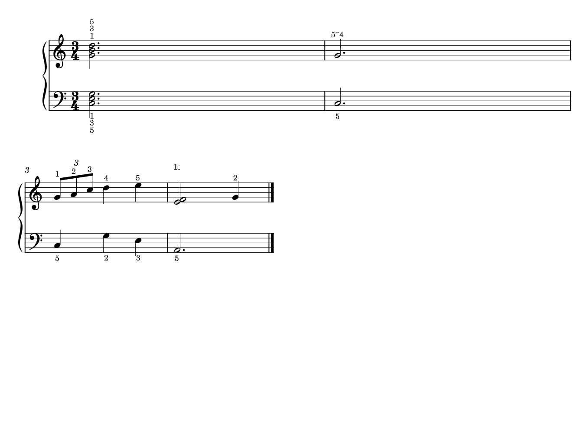
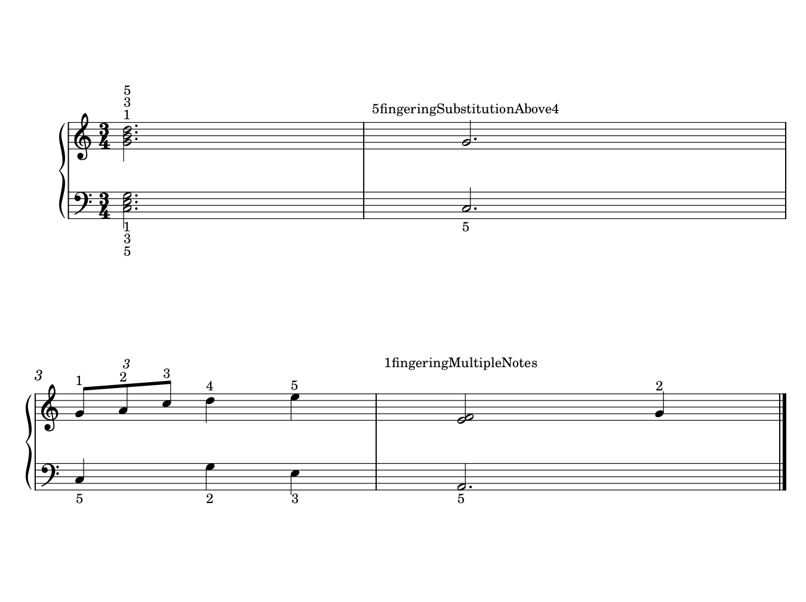

# 指法、替指与手提示：数字属于谁，小弧在说明什么

2026-10-20。复看Gould印刷p308–309完整图文和A063 p3，原创四小节检验和弦指法、替指、连音数及同指多音的识别。结果包含应保留的原生排法、两个拒绝试验，以及实际MusicXML往返暴露的符号损失。[证据](fingering_evidence.json)记录输入、所属音、渲染和播放边界；原谱、当前GUI及软件均未改动。

## 1. 手、手指、声部和软件容器分别回答问题

A063《Imagination》p3 G，上谱表有上干部短型、下干部旋律，下谱表另有保持；l.h.及局部角括形提示接手。它们帮助辨认哪只手承担局部材料，并不指定每个音用哪根手指。把角括形都理解成“拇指同时弹两音”，或把l.h.换成数字1，都没有依据。

这页在既有阅读中已分析，本轮复看用于确认分类，不能冒充新发现的指法数字实例。现有官谱笔记尚未形成充分的指法正反例；Gould p308也说明许多版本不提供指法。没有数字不是遗漏，净书不以自动填指法为前提。

有指法时又不能只按所在谱表推断手。Gould p309以右手通常在上、左手通常在下维持识别，并为内声部给出靠干端的例外；实际两手移到同一表、跨表或接手时，仍需看明确手提示与前后动作。当前源码的Fingering自动位置会参考谱表、干向和是否多声部，这种几何判断并不证明它已经知道真实手分配。

## 2. 哪些看起来很小的区别需要保护

| 图面类型 | 读者需要辨认什么 | 整理时的限制 |
| --- | --- | --- |
| 和弦旁纵排的指法数 | 每个音对应哪根手指，纵向次序帮助逐音匹配 | 不为所有数字同高，把它改成一串水平数字；保存每个Fingering的所属Note |
| 音组上的连音数 | 全组怎样分时间、数字适用的范围 | 与指法分开分类；相同的3不等于重复对象，不能按距离最近的音归属 |
| 连续水平指法数 | 可能是颤音等动作的交替手指 | 结合奏法和动作，不能自动解释为和弦堆叠或时间比例 |
| 两数字间／上方的小弧 | 同一持续音中从一指替换为另一指，保持连贯 | 不把它当普通音乐Slur删掉，也不改成两个需重新发音的音头 |
| 数字旁同指多音括形 | 一个手指、通常是拇指，同时承担多个音 | 它和手接管角括形用途不同；单一父Note未必列全人类动作涉及的音 |
| 从某指法数字延伸的水平线 | 个别手指保持多久 | 与该手其它手指活动并存；不能当多余延长线压短或与普通分句线合并 |

最后一项本轮只作教材理解，没有重建原生持指线候选；交替指法也没有通过本轮变成自动推荐功能。Gould采用小粗直立数与斜体连音数区分类别，是有阅读理由的样式。当前练习保持宿主既有字态以隔离问题，未比较字重或选定用户默认字体。

专用字形有明确身份：SMuFL的`fingeringSubstitutionAbove`与`fingeringMultipleNotes`分别表示替指连接、同指多音。字形身份来自[SMuFL指法表](https://www.w3.org/2021/03/smufl14/tables/fingering.html)，不能由一个短弧或直角的外形单独反推PDF中的用途。

## 3. 原创四小节：保留已清楚的默认处理

自制3/4双谱表，无参考旋律摘录。固定Leland／Leland Text和spatium 1.57mm，指法沿用同一宿主的文本样式；未固定全部上干。m2后换行，末系统自然宽度较短，属于练习的布局条件，不是建议成品都这样分页。

- m1两手各一个带点二分和弦，各音附一个Fingering。上方5／3／1、下方1／3／5的纵排与各自音高顺序对应，保留。
- m2一个G4持续，指法文字为5、替指弧、4，演示持音中换指；不是两种可任选的指法，也不是同音再起。此为自制语义练习，不推荐为某实际乐曲的最佳手型。
- m3八分三连组分别带1、2、3指法，后接两个四分音符。斜体连音3与靠近各音的直立指法分层，保留这种类别区别。
- m4相邻E4／F4共用拇指的说明由数字1与同指多音字形组成，后接G4。原生Fingering挂在E4 Note上，但本例明确的动作涉及两个音，不能据单父节点推断只影响E4。

此练习20个音、19个Fingering、1个3:2组，没有逻辑Slur对象。m2的小弧实际是Fingering富文本里的符号；这对原生审计是可确认的事实，对只有PDF的任务仍需结合上下文判断。

## 4. “贴近一点”与“删一点”在这里都未通过

**移到音头旁的拒绝例。** 只对m4的1与同指多音括形关autoplace，加offset x=-1.6、y=0.2sp。两个Fingering绘制元素之外，全部原生SVG元素保持，完整MIDI也相同；但标记挤到小节线上，归属更差。更近不能单独作为成功标准，当前保留原排法。若以后必须改放旁边，应同时规划文字、谱线／小节线和所需前置空间，而不是全曲强套此偏移。

**删附属符号的拒绝例。** 仅去掉两处富文本sym，保留数字、19个Fingering及其父Note。m2变成54，m4只剩1；MIDI不变，却丢掉换指与同指多音关系。该版本还使第一系统的少量音头、干、附点与小节线位置连动，不能声称“只改指法，排版其它部分必然不动”。

两个试验均未采用，也没有修改用户已有指法。原生基线保存重载后，富文本、全部所属音与实际时值、SVG（除导出标题）、PNG像素及完整MIDI均保持。本轮判断的价值包括有理由保留默认堆叠，而不是必须制造一个外观修改。

## 5. 实际格式反例：有19个指法对象，仍没有保住指法

从自制原生基线导出MusicXML 4.0，m2和m4分别变成纯字符串`5fingeringSubstitutionAbove4`、`1fingeringMultipleNotes`，没有对应的富文本符号，也未生成替指属性。再用固定宿主实际导入该文件，保存为独立MSCX并渲染，这些名称就作为普通字母印出来。

导入后仍有20音、19个Fingering、相同书写音高／起点／时值及一个3:2组，两个富文本符号却已经没有了。检查数量甚至逐音音乐配方都不足以证明指法保持。不能将这个往返文件用来替换原生基线，或以“名字仍在字符串里”认为功能未丢。

这不等于交换格式无法表达替指。[MusicXML 4.0的fingering参考](https://www.w3.org/2021/06/musicxml40/musicxml-reference/elements/fingering/)定义了多个指法元素和`substitution`属性，用于持续音中的替指；`alternate`另有替代选择的含义。本例暴露的是当前原生富文本经这条输出／导入路径没有被正确转换。源码可见writeFingering把xmlText转为plain text，导入又用setPlainText；它与实际输出一致，但未证明当前源码提交就是固定二进制的构建来源。

### 播放与样式也须另记

MusicXML重导入还带来版面与乐器配置变化。其完整MIDI没有保持：20个Note On的轨道、时点、音高和速度以及Tempo事件相同，Note Off却改变，通道事件也不全相同。导入的Piano配置出现默认gateTime=95，最后一音释放比源早72 tick；这些附加变化没有一并归因于指法符号转换，也没有另作gateTime开关实验。

因此不能借用前三个原生版本“MIDI逐字节相同”的结果来描述此格式往返。它首先是指法保护的明确反例，同时再次说明原生工程、交换文件与演奏配置应分别核对。当前没有修补导出、导入或乐器逻辑。

## 6. 对自主净书和后续适配的约束

先读指法的父Note、富文本、局部手提示与整个动作；数字识别和对象计数只作入口。每个数字是否保持、图形连接是否保持、同指是否覆盖多个音、文字是否仍指向正确层，需要各自确认。遇到不明小弧或括形，先保留并定位含义，不能混进“清理多余符号”。

未来Muse适配可用此自制输入复现富文本指法输出问题，研究结构化替指与多音归属是否需要更明确的表示，并确保导出仍可供人阅读；优先现有原生属性、插件或最小必要改动。这里仅保存情境、复现与源码位置，未开发接口，也不把任意两个相邻指法数字自动转换为替指。

本轮补上E35的部分原生案例：堆叠、替指、同指多音和连音区分；没有补齐指法的生理／演奏最优性、持指线、交替指法、复杂多声部内层、所有手交接或三踏板。Gould两页与A063均为复看，没有增加历史阅读页数。全部公开源谱、交换文件与图是原创CC0练习；教材和官谱图仍保留本机私有缓存。
