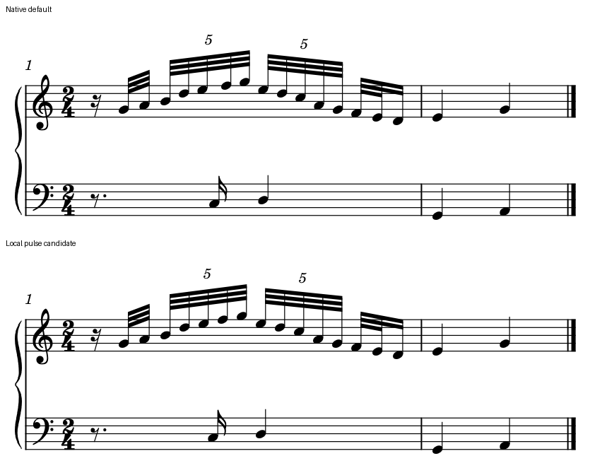

# 五连音内部为何忽然宽一格：真实进入、联合时间列和最低宽度

2026-10-23。接[ninelie整曲研究](INTEGRATED_READING_NINELIE.md)中J段的真实单位观察；本轮只采用其一般节奏构型，以独立原创音符作受控研究，没有转写官谱旋律，没有读写官谱PDF或用户工程，也没有修改MuseScore、MCP、插件或接口。原生研究与失败记录保存在私有缓存；本页公布经过复核的原创输入、对照与证据。

**默认版共同时间关系本来正确，但另一表在五组中间进入，足以使上方等时长的一格变宽。** 在本例中，变宽不必靠变音记号或本表真实碰撞解释。固定字体和版心后，可以用小范围重分空白形成更稳定的局部候选；它不是全谱等距方案，也没有解决默认最低小节宽度及自动换行。

## 1. 音乐配方在导出前独立确定

原创两小节2/4。第一小节上方为十六分休止、两个普通三十二分、两组5:4三十二分、两个普通三十二分和一个十六分：

`1/4(rest) + 2×1/8 + 5×1/10 + 5×1/10 + 2×1/8 + 1/4 = 2q`

15个快音采用独立音高G4、A4、B4、D5、E5、F5、G5、E5、D5、C5、A4、G4、F4、E4、D4；两组5各完整连三层梁，末组三音只有前两个连第三层梁。下方附点八分休止3/4q，然后C3十六分、D3四分，在q1与上方第二个5组共同开始。第二小节两表各两个四分作前后文。全例21音、2休止，不加官谱的外层slur、额外慢层、换号或八度状态，避免它们进入此轮间距成因。

另设**改变音乐的诊断控制**：把下方休止改为八分，C3改为八分，在q1/2与首5组同时进入；D3仍在q1。这个控制不是可采用的净书候选，也不声称它与默认音乐相同。

共同条件：Leland／Leland Text、sp1.57mm、minNoteDistance0.2sp、两表间距及字体固定，180dpi原生SVG／PNG／MusicXML／MIDI。版心取名义80／120／180mm，页宽等于版心加30mm，左右各15mm。它们是压力条件，不是建议用户使用窄页面。原生StaffLines已逐一量到实际版心右边界，记录了谱头缩进及实际小节宽度；“同版心”不被写成“同组宽”。

## 2. 两只手对了，五组仍会不稳

测的是同黑符头、同字号、同干向的横向原点差。每个5组量5个等时长间隔，包含最后一个五连音到下一个组起点的1/10q；数值描述现象，不是审美分数。

**统计范围必须一致。** 五颗头之间只有4个组内间隔，本表则还计入组末到下一组起点，共5个间隔。若官谱只量内部4间隔，不能直接拿其max/min和本表数字比较；须先统一起止、字体／字号、音型、真实占位与空间预算。即使都接近1，也不能由不同输入推出制作引擎的优劣或排版成因。

| 名义版心 | 默认首5组最大／最小 | 默认第二5组 | 无组内进入的诊断首5组 | 局部候选首5组 | 默认／诊断／候选系统数 |
| --- | ---: | ---: | ---: | ---: | --- |
| 80mm | 1.4962 | 1.0002 | 1.0000 | 1.0000 | 2／1／2 |
| 120mm | 1.2678 | 1.0002 | 1.0000 | 1.0000 | 1／1／1 |
| 180mm | 1.2500 | 1.0001 | 1.0001 | 1.0001 | 1／1／1 |

120mm默认首组五个间隔约2.366、2.366、2.999、2.366、2.366sp。下方q3/4的起音在上方q0.7与q0.8之间；它本来已落在该5组起止的中点，差约0.000045sp。q1的真正共同起音也已对齐。因此不能把问题概括为“左右手对错了”，更不能把下音吸到最近一颗上音。

80mm默认的第二小节被折到下一行，而改变音乐的诊断仍容纳一行；不能拿其较小的头距当同组宽比较。此档用来观察最低宽度与换行边界。120／180mm各条件均在一行，可直接看到组内进入对等时长轮廓的影响，但仍须记录其各自实际小节分配。

## 3. 为什么宽时约1.25倍，窄时更明显

上方首5组q1/2到q1的相邻单位原为0.1q。下方在q0.75进入，将其中q0.7到q0.8分成0.05q＋0.05q。合并时间轴在这段多了一列，而相邻上方音头总时差没有变。

本机只读源码的Measure::computeTicks／stretchMeasure对相邻有效时间列使用非线性弹性。对于当前最小区间0.05q，公式给它权重1，0.1q的权重约1.6。于是两段短区间相加为2，未拆的一段为1.6，宽松时比值自然接近1.25。这是按联合相邻时间列处理、再加总到某一表的后果；额外起音在另一表，没有自动免去其最低列宽。

再加“符头宽＋minNoteDistance”的下限，窄／中档两个0.05q段各被托到约1.5sp，合计约3sp。180mm弹性已足够，没有触发这一下限；80／120mm触发，首组局部不均匀更明显。

按该源码公式、精确的480PPQ时差和原生黑头墨迹宽代理计算11段联合区间，仅从两组完整1q的实测总宽校准**一个整体力值**，不逐格拟合，三档全部区间最大误差0.000373sp。忽略下限的纯弹性模型在80mm误差0.217sp，在120mm误差0.0184sp，不能用它解释所有条件。

这里核的是内部形状；总宽仍来自实际导出。墨迹宽是noteHeadWidth的代理，固定二进制的构建提交与当前只读源码尚未对应，也没有运行时分支追踪。结论为此构型、三档宽度的实测与该机制一致，不把它升级为所有版本与织体的唯一原因。

## 4. 一个可用的局部候选，及它的代价

两份可编辑输入是[共同环境默认](fixtures/five-four-spacing-default.mscx)和[局部脉冲候选](fixtures/five-four-spacing-pulse-candidate.mscx)。图为原生180dpi导出合白底、同一个裁框，保留两表及第二小节；标签在谱外，没有移动或缩放图中符号。

候选只重分q1/2到q3/2这一个四分长度的区域，使两组十个0.1q间隔稳定；不把普通0.125q三十二分或末0.25q十六分强行改成同距。区域两端、前后音型保持；同时调整下方q3/4和真正共同的q1，不能只把上表“排漂亮”后留下错位的下方进入。两组数字5和分梁仍交代各自单位与范围。

第二组默认本已稳定，候选并非在修理两个坏组：它选择在同一个1q区域重分预算，使两组真实相同的0.1q脉冲衔接稳定，因而第二组的平均头距也略有变化。这不是全谱等距要求；周围普通三十二分为0.125q，末十六分为0.25q，仍按各自真实单位与读法判断。本候选跨过q1共同点，若只按目标移动上表、把下表q1留在原位，会破坏原来正确的可见汇合；单表吸齐不能替代两手联动核查。

120mm通过9个上方、2个下方Chord的x offset实现，最大约0.4435sp。十个间隔约2.429sp，两个5组内部与彼此的脉冲一致，符头间仍有约1.129sp墨迹空白。下方q3/4保持在首组时间中点，q1上下对齐；周围音符高度、字形和不相关标记保持。默认音乐没有删改，完整MIDI字节相同。

本线判断：这个无额外符号的孤立构型中，局部候选减少了不能由本表分组或占位说明的“中间一格拖宽”，主任务复核后接受其作为有条件的局部候选；没有用户审美选择或认可。两组间的普通梁断口仍在，不把一致头距当作所有拍组的唯一清晰办法。

**局限很具体：** 这些offset按当次宽度计算，各宽度分别重算，不能做全局预设。80mm候选仍是两行，因为后处理移头没有重新解决原生最低小节预算。120／180mm候选还带来小于0.001sp的微小原生重排：部分非目标头及内部小节线并非字节精确不变，已量化保留，不能仅归于SVG舍入。没有加入新的变音、额外声部或文字，因此不能保证同一位移在真实密集谱里仍安全。

## 5. 原生音乐核查与重载

所有有效输入均以预先独立的音符／休止配方核MusicXML：实际起止、音高拼写、voice1／5、谱表、干向、梁层数、5:4字段、附点休止和末十六分均相符。MIDI全部21次起音精确落在独立的480PPQ时间点，音高和力度80相符，21次音长均为配方时长减默认1tick门限。候选与各自默认完整MIDI相同；不同宽度的同一音乐也相同。

推荐的120mm两版使用与原生保存一致的数值精度，并各实际保存再导出。原生保存后的21音、11／0个offset均核过；全部SVG绘图、原始RGBA尺寸与字节、MusicXML除日期、完整MIDI均精确保持。这里的“重载精确”只指各版本自身保存前后，不表示候选和默认的图形相同。

第一批9位小数页尺寸输入另有很小保存差异，原始输出没有覆盖：120mm默认／候选均仅1像素通道差1；80／180mm候选147／155像素、最大通道差2。单独只改4个页数值字符串的控制，已精确复现120mm默认重载的SVG与RGBA；这才支持本例首次保存差异来自共同页数值量化。另180mm有一颗MusicXML default-x差0.01tenths，除该坐标、日期和右边界正负零外内容精确保持。不要把数值序列化变化当成净书改善或音乐改变。

首次构造还重复遇到已知输入陷阱：Rest的dots放在durationType后，宿主画了附点却按未附点时长推进，后续音提前并补休止。这3个输入已拒绝，按原生writer的dots在前顺序另建，直到独立配方与导出一致才纳入比较。它是本次输入构造失误及旧经验复核，不新增一个“软件弱点”。

## 6. 这项经验怎么用于以后净书

先核三件事：实际共同时间点是否清楚；新增符号是否真的需要本表水平空间；需要快速识别的脉冲是否被另一表多出的时间列过度扭曲。两手已经对齐，并不代表某层跟读稳定；更稳定也不能靠删掉真实进入或改掉时值。

对于这样的简单五组，可提出只在确定局部内重分空白的候选，同时移动真正共同对象并核邻近两手。把它扩展到真实谱之前，须加入变音、和弦、额外层及标记的反例，重新查墨迹和组形；不把本次0.44sp或等距结果应用到整页。

本阶段只记录可复现情境。以后若做软件优化，应同时考虑每表阅读脉冲、共同时间点和真实墨迹约束；不能仅在联合轴的每两个相邻事件间孤立分配后，假定某层累加结果仍自然。当前offset例也说明，局部显示可修与最低小节预算／换行可修是两项不同能力。没有设计或实现新的分配器、MCP字段或本体接口。

证据为[five_four_spacing_evidence.json](five_four_spacing_evidence.json)，私有原始进程、失败输入、SVG、XML、MIDI和重载记录均保留。沿用冻结宿主7b4e6fbf…，1936个文件导出前后大小／SHA一致；预建私有配置实际生成menubar.xml。未复制宿主，新增缓存约2.5MiB，低于100MiB检查线，没有删除文件。

尚未做MusicXML导入、试听、打印、用户选择、真实官谱工程迁移、密集织体边界或软件适配。不能由本例证明官谱采用了某个制作软件、人工调距或相同机制。

## 原创材料与许可

本页公布的两份MSCX及原生对照图为独立原创材料，按**CC0-1.0**提供，供复现、修改和研究使用。官谱及教材仅作风格／规范背景；本次发布不含其页面、图例、旋律转写或嵌入字体，CC0声明不涉及这些来源。输入、对照与本页的SHA-256列于证据的publication_files；证据自身的校验值保留在私有发布检查记录中，避免自引用。
