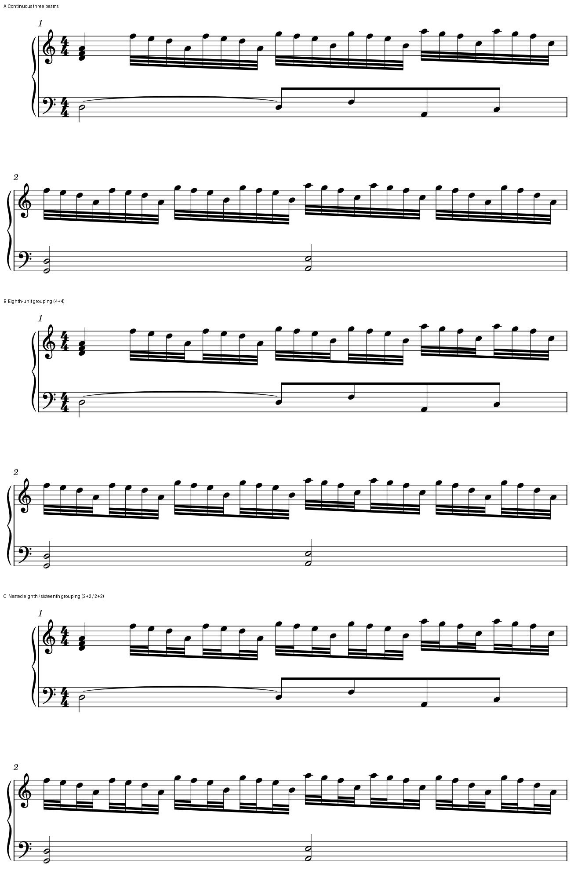

# 三十二分内梁：让节拍层级看得出来

2026-10-29。**普通四分拍内的八个三十二分，优先比较分层内梁：主梁连整拍，第二层按四音连接，第三层按两音连接。** 它给读者“整拍—半拍—四分之一拍”三层定位。本例保留四音下降轮廓及两手位置，完整分层版作为首选候选；四加四版作为断口较少的备选。未取得用户对这三版的偏好反馈。

这接续[A068 C段的待验证问题](INTEGRATED_READING_TANJIRO_KANTAI.md#1-c的稳定快层可以保留内梁层级仍有改善候选)。原官谱快层间距和两手共同列已有稳定依据；这里用原创音乐隔离梁层级，不改原谱，不重做其间距。

## 阅读收益与代价

Gould《Behind Bars》p156先建议：四分及附点四分拍中的短时值，内梁显示八分单位；随后要求八分单位内再显示十六分单位。p157说明，连接某层小组的梁数须与该组时长对应，并给出特意不强调内部重音的连续音阶例外。本轮完整复读两页，不增加教材覆盖。

| 版本 | 每拍八音的三层连接 | 读者得到什么、付出什么 |
| --- | --- | --- |
| A 全连续 | 8／8／8 | 八音作为一个连续轮廓，墨迹端点少；半拍和更小单位须靠音头、音型及另一手辨认 |
| B 四加四 | 8／4／4 | 中点直接显出八分单位，重复四音型容易归组；没有进一步显示十六分层级 |
| C 完整分层 | 8／4／2 | 四音内部再有两音线索，寻找另一手落点或重新进入较方便；梁端更多，轮廓较碎 |

分梁提供时间组织，不会自动增加重音、改变触键或改成断奏。也不应把主梁一起断成两组来代替内梁：那会弱化本例整拍的父层级。真正有跨拍分组、复合拍、连音或刻意无内部重音的连续音阶，要重新判断。

本例的重复下降四音不是一条不断延伸的音阶；仅凭速度快，不能直接套用p157的例外。我的判断是先保留C作为普通细分的候选，B供较少断口的阅读取舍。这个判断尚未迁移到官谱的原生副本，也不代表用户已经认可C。

## 原创原生对照

四小节4/4钢琴练习，CC0独立音乐。m1四分和弦加24个三十二分，m2为32个三十二分；左手有二分保持、同音弧接收及八分进入。m3–4提供邻接慢速材料。三版输入指定Leland／Leland Text、1.57mm谱间、180mm版心；宿主保存省略默认字体字段，MusicXML显式确认为Leland，原生重载的字形绘图另核。本例没有力度等音乐Text符号，不以它验收Text字形。实际排成三系统，起始小节为1／2／3。

[四小节完整上下文](fixtures/inner-beams-full-context.png)保留后续系统；三版共用同一裁框及物理比例，只合白底并在谱外加标签，没有移动或缩放音乐符号。

可直接用MuseScore打开：[A连续](fixtures/inner-beams-continuous.mscx)、[B四加四](fixtures/inner-beams-four.mscx)、[C完整分层](fixtures/inner-beams-nested.mscx)。这些是练习及候选，没有套用到用户工程。

## 宿主已支持的能力与实际核查

`begin32`使第二层及更内层重新开始，主梁保持；`begin64`只让第三层及更内层重新开始。因此B需七个中点断口，C在此基础上再加十四个第三层断口。名字容易误读，调用时须按实际层级和图面核对。源码定位为`libmscore/chordrest.cpp`、`beam.cpp`及MusicXML进出代码；只读，没有修改软件，也未证明固定二进制对应当前源码提交。

原生输出中，上方七组的梁段为21／35／49；另有左手一条梁，总计22／36／50。三版除Beam绘图外，全部带class的SVG对象相同，包括音头、符干、谱号、同音弧、谱线和小节线。故本例的差别确实来自内梁层级，未借助间距变化。

84个书面音符逐项对独立配方核音高、拼写、起点、时值、谱表及同音弧；其中一个tie接收不重新发音，实际83次攻击及完整MIDI相同。保存重载保持这些内容及每层梁标签；三版再次保存均逐字节保持。首份手写输入到首次保存有小于0.000450sp的坐标舍入，RGBA并非逐字节相同，发布采用保存后的共同基线。

三版MusicXML导出后重新导入，再导出逐层核查：本例第二／第三层断点及84音配方保持，实际梁段仍为22／36／50。没有据此宣称交换后的全部页面几何相同；此前[仅第四层断点丢失](BEAM_STEM_STUDY.md#6-新的具体限制第四层断点在导入时丢失)的问题也没有被修复。当前情境可使用宿主已有分梁模式，暂不需要新增本体能力。

[核查证据](inner_beam_hierarchy_evidence.json)记录输入、图、固定宿主、39次正式CLI及发布检查、运行时前后哈希和首存精度差异。未做实际打印、试听或用户采用。教材页及参考谱图保留在私有缓存，不随此文分发。

## 后续怎样应用

遇到密集普通细分时，先核拍号、实际时值、梁所覆盖的范围及另一手的落点，再检查各层是否提供了合适的计数单位。连续梁有明确的音乐作用时保留；普通重复细分缺少层级时，给出局部原生候选。断梁改变可见记法，必须让用户看得见具体建议，不能夹在纯间距整理里默改。

本轮解决一项候选验证，阅读账面仍为官谱66/146（余80）、教材696/696、资源13/25（余12）。继续未查整曲和资源缺口；软件适配留后续。
