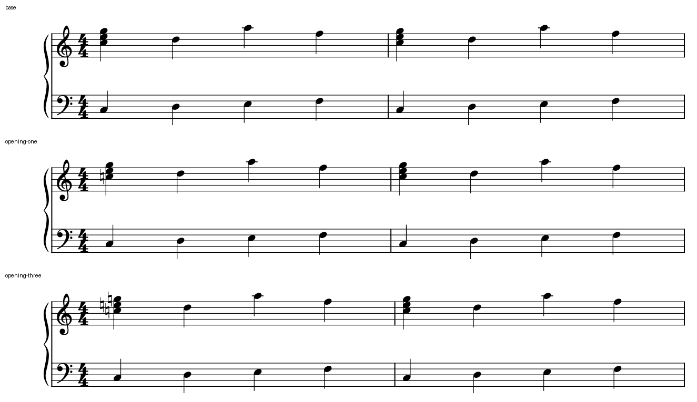
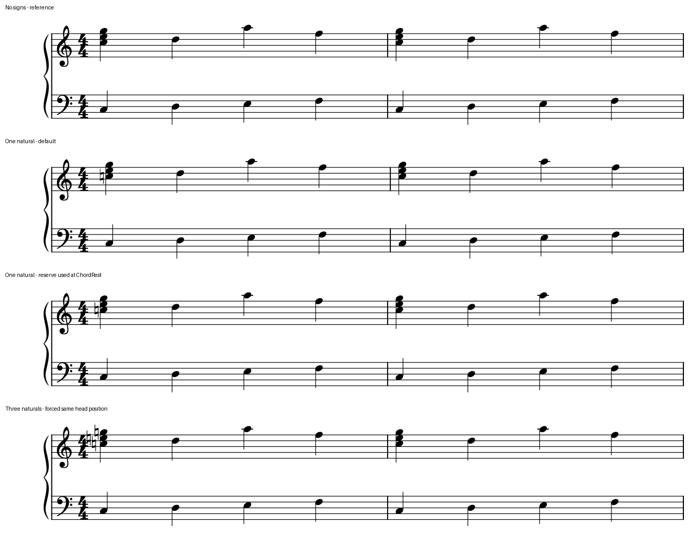

# 行首留白：变音何时可以放进已有空间

2026-10-22，研究于10月21日开始。本轮把[Gould／MPA间距阅读](MPA_READING.md#3-对用户关心的变音与间距补一项实际判断)转成原创原生对照；没有新增官谱覆盖计数，也未修改用户谱。完整数据见[证据](leading_reserve_evidence.json)。

## 1. 为什么值得区分这块空间

首音前的空白隔开谱头和音乐进入，也给变音提供识别空间；它本身不是一个有时值的拍间隔。新增符号未必需要把全部宽度追加到首音之前：有足够空白时，可以用掉一部分预算，保持熟悉音型的起点和两手对齐。Gould印刷p42的相关谱例提供这一思路，已在前轮实际读图；它没有要求所有首音永远保持同一x，也没有给出本机应设多少负留白。

这里要平衡两件事：稳定的进入位置方便预读、对应和重复材料识别；清楚的谱头／变音分隔使音高与节拍容易确认。空间不够时，应允许整个共同起音列后移，或比较其它排法。不能只移动有变音的上表音符来满足一个横坐标目标。

## 2. 先用同一音乐区分三种前沿

原创四小节4/4、钢琴双表，每小节上表首拍C5–E5–G5和弦，随后D5、A5、F5；下表C3、D3、E3、F3均为四分音符。每版40颗头／40次实际起音，不含延音、静音层、八度线或反复。第二小节后换行，实际两行各两小节。

七个条件只在m1（有拍号的曲首）、m3（只有常规谱号的后续行首）、m4（行中小节起点），分别给首和弦加一个或三个显式USER还原号；另有无新增符号的基线。它们是**显示占位控制**，本例本来不需要这些提示变音，不作为推荐记法。

固定Leland／Leland Text、1.57mm sp、A4和共同版心，`lastSystemFillLimit=0`使短练习按同一整行宽度比较。这是有意放大的诊断条件，稀疏且被撑开的两行不是出版模板。正式输出在[重建的共同运行环境](NATIVE_EXPORT_ENVIRONMENT.md)全部重画。

| 位置 | 加一个还原号时，首头绝对右移 | 加三个时，首头绝对右移 | 前沿到最左还原号 |
| --- | --- | --- | --- |
| m1，拍号后 | 0.934sp | 2.280sp | 拍号实际墨迹右缘后约2.000sp，两版相同 |
| m3，后续行首 | 0.837sp | 2.183sp | 上表谱号实际墨迹右缘后约2.500sp，两版相同 |
| m4，行中小节 | 0.252sp | 0.925sp | 该小节线中心后约0.960sp，两版相同 |

这里的“头”是同一字形、同一缩放的正常侧绘制原点，比较其位移有效，但没有冒充真实头中心。实际sp来自谱线间隔约22.252个SVG单位；字形墨迹界限计算了完整cubic极值。小节线以中心为参考，未减去半描边，因此0.960sp不能直接与字形间的净空比较，更不是推荐阈值。

三个还原号在本构型中有三个不同x的绘制原点，不能把总数机械当成三个互不重叠的固定宽列。其它字体、升降／重变音、括号和邻位错头还会改变构型；没有在此验证。

表中行中首头位移较小，不能解释成“额外宽度主要被已有空白吸收”。m4前的小节线同时左移0.252／0.925sp；从这条线量到首头，距离从基线1.390sp变为1.894／3.240sp，实际增加约0.504／1.850sp。必须把参考前沿一起量。

三种条件都保持两手的共同时间列，但固定行宽内，后续普通四分间距及中间小节线一起重分。没有改变下表音乐，也不意味着下表排版不受影响。[后续行首图](fixtures/leading-row-comparison.png)和[行中图](fixtures/leading-inside-comparison.png)保留完整目标行两手；这种变化不单凭“不均匀”即可判错。

## 3. 有容量的局部控制与超出容量的反例

再建立两个独立原生输入，只给**首个ChordRest的共同Segment**加负leadingSpace；补偿量由本例首头位移计算，目标是检验能否利用原有预算。它们不是全谱预设。

| 控制 | 拍号／谱号 | 两手头列相对无符号基线 | 拍号墨迹到最左还原号 | 判断 |
| --- | --- | --- | --- | --- |
| 一个还原号，约−0.933759sp | 保持 | 两行全部列保持 | 约1.066sp，仍有分隔 | 本例可行的诊断候选；没有用户审美采用或实曲迁移 |
| 三个还原号，约−2.279705sp | 保持 | 两行全部列保持 | 水平墨迹范围约重叠0.280sp | 放大图可见拍号右沿与还原号相接，分隔变差，拒绝 |

单符号版说明当前原生属性能表达这一个局部控制，尚不能推导现有MCP能读写、批量应用或自动算好。三符号版说明“所有头列回到基线”和“完整MIDI保持”依然不足以验收。允许共同列合理后移，比挤坏谱头更容易读；也可另比较只利用部分空白，不必非压回原位。当前未构造这一第三方案。

两版实际原生保存重载：单符号版SVG绘制元素和原始RGBA完全相同；三符号反例保存的leadingSpace舍入到−2.27971，一个还原号的SVG x从510.023到510.022，其它绘制元素相同、180dpi原始RGBA相同。这个0.001单位差异是已定位的保存／坐标精度边界，没有笼统写成所有SVG完全相同。两版的40音配方、拼写／显示身份与完整MIDI均保持。

## 4. 试验还纠正了一个输入假象

首版把`Segment`放在TimeSig之后、首Chord之前。本机读取代码对当前已建立的segment调用read；此处实际改到TimeSig段。首头恰好回到目标，拍号却一同左移，甚至挤到谱号。仅查头列或MIDI会误收。

正式两版改为在首Chord之后写`Segment`，并检查原生保存结果中的挂接顺序及所有谱号／拍号图元保持。首版输入、输出和更正记录仍保存在私有目录，不发布为“负ChordRest留白会挤拍号”的软件缺陷。此前琶音例在段首StaffText已建立ChordRest的上下文不同，不能照抄相邻XML位置判断目标。

只读本机源码还可找到`systemHeaderTimeSigDistance`、`systemHeaderDistance`、`barAccidentalDistance`及`barNoteDistance`等不同前沿的控制线索；没有完成这些样式的逐项参数实验，也没有确认源码提交对应本轮固定二进制。观察得到的是本构型的行为，不宣称已定位所有MuseScore间距问题。

## 5. 后续怎样应用这个判断

诊断先读两手实际时间和最左必要构型，再看当前前沿及留白作用。保留谱头清晰、符号归属和共同时间列的条件下，可比较使用一部分既有预算；容量不够便允许后移，或再比较断行／局部密度。随后读完整系统、前后小节线、普通拍间隔和后续行页，不能只验目标首头或更匀的数值。

本轮只证明单个普通还原号的原创短例可作这种控制。必要变音、调号后的还原、括号、密集复调、真实伴奏和整曲行页连动尚需结合实曲复核。当前没有替换字体、开发适配、改用户工程、MusicXML导回、打印或试奏，也没有新增个人风格偏好。
