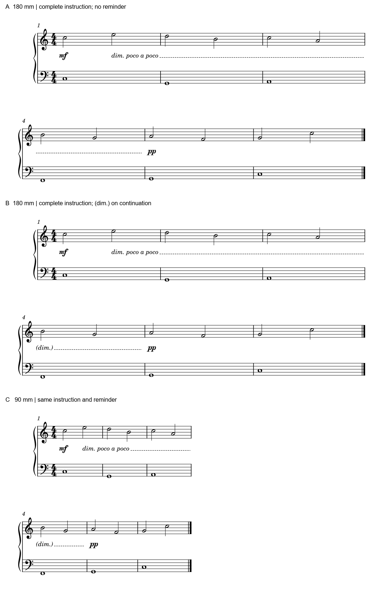

# 长动态文字：先认完整指令，再追踪范围

2026-11-01完成，10月31日开始。**完整短语加续行提醒是可用候选；沿范围铺词也有方向感，不能直接判错。** 本批回到A137《unlasting》p6 L的既有未解项，补规范和原创原生验证，没有改官谱／用户原件或开发软件。

## 实际官谱为什么这样排

[前次完整读法](INTEGRATED_READING_UNLASTING.md#3-l的渐弱长范围与完整指令应一起容易读)已记录：先有sffz攻击、高部mf，再在两行中铺开dim.、poco、a、poco，虚线延至pp；poco rit.及ad lib.另在上方。本批重看完整p6和完整末两行，原PDF哈希保持。

这种排法把长时间的消退铺成可见路径；长值、持音弧和词间延续线也共同维持尾声。它的代价是限定短语要到下一行才认全。首个dim.已经说明减弱，不能说演奏者此前完全不知道该做什么。没有原工程，词的位置也不证明新增了数个力度节点。

**本线判断：保留原谱作为成立的出版选择，完整短语版值得比较。** 若起点有足够通道，完整写出dim. poco a poco可减轻第一次阅读的拼接；续行加(dim.)可在重新找到声部时恢复上下文。代价是更长的起点文本和一个重复提醒。实际候选须连同低部持音弧、前面的mf／sffz、上方速度文字与原pp边界检查；本批没有复刻该官谱。

## 来源带来的条件

- Gould印刷p106–107（物理126–127）完整复读：长变化可用文字、延续线及新系统的括号提醒；中途确认力度宜节制，以免把长过程切成零碎事件。这里没有得到一概禁止铺词的规则。
- Dorico6.2的[渐变外观](https://www.steinberg.help/r/dorico-pro/6.2/en/dorico/topics/notation_reference/notation_reference_dynamics/notation_reference_dynamics_gradual_appearance_changing_t.html)同时提供文字、延续线及沿跨度拆词；[poco a poco设置](https://www.steinberg.help/r/dorico-pro/6.2/en/dorico/topics/notation_reference/notation_reference_dynamics/notation_reference_dynamics_gradual_adding_poco_a_poco_text_t.html)把该限定词作为同一渐变的附加内容。它们证明表达方式可分开选择，软件提供的选项不独自决定哪种净书更好。
- [渐变范围](https://www.steinberg.help/r/dorico-pro/6.2/en/dorico/topics/notation_reference/notation_reference_dynamics/notation_reference_dynamics_gradual_c.html)与[声部力度](https://www.steinberg.help/r/dorico-pro/6.2/en/dorico/topics/notation_reference/notation_reference_dynamics/notation_reference_dynamics_voice_specific_c.html)将逻辑跨度、对象归属与播放区分。审谱先问谁在变化，不因有两个绘制系统或几个词就建立新的音乐进程；Dorico的默认及播放条件不能直接套到MuseScore。
- [渐变间距](https://www.steinberg.help/r/dorico-pro/6.2/en/dorico/topics/notation_reference/notation_reference_dynamics/notation_reference_dynamics_placement_spacing_gradual_c.html)说明其最小发夹长度会影响音符间距，用以避免短发夹像重音。这提醒后续间距诊断也查动态占位；手册的3sp是该软件策略，本批未运行Dorico，也未验证MuseScore采用同一值。

以上五篇正文实际读完；四张相关图片请求未取得，图片阅读增量为0。固定25项资料的完成数不因此增加。

## 三个可编辑原生条件

一个独立原创CC0六小节钢琴例：4/4、两表18音，上部每小节两个二分、下部一个全音；显式设Music为Leland、Musical Text为Leland Text、谱间1.57mm；本宿主实际拉丁动态字体经PDF核为Edwin-Italic。每行三小节，渐弱从m1 q2到m5 q0，共14个四分单位；mf和pp各保位置。不是参考音乐的转录，也不是推荐个人样式。

| 条件 | 阅读判断 | 代价／边界 |
| --- | --- | --- |
| [A，180mm完整短语，无续行文字](fixtures/dynamic-text-no-reminder.mscx) | 完整指令已在起点，延续线能跟至pp；可以保留 | 新行只见虚线，须记住前行所述变化 |
| [B，180mm完整短语，续行(dim.)](fixtures/dynamic-text-reminder.mscx) | 本例优先比较；新行能直接认回同一渐弱 | 多一个提醒，占去一段虚线空间；并非每行必须重复 |
| [C，90mm，保B文字](fixtures/dynamic-text-reminder-90mm.mscx) | 本例仍清楚，不因较窄就自动拆词 | 本例稀疏且没有长弧／独立层，不能保证密集实谱也放得下 |

图为180dpi原生PDF渲染，保留每版全部两行；90mm版没有拉宽，标签在音乐外。B与A的18个MusicXML音位置完全相同，说明本例加提醒无需移动音乐；这不证明任意文本都不参与间距。

## 已验证什么

15次CLI含13次有效比较／保存重载和2次初始输入探针。初始手写Hairpin大小写错误，使预期渐变未出现；修正为实际原生HairPin后才形成三版。错误输入与输出留私有，不能拿退出码成功代替内容检查。

三版加一次B重载共72条音符记录逐项符合独立配方；四份完整464字节MIDI相同，各18次起音／释放。MusicXML把终点写成m4 q4，与原生m5 q0为同一绝对时刻，不能误报提前一小节。

B保存后省略默认continueText字段，重载原图仍实际出现(dim.)；不是丢字。PDF文字提取曾把SMuFL音头混进该词，核图后分开拉丁字符提取，不能据OCR／词分组宣布碰撞。重载54字符／92线的最大包络坐标差约0.000016pt；144dpi有191像素的最大RGB差1，**不称逐像素相同**。音乐、范围和可见指令保持；没有导回MusicXML、打印、试奏或用户采用。

## 给后续审谱的判断顺序

先读完整语句、作用层和起止事件，再决定怎样铺字。跨行时检查读者是否能认回正在延续的指令；只在需要时补提醒。修改起点文字后重看邻近动态、弧和整行预算，保持文字的语法组成与逻辑音乐进程相连。把“完整短语优先比较”作为有条件的建议，不写成全谱替换规则。

[证据](long_dynamic_text_evidence.json)保存只读哈希、实际宿主、来源范围、三份输入／一图、15次调用及预算；研究不涉及MCP／插件／本体或字体改造。固定0.24标签保持，工作分支可直接使用本案例。
