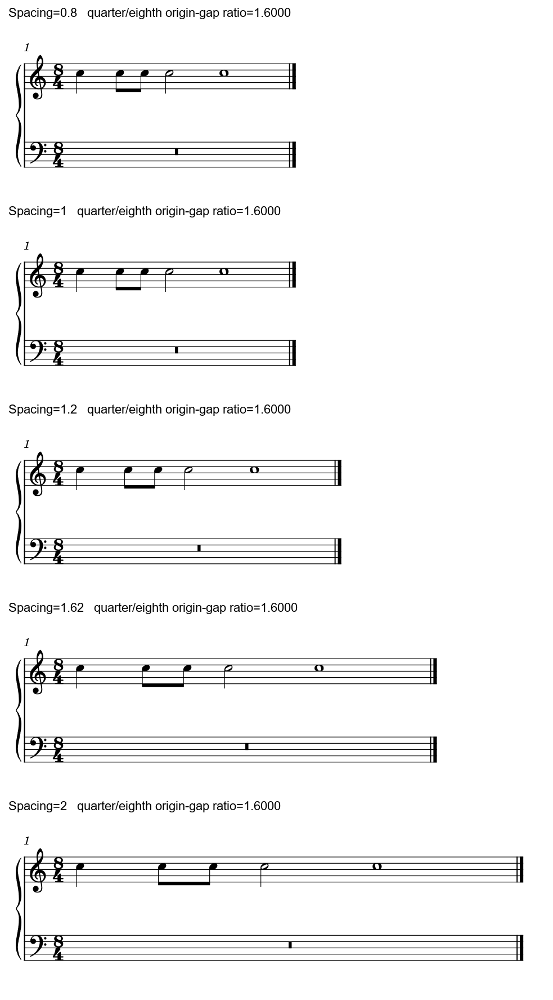

# MuseScore 3排版手册回查：认清调的是哪一层

2026-10-26。**不要把Evolution的Spacing填成1.62，就期待得到另一软件的时值比例。** 本轮五档原生输出中，整体宽度改变，所测四分／八分的间距比始终约1.6。现有调参要分别处理行容量、小节预算、内部时间列和局部符号占位。

这是对既有[联合时间列解释](SPACING_STUDY.md)的操作层补证；没有新增净书候选或软件适配。目录回查30/146（余116）、Gould421/696＝401实质＋20辅助（余275）、资料11/25（余14）保持。R20补读／复核规定正文8/8段，关联图0/14幅、定向源码核对8/8项，整体仍为partial。[来源与原生证据](musescore3_layout_reading_evidence.json)。

## 1. 本轮规定范围与仍缺什么

英文旧入口目前跳到Studio新手册；中文3版和官方[3版连续打印页](https://musescore.org/en/print/book/export/html/278625?toc=1)仍能由网页工具读到。以下按该打印页当前章节定位复核，不能把新手册的菜单或行为套回3。

| 规定正文 | 文字覆盖 | 配图实际查看／规定不同图 |
| --- | ---: | ---: |
| Layout and formatting：概念、样式、命令及各类默认设置 | 完整 | 0/7，含一图在两处出现 |
| Measure and horizontal spacing | 完整 | 0/0 |
| Page settings | 完整 | 0/1 |
| Breaks and spacers | 完整 | 0/2 |
| Frames | 完整 | 0/2 |
| Align elements | 完整 | 0/0 |
| Automatic placement，含Z序表 | 完整 | 0/0 |
| Beams中的Local relayout小节 | 完整 | 0/2 |
| 合计 | **8/8段** | **0/14幅不同图，15处图位置** |

普通HTML请求返回403；十四个官方图链接经网页工具均为Cache miss。保留缺图，不以文字说明、菜单源码或下方自制谱替代官方图的阅读成绩。R20此前笼统的“相关章节及Evolution差异”在本批展开为这份清单，后续补充关联材料另记；没有将整个MuseScore手册算作已读。

手册提供操作入口，净书判断仍须看阅读任务。例如增减小节容量、局部留白、标记偏移和音符重新分组，应当分开提出；遇到界面名称近似，先查实际对象与范围。

## 2. 五档Spacing实际改变了什么

原创CC0钢琴双表、一小节8/4：上表同一C5依次为四分、八分、八分、二分、全音符，下表整小节休止。总计8拍、五次起音，没有引用官谱旋律。固定Leland／Leland Text、1.57mm sp、纸幅及其它样式，只改measureSpacing；末系统不撑满，便于看参数自己的作用。

标签位于谱面之外；五段均来自同一物理比例的原生PNG，只合白底和裁去页内空白，没有拖动或缩放音符。

| 输入Spacing | 小节宽度，MusicXML tenths | 前三个同字形黑头的四分／八分原点距比 |
| ---: | ---: | ---: |
| 0.8，诊断输入 | 434.32 | 1.59999 |
| 1.0 | 434.32 | 1.59999 |
| 1.2 | 507.02 | 1.59999 |
| 1.62 | 659.67 | 1.59999 |
| 2.0 | 797.79 | 1.59996 |

本例1sp对应10tenths；小节宽含谱头，不能当纯音头跨度。比较比率只取前三个相同实心头，避免二分／全音符的字形宽和光学中心混入。0.8与1.0整页原始RGBA完全相同；界面SpinBox最低为1，0.8仅用于核对XML输入的钳制。

**实用结论：Spacing适合改松紧与容量，不能独立指定这条时值空间曲线。** 手册将默认1.2解释成相邻时值的空间倍率，与本机此项实测不符；采用当前输出及下节源码定位。1.2与1.62已分别原生保存、重载，图元、RGBA、完整MIDI及MusicXML除编码日期均保持。五版书面配方与MIDI五个起点另核，完整MIDI彼此相同。

对照[团子大家族的裸主题](INTEGRATED_READING_DANGO_HANEZEVE.md#2-相同主题可以变宽节奏形状仍应熟悉)，其长短空间比也约1.6。这个相近值不能反推出版者用何软件或参数，却提醒我们：先诊断局部哪里失衡。用户关心的另一表中间进入、变音和同值组忽宽忽窄，仍要回到[真实占位](TWENTY_TO_SIX_OCCUPANCY_STUDY.md)及共同时间列，不能用全局“黄金比”代替。

## 3. 为什么调大它只会把本例展开

当前只读源码的[Measure::basicStretch／basicWidth](../../../muse3_dev/MuseScore/libmscore/measure.cpp)将局部userStretch与全局measureSpacing相乘，并将合成值钳到至少1，再参与小节基本宽度。

同文件stretchMeasure对真实相邻时间列采用：

`权重＝1＋0.865617×ln(该列时长／当前最短列时长)`

若最短列为八分，八分、四分、二分、全音符的权重约为1、1.6、2.2、2.8；这是加法增长的对数权重，各级之间没有统一倍率。最低形状占位先进入约束，剩余空间再按弹性分配；紧排、其它层的新列和整行撑满都会影响最终头距。

所以需要区分：

- 小节整体获得多少宽度：全局Spacing、局部stretch、行容量与系统预算。
- 小节内部怎样分给时间列：计量、形状下限及弹性权重。
- 音头相对列的光学位置：干向、二度、不同头型及局部偏移。

这延续了既有1.25倍宽格解释，不是本轮首次发现该公式。此轮增加了五档参数控制与手册的直接核对，避免后续skill把“Spacing=1.62”作为同义操作传给不同软件。

## 4. 八项源码核对：看似相近的操作不能合并

下表记录代码所示范围；除Spacing探针外，本轮没有执行这些重置命令。

| 机制 | 当前源码所示行为 | 用于净书的判断 |
| --- | --- | --- |
| 全局Spacing及内部权重 | basicStretch与stretchMeasure承担不同阶段 | 先判整体预算还是局部形状问题，再选控制 |
| 增减／重置小节stretch | 增减要求范围选区；resetUserStretch从选区段找边界，缺失时回退首／末小节 | 调用前明确范围；“重置”不会保住旧的小节预算 |
| Ctrl+R的reset与resetAllPositions | Ctrl+R走当前编辑对象或选中对象的reset，含各类型重置；Chord会恢复干向，Beam会恢复手动梁形及分配。全谱resetAllPositions另走遍历位置属性的路径 | 清局部偏移、恢复默认干向和重置整谱是不同动作，不能互当快捷清理 |
| Reset Text Style Overrides | 遍历当前score的所有页及TextBase，不按当前小选区过滤；resetProperty再通过TextBase的propertyDefault读取当前对应样式 | 会清局部文字覆盖；手册的“factory”概括不能据此解释为将全局文字样式恢复出厂 |
| 样式／页面重置 | 样式窗口的resetStyle保留pageStyles、concertPitch和长休止开关；内部reset-style动作可遍历全部样式。页面重置作用预览的pageStyles及页码。重置值还来自可加载用户偏好的MScore默认样式 | 按具体按钮／动作判断，不将所有Reset Style叫成同一种出厂恢复 |
| Reset Beams与Regroup Rhythms | 前者将音符BeamMode设AUTO、休止设NONE；后者调用按节奏位置重新组合音休止的函数 | 保留自定义拍组时勿全谱恢复梁；重新分时值属于记法提议 |
| Beam Local relayout | Inspector的DISTRIBUTE进入Beam::layout2，再由respace只改该组内部ChordRest横位置，保组端；没有把其它谱表同一时间的对象一起移动 | 对齐要求存在时不能当共同列优化；本轮未制作这项的新原生前后例 |
| 两种最小小节宽度 | 普通minMeasureWidth与长休止minMMRestWidth是不同Sid、不同UI控件，内置值分别5sp与4sp | 手册Score页的4sp在长休止设置组，不能拿它与普通5sp比较后报默认值冲突 |

代码定位及工作文件哈希见[证据](musescore3_layout_reading_evidence.json)。本轮读到的源码HEAD为0e320db5，固定原生宿主EXE为7b4e6fbf哈希版本，尚未确认二者的构建提交对应；重置命令及撤销行为尚待独立副本运行核查。

## 5. 对后续自动净书的实际要求

现阶段先用已有控制解决看得见的问题：整体太散时比较行容量／预算；必要变音占位先核字形与净空；另一表中间进入造成宽格时，保共同入口再比较局部重分。已有[五连](FIVE_FOUR_SPACING_STUDY.md)和[20对6](TWENTY_TO_SIX_SPACING_STUDY.md)候选继续作为实际判断材料。

将来若需要独立选择时值空间曲线，应把“基准宽度、曲线、符号最低占位、共同列、局部／整行范围”写清楚，并在裸主题、持续背景、密集变音和异分两手中检验。参数或插件不足时再评估最小本体控制；本轮只积累需求，没有改引擎、MCP或插件。

Skill现在可直接应用两点：先说明所调参数实际控制的层次；重置前指出哪些有意排法会被恢复。个别offset、独立声部和手工梁弧都可能保存着净书决定，不能把清掉它们当作已经改善。

## 6. 可复查材料与保护

[原创输入及对照图](fixtures/README.md#全局spacing的五档参数控制)可直接用MuseScore打开研究。五条件四格式共20次导出，1.2／1.62的保存和重载各五次，共30次成功CLI；复用原1936文件运行时，前后哈希保持，没有复制新宿主。实际私有配置目录在运行前已创建，生成的工作区配置另留证。

原PDF、MSCZ、教材和用户GUI未用于本次试验；软件仓库仅只读，已有他任务的修改保留。没有新增官谱或Gould覆盖、用户审美选择、实曲候选、打印／试听或文件删除。手册图待补，完整资源目标继续保持。

2026-10-29补查：官方打印版所连正常／Local relayout／页面设置三个图址仍返回cache miss，未取得图像阅读。R20正文8/8、图0/14保持，资源累计13/25没有增加。[本批记录](konosuba_kuchizuke_closeout_evidence.json)保存三图URL；继续其它可读材料，不把图注或源码当成已看谱图。
