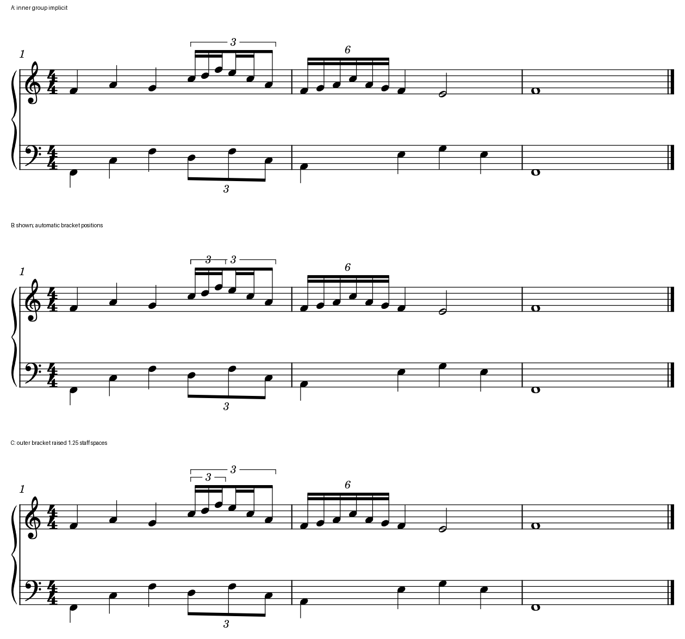

# 嵌套连音：先让两层范围可读，再谈数字省略

2026-10-29。本原创例优先比较C：显示前三音的内层3，并把外层总括号抬到更远的一层。A省略内层数字时，读者需要自行猜层级；B虽补出内层3，宿主自动把两层括号放在同高，起点和横线重叠。C保留主梁和全部音位，把“总分三份”与“第一份再三分”直接画清。

这个试验落实[My Dearest K的嵌套候选](INTEGRATED_READING_DEAREST_HERO.md#2-k的1613和末尾六个头不能都靠一个数字猜)。官谱的原工程层级仍未取得；这里验证的是该推读能否用现有宿主清楚表达。使用独立设计的三小节CC0练习，没有转写参考音乐或改用户原件。

## 为什么只有一个3容易误导

第一小节前三拍为普通四分，最后一拍是外层3:2八分三连。第一份再拆成三个3:2十六分，第二份拆两个普通十六分，第三份保一个八分。以四分为1，最后六个头实际为：

`1/9＋1/9＋1/9＋1/6＋1/6＋1/3＝1`。

只有外层3时，五个十六分和一个八分若全部按单层3:2读，会得到`7/6`拍。把它们改成六个均分音虽凑足一拍，又抹掉三种细分和它们对下方三连八分的关系。下面三个头应分别与上部第1、4、6个头同时；这三个共同列在所有候选中保持。

主梁贯穿六音，次梁分为前三音、接着两音、最后单八分，既保动作连续又提示内部结构。第二小节另放完整6:4十六分六音作控制；它是两个三音的二分结构，与前小节的外层三分不同，继续只留6，不为统一外观加同样两层括线。

Gould《Behind Bars》p213说明混合时值仍按整组最简分割标数，p214说明嵌套层级：空间许可可分置梁的两侧；两层同侧时，总组标记放得更远。p200还要求部分梁的连音范围清楚。本例内层只占主梁前三音，短括号有用；外层围六音并放远，读者便可先认总拍，再读局部细分。

## 三种原生结果

- [A内层省略](fixtures/nested-tuplet-implicit.mscx)：音乐内部已正确嵌套，只隐藏第一内层数字／括号；保留为歧义控制。
- [B补出内层，自动位置](fixtures/nested-tuplet-auto-position.mscx)：只改变该内层的数字和括号显示；两层同高，横线和起点相叠，本例不采用。
- [C外层抬高](fixtures/nested-tuplet-tiered.mscx)：在B基础上只把外层两个端点上移1.25sp；内层靠梁、外层靠外，保所有非连音图元。

C的收益是明确“前三音只属小3、六音共属大3”，代价是上方多占高度。1.25sp只用于这个孤立例；若上方有长弧、指法、另一声部或跨行续组，须在完整上下文重排，不能成为全谱偏移预设。这里没有新增用户审美选择。

## 宿主已经能表达，需要净书判断

当前MuseScore 3 Evolution能显示嵌套数字、括号，并保留端点的局部位置。选择实际连音组，先核内外成员，再显示必要数字／短括号、分开同侧层级即可；不需要改变音符时间或拆主梁。复现字段为外层Tuplet的`p1/p2 y=-1.25`，它们表示谱间单位下的端点偏移。

只读核对本机`libmscore/tuplet.cpp`：587–588行把端点用户偏移加到布局位置，877–880行按谱间读回。固定宿主实际保存／重载保留该值。自动位置在本原创例把内外括号同高的行为已有复现，可作为后续诊断案例；本阶段不做插件、MCP或本体适配，也未确认当前二进制与该源码提交一一对应。

## 核查与可用范围

三版固定Leland、1.57mm谱间、180mm版心、同一三小节上下文，29个书面音／29次攻击。按独立分数配方逐音核对音高拼写、起点、时长、谱表／声部、外内3:2及6:4、主次梁连接；前三音MusicXML合成比例为9:4十六分，恰好各占1/9q。下方三处共同列和全部非Tuplet的带class SVG绘图相同。

三版均做原生保存、重载和再次保存，二次保存字节相同，内外比例、数字、括号与C的端点偏移保持。完整MIDI在三版及重载间逐字节相同；480 PPQ不能精确整除九份，逐音时间另与分数配方比较，具体最大量化误差见[证据](nested_tuplet_scope_evidence.json)。MusicXML只做导出核查，未重新导入，未打印或人类试奏。

最初试制把次梁指令写成宿主不支持的`begin16`，导出仍将前五个十六分连成同一次梁；逐层检查发现后改用实际支持的`begin32`，三版完整重跑。错误探针保留在私有缓存，不列为可采用谱例。共60次成功CLI，其中最终三条件保存／重载30次；复用并前后核1936文件的运行时，没有新增软件副本。

本试验为一个原创情境的3/3条件，不新增官谱、教材或资料覆盖，也不填入用户组合应用的成绩。知识库和skill可直接用它提出“明确层级并检查净空”的建议；Dearest原谱是否确实这样编码、完整比例的首处显示及实曲候选仍待核。
