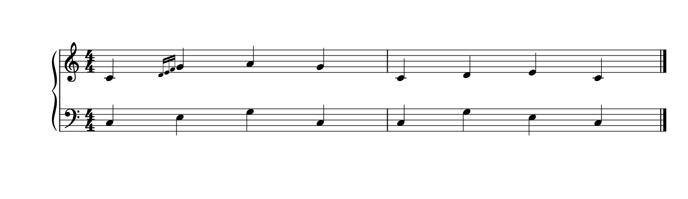
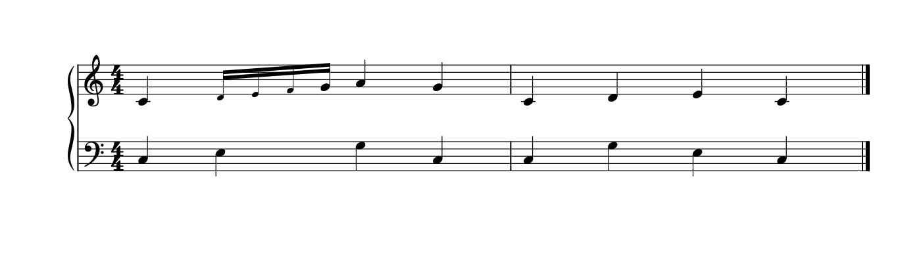

# 看似小的符号，怎样影响读谱和间距

2026-10-27[Legato拉威尔案例](LEGATO_RAVEL_READING.md)：Chabrier m9括起休止仍计满6/8，m37实际9/8而后恢复6/8；方括休止、手名／角形和连音各有对象。复杂7／8完整比例与编辑增补来源仍须底本校勘，不由括号或普通默认比例重建播放。

2026-10-22[Mixed Nuts整曲复读](INTEGRATED_READING_MIXED_NUTS.md)补节奏拼写的条件：熟悉的长值可保持简洁，B／F的第三拍tie接收头又有定位用途，不能按少头／少弧批量合并。末小节的两个5连组与局部8va须分读；完整小节和旗梁细图纠正了旧笔记的“8组”误读。2026-10-23补入本专题，使skill的`notation`入口可直接追到该案例；没有新增原生改谱或播放验证。

2026-10-21补[MPA图例复核](MPA_READING.md)：先核符号身份、覆盖整小节的条件和作品脚注，再选资料中适用的建议；一般概括、专章例外及出版体例分歧不能合并成一套无条件规则。本批只读，没有新的原生候选或软件适配。

2026-10-20补看Gould p229完整图文：跨多个值的双音震音可用整组slur避免逐对tie的复杂并指示不重新强调；三音以上震音的书写值与位置又有专门条件，不把它按普通顺次起音读。此处仅补规范阅读，没有新增三音震音原生验证；与反复章及Slur实际功能的联系见[REPEAT_NAVIGATION](REPEAT_NAVIGATION.md)。

滑奏另见[端点、方向与线形](GLISSANDO_READING.md)：gliss.、特殊头和键集合共同说明动作，直／波线与实际声音分读；含用户m113私有副本的原生备选及实际交换分类差异。

颤音另见[范围、辅助音与续行](TRILL_READING.md)：小辅助头与起止grace、波线与tie、连续与重奏要分类；含官谱条件及原生提前收线拒绝例，不把缩短黑线当无语义的美化。

最初2026-10-18读取印刷p54–58、78–84、200–202完整图文15页；以下各节另记后续范围。2026-10-20新增第11节震音省写、时值与同步，补Gould p219–228完整图文及原创原生对照。该主PDF的已核页码为印刷页码加20；原书／图页不入Git。以下按本项目用途归纳，书中建议、阅读解释和软件实测分别记录。

## 1. 附点：既要贴近，也不能像属于旁边那个音

普通音在线上时，时值附点一般落到上方间；音在间里，附点与它在同一间。加线音仍遵循这一关系。和弦的附点通常形成一列，但二度密集和弦、两个独立声部不能简单地把所有点拖成一列。

读者需要直接看出“哪个音延长了一半”。因此p55–58反复处理归属：另一声部的头或干不能插在附点和所属音之间；若只有一个声部带点，有时必须给两个声部留出额外横向距离。这个距离有语义上的阅读用途，不能因为符头不齐就消掉。

| 情况 | 可用做法及理由 | 容易犯的错 |
| --- | --- | --- |
| 带旗尾的上干音遮住附点，p55 | 附点放到旗尾右侧，或适度延长符干；先保证点能辨认 | 为追求统一X，把点藏进旗尾；或全谱无差别加大附点距离 |
| 二度和弦，p55–56 | 附点分占不同谱间，尽量围绕和弦，而非全部向外堆；各点仍是一列 | 将两个点并排放在同一高度，读者会把它读成复附点 |
| 很密的连续二度和弦，p56 | 书中允许只保留覆盖该和弦所占谱间的点，避免点远离和弦两间以上 | 以图形点数少于逻辑音符数就判漏记；也不能因此自动删除工程中的时值信息 |
| 两声部都带点，p56–57 | 可共用紧凑的附点列；某些上下文也允许各自贴近 | 把“允许共列”推广成所有多声部都必须共列 |
| 仅一声部带点，p56–58 | 点应贴近其头，避开另一声部的头和干；必要时改变同拍内错列 | 为节省宽度，将点放在另一声部后面，造成延长谁的歧义 |
| 共头同音、两部均带点，p58 | 同一个可见音头只需一个时值附点 | 依照软件有两个voice就强画两个相邻点，让单附点变成复附点 |

p54说传统时值附点通常比断奏点大，这是辨识线索，不是给所有字体强设两倍直径的理由。p57还提醒：附点落在邻近低音头上方时可能像断奏，某些版本改同拍内错列来澄清。净书诊断需要同时看点的角色、归属和周围图形。

应用到自动化：先读取实际时值、voice、共享头/错头关系，再检查图形；几何警告应描述“点可能被误归属”，不能只报距离小。后续[同音附点](UNISON_DOTS_STUDY.md)及[二度归属](SECONDS_OWNERSHIP.md)已补部分原生条件对照，尚不能列作所有附点情境或已证实的通用软件缺陷。

## 2. 变音：演奏者的短期记忆也占排版空间

2026-10-20后续[提示变音与实际来路](ACCIDENTAL_CONTEXT.md)复读p80–84并补换调／反复图文，将A008、A005、A047与原创六小节连接。新行tie补普通升号后，后续自动升号会省去，音高不变；不能只检查插入点。已补行中／跨行tie和简单反复起点，跨谱表、八度线、装饰音及复杂结尾的成套原生处理仍未验证。

p78–84不只讨论变音离符头多远，还讨论读者必须记住多久、跨了什么边界。多写提示能减少回看，但也会增加空间需求；删掉提示可能让版面变窄，却增加猜测。

### 先弄清读者该记住什么

- p78–79：同小节内的变音与书写音高、八度、谱号和谱表有关。书中建议换谱号、换八度或移到另一谱表时重新确认；仅在同一谱表换手，不因此重新写一个。单人键盘在同一谱表的各声部共享变音影响，不按软件voice编号各自重新开始。
- p79–80：多个演奏者共用一谱表是另一情境。书中要求各部确认，兼顾分谱抽取与各人独立读谱。不能将这个规则机械套给独奏钢琴的多voice。
- p80：延音跨小节只保护被延住的那次发音；新小节后续重新奏出的同音，需要明确其变音。换行后的延音首音可以加提示，密集延音和弦则可能因新增符号过多而更难读。
- p81–82：小节线会重置通常的变音记忆，但紧接着重复该音，仍宜明确确认/取消，以免读者怀疑漏印。隔几小节、换八度、长的半音化小节或易误认的增减音程，也可能需要提示。等音重新拼写可改变是否需要重复的判断。
- p84：装饰音与正常音不是两个独立的变音世界；两边可能需要确认/取消。装饰记号中的辅助音与后续正常音也需要相互核对，不能只检查可见主音头。

这些规则服务于阅读确认。与它们不一致的版面未必音高数据有错；提出建议时要说清是音高错误、提示不足还是出版社选择。Gould的某些确认惯例不能冒充所有出版体系统一采用的唯一规则。

### 为什么提示变音不宜全部加括号

p83的正反例说明：少量提示用圆括号可以表明提醒身份，密集提示全部加括号会打断间距，也降低字形辨识。书中给出统一不用圆括号的做法；横向空间受限时，还展示把**提示性**变音放到音符上方的替代。必要变音不能按这个办法随意移走。方括号又有编辑增补的含义，不能只因“方括号好看”而换。

对应开发方向：提示判定与符号排布分成两步。先解释为什么需要该提示，再比较括号、普通提示或原样的可读性和占宽；不能为压缩间距无声地删除它。新增/删去提示属于编辑建议，应与纯几何调整分开。需要在自制fixture核查当前宿主的小节线、延音、谱号、八度线、跨谱表和装饰音处理后，才列最小改进。

## 3. 连音：先确定比例和范围，再谈等距与括号

p200–202给出了三个不同问题，不能混在一起：

1. **范围是否清楚。** 整个连音组由同一梁清楚包住、数字贴近时，可以省括号；只有一条长梁的一部分属于该连音时，括号应澄清边界。遇到混合时值等歧义，即便全组有梁也可能保留括号。休止被梁覆盖到完整拍的例子也在p200，不能只凭“有休止”决定加不加。
2. **真实同步位置。** 三对五等比例先用共同细分核对：同一跨度内，三连音起点为0、5、10，五连音为0、3、6、9、12，共同跨度15。混合时值则将每组折成其最短单位再求公倍数，不能按可见音头数量平均分配。
3. **图形空间如何取舍。** p200明确允许为了复杂部的可读性，使另一部的同值间距变化。p201的对齐表和p202的网格用于理解时间关系，不代表成品谱所有空白都必须线性对应时间，也不取消符号占宽、光学补偿和p39–43的传统压缩时值空间。

与实际谱例的联系：A006《lit》变奏p2的五/六连交替、p4的七连和三连伴奏，说明需要分别识别组边界、真实比例和持音层；A004《The Ultimate Price》p2末系统的18连运行，也不能只按一个“18”或最短音值估算全小节的视觉密度。具体位置见[逐谱笔记](corpus/READING_001.md)。未从PDF反推软件内部tuplet层级。

对现有间距研究的补充：原生极简谱的25%变幅仍是待比较的候选问题。复杂部需要空间，有时确实值得牺牲另一层完全均匀；应比较这个牺牲是否必要、能否更小，不能从“规范允许”直接推出默认结果最优。

## 4. 不接另一音头的弧线，不一定是断了

由A021《Bloody Stream》p4 F的开放弧尾引出，本轮另完整看过主书印刷p72–73（PDF p92–93）的2页图文。Gould区分普通完整tie、延伸到休止/小节边界的保持提示、短开放弧和l.v.自然共鸣，不能统一“修复”成两音头相连。

短开放弧可说明超出所记时值的持续；l.v.强调不制止自然余响，并不自动要求手指按住。p72同时不推荐把两端短弧常规用作完整tie的替代，因持续去向不够清楚，只有其它方案不实际时才考虑。p73又提醒钢琴若踏板已清楚表示共鸣，往往不需把整个响声写成持续音符和弧线；钢琴章p337讨论持键等例外。

因此同样一条短弧可能需要保留，也可能值得改写。判断顺序应是：它表示哪种持续、是否有踏板/手保持条件、读者能否知道何时重新发音或释放，再比较外观。不能把“书中提供这种表示”泛化为参考谱的所有开放弧都最优，也不能仅凭PDF没有接收头就报损坏。官谱原工程未提供，当前只保留其图形事实与待确认含义。

自动化保护：读取tie类型、真实持续、声部和踏板关系；未知时只标记疑点。替换成完整时值或补接同音属于记法/编辑建议，不能混入移动弧线的纯几何操作。定位见[逐谱四](corpus/READING_004.md)。

## 5. 连音数字不是完整的时值数据

2026-10-20后续补齐p208–209表图，并在[连音原生应用](TUPLET_READING.md)核对嵌套3:2／5:4：内层各音合成时长为2/15个四分音符，导出time-modification是15:8，不能再按头数或将比例重复相乘。省重复数字、变化处恢复和外层括号分离均已有原创受控情境；未将未知PDF分母自动补定。

2026-10-19完整看过印刷p203–207（PDF p223–227）5页。由A064的复合拍11组、A074的节奏解释等式和A081 p5上6/下5触发复核，不能仅看到一个数字就推断它占一拍。

Gould p203–204倾向采用方向一致的收缩比例，使读者不必临场判断“这个十三更接近八还是十六”；若采用扩张比例，建议写完整比例。p204–206同时保留复合拍二连/四连的传统例外及附点记法的替代，不是所有谱都套一张普通拍号换算表。选择哪套惯例后要保持上下文一致，避免更短的图形音值反而看起来演奏更慢。

p205的区别尤其容易被机器误改：用附点音值直接表示复合拍的二分可以成立；在已经自足的传统二连/四连上再给每音加相同附点则是另一个问题。不能以“附点多不好看”统一删点，更不能把二连数字和附点当可互换的字形装饰。需要实际比例、基准音值、总跨度和上下文惯例。

p207对非标准跨度、复合拍歧义或混合音值不明显的组，建议明确比例；整小节等分等清楚情境又可能不必写全。数字、括号和音值各提供一部分线索。参考PDF只印一个5或11时，先利用拍号、其它声部和相邻组核算；无法唯一确定就保留未知，不立即判漏记或自动补比值。

这影响净书：增加说明可能让阅读更确定，也会占空间；省略说明能减少杂乱，但前提是读者无需猜。后续工程审计应读取完整tuplet层级/比例，再评价括号范围、重复数字与间距。重写比例、改音值或更换拍号属于记法建议，不能混进纯几何美化。嵌套/混合音值后续p208以后仍未完整核查。

## 6. 装饰音：拍点、对齐和局部弧线的取舍

2026-10-23[My Dearest十页复读](INTEGRATED_READING_MY_DEAREST.md)复核本节星号组，已有结论和原生验证不重复算新成果。新增P段正常快音／11组与装饰约定的对照：有计量跨度的异分应找真正汇合点，拍上小音的显示顺序又按本谱说明读；S不同进入的力度不按共同末点的规则吸齐。

2026-10-19由A092 p5明确的拍内装饰脚注，完整看过主书印刷p128–130（PDF p148–150）3页。这补足此前只读p125–127时未覆盖的演奏时点与弧线条件；p128首段接前页、p130力度段接后页，本文不声称读完其前后所有内容。

p128区分读者任务：独奏乐器的多谱表应保护正确竖向关系，避免一名演奏者误读两手；同谱表两部的装饰也应对齐。分开谱表的不同乐器则可按情境把装饰组收近各自主音，避免为严格对齐造成巨大孔洞。不能把总谱允许的光学折衷直接套给钢琴两手。该条件正好解释为何“装饰都挤到主音旁边”不是通用算法。

拍内或拍前若不明显，应明确说明；写在小节线之前只明确首拍前的情境，不能解决所有拍。p129允许用有说明的重音等方式区分，也可写成确切节奏或接入有时值音。它们是记法选择，会影响演奏理解，不能当普通offset替换。A092脚注因此是比“小字形/靠近哪个音”更强的依据。

p129–130对装饰slur的要求也服务归属：接到解决装饰的目标音，避开加线和必要变音；两声部时弧向外以免串层。长句中给每个装饰组独立短弧能增强边界，也允许只含在大弧里来减少繁杂，但可辨性会下降。这是规范内的取舍，不能用“短弧数量越少越好”或“每组必须补弧”一刀切。缩小的奏法符号也须仍可看清。

后续诊断先读脚注/全局说明、组起点/目标、所属手和另一层同步，再提出几何候选。力度位置可能按主音或装饰组作不同选择，不能单从文字X坐标推断唯一演奏时点；相邻谱例和工程仍需核查。

### 2026-10-20续学：图形在前、拍上开始、正常音列对齐可以同时成立

本次完整复读并看印刷p125–131／PDF p145–151，补此前p126–127仅文字或部分图的缺口，也接完p130–131的力度段与谱例；p131后半为已读琶音设计的图文复核，不据此宣称全部装饰／琶音／颤音情境已掌握。[证据](grace_reading_evidence.json)记录参考、宿主、具体核对和原创样例。

**先把小音写得可认，再判断它是否在拍前。** p125推荐多音装饰组用两层梁减少繁杂，也承认三层／更多层的出版惯例；这里的梁数不能直接换算为实际发音时长。p126要求斜杠穿旗／梁而不撞头，干、旗／梁与斜杠之间尽量露白；加线处要有足够干长，避免斜杠把加线抹黑。它解释了紧密处为什么会糊：即使音乐字体本身漂亮，缩小后几根笔画的关系仍可能不清。一般上干有多声部和特殊连接例外，不按小头的高低机械翻干，也不把书中约2¼sp干长当所有情境的硬上限。本轮没有为这些几何条件制作全部原生候选。

**小节线的左／右与演奏先后是不同判断。** p127通常把首拍前的装饰写在小节线后；拍上弹的应在线后，较长且明确拍前的组可放线前，避免把下一小节首拍推得太远。trill／tremolo的收尾小音另有在线前结束的用途。因此，不能把线后小音都理解为占拍，也不能为了贴近目标就把上一音的收尾搬进下一小节。先认准备／收尾及归属，再看位置与留白。

**A092《My Dearest》p5第四系统第二小节的星号组，是很明确的阅读例。** 页脚要求这组装饰在拍上开始；高分辨率复看整小节可见，三个小音仍在主音左边，下面的正常低音对齐正常主音列，而非第一个小头。印图是有约定的记谱，不是将所有声音起点按X画成时间线。保持这种对齐能让两手沿正常拍网找位置，脚注另说明弹奏。不能为“模拟实际同时”把低音挪到首个小头下；这会损坏原有计量列。星号所指组的说明也不能自动扩大为全曲所有装饰、颤音收尾或任意小字形的精确范围。

**A106《Sadness and Sorrow》p1开头**也把小音群与正常震音端点分开，后者和下部计量层相参照；但未从此页得到与A092同样的明确拍上脚注，不移植其演奏结论。**A027《Call of Silence》p4 F**则有大量缩小运行、不同连音数字与独立长干层，不能因小头就当作不占拍的装饰。它仍缺原工程，具体对象身份和完整比例待核；这里得到的是分类必要性，不是假定已经读出内部编码。

p130–131的力度例也解释了为什么不能统一按主音X吸齐文字：力度可按正常主音居中，装饰组有独立强弱时应分别说明；长组把力度放首个小音下会更醒目，提醒读者从开始就执行。这是归属／可见性的选择，不表示文字X独自编码了精确起音。此处没有制作新的力度候选，不把该条件自动应用到已有工程。

### 原创原生例：十九个音、小节都够拍，仍可能改错音乐

原创两小节4/4双谱表，固定Leland／Leland Text、spatium 1.57mm、相同A4满行宽度预算；满行控制仅隔离条件，不是稀疏终行预设。m1上部先C4四分，在第二拍G4四分前写D4／E4／F4三个grace16，后接A4、G4四分；下部四个普通四分。m2为普通上下四分参照。没有设置拍上文字或新的显式播放模式，也不拿这段未配装饰slur的分类练习当完整出版模板。

保留真实装饰身份与正常主音列：

反例把三个小音改成缩小的普通十六分，又把G4缩成十六分，让小节仍合4拍：

两版都有19个音头、19个MIDI起音，每表每小节都占4拍，三个小头在当前宿主的实际缩放也同为正常头的0.7。第一版是16个计量音加3个装饰，后者在原生／MusicXML计量游标中不另推进，却仍有真实播放时长；反例是19个计量音，D／E／F／G明确各占¼个四分。音头总数、小节和与尺寸都不能证明音乐保持。

按独立配方核对原生与MusicXML：原版G4的逻辑位置是小节起算1个四分；反例变为7/4，书写时长从1变1/4。实导MIDI也不同。在当前固定宿主、默认输入的实际导出中，D4与低音E3在第480 tick同起，G4延到667 tick（PPQ=480）；纸面G4与低音E3的正常头列仍对齐。这不是所有版本或所有grace类型都采用同一时长的证明，未据此指定参考谱播放。保留版原生保存重载后，三小音的身份／目标、计量事件、SVG除标题、PNG像素、完整MusicXML与MIDI均保持；反例不作为等价美化，也未冒称做过它的重载。

对齐还要量对轴。两版八个上下共同计量拍点的**头中心**均对齐；反例第二拍上头较小，其绘制原点比下方普通头右约4.338 SVG单位，中心却只差导出舍入量。不能因原点不同再强吸齐，否则会新造偏移。这个同字形缩放例可量头中心，不替代二度和弦的正常侧判断。两版全部StaffLines和页面尺寸相同，其它音列随记法重新分配；图只合白底、同框裁去页边，未缩放／移动符号。

### 交换格式也要区分“大小”与“身份”

本次原版输出三个`<grace/>`且无计量duration；反例输出普通duration及`<type size="cue">16th</type>`，没有`<cue>`，这些小音仍实际播放。MusicXML官方将[grace身份及可选演奏属性](https://www.w3.org/2021/06/musicxml40/musicxml-reference/elements/grace/)、[type图形与size](https://www.w3.org/2021/06/musicxml40/musicxml-reference/elements/type/)和[无播放的cue身份](https://www.w3.org/2021/06/musicxml40/musicxml-reference/elements/cue/)分别定义；`size="cue"`不能独自当静音提示音或装饰音。

当前三个`<grace/>`没有steal-time／make-time属性，不能仅凭这份输出重建刚才测得的精确播放起点；格式有表达相关属性的能力，不等于本输出已经写入。本轮未做其MusicXML播放往返，不泛称格式不支持。未来诊断需要分别保存原生类型与目标、书写／计量时值、before／after或收尾角色、显示顺序及实际播放；未知处保留，而不是从尺寸或offset猜。当前实例的自动对齐已有合理理由，未从它发现需修复的排版缺陷，本次不开发适配。

## 7. 连音怎样让拍子可读，又不破坏流动感

2026-10-20[实际续学](TUPLET_READING.md)复看p213–215，并补前轮缺少的p208–209全图；原创四小节保留变化处和嵌套标记，只省重复小节的四个3，再用外层p1／p2分开穿过内层5的括号。所有非Tuplet图元、精确时值及完整MIDI保持，候选原生重载稳定；全隐藏版作为拒绝例。下面2026-10-19的未读范围是当时记录，当前p208–209缺口已补，仍不等于任意连音情境已验收。

2026-10-19，Gould印刷p210–215／本地PDF p230–235六页正文及图全部查看；本轮未完整查看p208–209图表，不能称连音章全读。

- **揭示拍点有收益也有代价（p210）。** 慢速或需要精确合奏时，可把长连音拆分/加tie以显露所需拍点；连续不拆则强调流动线条。前者易数，但可能诱发无意重音/顿挫；需要时用连奏/流动文字补偿。它说明更明确的拍网并非总是更好，记法候选应解释演奏取舍。
- **跨小节线的连续组仍须精确放时点（p210–211）。** 可以用不断梁/括号跨线，第二小节首个实际音未必在小节起点。按拆分等价读法核对，不能为左右对齐将其吸到小节线上；拍点必须明显时可提出拆分方案。
- **组内休止不是一律合并或一律展开（p211）。** 保留分割有助于数较长组；非常短的组可以合并休止，减少一串碎符号。这是按读数任务选择，不是单纯最少符号原则；A116 p6含休止括号可作实践入口。
- **内梁断点是节奏信息（p211–213）。** 单梁组通常各tuplets分开；多梁可以主梁相连、内梁按组断开。Gould用三分大组内再二分与两个三音组的6区分重音结构，混合时值数字按全组最小倍数表示。仅数六个头不足以决定写3、6、两组3或如何断副梁；A102、A110的连续组需保留层级，不能为了平整抹掉断点。
- **嵌套组须显示谁包谁（p213–214）。** 外层完整括号，空间合适时内外分置两侧；同侧则外层离音组更远，且与相邻同类标记方向一致。九个音也可以在不需内部重音时写单独9组，但这不是所有嵌套三连的通用替换。以后诊断先读嵌套结构，再看外框碰撞；目前官谱尚未选定可编辑嵌套验收例。
- **省略重复数字有条件（p215）。** 完全相同的节奏型建立一两小节且分组清楚后可省；复杂总谱为方便指挥看对齐宜持续显示，也可加sim.。A116 p1符合值得研究的省写情境，但不能由PDF推定所有未印数字处的工程比例。自动化可提出显示策略，不通过删除真实tuplet来实现简洁。

候选应保留音高、实际时长、共同拍点和嵌套总时长，分别比较显拍程度、流动感和标记负担。拆/合时值、改变分组重音属于记法建议，应与纯坐标/间距调整分开。

## 8. 对齐哪一侧，以及文字怎样不丢归属

2026-10-19完整看主书印刷p491–494／PDF p511–514四页图文；p491开头承接此前已读p490。这里将总谱/演奏说明的一般原则用于钢琴时，仍须结合钢琴章的声部和手分配条件。

**二度和弦不以整个外框中心对齐（p491）。** 同时发声时，按每根干正常一侧的符头建立对齐，错到另一侧的相邻头突出在列外；全音符参照假想干处理。若为了让两手二度的整对头对称而移动整个和弦，会破坏它与另一部的同步提示。自动测量应先识别正常头、错头和逻辑时点，不对每个和弦外框中心强拉一条线。这给用户所说的“两手对齐导致不均匀”增加一种必须排除的视觉原因；后续已用既有密集原创谱作[原生核查](ACCIDENTAL_SPACING.md#4-二度和弦的外框中心会制造假的不齐)，不代表所有交叠部情境。

**文字层次服务识别（p491–493）。** 速度、表情、技术说明有不同字重/字态惯例，也允许按上下文选更易辨的方式；长说明先置前言或同页脚注，短说明靠实际受影响的音。多条同时开始时可堆叠，必要时提前利用休止区，不能因横排过长使读者误以为后面的词从后几个音才生效。跨度虚线与过渡箭头又表达不同事情。A124的non legato与non Ped.、A143的1/2 Ped.应按作用分别处理，不能只排成同一行。

**simile有省写收益，也有回看成本（p494）。** 教材建议别让sim.在系统开头迫使读者回找，并反对用它替代整段反复力度或分句标记。官谱中A136开始几次斜线后simile、A140 legato simile是可讨论的局部省写，不能升级为“相似处都删标记”。新符号应有清楚说明且功能一致；偶发技术通常写简短文字比造一套符号更易记。这是后续简洁化候选的限制，不自动改参考谱或用户记法。

## 9. 共头附点与分离附点是在解释声部，不是数点

2026-10-19补读完整印刷p59、复看p60上半的续文与全页；连同此前p54–58，补足同音双部带点的条件。各点是否要分开，取决于可见头、时值和归属，不等于软件里有几个voice。

同音全音符的双部需要两个头，各自带点；不同时值通常也各在自己的头旁带点，拥挤时有更紧的替代。只有一部带点时，键盘重复型等清楚情境允许共头，但两种节奏必须一眼可辨；有歧义时分头更明确。不能为少占宽度，就把所有同音或近邻头合并。

分头也不只有一个横向顺序：上部在左是通常安排；无点部在左可以使两头靠近；带点部在左则用点隔开两头，强调只有左边的部带点。p60的加线例又区分：若前面的头带点，应分开两头的加线；若只有后面的头带点，加线可以连续。这里的间距和线段是在提示“点延长谁”，不能作为无意义的空隙抹掉。

后续已在[同音附点专题](UNISON_DOTS_STUDY.md)用用户副本与原创三版补原生情境：选择性共头和全部共头的MIDI相同，明确程度仍有取舍；密集二度只有一部带点等尚未覆盖，不声称发现相关软件缺陷。p85–92的变音制度、字形嵌排、交叠部、变化同音与调号，以及四条件原生实验，见[变音与间距专题](ACCIDENTAL_SPACING.md)；其无附点结果仍不能代替本节检验。

## 10. 交叠二度：哪一部带点，决定空白的用途

[二度归属专题](SECONDS_OWNERSHIP.md)随后补普通／交叠、单部／双部带点的八小节原生情境：m2上干A4比下干B4低一度，只有A4带点，候选将它置左、点隔开两部。m1普通高低关系却保留带点部在右，m4交叠的下干B4则让点在上方间，m5／6双部带点保留紧凑共列。它们解释为什么不能统一换列或只调一个dotNoteDistance。

29音、19附点、MusicXML和MIDI及候选保存重载已核查；只是这些单音双部的情境，多音密集和弦、快速旗尾、不同大小字头仍须另核。m7／8补变化同音自动样张，斜接／分叉干候选未完成。另从用户副本读到调音`tuning=10`导出小数alter的实际例，纯净书不能按异常变音去改音高。详细依据和宿主切换记录见该专题。

## 11. 震音的省写、时值与同步

其它新读记法见[小音符、替代方案与提示声部](EDITORIAL_ALTERNATIVES.md)：Gould p495–498的ossia、playing cue及主线提示不能靠字号或括号外形互相识别；它们不是震音或本轮官谱新增实例，按实际问题另读。

2026-10-20完整读并逐页看Gould印刷p219–228／PDF p239–248，补p223–224此前未完整核的图文和p228续文。复看A106 p1／2、A113 p7由原PDF渲染的缓存图；定向复核不增加历史379页官谱近读计数。书例、官谱和用户音乐均不复制入Git；原创输入与保护哈希见[tremolo_reading_evidence.json](tremolo_reading_evidence.json)。

### 从读者任务决定写全还是缩写

单音震音重复一个音／和弦，两音震音在两个音／和弦间交替；两者都可能有节制或无节制。单音斜划还须合读已有梁／旗：每多一个已有梁层，需要的斜划就少一层，不能只数斜划判细分。连音重复的数字又按整个被缩写音值解释，首次宜写全；这些是谱面惯例，本轮未用带旗／连音原生例验证宿主映射。

**缩写适合已经明确的长重复。** p223–224建议孤立短型写全，首次有节制快重复先交代拍内细分，必要时文字确认；自由重复则保留缩写。三划经常提示自由快速重复，具体解释仍须读速度／文字／上下文，不将全部转换为严格三十二分，也不把两划一律解释成自由。A106 p1明确写tremolo，上部两音交替和下部写出的六连运行承担不同任务；第一小节四个二分音头组成两对，每对占二分时长，不能加成八拍。p2 C再用tremolo quasi shamisen、小装饰及单音重复改变触键形象，不宜用普通梁整理器统一。

**省写还会改变视觉层次。** A113 p7 J的sotto voce下部用全音符端点与紧凑悬空梁，保留交替音域、持续块和弧的范围，让上部慢线更显眼；随后有干／附点和弦与写出的运行又给出具体动作。阅读收益是减少重复解码、突出角色，这属于本研究的解释。代价是读者要认得缩写并知道进入／结束；有独立旋律或细分变化时，写全有更明确的轨迹。不能为降低黑度将主题也缩写；PDF不提供这些组的精确播放速率或内部voice。

### 线的重量与边界也有条件

p221–223的单音短划通常略细于普通梁，保持谱线间白缝、离头至少相应净空，且不应混成加线或挡住已有旗／梁；带梁组也存在允许等粗、随梁平行的版式。不能把其中一种风格变成所有版本的硬错误。p225–228两音连接则用普通梁重量，可依二分音符样式附干／悬空；全音符按假想干定位，过宽时可对称缩短以免笨重，前提仍能辨清端点并避开头／加线。

一条全局线宽不能独立替代这些分类判断。当前只读源码中的tremoloLineWidth同时进入两类形状，不能仅为单音短划套较细值而默认两音连接也应同减；是否要分别控制留待实际需求。p225自由震音间同音tie可表示避免后拍再加重音，不能简单等同停止重复的普通持键；p228的slur有奏法与乐器条件，也不授权给每个钢琴两音震音自动加弧。本轮尚未做这些连接／奏法的原生例。

### 逻辑中点应与另一手对拍，梁可以另选长度

p227要求第二端点在整组时长的**逻辑一半**，不是图面几何中点。原创三小节4/4双谱表，固定Leland／Leland Text、spatium 1.57mm、A4同预算：m1上部先写16个C5／G5交替十六分，m2缩成两个全音符端点的c16，m3单音C5的r16；文字明确有节制十六分。下部m2前两拍四分、后两拍八个十六分，其余小节四分。37个书写头、2个真实震音对象、无真实Tuplet；实际播放有66个起音，不按符头数估计重复次数。

| 版本 | 读法判断 | 原生结果 |
| --- | --- | --- |
| [保留时间列](fixtures/tremolo-reading-source.mscx)／[图](fixtures/tremolo-reading-source.png) | 原版有效。m2第二头在可用横区间约35.8%，却与下部第三拍正确对齐；不是需要修的偏心 | 两个whole的实际slot各2个四分，总4拍；不能按durationType各算4拍 |
| [短梁备选](fixtures/tremolo-shorter-strokes.mscx)／[图](fixtures/tremolo-shorter-strokes.png) | 条件性背景风格选项：减轻长条黑度，同时保住端点与时序；不宣称原版丑或0.38最优 | 仅Style/tremoloStrokeLengthMultiplier=0.38；两音连接宽约6.95→4.26sp、中心保持，单音斜划与全部其它SVG图元不变 |
| [几何居中拒绝版](fixtures/tremolo-visual-midpoint-rejected.mscx)／[图](fixtures/tremolo-visual-midpoint-rejected.png) | 拒绝：将第二头移到首音列与小节右界的几何中点，破坏第三拍对应 | 仅第二Chord offset x≈4.431sp；完整MIDI与原版一致，头却偏离该时间列约4.431sp，不能称同样可读 |

两个修改都能逆回原XML；三版实际事件／时长、全部MIDI保持。全音符与实心头宽度不同，原点相差约2.14 SVG单位，但真实墨迹中心在舍入容差内对齐，不能用原点制造另一个“不齐”。短梁版另经原生保存重载，参数、类型／实际时值、SVG除标题说明、PNG像素、MusicXML和完整MIDI保持。全局0.38只在此输入验证，未比较密集／跨表／不同方向全部类型，未设为用户预设；没有新增界面或MCP能力。

### 交换与播放核查须分别下结论

[MusicXML 4.0一手定义](https://www.w3.org/2021/06/musicxml40/musicxml-reference/elements/tremolo/)区分single与start／stop；两音震音每端实际duration为书面type的一半，并配2:1 time-modification。**实际duration已经折算**，不能再乘一次比例，也不能因此在工程新建真实二连音。本例实际导出／重导入保住c16／r16、whole及1/2 slot，没有多出Tuplet；普通／短梁两份MusicXML甚至逐字节相同，0.38没有由它承载。导回图面恢复默认梁长且布局变化，不能据记法保持推断几何保持。格式中的unmeasured／0还涉及专用字形表示，不按纸面三划机械替换该标签。

重导入的66个正力度NoteOn及速度事件保持，66个NoteOff却均改变，另增gateTime=95等乐器默认、CC／pan也变化；完整MIDI不同，不将这些附加变化归咎于震音身份。固定宿主原输入m3 r16的间隔又实测119 tick，而非理想120；三版及原生重载均保留。当前rendermidi.cpp普通单音分支以整数l=1000/16得到62，再按整音1920tick缩放，预测3840+floor(1920×62×i/1000)，恰好匹配16个起点；这是有源码支持的量化解释，二进制与该提交的构建对应仍未证明。不由它推断作者要自由震音，也不改源时值掩盖。精确听感／打印、带旗／附点／连音／跨表震音及复杂连接仍待后续情境；本轮没有修改软件、本体或用户工程。

2026-10-22[unravel实曲续读](INTEGRATED_READING_RUMBLING_UNRAVEL.md)将p4第三系统的两音震音与随后写出的下降分开：两个二分端点占前两拍，十六个三十二分位置占后两拍，末四个跨到下表。三划本身没有证明实际演奏／播放速率；缩写重复与写出变化各有用途，不能把每个二分端点都按两拍累加，或为省黑度把变化路径一起缩掉。本轮只是PDF整曲阅读，不是新的原生／交换验证。

## 2026-10-24：震音局部放回全曲

[Sadness and Sorrow八页](INTEGRATED_READING_SADNESS.md)完整复读后，二音交替、C单音重复、F／I写出跨表变化及L的长旋律叠重复和弦分别保留。p4 m86未带斜划的全音符八度与m87重启重复不是同一状态；K改6/8／附点四分58，不能沿用引子四分64。P m157较大的上层等待与小3组首休止分开，Q的sfz→mf→ff又有先后。

复看Gould p223–229完整图文，沿用已有逻辑中点／短梁原生研究，没有重跑或将0.38套为官谱参数。Q后段重复转长连接的音响／工程仍有未知，不用长震音slur建议替掉所有tie。新的[cue续学](EDITORIAL_ALTERNATIVES.md)只在明确提示角色下使用，不把本曲装饰音或小字直接当不播放提示。

2026-10-24[Sincerely整曲](INTEGRATED_READING_SINCERELY.md)把J两音震音的共同持续、后续有干／局部持续、m200写出3／5／6和m201 pesante分开读；尾声又明确N的ppp与末行ff→fff。复看Gould p223–225、229，保留technique边界和跨值slur，不凭三条连接推精确播放速率。下表休止与开放共鸣弧仍可共存；r.h.指向的局部低音也不因谱表归属而改给左手。

2026-10-25[T06／Avid](SKILL_TRANSFER_NOTATION.md)把m65计量运行与m87自由收尾配对：10含一休止九音，5后接组外普通八分；m65还跨两行，不按行首重开计数。尾声24头约0.75大小，曾因放大图误判正常字号，现按矩阵及自由段上下文纠正。字号、梁数和时值相加只提供部分线索，实际功能与持续背景共同判断，不自动改grace、cue或补24:16。

2026-10-25[T07尾声](SKILL_TRANSFER_CONTINUITY.md#4-ad-lib没有让整小节失去计量)补实际两音震音：Bios m161两个附点二分白头以三梁相连，共同占三拍，再接一拍四分落点。Gould p225的整组时长约定不同于普通顺次相加；三梁与ad lib.也不独自指定攻击次数。保留背景持续和落点，不自动补连音比例、取消拍号或写出固定重复。

## 2026-10-27：两个全音符共同表达一段交替

[COLORS首小节](INTEGRATED_READING_COLORS_CROSSING.md#2-震音的两个头承担的是一个完整动作)两头震音共同占C拍的一小节，三条斜杠按Gould p224–225惯例保无定量交替；精确速率不能只从斜杠数展开。先保护对象、四拍持续和渐强，再估宽；不按两个普通顺次头或假定32次攻击分配。p226–228的假想干、靠表与缩短条件服务头／加线／杠的清楚分离，当前保留，不重跑旧fixture或宣称新宿主行为。

## 2026-10-27：点、头与杠的整段计量

[Cry Baby H](INTEGRATED_READING_CRY_DAISY.md)八分＋附点四分震音对＋二分震音对合四拍；下一小节附点二分震音对＋八颗32分又合四拍。每对共同承担持续，头数及X距离不提供交替次数。Daisy首组六连含一个休止，括号定义完整六份；共头附加干则显示旋律路线，不增加第二次攻击。Gould新读p339–342进一步说明括号音、交叉符号与gliss.须有技法语境，预置键与结果音高也不互换。

## 2026-10-27：六份可以只有五次起音

[Eien拆行段](INTEGRATED_READING_LAZY_EIEN.md#4-两行各两拍共同完成一个44小节)第一组六份是八分和弦占两单位、四个十六分各一单位，合六个十六分单位；下一组六个十六分再一拍。跨行后两组各一拍，下层各四八分合四拍。后小节的普通两个16分、休止及末八分另算，不从6数字延伸全梁比例。Lazy半音长运行缺明确比例，保为记法疑问；10:6／9:6只是在侧翼普通、每小节四拍条件下的重建，不写回播放。

## 2026-10-27：震音省写与普通梁在同一收尾分工

[吹雪／无限城](INTEGRATED_READING_FUBUKI_CASTLE.md)：A048 p7短2/4的四分头震音对占1拍，随后八分与八分休止；三划与干分开符合Gould226–227。末尾普通32进入后附点二分头对占3拍、次小节全音头对占4拍，再接tie。按实际重复动作与时段读，不把长头逐个相加或缩成两次攻击。

## 2026-10-27：短震音两条悬线不可当普通beam hook

[Gurenge／Hacking](INTEGRATED_READING_GURENGE_HACKING.md)：A053 p3s3普通16后，附点8对的一条普通梁旁有两条悬空短线；整对占3/4拍，随后二分对占2拍，再七7:8三十二分占1拍。A054末附点二分对共3拍；保缩写与普通材料边界，不按每个端点加总。首次短组写全仅列记法候选。

## 2026-10-27：数值份数不等于音头数量

[光るなら／History Maker](INTEGRATED_READING_HIKARU_HISTORY.md)：A058 N前第二13组有12头，末8使全组仍13份16；A057二分两音震音对共2拍、全音符对共4拍。括号、普通梁与悬线先辨任务，不以几何／头数代替计量。

## 2026-10-29：不同连音数字、震音和普通梁分读

[Key C／KICK](INTEGRATED_READING_KEY_KICK.md)的3:2与6:4十六分每音同长，数字不同不自动换间距；KICK九连按9:8填后两拍。双音震音两端写整段时长，p225普通梁厚不能混用p221单音笔画建议；col pugno音簇及开放持续也保动作身份。

## 2026-10-29：前导、局部比例与整小节等分

[Kimi N前](INTEGRATED_READING_KIMI_KIZUNA.md)八分接收和弦后八个双梁头占一拍半，建议完整8:6；错位和弦头仍一次接收。22组是独立全小节22:16十六分，11组只占后两拍；U第二小节14十六分＋八分。先核梁／总长／范围，不能由数字或重复外形补音。

## 2026-10-29：先数梁层与末普通八分

[KonoSuba Q](INTEGRATED_READING_KONOSUBA_KUCHIZUKE.md)先八分／三十二分休止再七普通32上行，下降四32＋三连16＋普通八分，共6/8；末头与另一层八分共享。裸3不管整条下降梁，按Gould200比较短括号。B含休止四分三连和后续两组5:4另核，普通前导不入连音。

## 2026-10-29：裸数字不能独自定义非标准比例

[Kura H](INTEGRATED_READING_KURA_KUUSOU.md)核8／7／8／5／5实际双梁及普通前导／尾八分，8:6等接点重建仍有疑点；先依据Gould207、210–211核完整比例与真实同步，不自动改节奏。Kuusou p5s3两组6:4对两组5:4明确同拍；p3s4低层6组含首十六分休止，不能按六个发音头计。

## 2026-10-29：七、三、六、九分别核范围

[两首](INTEGRATED_READING_KYOURAN_CONAN.md)Conan7组前后有普通8、3组后有普通8；完整6:4梁与下方4普通16有起点／中点共同，不能按序号逐头吸齐。Kyouran两组9:8十六分各两拍，8va与连音数字分判。

## 2026-10-29：连音数字的作用范围要可见

[部分梁原生对照](PARTIAL_TUPLET_BRACKETS_STUDY.md)首选只包中间七音／前三音的短括号，保普通首尾及完整六连组。裸数字不改变实际音乐，却增加辨认范围的步骤；多一条括线可换取直接边界。先核组员、普通值、主梁与第二层，再决定是否补；不把所有连音全框起来。

## 2026-10-29：写出与缩写保边界

[Merry B](INTEGRATED_READING_MELISSA_MERRY.md)先写十二16，后两音附点二分头以两条连接线缩写整段三拍，不能合计六拍；变化处重新写出。Gould223–225、227与本例合读，末页其它划数另判。Melissa J五连／普通16及O前含首休止6组分别核。

## 2026-10-29：相似黑线不能代替符号类型判断

[两首开头](INTEGRATED_READING_MIIRO_MIXED.md)Miiro十个实头有两组三梁／5数字，共一四分；Mixed两个二分值交替位置有三个白头、三条连接线，整对二拍。不能将白头交替误作普通三十二分序列，也不能把各位置时值累加两遍。

## 2026-10-29：完整音值核算优先于数字相似

[Dearest／Hero](INTEGRATED_READING_DEAREST_HERO.md)P下11是两梁16／11:6，复核旧笔记；K末六头含混合音值及疑似内层连音，单一3读不闭合。Hero白头附点二分交替整对3拍，末5与3所用基值不同。不可按实头个数、黑线数或文字数字自动补谱。

## 2026-10-29：两音震音与短第三层梁分判

[NieR H](INTEGRATED_READING_NAGI_NIER.md)一对附点二分震音共3q，后四分短划重复1q；两个端点不相加，三划不独自证明精确32速率。Amusement普通混合梁的短第三层只含前两32；p11普通半音16另按音列读。Nagi末长运行没有明确adlibitum，不为凑拍添加总比例或自由标签。

## 2026-10-29：部分梁数字和总层级分开

[Chance H](INTEGRATED_READING_KISS_CHANCE.md)第二束七头只有前五为5:4三十二分，后两普通16不在比例内；短第三层提供范围证据。[嵌套原生](NESTED_TUPLET_SCOPE_STUDY.md)显示内3仍可能同高重叠，外层放远的C保主次梁和同刻列，更直接。

## 2026-10-29：缩小音与缩写的时间

[Railgun／Pierce](INTEGRATED_READING_RAILGUN_PIERCE.md)：Pierce开头实际3小头、字号约75%，最后接收进下部全音；不能加三个普通16到完整小节。末双音全音头震音共4q，较高端点再接最后全音；不算8q，也不凭三划指定唯一播放速率。

## 2026-10-29：共享震音与普通时值分开算

[Resonance／Rising](INTEGRATED_READING_RESONANCE_RISING.md)：Resonance二分端点对共同2q；Rising J附点四分对1.5q、二分对2q，N全音端点对4q；写出快音的真实变化保留。J小前置头约75%，不硬加普通8。L的14个16＋8及13个16＋附点8不能整段等距。

## 2026-10-30：去重、和弦和休止不能混计

[Sakayume／Sayonara](INTEGRATED_READING_SAKAYUME_SAYONARA.md)：F起始和弦顶头PDF精确重画一次，排除该字符重复仍为三头和弦；三头是一个时点。M普通24个16、六连中的休止和六连8／16基值分别核。末前置小音不加普通时值，末全小节休止延长有结束功能。

## 2026-10-30：细梁与多行附点先认清

[Shinzou／Shirushi](INTEGRATED_READING_SHINZOU_SHIRUSHI.md)：Shirushi K是32普通32而非16；末sfz小节有双附点四分7/4q＋两个32共1/4q，初猜三附点／64撤回。8组第三梁不含最后普通16；10组休止为成员，共头不同角色不能报多音。

## 2026-10-30：符头颜色与绘制次数不能独断时值

[Silhouette／Sirius](INTEGRATED_READING_SILHOUETTE_SIRIUS.md)：Silhouette P空心头支持慢二分及快八分三连角色，保一可见头、两类干；Sirius弱起8＋六16合2q，E五连首头已连梁。和弦多头仍一时点，原稿C力度sfz不泛化为ff。

## 2026-10-30：连音数字不等于符号个数

[Snow／Sparkle](INTEGRATED_READING_SNOW_SPARKLE.md)：Sparkle E前两个8休止＋两个16合三连单位一拍，D.S.前四分＋两个16同样占一拍。Coda15首时点的另一低部普通头不增第十六个快音。开头两个小装饰头不计普通时值；完整比例、梁层与成员须合看。

## 2026-10-30：缩写保读法，写出保顺序

[SPECIALZ／Ghibli](INTEGRATED_READING_SPECIALZ_GHIBLI.md)：Ghibli V两附点四分共享1.5q、两二分共享2q、两对四分各共享1q；后续普通16／32另计，不能每枚成员相加。三笔不独立证明实际交替次数，必要时讨论首处示范。SPECIALZ E二度横移头不增攻击，末全音和弦只有下头接收旧tie。

## 2026-10-30：数时间列也要核成员角色

[STYX／Sugar](INTEGRATED_READING_STYX_SUGAR.md)：Sugar21有22枚头、21个时间列，首和弦接前页旧tie。J同一二度横移约4.963pt不增时点；交替跨表近头也不必同时。末尾二分震音对共享2q、全音对共享4q，普通16／3／5另计；三笔不独立证明演奏交替次数。

## 2026-10-30：休止也属于连音成员

[Suzume／Swordland](INTEGRATED_READING_SUZUME_SWORDLAND.md)：Suzume X首9为一个32休止＋八个头占1q，后面24普通32另占3q；不能补头或扩9范围。V前两书面half震音成员共享2q，后普通quarter另计。Swordland whole震音对共享4q，之后24双梁列是否延续6仍待意图，不由数字缺省直接定为自由或缺拍。

## 2026-10-30：休止在组外时不能硬并成员

[Tabi／Tamashii](INTEGRATED_READING_TABI_TAMASHII.md)：Tabi M下降八头三梁前有独立32休止，和相邻普通上行16休止＋八32＋末16不同；条件8:7先核意图。Tamashii终段首7首头含八度仍一份，第一5含四上＋一下，第二5全下；不要按字形数或谱表截断。

## 2026-10-30：完整梁不用机械补括号

[Everlasting／Heroes](INTEGRATED_READING_EVERLASTING_HEROES.md)：Everlasting F三连、G前3／5、O首5均各自完整两梁，bare数字可保。O末两16后8只保一层梁。末三个7各对应1.5q、12对应2.5q；严格读是7:6／12:10，待原工程／意图确认再完整标比例，不能按数字套常规分母。

## 2026-10-30：装饰小音与低音保持的同图读法

[Rumbling／Aether](INTEGRATED_READING_RUMBLING_AETHER.md)：Aether m25六小音在下表、m51三下＋三上，同字形字号约普通60.16%；后附点二分已满3q，不能另加六普通8。组首另接下干／tie提示低音持续，精确借时与编码待核；m54圈升号属页面内容、无批注，意图待核不立规范。

## 2026-10-30：交替震音共享时段

[WORLD／Reason](INTEGRATED_READING_WORLD_REASON.md)：Reason p5s5中间两个全音端点、三划交替震音共享4q，不能加成8q；精确计量率未核。末三小音／pp长和弦及低部继续各保身份；小音借时不由字号反推。

## 2026-10-30：末gliss与已有和声共存

[This Game两版](INTEGRATED_READING_THIS_GAME.md)：2021末p附点四分至八分gliss与全音终和弦并存，旧tie／八度范围保留；准确进入未由PDF确认，不套成自由尾奏或重奏全部和弦。2014末仅下部四头接收，上表留空，编配不同不统一。

## 2026-10-30：黑短头与空心接收各有时值

[Beginning／To You](INTEGRATED_READING_BEGINNING_TO_YOU.md)：To You p1s5末上部双附点四分1.75q＋16.25q＋二分2q，短头tie白头再跨页；p2s1运行首16、之后才32。梁数／附点／音头一起读，不能当多附点二分或重复头合并。

## 2026-10-30：密度、白黑头和范围纠错

[Tokimeki／Uchiage](INTEGRATED_READING_TOKIMEKI_UCHIAGE.md)：Uchiage F两层梁为16，8休止＋14six＝4拍；Tokimeki J白二分与黑八分同音并置各有持续。Uchiage部分3只含末三16，前普通8或普通16不缩放；局部计量是核对，非全曲逐音证明。

## 2026-10-30：裸12的范围需要读到梁尾

[unlasting／unravel](INTEGRATED_READING_UNLASTING_UNRAVEL_CLOSEOUT.md)：unlasting末组十二快32之外还有普通8，12:8仅在确认意图后采用；两处5也排除普通首尾。unravel F首组八分休止＋三个16仍占五份，末组四音＋16休止完整；不能补成五头。

## 2026-10-30：头数与组份额分别数

[Uragirimono／Vogel](INTEGRATED_READING_URAGIRI_VOGEL.md)：Vogel开头6含十六分休止＋五个连音十六分，p1s2末却是普通十六分休止＋六个普通三十二分；不能按六头补6。局部3／5排除普通前缀尾巴，完整梁及清楚休止括号保留。
