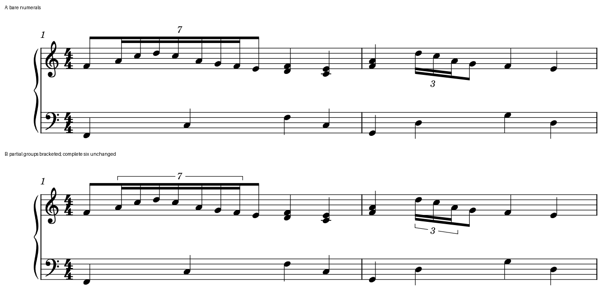

# 部分梁连音：用短括号说清数字管哪几个音

2026-10-29。**普通音与连音共用一条主梁时，优先给连音本身加短括号。** 它明确比例的作用范围，同时保留原来的动作轮廓。完整独立梁已经划清范围的六连组，本例继续只留数字。

这把[Conan的七连及三连候选](INTEGRATED_READING_KYOURAN_CONAN.md)推进到原创原生验证，也适用于此前多首谱里反复出现的部分梁问题。本轮没有改写官谱或用户乐谱。

## 为什么这点值得改

第一小节前半是“普通八分＋7:4十六分七音＋普通八分”，共两拍。长主梁把九次起音连成一个动作，第二层梁只连接中间七音；裸数字7虽可由熟悉者结合音值推断，仍让读者额外判断起止。短括号直接给出七音的边界，普通首尾保持原时值。

第二小节中段是“三个3:2十六分＋一个普通八分”，共一拍。短3括号在第三个快音结束，排除最后的普通八分。这比要求读者从两层梁长短自行推理更直接。第三小节则是完整的独立6:4十六分梁组，主梁和第二层都恰好包六音，没有相同的范围缺口。

依据为已读的Gould《Behind Bars》p200：连音只占完整连桁的一部分时，用括号明确范围；独立完整梁组可由梁表达范围。这里是有条件的记法判断，不把所有连音数字都加框。规范原页及官谱图保留在私有缓存，本轮沿用既有阅读，不增加覆盖。

上为裸数字，下为短括号；两版字体、音符位置、梁和上下两手相同。改进的是范围辨认，代价是多两条括线及少量垂直空间。若该通道已有长弧、指法或另一声部，还要在完整上下文检查冲突；本例不能替复杂跨表、嵌套或跨行连音下结论。

[四小节完整上下文](fixtures/partial-tuplet-brackets-full-context.png)保留下一行的完整六连组及结尾。短括号版作为本例首选候选；没有新增用户审美选择，也不要求用户辨认微小间距差别。

## 当前 MuseScore 已能怎么做

选中实际连音组，在检查器的连音括号属性中将自动／不显示改为显示，并核对端点只包组内音。本次固定宿主能直接画出所需短括号；不需要移动音符、重建比例、拆主梁或新增本体接口。

只读核对本机`libmscore/tuplet.cpp`的281–301行，自动模式逐个检查成员有没有梁，遇到休止、嵌套或无梁成员才要求括号；这段没有判断梁是否伸到连音外。固定宿主的自动模式也省掉本例两处短括号，其全部带class的SVG绘图与裸数字版一致。源码与二进制在本例呈现相符行为，未证明该二进制对应当前源码提交。

因此，自动模式不能替代这一条净书判断。后续若做诊断，可先比较真实Tuplet成员与所共用主梁的成员范围，找出需要人工检查的部分梁组；再排除已有手工说明、特殊记法和合理省略。当前先保存复现及现有属性操作，不开发插件／MCP／本体适配。

## 可直接使用的原创例与核查

独立原创CC0四小节4/4钢琴练习，Leland／Leland Text、谱间1.57mm、版心180mm，实际两系统，起始小节1／3。没有借用官谱或用户的音符；本例无音乐Text字形，不据此检验Text设计。

- [A裸数字](fixtures/partial-tuplet-bare.mscx)、[B短括号](fixtures/partial-tuplet-short.mscx)：原生保存版，已实际重载及再次保存。
- [自动模式探针](fixtures/partial-tuplet-auto-probe.mscx)：手写输入只做SVG／MusicXML导出，未认证其保存重载。与A的原始输入仅有括号属性不同。

两候选原始输入只差第一、二小节的两个`bracketType`。全部52个书面音／52次攻击按独立分数配方核对：音高拼写、谱表、声部、起点、时值、7:4／3:2／6:4比例及逐层梁连接保持。MusicXML的每音duration精确对应配方；显示括号分别为无／无／无与有／有／无，端点落在实际组内。

两版音符坐标和全部非Tuplet的带class SVG绘图相同，保存重载后仍相同。完整MIDI逐字节相同；480 PPQ无法整除七份，逐音起止与精确配方的量化误差最大6/7 tick，未将整数MIDI当精确分数。原生再次保存均逐字节保持；手写输入首存有最大0.01 SVG单位、约0.00045sp的坐标舍入，发布同框图使用保存重载后的共同基线。

本批22次成功CLI，复用并前后核对1936文件的固定运行时。图只合白底、裁去页外空白、在谱外加标签，180dpi且不缩放。没有做MusicXML重新导入、实际打印或人类试奏；不借用旧案例替这些项目验收。[完整证据](partial_tuplet_brackets_evidence.json)记录输入、图、宿主与缓存。

本轮新增一个候选验证，阅读增量0：官谱80/146、余66；教材696/696查阅覆盖；资料13/25、余12；用户组合0/1、准备2/4保持。接着回查A087／A088及缺图资料，继续把有阅读收益的判断做成可用候选。
