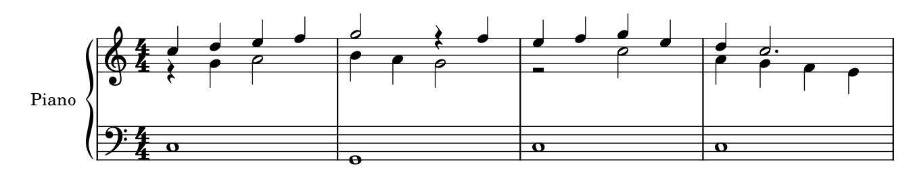
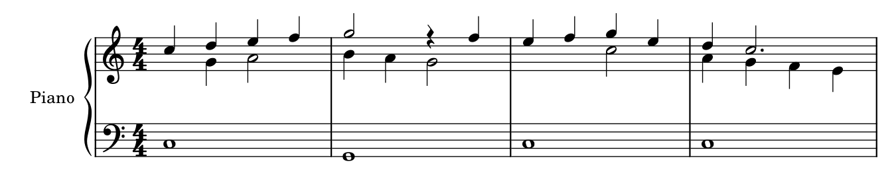

# 钢琴织体：简洁何时帮助阅读，何时隐去必要的信息

2026-10-19续学。目标是形成具体判断，不把“少一些符号”“播放不变”当成净书成功。规范来源为用户本地Gould主PDF，印刷p303–315、326–338的正文与完整图页已实际阅读；包含此前读过部分的复看，并非26页全属新增。页码映射及哈希见[piano_texture_evidence.json](piano_texture_evidence.json)。原教材、官谱和用户谱只读，本次没有软件适配开发。

## 1. 先分开四个问题：什么线、哪只手、画在哪、怎样发声

声部描述连续的音乐关系，手描述实际动作，谱表组织显示，软件voice容器组织编辑事件。四者经常相关，却不能互相代替。

Gould p303–306以可行的手分配为钢琴记谱的重要目标。上右下左是通常预期，偶发加线往往比频繁换谱号更容易追踪音程；但p304也给出反例：把手的编舞写得过于细碎，会掩盖音乐轮廓。因此，不能只按音高分上下谱表，也不能为了标出每次交接而不断搬音、换谱号。

当两手各只有一条线并移到同一谱表，干向可以提示手分配；手交叉时却可采用相反干向，并在入口明确标手。已有两层时，保留声部所在谱表、加sopra/sotto或局部手提示可能更清楚。**“上干=右手”不能成为跨全谱的推断规则。** 两手转到一表后，原来空出的表也不能自动补休止：那可能使读者误以为某只手停了。

p307的跨表声部引导线还有分类作用：虚斜线有助于追踪中层；连接音头的实斜线可能被读成滑奏。不能把所有引导线统一为更醒目的实线。

## 2. 休止的判断依据是织体，不是voice编号

| 情境 | 读者需要知道什么 | 合理做法与代价 |
| --- | --- | --- |
| 临时附加符干突出原音型中的旋律，p311 Debussy例 | 从完整音型中辨认旋律走向 | 可以没有附加休止；把软件第二容器自动补成满套休止反而增加噪声 |
| 同表两条节奏独立的线，p312 | 每条线何时停、何时进入、占满什么时长 | 各自以休止补足小节；不能因为“伴奏已经显示拍子”就隐藏另一线的停顿 |
| 再添临时层且已拥挤，p312 | 局部进入的位置，不一定是永久声部身份 | 可只补清该拍，或在明确时共用休止；双向干组旁另有一部时，又需其自己的休止 |
| 严格对位，p313 | 哪几部持续存在，当前活动的是哪部 | 持续保留各部符干及休止，包括整小节休止；高度也帮助辨认部的身份 |
| 两手组成一个跨表运行，p314及p317–318 | 同一动作的连续节奏 | 共梁可省去两套交替休止；整拍共同停等条件另见[跨谱表专题](CROSS_STAFF_STUDY.md) |

这不是按“音乐类型”贴固定标签。需要看前后乐句、独立节奏、奏法/力度及材料是否持续。p310即使同拍起音、时值相同，只要奏法或力度不同，也需要分干；由多层回到单线宜顺着乐句边界，不自动在每条小节线处合并。

### 官谱A063《Imagination》p3 G：伴奏在高处，旋律在低处

上谱表的上干短型与下干旋律同时存在，下谱表另有长保持；l.h.及手分配角括形提示局部接手。上干层开始的四分休止交代它晚于下层旋律进入，后续八分休止也在维持自己的节奏轮廓。

这里的好处是读者能追踪两条不同动作，而不是永远把最高音当旋律。若把所有上谱表音按一个连续时间线合梁、把上方休止视为“多余空白”，会破坏层次。保留原排法是有理由的判断；仅凭PDF不能断言具体voice ID，也不能由此替演奏者决定每个音用哪只手。

### 原生反例：隐藏休止，数据检查通过仍可能不合适

原创四小节练习的上谱表是两条连续独立的线，下谱表是长低音。第二条线在m1先停一拍、m3先停两拍。本例目标是明确呈现持续的两部写作，不是临时给旋律加符干。

保留休止：

隐藏第二部的两个休止，仅作不合适的反例：

隐藏版可以借另一部的横向位置推算进入点，但需要额外推算，并弱化这条线在停顿中仍持续存在的提示。可见符号少了，不足以判它更好。反过来，p311的附加旋律符干又证明“所有第二声部休止都显示”也不是通用答案。

两份原生XML仅差两个Rest的`visible=0`；29个事件含26个音头、3个逻辑休止。重新导出MusicXML，逐事件核对音高、以四分音符计的起点/时值、谱表和voice，均与源练习一致；SVG可见休止由3减为1。没有做音频文件比较，也没有编写通用对位校验器。两图固定Leland/Leland Text、同宿主原生输出，只合白底并使用相同裁框保留完整音乐；不是移动像素拼成候选。可编辑文件及复现见[fixtures说明](fixtures/README.md)。

## 3. 合干、共头、共梁各自省掉的是什么

同一节奏的和弦合干，可省重复符干、休止和奏法；它以不需要分别表现各部身份为条件。部分音有tie也未必强制全拆：p311允许另一部占据反向符干时合干，或为连续和弦写法的一致性保留。代价是必须读清哪些音持续、哪些重奏。

p307–308允许重复音型中的同音异时值共头，甚至附点与非附点共头；孤立同音则分头更能交代部的关系。**图形共头不能变成合并逻辑音。** p311 Schumann例还含用于突出同时线条的方便梁值，主要短音层给出实际节奏；遇到类似历史写法，不能把每套视觉符干都当一条需要相加的播放时值。

共梁则可把两手表现为一个动作，省去重复的节奏账本；独立旋律与伴奏不因此成为同一声部。双向干居中梁需要足够谱表间距，p315最短干的条件是2½sp，不是OCR中的“2%”。受页面约束无法满足时，可比较梁在一侧的方案；把中间干压成短桩并不算解决问题。梁坡与白缝另见[梁干专题](BEAM_STEM_STUDY.md)。

## 4. 用户p8 m148–149：额外谱表在分离时间层次

本次完整复看《如果有来生》PDF p8。m148–149上两表承载跨表运行，下两表为长和弦/低音及跨小节tie；四表由同一大括号组织。下方另有低八度状态，m149的延长与运行的终点共同形成收束。

可以直接观察到的收益是：短音的连续运动与长背景各有跟踪空间，不必让长tie、长时值和跨表梁都挤进同一对谱表。这与Gould p331–332在多层持续织体中使用三/四表的理由一致，并不说明本例每个细节已经最优。

代价也真实存在：系统增高、目光要覆盖更大垂直距离，初见者可能不清楚各表如何分手。p332建议首次出现时交代手分配；本例是否需要怎样的提示，须先理解实际奏法。PDF不足以确定背景是手持、踏板留声还是其它实现，不能看见长音就擅自缩短成踏板时值，也不能把四表强制压回双表。下一阶段应比较同一音乐的可编辑副本，而非仅凭更少谱表就判改善。

## 5. 指法数字为什么不能统一整理成一排

p308–309中，指法是可选的编辑内容；许多正式版本完全不写指法。没有数字不能自动判缺漏，也不能为“干净”删除已有数字。

和弦指法纵向堆叠便于音与手指对应；连续横排数字可能是颤音交替指法。两数字间的小弧可表示替指，水平线可指某手指保持的时长，竖括形可指一个手指/拇指覆盖多个音。把小弧识别成普通slur后删掉，会把动作说明也删掉。

数字首先靠近所属音。通常右手上方、左手下方，能让系统中部留给力度；内声部却可能以靠近干端更明确。所有数字同高并非优先目标。Gould采用小粗直立数字与斜体连音数区分，是可解释的出版惯例，尚不能据此将其它字态一律报错。现有E35仍缺实际工程正反例，本次教材精读没有把该缺口自动填满。

## 6. 踏板：先保住动作，再考虑对齐与省写

p332–338区分制音、选择延音和弱音三类踏板及持键、无声按键。它们控制的并非同一个状态。

- 制音踏板与中踏板同在时，符号和释放要分别可追踪；下方通道也须避开低八度线。常用叠放顺序让频繁、精确操作更靠近音符，但短弱音线有就近放置的例外。
- 单个开始/释放组应清楚对应；连续短组可以随局部空间上下变化。全行压到同一条最低基线，可能让其离谱过远而漏读，p333并不要求这种“整齐”。
- 起点要看约定的字母锚点，非整串文字的中心：`Ped.`的P、`Sost. Ped.`的S；p336的`½ Ped.`仍以P交代踩下点。远离音符时，可用垂直虚引导线补精确对应。
- 印刷Ped.可以对在起音处而实际紧接起音后踩下，也可以精确写在稍后；不能把PDF横坐标直接当物理动作的毫秒时间。
- 立即换踏板的尖角与先清声、之后另踩不同。把前后符号拉得很开，可能暗示不应有的断声；为了均匀空白而移踏板会改变读法。
- 重复模式可用sim.并在变化处恢复明确标记；持续按住与按同一方式反复换踏板又不同，`Ped. sempre`可能有歧义。不能把所有长线统一缩成它。

### A056《Here》p8第三系统：参考本身也有可讨论之处

图中先写`sost. Ped.`，稍后又写`sus. Ped.`，末端有两组叠放释放星号。保留两类控制及释放的独立性很有价值，不能把星号当重复对象删掉。但Gould p335明确反对用sus./sust.指制音踏板，原因正是容易和sostenuto混淆。

因此，本例应同时学到“复杂动作如何分层”与“名称仍可能改进”，不能把喜爱的官谱当每处都正确的模板。就这个上下文，后一个标签很可能要区分制音踏板；没有前言定义/工程，仍不把推断当已确认动作。在自制或获准重编的版本中，可以比较清晰的完整命名；本次不修改原谱。

用户前页的`(S.P.)`也继续标为含义未确认。p334对senza pedale缩写、p336对sostenuto缩写均提示混淆，恰好说明不能凭字母自动归类或替换。若后续确需执行相应修改，应先确认音乐意图。

p337特别区分：由踏板保持的声音可用便利的书面时值加明确踏板范围；要求手一直持键的音应写足时值。括号内重复音可提醒中踏板仍持有的音，手此时已经离键；它未必是新起音或可删冗余。播放一致也不能替代这种动作核查。

## 7. 特殊字形也可能承担动作或时值

p326–329的相邻音簇不是任意厚和弦的美化替代。音簇外界可能精确或近似，需看加线、外界音、说明；黑/白矩形用于区分时值，不能直接解释为黑键/白键。键色另靠变音或文字定义。滑奏斜线也不同于逐音指法的写出音阶，不能为了少几个头就互换。

p338菱形头在无声按键语境中表示提起对应制音器、保留共鸣的动作，仍有持续时长；虚tie可表示响后无声再接住。遇到菱形不能直接统一成普通头，或一律归为泛音。该页用于补全分类意识，尚无相应用户工程或音响验证。

## 8. 这批学习怎样约束后续判断

先问读者要追踪什么，再决定可以省掉什么：独立声部的进入、同一动作的连续性、手的接管、持续的方式、控制的范围。证据不足时，结论应是具体疑问或保留原样，不是自动美化。

本次已经把“隐藏第二部休止”做成原生拒绝案例，也把四谱表、双踏板、指法附属符号连到具体规范条件。尚缺：可接受的临时旋律省休止原生对照、复杂共头/三部的工程、指法/替指与三踏板实际候选，以及用户的少量审美选择。它们没有因一次XML核对通过而完成。

后续已补[同音异时值与附点](UNISON_DOTS_STUDY.md)：用户副本m89两个可见头与m99／101／103隐藏短头／可见长头的配合分别有理由；原创选择性共头与全部共头的MIDI相同，读法仍有取舍。这补上部分双部共头工程，三部、变化同音与不同大小字头等尚未覆盖。不能按同音、静音或不可见去删除承担角色的对象，也不能以默认等价为由去掉会影响共头的显式headType。

软件适配、接口扩充和本体修改仍留到以后。当前继续学习和积累可应用的判断，已由[skill初版](../../skills/piano-engraving/SKILL.md)按问题引用；不能把本专题直接当成自动执行指令集。
