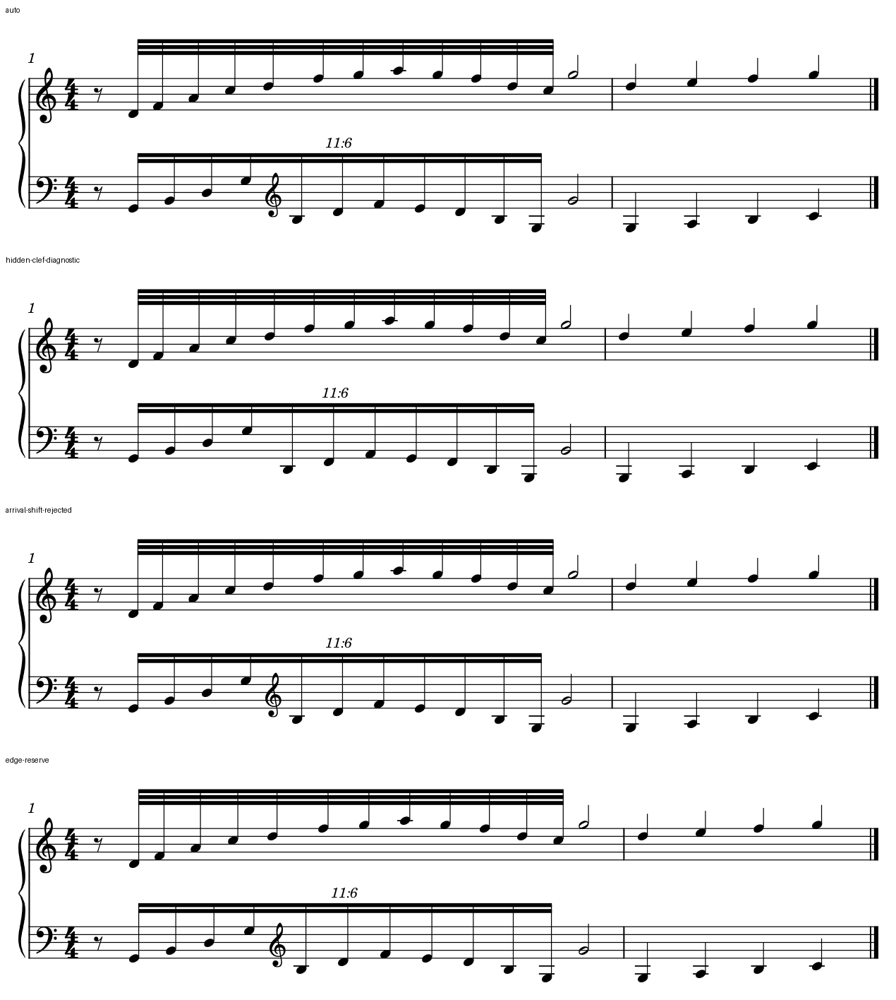

# 十二对十一的间距：共同时间列正确，等时值仍可能忽紧忽松

2026-10-23。接[My Dearest P段](INTEGRATED_READING_MY_DEAREST.md)，用另一套原创音符验证其引出的判断，不转写官谱。固定Leland／Leland Text、1.57mm sp、A4满行两小节；本轮只使用已有原生字段和固定宿主导出，没有改软件、MCP或插件。输入为CC0，过程与核查见[证据](polyrhythm_spacing_evidence.json)。

**本例默认排版已保住两手共同开始和到达。** 剩余宽窄变化既有换号占位，也有合并时间轴上的非线性分配。隐藏谱号、只移一个到达头和简单增加两个时间列留白，都不能作为这个例子的有效优化；当前保留原生默认版，同时留下一个可复现的间距改进情境。

## 1. 独立音乐与原生对照

第一小节两表先八分休止；上方十二个普通三十二分、下方十一连十六分，占同一段`3/2`个四分，在小节位置`2`共同收二分。下方明确写11:6，并在第五个快音前由低音谱号换为高音谱号。第二小节四分运动作后续空间参照。共33个音、两个八分休止，不含原谱的八度线、额外保持层或完整音型。

图为180dpi原生PNG合白底、同框保留全部墨迹，标签在谱面外；没有移动或缩放音符。

| 自上而下 | 唯一明确改变 | 结果与判断 |
| --- | --- | --- |
| [auto](fixtures/poly12-11-auto.mscx) | 无 | 两组开始／到达对齐，保留；不是已证明最佳间距 |
| [hidden-clef-diagnostic](fixtures/poly12-11-hidden-clef-diagnostic.mscx) | 只隐藏中途高音谱号，内部换号仍在 | 空间变化减小，但后半仍按高音谱号排，读者却只见低音谱号；仅供定位原因，不能采用 |
| [arrival-shift-rejected](fixtures/poly12-11-arrival-shift-rejected.mscx) | 只将下部二分Chord左移`5/6sp` | 完整MIDI相同，但共同到达看似先后；拒绝 |
| [edge-reserve](fixtures/poly12-11-edge-reserve.mscx) | 第二个上方快音及共同二分到达的ChordRest列各加`1.25sp` leadingSpace | 主要重分小节预算，未明显解决首尾紧缩；本例不采用，不是参数失效或字段未存 |

同总版心不等于同小节宽。留白版第二小节首头比默认右移约1.50sp，运行跨度也改变；不能把它当固定组宽的纯局部比较。两个目标Segment均实际保存，原生重载保持本轮结果。

## 2. 换号是原因的一部分，不能解释全部波动

量的是各组连续音头原点的横差，包含最后快音到二分到达的间隔；同字号／干向条件已固定。这些比率用于描述症状，不是美观分数。

| 条件 | 上方12个间隔最大／最小 | 下方11个间隔最大／最小 |
| --- | --- | --- |
| 默认 | 2.028 | 1.401 |
| 隐藏中途谱号诊断 | 1.616 | 1.134 |
| 两列加留白 | 2.018 | 1.404 |

默认最宽处与下部换号位置相应。隐藏谱号使实际绘制从三个谱号变为两个，音头谱位、原生音乐和MIDI不变，但整行重分空间；它支持“换号确实占一部分预算”，不支持删谱号美化。

隐藏后上方首尾间隔仍比中间紧。这里没有临时变音，也不是两手共同到达排错；需要继续看两个节奏如何合并为时间列，不能将所有不匀归给字体或升降号。

## 3. 为什么同样一个三十二分间隔会得到不同宽度

两条快线的实际间隔分别为`1/8`与`3/22`个四分。共同细分为`1/88`，上下各隔11／12份。合并两手事件后，运行内共有22个相邻时间区间：

- 上方第一个与最后一个三十二分间隔中，没有下方的新起音，只对应一段相邻时间区间。
- 其余上方三十二分间隔中，各插入一次下方起音，被分成两段。

本机只读源码中的`Measure::computeTicks()`取相邻有效Segment的时间差，`stretchMeasure()`按这些差值计算非线性弹性，再与最低宽度共同决定最终位置。`Segment::minHorizontalDistance()`还对普通相邻ChordRest距离使用“至少一个符头宽＋minNoteDistance”的下限，位于不同谱表也不因此自动免除这一下限。

这意味着同样的总时长，`f(a)+f(b)`通常不等于`f(a+b)`。再将很短的时间区间抬到最低宽度，差别会继续变化。**每一段按自己的规则分配，并不保证某一只手的等时值间隔累加后仍一致。** 这正好补充了用户所关心的两手相互影响的间距情境。

### 用实测核对解释

对隐藏谱号的诊断版，按所读源码的对数系数及tick舍入计算22段弹性，用原生黑符头实际宽约1.300sp，加输入已明确的0.2sp最小间距，得到约1.500sp下限。两个极短时间区间触及此下限。

只使用实测运行总宽来确定**一个整体拉伸量**，没有逐间隔拟合；模型重建上下两组全部间隔，最大误差约`0.000398sp`，处于该SVG的坐标舍入范围。最初只用对数权重、漏掉下限的模型误差达0.420sp，已拒绝并保留记录，不能只凭最大／最小比相近就称解释成立。

该结果检验的是一个诊断条件下的**内部宽度形状**，并未独立预测总宽。所读源码提交与固定二进制的构建对应尚未确认，也没有运行时分支跟踪，因此结论是实测与这一机制高度一致；不将它扩大为所有版本、织体和宽度的唯一原因。

## 4. 这次怎样使用已有控制，为什么最后保留默认

将一个Chord的offset向左移，只改变该头及其附属绘图，不能代表修改共同时间列。本例移头控制虽然保完整MIDI，仍破坏可见汇合，说明播放保持不能替代读法保护。

leadingSpace属于最低空间输入，之后还经过碰撞约束、整行预算和弹性分配。本次两处各加1.25sp，最终并没有让所选间隔各增加1.25sp；它主要扩大第一小节、压缩第二小节。上方比率仅从2.028变2.018，下方略增。图上首尾仍紧，且付出后文预算，因此不采用这次简单试排，不继续靠无依据加大数值宣称解决。

默认仍有可讨论的节奏轮廓，但它保住谱号、时间关系和共同到达；其余三个控制各有明确不足。当前保留是本组比较的结论，不是对所有原生默认的认可。

## 5. 对后续自主净书和软件改进的作用

诊断应把三件事分开：共同时间点是否成立、必要符号是否确需空间、某条可跟读脉冲是否被联合时间轴过度扭曲。既不逐头吸齐异分，也不以“已经对齐”排除可读性问题。

后续先换宽度与其它比例验证边界，再回到有可编辑输入的真实织体。若需要软件改进，可研究在保留共同时间点和各表墨迹约束时，同时照顾主要脉冲的稳定性，避免把所有相邻全局事件都按孤立段分配后再累加。这里只形成具体输入、观察和机制依据，本阶段不实现新分配器或接口。

四个输入的33音均按独立配方核音高拼写、起点、真实时长、显示谱表、梁和11:6字段；MusicXML以divisions=88精确表示本例。MIDI为480 PPQ，十一连起音相对分数时间的最大舍入差为`5/11 tick`，四版完整MIDI字节相同。默认与留白版实际原生保存重载后，完整SVG绘图、原始RGBA、MusicXML除日期及完整MIDI保持。

原生音乐、符号读法、几何和播放分别核查；没有MusicXML导回、试听、打印、用户审美选择或官谱工程迁移。本轮未写入原PDF、用户MSCZ或软件仓库。
