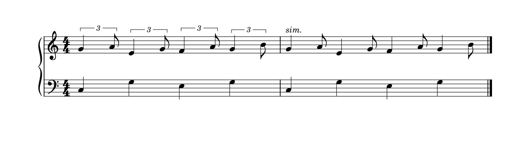
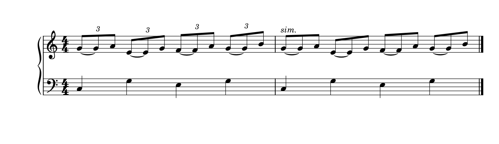

# 节拍怎样显露：连梁、休止、切分与换拍

2026-10-24的[T03应用](SKILL_TRANSFER_RHYTHM.md)给出可保留的实排：A007 G五音弧罩住一个动作，主梁2＋3标出普通拍位，断口处头距仍平顺；初判四头／内梁的解释已纠正。A010短三十二分3:2只占一个十六分时段，下层保持后到下一拍才共同进入。拍组、动作和共同时间各有任务，不按头数推连音，也不为分梁额外撑一格。

2026-10-24补[Michishirube D／m34](INTEGRATED_READING_MICHISHIRUBE.md)：末拍6组含一个十六分休止及五个音，括号跨休止，slur从第一音开始。两条线范围不同有阅读理由；不把数字当起音数，也不把全表所有头混成同值间距。

2026-10-23[ninelie整曲](INTEGRATED_READING_NINELIE.md#8-2026-10-23把局部放回整首)补A与I的短休止频率、J首个两拍15个快头和末组三音的不同梁层：同样三个头的组不一定同一计量，外层slur也不代替两组5的范围。保留真正进入和单位，才能评价空间；全六页已复读，未新增原生候选或独立skill评测。

2026-10-23[12／11原创原生研究](POLYRHYTHM_SPACING_STUDY.md)补共同拍点正确之后的空间判断：同一上部时值在联合事件轴上跨一段或两段，非线性弹性与最低距离可造成不均匀。原生33音／11:6时值保持，藏谱号或只移一个到达头仍误导读法；两列加留白未改善则不采用。既不按第几个头吸齐，也不以“时间正确”排除跟读问题。

2026-10-21补[Connect的H段](INTEGRATED_READING_CONNECT.md)：首小节是七连八分、三连八分与两个普通八分；六连变体的前6音和后3音却具有相同每音时长，最后一小节还以四分替代末两八分。先核全小节分法与持续，不能由数字不同推断音距应不同，也不能按头数／大弧建立一个等分组。本批为整谱近读与精确时值核读，不是原生改排试验。

2026-10-20续读已补齐印刷p174–190／PDF p194–210全部图文，见[速度关系与停顿](METRE_TEMPO_READING.md)。下文首批“p174以后未完整阅读”保留为历史范围，现时以本补记为准；新学习不等于任意异拍／自由段均已原生验证。

2026-10-19。完整阅读并查看用户主《Behind Bars》印刷p153–173／PDF p173–193，共21页文字和谱例；另复看p17、19、22、24。p174–178虽已渲染，只作文字开头定位，没有读完或逐图查看。主书及两份参考原PDF只读，保护与范围见[beam_rhythm_evidence.json](beam_rhythm_evidence.json)。本页整理可用于判断的条件，不把书中的推荐自动变成全谱改写。

## 1. 先把四种信息分开

拍号与拍组给基本重心，主梁把活动材料组织成可认的单位，内梁断点显示更小层级，奏法／分句再说明怎样弹。几种线索可以协作，也可能故意相互对抗。漂亮的连续轮廓不能以抹掉其中一层为代价；而过度显拍又会把熟悉的节奏写得支离。

检查一串音时，先回答：基本拍在哪里、演奏者要数到哪一级、是否明确要求切分／交错重音、有没有跨小节或换拍关系。仅靠音头数量、梁的长度、是否同值，均不足以决定分组。

## 2. 主梁：可连得长，但要知道读者可能误认什么

Gould p153–155并不要求所有拍号都逐拍断主梁。2/4、3/4可以连较长的八分组；4/4的常规分法突出半小节边界；复合拍按其大拍组织。更保守的单拍分组适合需要特别明确重心的上下文。表格中的5、7等组合又说明：相同分子不提供唯一重音顺序。

3/4的长梁若形成明显3+3外观，可能诱发6/8读法；历史作品和明确上下文可有例外。另一方面，p169–172明确讨论有意违反基本重心的分组：切分、交错重音和作曲者句法有时正需要它。不能只查“跨没跨拍”就自动修正，也不能因某个官谱使用长梁而移植到不同拍号。

**实际对照：A128《The Song of Aether》p1。** m20的六个八分起音按2+2+2组织；m29起改6/8，m30可见完整六个起音的3+3。这里用梁提示三拍与两个复合拍，较长slur另外组织句子。m29本身是活动层一个八分休止加五个起音，首拍只见两颗活动音头；拍组并未因此少一拍。此处纠正[旧笔记](corpus/READING_022.md)中把m29也称作“六个八分”的简写。

这两段不是同一音乐的引擎对照，也不是同一内部voice；它们提供的是不同拍子需要不同阅读组织的事实。若连梁的变化只来自换拍，净书工具应保留这种变化，而不是为了“全曲统一”抹平。

## 3. 内梁和短副梁：小断点也在说明归属

p156–157用分层连接表达小单位：连接两个小组的梁数与该层单位有关。快音的内梁断开，可让读者一次认出小组而不用逐头数。并非所有层都要在同处断开；只留一根主梁会丢掉更细层级的关系。连续音阶若特意避免内部重音，又允许不断内梁，但长组会更难计数。

短副梁指向所属拍／细分，不宜单按最近的另一颗音来决定。邻近休止时，p158既允许留在主梁内，也允许指向休止以澄清拍组；必须一起读两种例子，不能把前一段变成禁止另一方向的硬规则。

这影响后续处理顺序：先保存每层的起、续、止和短梁方向，再考虑坡度、干长或厚度。音高、时值和播放相同，并不保证这层信息没有丢。当前宿主导入自制64分例时丢失第四层独立断点，是已定位的能力限制，见[原生检验](BEAM_STEM_STUDY.md)。它不是字体问题，本次没有开发修复。

## 4. 休止：时间位置与视觉居中是两种任务

2026-10-20实际复读并看p159–160，补完整小节休止的选择：通常用semibreve rest表示整小节，Gould对4/2、8/4及以上列breve；复杂、频繁换拍时可偶尔使用相应实际时值的休止，并仍对准其起点。不要由“整小节休止居中”推成“所有休止居中”，也不一律禁止按拍号写值。用户m133–135填满6/8的带点二分休止值得记法复核，但m135还有Slur接收，见[综合应用](INTEGRATED_REVIEW.md)，本轮未改型／居中或删休止。

p159要求普通有时值的休止像相应音符一样标出持续的起点；另一部有装饰音时，参照正常计量音。整小节休止则是例外，放在小节的视觉中心；若有谱号、调号、拍号占位，使用剩余空白的中心。不能用“所有对象都吸到共同时间列”纠正整小节休止，也不能把普通半休止拖去所占空白的正中。

**实际对照：A015《Attack on Titan (Main Theme)》p1首系统。** 上谱表整小节休止居于各自小节空白中央；下方运行小节明显更宽，普通休止仍参与该层节奏位置。上部没有发音是需要保留的信息，不能为了减空白而删去谱表，或把整休止当成一次中途事件。它与下方某个音恰好竖向接近，也不能据此推断起始时点。

p160–164还区分拍组内合并与暴露边界。三拍休止要帮助辨认三拍；两／四拍要保留重要分界。单拍子中，推荐的拍首附点休止与拍尾拆写能提示所处部分，但两端都用附点也是允许选择。复合拍的整拍附点休止又是正常读法，不能套“不许附点休止”。同一个时长合并起来更短，不保证读起来更快。

普通节奏可合并减少碎符号；需要数细分或伴奏位置时展开更有用。拆合休止、隐藏休止属于记法选择，需结合[自由织体与独立声部](PIANO_TEXTURE_STUDY.md)，不能从本章推出所有voice必须填满可见休止。

## 5. 跨休止的梁：连续感可以帮助数拍，也会增加线条

p164–166把休止视作拍内组的一部分，允许主梁跨过它，复合拍尤其有助于看出完整大拍。内梁通常可在休止处断开以减轻黑度，交替音／休止型又有保留内梁的例外。拍首／拍末的休止还可配延伸梁和stemlet，明确所覆盖的拍及细分。

stemlet不是误画的短干，也不意味着休止要发音。它有计数用途，但p166明确限制：普通节奏全部加上这种结构，反而繁杂。使用前要能说出普通梁在哪个地方让读者难以辨认拍子；当前尚未在本宿主验证这套延伸梁的完整支持。

## 6. 时值拆分：显拍程度要与切分意图匹配

p166–168建议复杂的跨拍持续用tie显露需要的边界；从拍后开始的长时值通常比从拍上开始更需要拆分。拍上开始的长音可以直接写一个长值，不必把每一拍都切开。三分结构往往暴露其中两点就足以让人认出全组，优先在哪一点显露还取决于后面的读法。

p169–171是重要反例：有意切分时，跨拍记值可以正确表达重心；常见短—长—短等模式也不宜机械拆成一串tie。慢速、复杂段或需要精确对齐时，较充分的拆分又可能有帮助。候选应解释究竟在强调基本拍还是切分，而不是给“跨拍对象”统一报错。

因此，合并tie减少黑线和拆开长值显拍都可能合理。二者会改变读者对重心与持音的理解，不能作为无声的纯几何操作。自动净书先保护原记法，必要时把记法提议单列。

## 7. 换拍：相同八分符号不保证相同时长

p172–173区分细分单位保持与整拍保持。例如6/8转2/4，写“八分=八分”与“附点四分=四分”是不同的速度关系：前者保留小单位，后者保留两个大拍的时长。不能看到拍号或连音数字变了，就自动拉直所有起点或沿用旧的毫秒换算。

首批尚未完整阅读p174以后的复杂同时拍号／异长小节；2026-10-20已由[换拍续学](METRE_TEMPO_READING.md)补p174–190图文，仍不声称已支持任意polymetre或演奏映射。PDF上若没有足够方程和上下文，保留未知；工程中则读实际时值和速度变化，再判断版面对齐。用户F的单位转换获实际导出支持，E则存在小幅播放偏差，两者不能因等式外观相似给出同一结论。

## 8. 旗尾很多，未必是缺梁：先读已经建立的长短型

2026-10-20复看A109《Secret Base》p1–3和A074《Kigeki》p1–2，并复读Gould印刷p210、215完整图文。全为已有材料定向复看，不增加历史近读页数。这次纠正[逐谱十九](corpus/READING_019.md)关于“可比较按拍连梁”的过宽判断；[原生证据](flag_reading_evidence.json)保存核对范围。

### 从开头追读，而不是把孤立一页当完整记法

A109开头为C拍号、四分=134，上部明确用3及括号标出四分＋八分的长短组；同一小节也有不属于这些组的普通四分，不能把所有四分都缩成2/3拍。p1第二系统开始写simile，重复型随后不逐组印3。回看开头，才知道后页的“长音＋独立旗尾”有省略连音提示的上下文。

两个局部支持这种读法：p2 B首小节有四对四分／八分，按普通音值相加是6个四分，按已建立的3:2长短型是4个；p3 C首小节先有附点二分保持，后接一对四分／八分，将该对读作一拍，便与4/4及下部整小节保持相合。这里的算术是上下文佐证，不是把全曲每个未标数字的组都认定为同一比例／范围的证明；官谱工程及完整演奏映射仍未知。

因此，许多旗尾旁边是四分音符，不能像连续普通八分那样直接合成普通连梁。若为了完整三音梁把长四分拆成两个tie相连的八分，就已经改了记法。原写法的收益是：先让读者学会反复的长短轮廓，再省掉重复数字和细分音头；代价是后页读者需要记住前文。它的秩序不单靠梁，也靠熟悉音型、下部参照和少量明确提示。这是本研究的阅读解释，并非出版者亲述意图。

Gould p215允许相同节奏型建立一两小节后省数字，条件是组形仍清楚；复杂配合或变化处又可能需要持续／恢复显示。p210讨论显露细分和流动的取舍，提醒过度分组可能诱导不需要的重音；这里只借其判断原则，不能据它规定每一拍内的长短组都应拆成三颗头。若把C剪作独立谱例，或实际跟读显示页首失去参照，可另试局部恢复3；本轮没有制作或采用这个提醒候选。

### 原创两小节：连得完整需要付出什么

下面不是官谱转写，而是原创C大调双谱表4/4机制练习。上部每拍一个真实3:2八分单位连音组，下部每拍一个四分作参照；第一小节示范3，第二小节保留真实Tuplet但省数字／括号并写sim.。固定Leland／Leland Text、spatium 1.57mm、同一A4版心；`lastSystemFillLimit=0`只用于共同的满行宽度预算，不推荐为稀疏终行预设。

保留长四分＋短八分：

把每个长四分拆成两个相连八分，再与短音共梁：

本例倾向保留第一种：两个起音已能表达反复长短型，没必要为梁的完整外形多写一颗不重新起音的头。第二种能把三等分格子画得完整，适合需要讲解／精确数细分的任务，但两小节增加8个音头和8条tie；干向与间距也随新梁组重新布局。不能称为只美化符梁，或假定更连贯就更易读。两图没有新的用户选择、跟读速度或打印验收。

限定检查如下：

- 原生输入共8个真实Tuplet，比例、基准值和跨度不变。逆向合并新增的tie音后，输入整棵XML与长短版相同，未暗改其它节点。
- 原生与重导MusicXML逐音核对：书写音符24→32，按tie合并后仍为同一24个实际起音，音高、位置与时长符合独立配方；每表每小节4拍。完整MIDI逐字节相同，并解析确认有24个Note On。
- 两版同为一页一系统，全部十条StaffLines几何及页面尺寸相同；不是所有音符时间列不动。原版8个Hook，拆写版8个Beam和8条TieSegment，图面显示的3均为4个；原版另有括号线，不将SVG Tuplet元素总数直接当数字个数。
- 长短版另经原生保存重载：真实组、显示模式、sim.文字和书写事件保持，SVG除文件标题相同、PNG像素相同、完整MusicXML与MIDI相同。没有据此声称拆写版也做过重载，或所有版本／工程行为一致。

两张公开图只将180dpi原生PNG合白底、用相同裁框保留整行两手，没有移动／缩放符号。原创MSCX见[保留版](fixtures/long-short-triplets.mscx)和[拆写版](fixtures/long-short-split-beams.mscx)，均CC0；官谱、教材图仍只在本机私有缓存，原件只读。

### 相似的长短听感，不等于同一种数据

A074《Kigeki》p1明确以两个写出十六分，对应三连音内的八分＋十六分；p2第二系统末2/4恢复straight等式，第三系统D再恢复swing，见[E20](CASES_EXPANDED.md)。这是对书写细分的演奏解释，与本练习实际存在的Tuplet不同；同一曲中还可另有明确写出的连音。不能把十六分swing套成八分swing，也不能用一个全局开关替代比例、作用范围、取消点及普通时值。

后续诊断应分别读书写音值、真实连音结构／实际时长、演奏关系与显示省略，再判断梁。PDF若普通音值相加不合拍，先回查开头、simile、换拍和其它声部，不立即报错或自动量化。工程若已有真实Tuplet而只是藏了数字，保留它；需要拆长值才能成梁时，把它列为有代价的记法候选。当前宿主已能表达本例的真实组和省显示，未从此发现需修复的连梁缺陷；未来只读适配需能区分这些信息，本次不开发接口。

## 用于净书判断时的顺序

先认节拍和重音意图，再核对每层拍组、休止与持续。若问题只是坡度／黑度，保留全部分组，用[梁干专题](BEAM_STEM_STUDY.md)的几何候选；若建议重分主／内梁、拆合休止或时值，单列其读法收益与代价。跨声部、跨表、连音和速度关系用相应专题补上下文。没有新候选明显改善时，保留原排法也是判断结果。

## 休止字形与谱位也约束位置优化

2026-10-21续读[符号阅读](SYMBOL_READING.md)：Gould p34–38把普通居中、跨休止梁、独立两部、谱外支撑线及同拍内休止局部同高分别处理。半sp自由纵移可把二分矩形休止画成全休止式悬挂；原创例同9次实际起音／完整MIDI仍拒绝。A015 p1的整小节居中与下部拍内休止再次分开，不能由x近邻推起点、或给全部Rest统一高度。目标谱表／有效基准和谱型先核，不直接查offset是否整数。

2026-10-22补[两首密集织体整读](INTEGRATED_READING_RUMBLING_UNRAVEL.md)：unravel F的5组不是五个可见快音；八分休止占两份，三个十六分占三份，首音在拍内2/5处。后接5／6组的相同书写音值又有不同实际时值。括号保护梁外休止的范围；若梁已延伸覆盖全组则另判，不能按“有Rest”统一加框。D／I的十六分与J的八分也不能只按保持和弦／休止的轮廓匹配。

2026-10-22[Mixed Nuts五页续读](INTEGRATED_READING_MIXED_NUTS.md)结合Gould p166–171复核长值与例外：D／H保留拍上开始的长值和重复半小节型，B／F则以tie接收显出第三拍；不靠单个跨拍检测或局部短—长—短子串重写。H续行八分线八头只有六个新起音，末尾两组5与局部8va分开，已校正旧笔记。本轮为只读记法／时间核读，未新增原生候选。

## 2026-10-23：梁与局部奏法可以保留两套参照

[Kakyoin整曲](INTEGRATED_READING_KAKYOIN.md)p2 B首小节八个八分和弦梁分4+4，tenuto位置1／4／7构成3+3+2标记间隔。Gould153／169及tenuto条件支持将基本计数与局部触键分读，不为复制标记而强制改梁。此处七个内部头距近稳，不能扩成全谱等距；F低部两次二分重奏也不能合成长音。

## 2026-10-24：simile省写的单位不能跨段盲目继承

[Secret Base六页整曲](INTEGRATED_READING_SECRET_BASE.md)补完既有长短专题的后半上下文。本曲基础是4/4；E的p4第四系统m95后半明确四分休止＋两个四分音符为3组，m96又有两组四分单位三连，均不同于开头一拍内长四分＋短八分的八分单位3组。下表普通八分伴奏另提供计数，括号必须把首份休止交代在内。

Gould p215的省略以相同型、组形可辨为条件；相同数字不证明单位、成员和另一层的配合没有变化。保留此处重新标3，不把旧simile变成所有部、所有四分音符的全曲比例开关。旧原创两小节的真实Tuplet／省显示及拆长值增头增tie结论沿用，没有重跑、没有新的迁移成绩或全曲播放证明。

## 2026-10-27：六连的休止与正文的演奏解释

[Cry Baby／Daisy](INTEGRATED_READING_CRY_DAISY.md)核A034首组六连＝一休止＋五头，再7／6／7各一拍，保留含休止的括号。A033则在A前解释十六分长短、H恢复均分、J重设；普通书写、显式连音和演奏解释各有范围，不能将所有短音再乘一次swing，也不能把I的三连伴奏改成复拍。

## 2026-10-27：总拍数相同还要核拍型

[光るなら／History Maker](INTEGRATED_READING_HIKARU_HISTORY.md)：A058实际6/8，Tempo di valse未印新3/4；6＋6十六分体现复拍。N前第二13组为11个16＋1个8，共12头13份；不能按头数或风格文字重建拍型。

## 2026-10-27：形似拱线不等于相同计量

[Homura／Hyori Ittai](INTEGRATED_READING_HOMURA_HYORI.md)：A060 L首行14头为普通3头＋六连6头＋五连5头，首16休止及末四分休止另占拍；下一行已变材料。A059 F28头为普通16＋两32＋五组5:4三十二分，普通前导不吞入5。

## 2026-10-27：头数和梁层都要放回整小节

[Ichiban／Idol](INTEGRATED_READING_ICHIBAN_IDOL.md)：A061 H前八分休止后13个三十二分占1.5拍，13:12；尾为8＋4＋8。A062尾声起始8后五个5:3八分占1.5拍，后8个普通16。大弧不决定比值，同值运动也不按谱表切组。

## 2026-10-28：两个相似拱形不代表同一开头

A064 M为八分休止＋10个16＋16休止＋11个16，快慢合23时点，第3拍慢线落在快层休止中。L前3/4是两组5:4及一组6:4十六分，各一拍；先看梁层再算数字。 见[完整两首案例](INTEGRATED_READING_IMAGINATION_POOL.md)。

## 2026-10-28：先恢复普通基值

A065 p4s5普通十六分，p4s6再为4普通16／7:4／6:4／4普通16，各一拍。下一小节为两组六连、独立四分、两八分和弦；不能按外形延续前组计数。 见[整曲理由](INTEGRATED_READING_IRIS_KAIBUTSU.md)。

## 2026-10-28：相似快型仍查当地基值

C四分后24个32；H16个16；p2则附点8休止、1个16、12个16。G首16休止之后8:6三十二分及三组9:8填满四拍，不能把数字8按普通一拍加入。 见[整曲案例](INTEGRATED_READING_TANJIRO_KANTAI.md)。

## 2026-10-29：八音三十二分的三级阅读

[原生三版](INNER_BEAM_HIERARCHY_STUDY.md)将p156–157按八分单位、再按十六分单位的要求放回两手及邻接慢段：8／4／2提供逐层计数，8／4／4断口较少。不能把全部音对都只用一根梁相连；连接梁数须与小组时长对应。保连续音阶避免内部重音的例外，也不把分梁解释成新增重音。

## 2026-10-29：连续拍号状态与3＋2分组

[Key R／Y](INTEGRATED_READING_KEY_KICK.md)把R七小节核为3/4、4/4、3/4、3/4、3/4、4/4、3/4；行末C为预告。Y五个八分按3＋2，后续6/8虽只有五起音仍为六份时间；整小节slur与梁组各有任务。保分组，首处数字提示仅为有条件候选，不按头数或段号推拍号。

## 2026-10-29：五头未必等分，三十二分末型另核

[Kigeki F](INTEGRATED_READING_KIGEKI_KILLY.md)五头含跨到上表的末头，首组八分＋四十六分，后组四十六分＋八分；各占附点四分。Killy H普通上部单元为三十二分休止＋三短音，低部为两三十二分＋十六分；续页末型另有休止＋三十二分＋十六分。保梁数和混合时值，K内梁分层另列候选。

## 2026-10-29：轮流细分与部分梁连音分判

[Kimi I](INTEGRATED_READING_KIMI_KIZUNA.md)低部三连发生在高部四分休止中，高部四十六分时低部已落四分，首小节两活动层合14时点；不能先按同拍3对4判断。Kizuna E前主梁9头为四普通32＋五5:4:32，保主梁，按Gould200比较只包后五头的短括形。

## 2026-10-29：跨小节三音重心与部分梁三连

[Kuchizuke J](INTEGRATED_READING_KONOSUBA_KUCHIZUKE.md)前三小节24普通八分分八组三头，两条主梁跨小节；保重心位移，不能改成3:2或强制4＋4。Gould171认可且提示计数代价；复杂时可比较常规梁加重音。KonoSuba Q下降梁为4普通32＋3:2十六分三头＋末普通八分，建议短括号只包中三头。

## 2026-10-29：跨线连音与跨行半小节分判

[Kura H](INTEGRATED_READING_KURA_KUUSOU.md)可见第二8组跨线3＋5头，完整比例尚待核；Gould210–211要求音数与对位正确，跨线后的首音可晚于小节起点。Kuusou H八组三连拆成同页四组＋四组，两半各两拍；优先比较整小节留行，不能把二分休止认成全小节。

## 2026-10-29：同一主梁内的普通首尾与连音

[Conan p3s6](INTEGRATED_READING_KYOURAN_CONAN.md)主梁9列＝普通8＋7:4十六分七头＋普通8，比较只包中七头的短7括号；p2s2主梁四头＝前三3:2十六分＋末普通8，短3只包前三。Gould200要求部分梁内明确范围，不改音乐；p4s3独立完整六头梁保留。

## 2026-10-29：短括号澄清范围，主梁仍保整段动作

[原创原生验证](PARTIAL_TUPLET_BRACKETS_STUDY.md)保九头共主梁，中七音为7:4；另保四头共主梁，前三音为3:2。短括号只圈实际组，完整六连梁仍裸数字；不要为说明比例先断主梁、改变普通侧翼或重建时值。两版音符位置与完整MIDI相同，保存重载保持。
