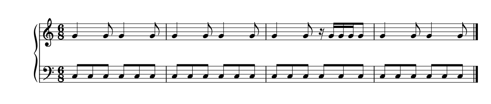
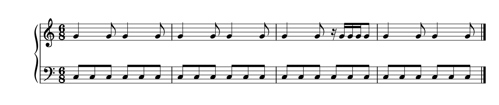
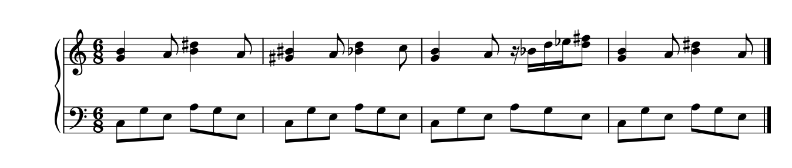
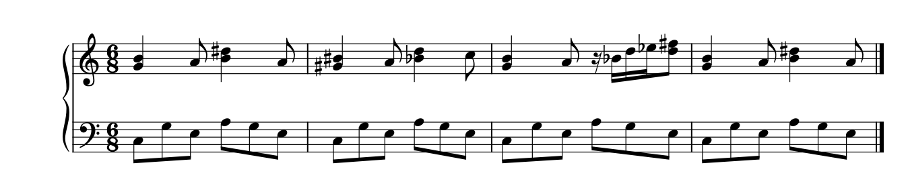
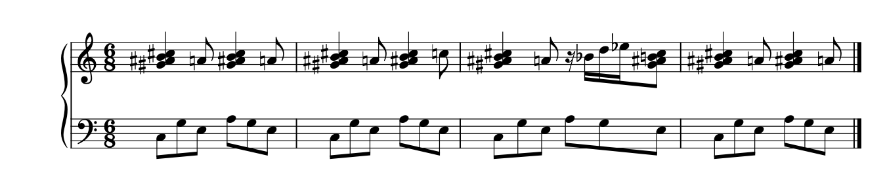
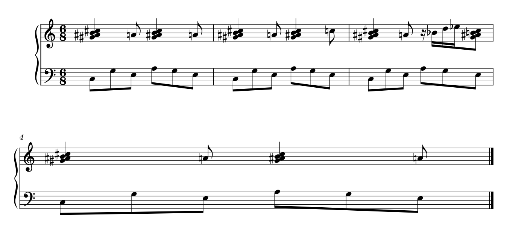
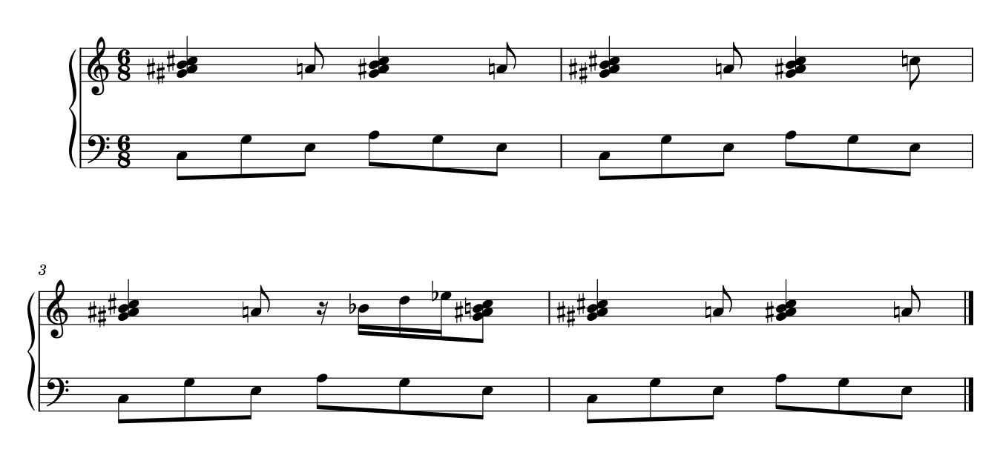

# 间距的实际改法：一个可用候选，以及为什么不能照搬

2026-10-19。接续[间距取舍](SPACING_DECISIONS.md)。本次从解释现象走到原创可编辑谱的原生候选，再用变音/和弦及分行反例检查迁移。原用户PDF、MSCZ和当前GUI没有打开或修改；没有开发插件、MCP或本体功能。来源、设置、产物及核查范围见[spacing_candidates_evidence.json](spacing_candidates_evidence.json)。

## 1. 极简例中，该保护哪条阅读线

四小节6/8练习的低部始终是六个同音八分；第三小节高部后半多出十六分位置。它故意去掉变音、不同音高、和弦错头、弧线和手工偏移，便于判断：连续八分提供脉冲参照时，额外的细分是否必须使这个参照忽宽忽窄。

原排法：

候选：

本例不需要靠加宽来容纳变音，也没有不同干向带来的光学补偿需求。根据已核查的Gould p39–43、490，值得尝试让同类脉冲更稳定，同时保住高部细分和共同起点。此理由只适用于这个明确条件，不能推广成全谱几何等距。

两版固定内置Leland/Leland Text、1.57mm谱间、同一A4版心和四小节一行。原生SVG的物理尺寸/viewBox核对后按5单位=1pt换算：

| 范围 | 原排法相邻位置距离，pt | 候选距离，pt |
| --- | --- | --- |
| 第三小节低部五个间隔 | 17.258 / 17.258 / 17.260 / 21.572 / 21.574 | 17.712 / 17.712 / 17.722 / 17.712 / 17.710 |
| 第三小节最大/最小 | 约1.2501 | 约1.0007 |
| 第二小节低部常规步长 | 约17.068 | 约17.684 |

图中候选让第三小节的前后两组及其它小节更接近同一脉冲尺度。它把较松的十六分位置收紧，给常规小节略多一些宽度；总版心和音乐内容不变。高部细分因此更紧，需与稳定低部的收益一起看，不能只报告方差下降。实际看完整两手后，未见新的明显碰撞；尚没有打印、试奏或用户认可的证明。

**技术核查与审美判断分开：** 两版42个音头、1个休止的音高、拼写、起点、时值和谱表一致，原生XML仅差3个Segment前置间距与4个小节stretch。16个同时起音的两手音头原点均保持同X。候选经原生保存、重新加载后，Note/Rest/Stem/Hook/Beam/BarLine/StaffLines几何和PNG像素完全一致。它证明本例可重现，不证明任意多声部、跨表或碰撞都已自动验证。

## 2. 现有局部控制能做什么，为什么单独调常会失望

原生Segment的额外前置间距作用于共同时间位置，并以sp计。它参加最低宽度计算，**不是指定该列最终X**。较小改动可能被整行弹性分配掩盖；明显起作用时，又可能改变小节最低宽、整行分配和换行。

本次先试单独加前置间距：第三小节变宽，邻小节被压窄，25%比率大体仍在。之后联合调整局部最低间距与小节空间分配，才得到上面的候选。不同位置需要的原有净空不同，给三个位置同一个额外值也不能简单得到相同最终间隔。

候选的具体实验值保存在可编辑文件与证据中，便于重现，不是推荐用户照抄的默认参数。只读源码核查：`Segment::write/read`保存leadingSpace，`Segment::minHorizontalDistance`与`Measure::computeMinWidth`计入它，`Measure::stretchMeasure`再伸展。当前插件/MCP能否以适当范围读写这些数据，尚未在本次验证。

一个认识由此改变：**这类极简问题并非一定要先改引擎才能改善。** 现有原生属性已经能形成受控候选；是否适合高效自动执行、复杂条件是否仍可用，应由后续真实片段决定。本次不扩接口或实施适配。

## 3. 变音与和弦：同一套设置反而没解决问题

第二份原创练习保持相同节奏，低部改为分解音型，高部加入双音及连续变音。它与极简例不是因果对照；真正比较的是它自己内容完全相同的前后两版。

原排法：

照搬极简例设置：

第三小节低部间隔由`18.036 / 18.036 / 18.038 / 23.012 / 25.488`变为`17.712 / 17.710 / 17.722 / 20.118 / 25.488`。末个宽间隔仍在，最大/最小反而由约1.413变约1.439。高部相邻十六分位置的变音和后接双音确有占位，不能只因低部想均匀就强压。

因此不把这一版列为改善。它没有证明25.488pt是出版最优值，但证明“把极简参数复制过去就能变稳”不成立。下一步应分别看具体变音、加线、头/干外形能否更紧凑、是否需要更多整行空间；不凭几个数值就删除变音、改拼写或单独挪低部音头。

这里也补了输入核查：音高与TPC拼写必须相容。探索时生成的两个三度曾有TPC不一致，已修正并弃用旧试验；本节只使用v2素材，逐音检查TPC并与原生导出MusicXML的拼写、起点、时值核对。不能让错误练习冒充排版证据。

## 4. 更密的和弦：局部参数还会改变整页问题

第三份原创练习使用相邻音的四音和弦及较多升/还原，仍是相同节奏。原四小节一行：

复制极简设置后，自动变为三小节加一小节：

这已经改变系统数量，不能再用单行距离指标宣布改好。新的最后一行只有第四小节，整行过散；原第一行更密也不因此自动更好。要看完整系统和页面预算。

另一候选保留原来的间距属性，仅在m2后加一次换行，改为2+2：

2+2让两个系统的阅读量较接近，避免孤立末小节，并给密集符号更多空间；代价是比原单行多用一个系统的高度。第三小节仍有局部不均匀，不能说分行已解决全部间距。与3+1比较，是同为两系统的分配取舍；与原单行比较，必须说明空间预算不同。该素材没有实际翻页情境，不据此宣称翻页更方便。

2+2原生输入相对密集源谱仅加一个LayoutBreak，其它XML相同。三个密集版本均66个音头、1个休止，原生MusicXML拼写与时间读回一致。换行是候选动作，有收益和代价，不是所有密集段落的固定模板。

## 5. 从这些例子积累的处理方法

先认持续的阅读参照和共同拍点，再判断占位来自新增时间位置还是同一位置上的复杂形状。若确实宽松，可比较稳定脉冲的局部候选；有真实符号负担时，先查形状与可用空间，必要时保留局部加宽或比较断行。

每次还要看改变传到了哪里：其它小节的粒度、系统数、末行疏密、数字/弧线范围，而不只看被处理的小节。参数效果随字体、内容、版心和布局模式变化；这次具体数值不成为自动规则。

本次已完成一个原生可用的极简候选、一个不应照搬的实际反例，以及带空间代价的分行备选。用户偏好尚未确认；当前仍缺真实复杂片段的改善与陌生谱例上的迁移验证，不宣布整套材料已吃透，不进入本次明确排除的软件适配开发。
