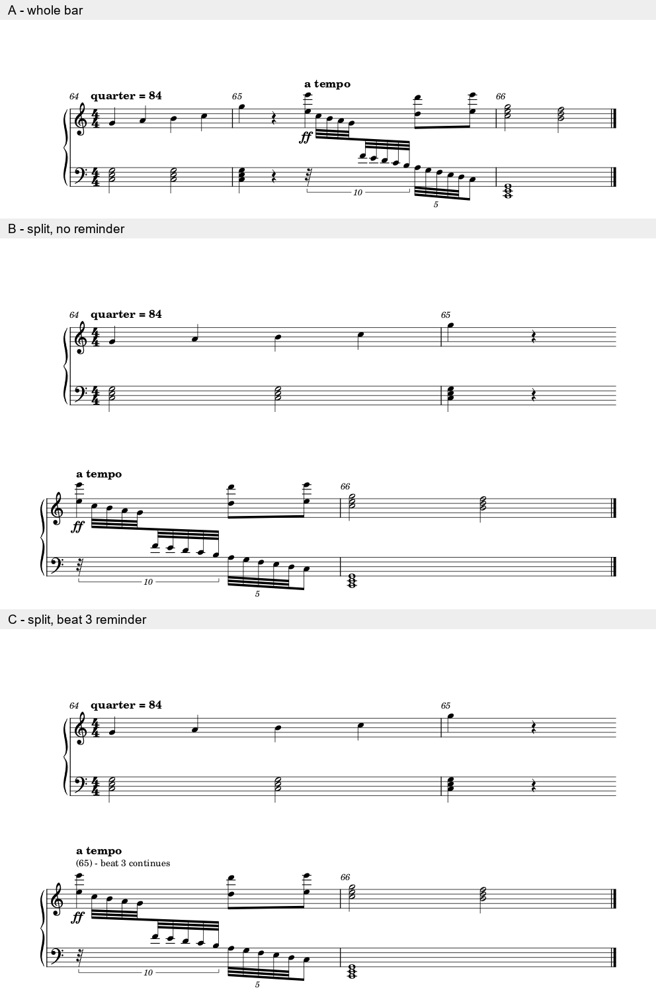

# 半小节续行：逻辑小节、印刷提示和导出拍号

2026-11-03。完成原创机制例**3/3版、1/1原生重载、1/1拆行版MusicXML导回及普通整小节对照**，共18次CLI。三份可编辑输入与一张原生对照图按CC0提供。[证据](split_bar_continuation_evidence.json)保存独立配方、读回、宿主与差异。

**本例优先完整小节A。确需拆行时，C的续读提示比B直接；它目前适合受控印刷比较，MIDI导出仍有拍号副作用。** 这次使用独立创作的三小节模型，尚未转录《Avid》m65或证明原页重排可行；该实曲原生候选仍0/1。

## 两个内部小节段可以表达一个逻辑小节

模型从逻辑64到66。65前两拍为音符和休止，第三拍开始a tempo／ff；下层先休止1/10拍，再进入十音组的九个音，随后5:4短组和组外八分。10:8共占一拍，5:4占半拍，普通八分占半拍。音高为原创，未照抄官谱。

| 版 | 内部容器时长（四分为1） | 读者看到的安排 | 本例判断 |
| --- | --- | --- | --- |
| A | 4＋4＋4 | 完整65，三小节一行 | 时间关系最直观，当前容量足够，优先保留 |
| B | 4＋2＋2＋4 | 65前半在行尾，开放结尾；后半在新行，编号补偿使下一小节仍为66 | 新行a tempo容易被当作首拍，前行又明显过松，本例不优先 |
| C | 同B | 后半明确写“(65) - beat 3 continues” | 若需保持拆行，第三拍的接续更明确；长文字仅为诊断，正式出版另比较括号小节号和续接符号 |

[3版手册](https://musescore.org/en/print/book/export/html/278625)说明Split／Join会改变Actual，而保留纸面拍号。本机`libmscore/splitMeasure.cpp`亦显示生成两个Measure、分别调整长度，并拒绝在连音组中间拆分。因此，内部Measure数量变化本身不足以判定音乐改错。

应保住原逻辑小节与两个显示段的对应、起音和持续、记谱声部／跨表关系、编号及续行读法。本例明确保存65的两段映射，使用编号补偿、开放行尾和可选提示；没有把两个独立2/4乐句假装成原来的4/4。

源码快照HEAD为`8f81421a5cc965dbb32a81fcecf39d626b5610ff`，所查文件干净；实际渲染用冻结exe及1936文件运行时，前后指纹一致。源码与exe的提交对应未认证；没有执行GUI的Split命令／撤销，输入是独立构建的MSCX。

## 音符完全相同，MIDI拍号仍会变化

五份MusicXML读回各有**47条音／休止记录**，与独立配方的音高、书面类型及实际时值相合。三版和重载的原生MIDI都保留44次起音、全部释放、力度及通道控制事件。a tempo／ff仍在全局q6，即65第三拍；第一个下行音在q6.1，保住先后。

但完整文件不同：A为441字节，B／C／C重载均459字节，三份拆行文件彼此完全相同。

| 全局位置 | A的MIDI拍号 | B／C的MIDI拍号 |
| --- | --- | --- |
| q0 | 4/4 | 4/4 |
| q4，逻辑65开始 | 继续4/4 | **2/4** |
| q8，逻辑66开始 | 继续4/4 | 恢复4/4 |

此外，控制轨的EndOfTrack由q6＋1tick移至q8＋1tick，两个音符轨仍至q12；PPQ为480。这是元数据边界差，不能报告“除拍号外所有字节都相同”。初次非拍号比较即发现此差，核查后将轨结束单列；并未忽略它取得通过。

**所以要按用途决定能否采用。** 固定印刷可比较这种续行表示；需要保留原MIDI计量网格、继续编辑或交换时，额外保护尚未闭合。当前没有通过改导出文件或本体代码消除副作用，也不要求普通排版都改成一种内部容器。

## 原生重载与交换分开评价

C原生保存重载保住记谱、编号、续读文字和完整MIDI；PNG只有9像素、最大1通道量化差，不称像素完全相同。

C的MusicXML导回仍保住47条书面记录及44次起音，拍号副作用也仍存在。图上跨表梁／干的形态及部分编号显示改变，不能当原生版直接替代。普通A也做导回控制：去掉拍号和轨结束后，A导回与C导回事件完全相同；它们相对原生都有释放和控制差异。这支持将这些共同变化归于本次交换路径，而非笼统归因拆行。没有进一步拆分本例跨表梁变化的各项因果。

## 可用材料及后续边界

- [完整小节A](fixtures/split-bar-intact.mscx)：本原创模型的优先版。
- [无提示拆行B](fixtures/split-bar-unmarked-experimental.mscx)、[续读提示C](fixtures/split-bar-reminder-experimental.mscx)：实验文件，保留对应关系；不直接套进用户工程。

自动净书应识别“同一逻辑小节的续段”，再检查编号、实际拍位和状态；保存／导出时分别核印刷、音符与计量。未来若需无这些交换代价的实现，再比较插件维护映射或本体支持逻辑小节的布局分段；本轮不开发接口。

资料仍16/25、余9项，官谱及Gould首次覆盖不增加。实际《Avid》上下文的完整小节／续读替代仍需原生重建和整页比较，本机制例没有替它验收。下一步回到实曲与可得余项，不反复扩充相同机制的小差图。
