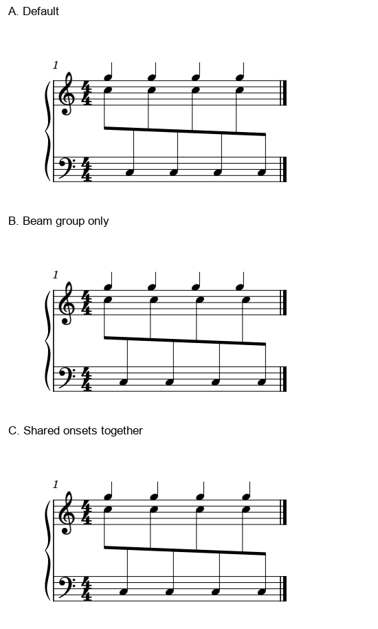
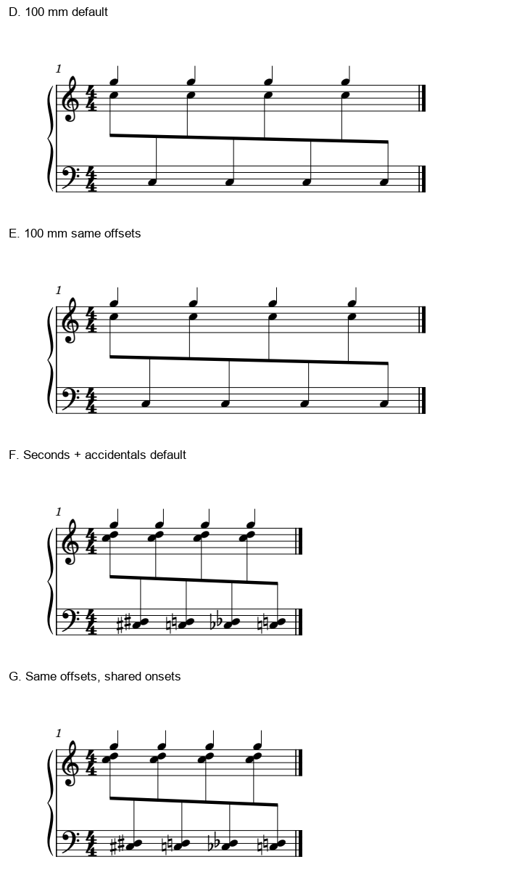

# 均干怎样兼顾独立旋律：共同起音、行宽和二度和弦

2026-11-02，0.27之后工作分支补充。**本组短谱可以同时获得稳定干距和正确对齐，条件是连同其它层的共同起音一起调整。** 只移动跨表音组的版本拒绝；它的梁看着整齐，却把三处同步旋律排开了。七个条件已完成7/7、三个情境3/3、一个候选保存重载1/1。

本研究承接[均头／均干](STEM_OPTICAL_SPACING_STUDY.md)，继续检验官谱中“头距有交替，沿共同梁仍读得稳”的理由。原先《FRIEREN》T与《Great Days》M的观察、Gould p41及官方文档依据保留在前篇；本批没有增加它们的阅读覆盖。全部试验音乐独立原创、CC0，未转写原谱，也未改用户文件、字体或软件。

## 1. 独立层不能留在旧位置

八个C5／C3交替八分仍属同一逻辑voice，跨两表共梁；上表加入四个G5四分，构成独立旋律。每个G与当时的上表C同刻奏，下表仍有一个隐藏整小节休止容器。固定Leland、谱间1.57mm和页面可打印宽参数70mm，系统缩进及表头占位另计；整小节共梁仅为隔离观察，不作普通4/4分组模板。

三个版本来自相同物理比例、相同裁框的完整两手原生PDF。标签在音乐之外，没有在图片里移动符号。

| 版本 | 具体动作 | 跨表干距最大／最小 | 同刻G与正常侧头的关系 | 判断 |
| --- | --- | ---: | --- | --- |
| A 默认 | 无手动横偏移 | 1.98998 | 保持对齐 | 旋律各自规整，但沿共同梁合读有疏密对 |
| B 仅音组 | 复用前篇内部六个Chord的横偏移 | 1.00010 | 三处错开；最大改变1.02013sp | 拒绝，整齐梁不能抵消同步误示 |
| C 联合 | B再把同时的G四分移相同距离 | 1.00010 | 对齐变化仅0.00045sp，属SVG坐标舍入量级 | 本构型优先比较C |

B保住了完整播放，仍然不宜采用：G的干与下面C的干分开，读者需要绕过视觉上的先后暗示才能确认同时。C让这两个属于不同voice的事件继续共列，保留各自时值与干向，沿梁的八分也恢复稳定间隔。四个G的间距仍近等距（比1.00002），没有为修跨表音型而破坏这条慢旋律。

这里的动作单位是有音乐关系的共同起音。两个voice没有合并；不同侧的符头也不要求所有墨迹中心同X。其余真正先后发生的上下攻击继续分开。

## 2. 换宽度后，相同偏移为何这次仍有效

将同一音乐的页面可打印宽参数改为100mm，继续使用70mm例的偏移，不预先重算。D／E验证：默认干距比1.49659，联合后1.00007，共同起音关系保持。宽度更大使默认的疏密比减弱，但本例仍有稳定的光学补偿收益。

D／E相同比例和裁框，F／G也相同；四图均2像素／点，没有把较宽版本缩小来显得更紧。

原因可以从挂头的位置理解：下干与上干的头挂在干的不同侧，同一字号、同一头型的横向差基本固定。行宽改变的是整体步长，这段左右差仍在。若原始正常侧头列仍近等距，补偿量主要由挂头差决定，便可能跨宽度复用。前篇“换宽度后要重看”在这里落实为一次验证，不能改写成每次都必然需要新的数值。

这仍是局部几何关系。同一页面有不同符头、起首符号、另一个更细节奏层，或发生重新分行时，共同列和可用空间可能都变；应检查实际渲染，不能只按毫米比例缩放或复制本例约1.02sp的最大偏移。

## 3. 二度翻头：哪个头代表共同列

F／G恢复70mm宽度，把跨表单音变为二度双音：上表C5／D5；下表依次C♯3／D♯3、C3／D3、C♭3／D♭3、C3／D3。四个G5四分保持。后续还原符号由原生记谱状态产生，不单独删去它们来挤空间。

F默认干距比2.01386，G复用相同联合偏移后1.00005；独立层共同起音关系保持。两份完整图均已看，本构型的变音和二度仍可辨，未见新产生的遮挡。本批没有证明所有字形净空的理论下界，也没有一般碰撞检测成绩。

上表下干二度把C头翻到左侧，正常侧D头与G旋律共列。C与D的原点相差约**1.190sp**；若算法选“最低音头”“第一个Note”或整个和弦外框中心作为时间轴，便会把原本正确的共同列误判。此时要结合干向、头侧和原排法辨认正常侧参照；翻头不是额外起音，不应拉回D头上。

本次加入变音后仍可调整，原因是当前可用空间容得下符号，正常侧列也没有被另一层强制改变。这个正面例与[20对6密集和弦的保留例](TWENTY_TO_SIX_OCCUPANCY_STUDY.md)一起使用：变音多并不自动禁止重分，也不自动证明默认分配有问题。先找实际读图任务、占位与收益。

## 4. 知识怎样用于审谱和后续自动净书

1. 先定位哪个层需要跟读：共同梁、独立慢旋律、真正同步和前后攻击分别确认。
2. 判断视觉参照：同向单音可看正常侧头列；交替干向的共同梁可看干轴；二度先辨翻头，外框中心不作为默认时间轴。
3. 形成局部候选时，检查同刻其它层。B这样的局部匀干可以被技术上直接拒绝，不必再让用户挑图。
4. 在实际字体、字号、行宽下复核共同列、变音与头侧、梁连接以及相邻空间。C／E／G在本组成立；稀疏与密集、宽与窄的具体收益仍要判断。
5. 音乐与播放保持后，再比较跟读收益和整体代价。坐标比率帮助解释现象，不单独作为美观分数，也未获得新的用户审美认可。

后续仍需看四类边界：更紧行宽的变音容量、另一层十六分／三连引入的额外时点、不同字号／头型的挂头差、带弧线／发夹／指法的实际通道。此四类作为下一批计划0/4，当前结果不冒充已经覆盖。先建立具体反例，再决定未来插件或本体需要什么；本阶段没有实现接口／软件适配。

## 5. 验证范围和可用材料

- 七版原生SVG、PDF、MusicXML、MIDI，加C保存与重载SVG，合**30次成功CLI**；三情境**3/3**，七条件**7/7**，重载**1/1**。
- 五份简单织体各12音，两份二度织体各20音；合**100条音符、7条隐藏休止记录**按独立配方核音高拼写、起点、实际／书写时值、显示staff、voice及干向。保存的C另核原生音乐容器，未合并voice或改staffMove。
- 简单五版完整MIDI **226字节**相同，密集两版完整MIDI **274字节**相同；独立解码分别核12／20个起音。不拿两种不同音乐的MIDI互比。
- C重载最大头／干坐标差**0.01 SVG单位**；不能称逐字节／像素相同。首末跨表干及五线保持，原生竖向头位未变。
- 冻结运行时1936文件保持；原用户PDF／MSCZ、Gould和前篇两官谱指纹沿既有记录复核。没有原件副本、运行时副本或删除，也没有打印、试听及实曲采用成绩。

七份原创输入均在[样例目录](fixtures/README.md)：`stem-optical-layered-base/group/joint.mscx`、`stem-optical-wide-base/joint.mscx`、`stem-optical-dense-base/joint.mscx`。B作为失败诊断保留。两张图可直接比较，[证据](stem_optical_contexts_evidence.json)记录配方、实际宿主、调用与坐标。固定0.27标签保留；工作分支知识库／skill即可使用本补充，无须改MCP配置。
