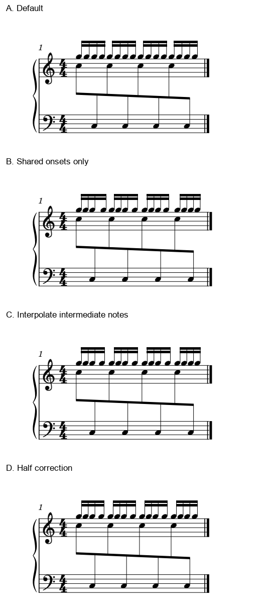
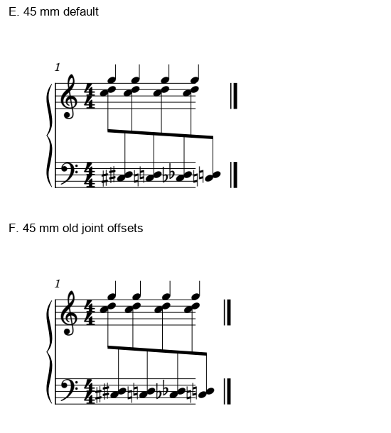

# 均干的代价：独立快线与行宽容量

2026-11-02，0.27之后工作分支补充。**本次连续十六分以默认版为优先；45mm窄版两种排法都拒绝。** 前者虽保住共同起音，校正跨表干距仍会打乱另一条连续快线；后者已超出本实验样式的容量，干距比率不能证明版面合格。

承接[前轮三情境](STEM_OPTICAL_CONTEXTS.md)，预定四类边界已完成**2/4**：紧行宽与额外细分；本批六原生条件**6/6**、保存重载**1/1**。后续[符头与标记通道](STEM_OPTICAL_SHAPES_MARKS.md)已补余两类，累计覆盖4/4；本篇六版结论按原范围保持。资料范围保持16/25，余九项；没有增加官谱／Gould首次覆盖或软件适配。

## 1. 独立十六分不能成为修梁的代价

原创一小节4/4：同一逻辑voice的八个C5／C3交替八分跨表共梁，上表另一voice连续十六个G5，每拍四个一组。固定Leland、1.57mm谱间、页面可打印宽参数70mm；下表隐藏整小节休止容器保持。全小节共梁用于诊断，不作常规4/4分组模板。

四图来自相同物理比例、同一裁框的原生PDF，标签置于谱面外。C并非从图片挪出，所有候选均重新原生排版。

| 版本 | 具体动作 | 跨表干距最大／最小 | G5十六分头距最大／最小 | 取舍 |
| --- | --- | ---: | ---: | --- |
| A 默认 | 无横偏移 | 2.04825 | 1.00026 | 连续快线稳定，优先保留 |
| B 只动同步音 | 跨表八音按前篇量补偿，G只移动同刻八音 | 1.32214 | 1.68019 | 中间十六分留在旧偏移条件，快线疏密明显，拒绝作为美化 |
| C 中间音也插值 | B再给两共同列之间的G分配平均偏移，最后一个G保0 | 1.32214 | 1.45349 | 减轻B的问题，仍打乱快线，不优先 |
| D 半量校正 | C全部偏移减半 | 1.44772 | 1.36191 | 两层作折中；本例仍缺少牺牲快线稳定的理由 |

四版所有八处共同起音都保持；音高、时值、显示谱表和voice也相同。**同步正确之后，仍需评价每条线自己的节奏轮廓。** C既对齐又比B更平顺，仍不能据此认定值得改；A的上层四音组最容易一次读出。

在“连续十六分是主要跟读对象”这一读者任务下保A。若实际作品的主要动作来自跨表层，权衡可以不同，应连同音乐角色看；不能自动给高音、短时值或voice编号永久优先权，也没有新增用户偏好。

为什么有这个冲突：共同梁交替干向需要左右挂头补偿；上层十六分始终上干，正常侧头本来呈稳定步长。将补偿传给共同列，会让上层一部分头跟着左右挪；中间头即使插值，也要容纳这些不同的间隔。前轮只有四分慢线时的正面例不能直接推广到这条快线。

复看《FRIEREN》p11整页，T的交替32分共同梁本身就是主要连续活动；低音保持、首休止、换号及局部变音另有任务。前轮保T近稳干列的理由仍成立，不能把本次额外G5十六分的读者任务倒套到那里。也不能由T推出该页所有头或干都要等距。[原曲语境](INTEGRATED_READING_FATE_FRIEREN.md)及前轮坐标继续按原范围使用，本次只新增该页复读。

## 2. 45mm两版都应先解决容量

将前轮二度／变音加四个G5四分的原创例压到页面可打印宽参数45mm，比较默认E与旧联合偏移F。保留实验样式的`minMeasureWidth=0`、`lastSystemFillLimit=0`及其余参数；这是一份明确压窄的压力构型，不能代表普通MuseScore默认样式的全部行为。

两图相同物理比例。实际五线段长约34.947mm，表头及系统缩进另占空间。E／F末跨表干分别超出五线右端约**2.731／1.711sp**，终止双线又落在更右边，形成可见脱节。这里越过的是五线段右端，不是说尾音越过了实际终止双线。

F干距比由3.31466降到1.43846，外观仍不能采用：原预算不足的问题尚在，缩小某个比率没有使乐谱重新放得下。E作为默认对照也不应被自动判为可接受。先恢复合理宽度、重新分配同系统小节，再看局部净书；前轮70mm两版已经提供可用的宽预算对照，不必为了本轮重复导出它们。

行首第一组临时变音还应清楚属于该和弦。Gould p42强调它与前置谱号、调号等的间隔及归属；p43又要求在紧布局中保护节奏轮廓，并按需要压实符号周围空间或给多枚变音留额外位置。没有把“所有同值都等距”当作扩张所有其它间隔的命令，也没有只凭本图认定变音的理论最小净空。

## 3. 手动偏移还会触发原生重排

本批不能再沿用“末音offset为0，所以末音绝对位置不变”的假设。B／C末个跨表音的显式横偏移为0，原生干却比A右移约**0.85341sp**；D右移约0.02786sp。五线左右端仍保持。实测位置不是基线坐标加显式offset就能完整预测。

只读当前源码的`Segment::createShape`、`minRight`和`Element::pos`可见：Chord形状以包含offset的位置进入谱表占位，最右需求再由这些形状取值。这提供了偏移参与后续分配的路径；本批原生结果也确有联动。源码提交与冻结宿主分别记录，未证明二进制逐行对应当前提交；没有据此修改软件或断言唯一根因。

以后给建议时，须重新看最终原生图中的共同列、节奏轮廓和行边界。输入值相同、保存成功和MIDI相同，均不能替代这一步。不要把前轮孤立构型的首末固定推广到有新层／不同容量的实例。

## 4. 规范与软件文档怎样帮助判断

本批完整复读Gould印刷p40–43，按同一问题联读：p40的时值关系与同类稳定、p41的光学补偿、p42的前置符号归属、p43的局部符号占位。四页一起判断，才不会把其中一段单独变成机械等距规则；它们不构成任意复调织体的唯一坐标解。

LilyPond 2.26官方[第30章限定小节](https://lilypond.org/doc/v2.26/Documentation/notation-big-page)的30.3.1／30.3.2／30.4.1正文及代码已读，图未取得：连音均匀伸展、strict note spacing、musical／non-musical columns分别定义不同控制范围。它提示我们辨清被忽略或被计入的符号及列；本批未运行LilyPond，也没有把它的参数当MuseScore现有按钮。两次短页直取失败后改读同版大页相应正文，没有把整手册计为已读。

实际使用的判断顺序是：识别主要阅读层与同步 → 确认预算确实容得下 → 核正常侧头、翻头和干轴 → 提出少量候选 → 复核其它层、符号归属及整行。这次A保留、B／C不优先、D仅记折中、E／F均拒绝；不要求用户从失败图中挑美观版本。

## 5. 实际证据与可用样例

本批**26次成功CLI**：六版各SVG／PDF／MusicXML／MIDI，另C保存与重载SVG。两种音乐分别20／24音，合**136条音符、6条隐藏休止**与独立配方一致；显示staff、voice、干向、音高拼写、起点及实际／书写时值均核。密集两版完整MIDI274字节相同，快线四版290字节相同，独立核20／24个起音。C保存的24音原生音乐容器保持。

C重载头／干坐标差为0，五线右端差0.01 SVG单位；不称整图逐像素或SVG逐字节相同。1936文件冻结运行时与五份原件沿既有指纹保持；无原件／运行时复制、删除、打印或用户采用成绩。字体保持固定，没有进入字体开发线。

[六份原创输入及两张图](fixtures/README.md)均CC0：`stem-optical-tight-base/joint.mscx`、`stem-optical-fine-base/shared/interpolate/balanced.mscx`。[证据](stem_optical_limits_evidence.json)保留实际配方、调用、坐标与来源范围；[当前进度](STATUS_AND_ROADMAP.md)明确四边界已2/4、仍余头型与标记通道两类。固定0.27标签保持，工作分支skill已可用本判断。
