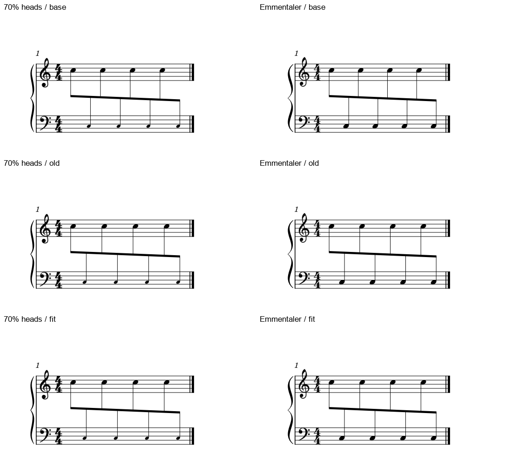
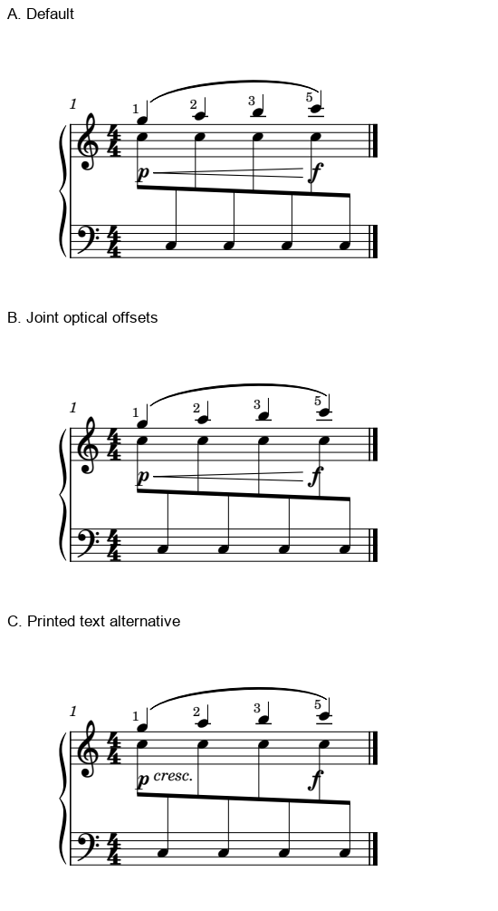
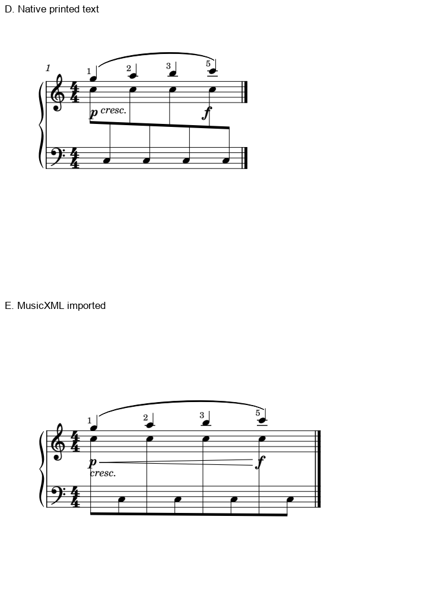

# 符头度量与标记通道：光学校正最后两类边界

2026-11-02。**只缩小音头，本例不必重新发明一套补偿量；换已有字体后应核实际度量，但不必让用户辨认微差。横向排匀则不能解决渐强穿干。** 本批九个最终原生条件9/9、两版保存重载2/2；原定四类边界覆盖4/4，仍保留各自条件与未解项，不记作全部净书能力掌握。

全部音乐独立原创、CC0，沿用70mm页面可打印宽参数、1.57mm谱间、一个跨表八分组。只缩小下表四个Note的头，或只改变已有音乐字体，分别与各自基线比较；没有同时改字体和布局后直接比输赢，也没有制作字体。原PDF／MSCZ只读。

## 1. 缩小头与缩小整个Chord，影响范围不同

本批下表四个C3的`Note.small=1`、`smallNoteMag=0.7`，C5仍正常字号。原生头变换比例实测0.6999997；不是缩小整根干、梁与旗的`Chord.small`。八个书面八分及播放保持，不将这串诊断音乐解释成装饰音或不演奏提示。

| 固定输入 | 无横偏移的干距比 | 复用旧Leland常规头补偿 | 按当前干轴重新算 |
| --- | ---: | ---: | ---: |
| Leland，四个下表小头 | 1.98987 | 1.00012 | 1.00010 |
| 已有Emmentaler，全部正常头 | 2.04197 | 1.00850 | 1.00011 |

比值均为相邻干距最大／最小。小头基线与此前正常头基线的干轴最大差仅0.002 SVG单位；头变小后原点会变，宿主却几乎保持挂干位置。因而“尺寸一变，旧偏移一定失效”也不成立。头原点、字形宽度、挂干侧与干轴必须分别看。

Emmentaler的实际头轮廓与Leland不同，MusicXML字体声明也已核；重新算出的最大补偿约1.0334sp，旧量约1.0200sp。旧量已很接近，微小几何差不是值得反复让用户选图的审美问题。这也不是两字体谁更好看的评测。

六格均来自相同物理比例、相同裁框的原生PDF。大小头组的音乐字体保持Leland，字体组保持全部正常字号。没有提取官谱嵌入字体或向字体开发线添加任务。

## 2. 小音的视觉角色不能由一个字段决定

复读《The Song of Aether》p2，m51的六个小头与随后正常长音分层，跨表梁保持上行展开，组首另有低音持续线索。[既有整曲解释](INTEGRATED_READING_RUMBLING_AETHER.md)的约60.16%名义字号比例沿用旧测量，本批未重新测。不能为了统一大小或时间列，把它改成六个普通八分。

本批原创小头例故意保普通计量音，用于隔离度量。导出的四个`type size="cue"`是字号属性，音符没有`cue`或`grace`元素，仍有完整duration且八个起音都播放。相同“small／cue”字样可以处在不同字段；既不能据此宣布不播放，也不能据大小自动决定借时。Gould p126的斜线、干长与跨表小音条件，也要求一起辨认这些信息。

MuseScore 3官方[小音／小头限定正文](https://musescore.org/en/print/book/export/html/278625?toc=1)已复核：Note与Chord的Small范围不同，本机试验验证的是前者。该页是完整手册导出入口，本批只读对应两段，未重计整本手册学习。

## 3. 弧线、指法跟随了，渐强仍在穿干

第二组原创上表独立G5–A5–B5–C6四分旋律，指法1／2／3／5属于这四个Note，Slur连接首末；`p`到第4拍起点q3的`f`渐强，在本练习明定作用于整架钢琴。跨表八分仍属另一voice，所有版本保持四处共同起音。

A默认干距比1.98998，B联合后1.00010；两版都有**两根干与发夹两翼的四个几何交点**。Slur仍连接旋律，四个指法的所属音保持，图面也清楚；这些成功并未消除发夹问题。不能用某条梁变匀、autoplace开启或MIDI相同替代通道判断。

Gould p308–309把指法靠近所属音，同时给内层和替指等不同情况留位置；它不要求固定在某个谱表外。p315重视两向干长与梁的清楚轮廓，p323说明双干梁会阻碍常规中间动态通道，允许有足够斜度、至少一端在表外的发夹穿过谱表。该例的共同力度不能随便丢到下表外后就按零交点验收，那可能削弱作用对象的识别。

## 4. 文字是有代价的备选，还要保护播放与交换

C保B的音符位置，改印`p cresc.`及后续`f`，原生HairPin隐藏保留为范围／播放辅助。文字在两表之间，避开本例符干；短渐强的图形跨度则需读者通过后续`f`确认。**它是一项记法备选，不能混入无说明的自动美化。** Gould p106通常偏好短变化用发夹，长变化再用文字；因此这里只提供有限通道下的比较，不据零交点宣布文字总优。

首个文字探针把offset y6叠加到下方基准，落到梁下并穿入低部干，已拒绝；最终v2用y2，先前源文件、六次探针调用和其重载全部保留。八个基础条件加最终文字版构成9/9，失败探针不充当第十个成功条件。

原生v2保存后仍保隐藏HairPin、文字和音乐。但MusicXML导出未保住该隐藏状态，实际导回同一冻结宿主后，发夹重新显示，梁也移到下表外：

此图用相同物理比例和裁框保留实际页面位置变化，未把导回版缩小。**原生候选与交换结果分别验收。** 本轮只核这份原创建谱的导回图面，没有把它称作完整音乐／播放往返测试，也没有修软件。后续适配可用此最小复现查隐藏spanner与跨表梁的保持；当前不把依赖隐藏辅助的做法作为可移植MusicXML方案。

## 5. 本批验证与知识怎样直接使用

最终九版分别8／12音，合**84条音符、9条隐藏整休止**与独立配方一致。三个固定输入组内完整MIDI分别202／202／375字节相同，独立核8／8／12个起音；三标记版的力度起止、Slur所属与四个指法单独核对。两最终版重载共20音，最大头／干差0.01 SVG单位；不报整图逐像素／逐字节一致。

实际CLI **48次**：最终40次、已拒绝定位探针6次、导回图面诊断2次；均返回成功，图面是否可取另判。1936文件冻结运行时及原件沿既有指纹保持。完整复读Gould **106、126、308、309、315、323六页**及A128 p2；101–108用于定位的文字片段不计八页完整阅读。

现在可通过skill查本例：识别字号字段与视觉角色 → 按真实挂头／干轴评价补偿 → 保共同起音并核关联标记 → 看实际通道和作用对象 → 保存／播放／交换分别检查。原定四类边界覆盖4/4，后续仍要在实谱应用中检验取舍，尤其未给本构型选定一个可移植、保原短发夹的最终替代；本次文字版与旧m97局部候选各按原范围保留。

[九份原创输入与三张图](fixtures/README.md)均CC0，`stem-optical-size-*`、`stem-optical-font-*`、`stem-optical-marked-*`；标记文字文件名以`-text-v2.mscx`结尾。[证据](stem_optical_shapes_marks_evidence.json)保存配方、调用、图面、字号与导回范围。本批纳入0.28试用版；官谱146/146份1135/1135页、Gould696/696查阅覆盖保持，固定资料**16/25，余9项**，无新增软件或字体适配。
