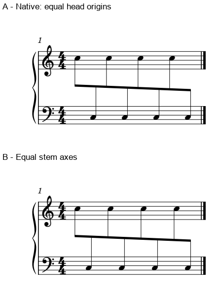

# 跨表间距：眼睛沿符头，还是沿符干读

2026-11-02，0.27之后工作分支补充。**本例倾向按符干轴线分配：同值音符的头可以有交替距离，共同梁下的干却应让人稳定跟读。** MuseScore本机默认把头排匀，干距近乎一宽一窄；手调比较改善了这一点，Local relayout没有改变结果。这个结论限定在本次单线跨表构型。

## 1. 官谱已经告诉我们什么

复看《FRIEREN Beyond Journey's End》p11的T，以及《Great Days》p5–6的上下文／M，另完整复读Gould p41。三官谱页与一教材页均复用旧图，不重加首次覆盖；下表坐标沿用已核旧记录，本轮复核图面，不冒充新的全组测量。

| 具体位置 | 旧坐标证据 | 现在保留的判断 |
| --- | --- | --- |
| FRIEREN p11 T首小节选定20次交替32分攻击 | 头原点距1.764–11.520pt，干轴6.516–6.750pt | 一头挂在干左，一头挂在干右，头距反复变化；中心梁和近稳的干帮助跟读，保留 |
| Great Days p6s6 M首小节最后两拍，八次交替16分双音 | 头原点距6.894–17.352pt，干轴11.664–12.546pt | 音头原点的几何不匀不等于节奏不稳，不把相邻两手攻击吸成同时和弦 |

T的密集和弦和M的双音显示同一阅读机制，也保留了各自的时值与音型。[前者完整解释](INTEGRATED_READING_FATE_FRIEREN.md)、[后者完整解释](INTEGRATED_READING_GRAND_GREAT.md)仍按原范围保存。头位变化还可能来自二度和弦翻头、大小字形或变音占位，不能遇到所有不匀都套这一理由。

Gould p41用普通单表音符的相反干向说明：视觉会把干的关系一并算进节奏感，应按具体构型补偿。LilyPond 2.26的[光学间距正文](https://lilypond.org/doc/v2.26/Documentation/essay/optical-spacing)也强调干向和相对音高；这支持按形态判断，不支持全谱所有符干机械等距。

## 2. 原创原生比较：MuseScore实际怎样排

一小节原创CC0钢琴构型：八个普通八分，C5／C3交替显示在两表、同一逻辑声部，共用中间梁；固定页面可打印宽参数70mm、1.57mm谱间及实际Leland字体，系统缩进／表头的实际占位另计。这里“默认”指没有手动横偏移，分组、干向与显示分配已固定。下表只有一个不可见的整小节休止容器，没有另一条活动声部。整小节共梁用于隔离观察，不作普通4/4分组模板。

两图来自相同物理比例和裁框的原生PDF，标签在音乐之外，未在图片里移动符号。第三版Local relayout与A几何相同，未重复贴图。

| 原生条件 | 头距最大／最小 | 干距最大／最小 | 本例判断 |
| --- | ---: | ---: | --- |
| A，默认 | 1.00004 | 1.98998 | 头近匀，干明显交替 |
| B，按首末干之间的等分位置调整内部Chord横偏移 | 1.92455 | 1.00010 | 共同梁的脉冲更稳，优先作为本构型的比较候选 |
| C，A仅开启Beam的Local relayout | 1.00004 | 1.98998 | 与A相同，没有解决干距问题 |

这里测的是同字形、同字号的头原点，以及干的中心轴。原生谱间约22.252 SVG单位；默认干距约106.46／53.50单位，B约83.76。不是把不同字形外框中心硬凑成相同参照。

B固定首末头、首末干和五线位置，只按目标干轴重分内部六个Chord的位置；最大横偏移约1.020sp，字形轮廓保持。两方向的干连在共同梁上，视线容易追这串干；A中每表自己的头很整齐，但交替合读会形成干的疏密对。B的头距交替有明确收益，不应再被“头距方差”判坏。

## 3. 不能把它和共同起音的错位混为一谈

本例相邻的上下头是前后攻击，两表并不在这些点同时奏。符头从不同侧挂在干上，又使几何位置和视觉参照不同；改光学形状并未重新排列音乐先后。

若另一层在其中时点同步奏，便须联合检查它的对应关系。不能只移动这串Chord，再以本例为理由允许另一条旋律的共同起音错开。[Local relayout前轮反例](BEAM_OPERATIONS_STUDY.md)保留：六个真正共同起音的误示先后仍应拒绝。先辨时间关系，再选光学参照，这两项检查一起使用。

反过来，均干也不必处处最优。音高造成的干竖向范围、梁的方向、和弦翻头、实际净空、独立层及行宽都可能改变代价。本例约1.02sp的偏移是固定70mm预算下算出的局部值，不是用户样式预设；换行宽后须重新看。

## 4. Dorico、LilyPond分别提供了什么依据

本批读到Dorico 6.2官方[光学跨表间距](https://www.steinberg.help/r/dorico-pro/6.2/en/dorico/topics/notation_reference/notation_reference_beaming/notation_reference_beaming_cross_staff_optical_changing_to_t.html)的公开索引正文／步骤及示例图注：它提供以干取代头作均匀参照的布局选项。原图未取得，没有运行Dorico；不能称同曲软件对照。

官方Dorico 4.3.30入门教程的[相应章节](https://www.steinberg.help/api/khub/documents/NCxfO9xLRKK36Jmv~ivZdg/content)索引又保留了另一种情境可能更偏好均头的说明。本批没有下载这份12.6MB手册，也未读其中实际谱页；该文本用于界定选项条件，不计完整教程学习。

LilyPond 2.26的[水平间距概述](https://lilypond.org/doc/v2.26/Documentation/notation/horizontal-spacing-overview)明确把干向修正与时值空间计算分开。这两篇限定正文已读，图片未在本批取得；没有运行LilyPond或把其参数当作MuseScore同名设置。

因此，后续自动净书值得准备两种信息：实际音乐时点／共同列，以及当前组的头侧、干轴和形态。光学目标应能在有理由的局部提出，并检查其它层；还需密集和弦、变音、额外声部与不同行宽验证后，再决定接口或本体需求。本阶段不开发适配。

## 5. 实际验证与可用输入

三原生条件**3/3**，B保存重载**1/1**，实际CLI **14次**。三版各8音／一个隐藏整休止，与独立配方一致；合24条音符、3条隐藏休止记录，显示staff、voice、干向和实际时值已核。完整MIDI **202字节**相同，另核8个起音。

B重载后最大头／干坐标差0.01 SVG单位，约0.00045sp，不能称SVG逐字节或逐像素相同。1936文件冻结运行时前后保持；原官谱、用户PDF／MSCZ及Gould五份指纹保持。没有打印、试听、交换导回或用户审美采用成绩。

三份原创输入：[默认](fixtures/stem-optical-baseline.mscx)、[均干局部比较](fixtures/stem-optical-even.mscx)、[Local relayout诊断](fixtures/stem-optical-local.mscx)。[证据](stem_optical_spacing_evidence.json)保留真实调用、配方、坐标及适用范围。字体作为固定输入，未制作或替换字体。

本批固定资料仍16/25，余九项。R10新合作署名仅补来源线索，未取得新谱面或具体人工改法，不增加完成数。固定0.27标签保持；工作分支的知识库与skill可立即检索本例，[进度与后续计划](STATUS_AND_ROADMAP.md)同步维护。
