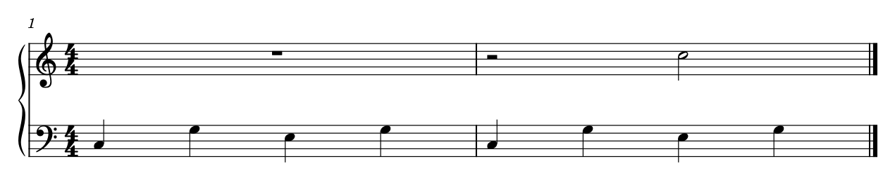

# 符头、线重与休止：形状和位置都参与表达

2026-10-21。按原目标回查基础依据后，完整读图Gould印刷p9–16、27、34–38，共14页；其中包含已读内容复看和此前只读文字部分，不将全组记作新覆盖。复看A015 p1，并以原创两小节验证休止符与谱线的关系。[证据](symbol_reading_evidence.json)记录实际图页、原生输入／输出、音乐配方、几何和保护范围。当前只学习与验证，没有制作字体、改用户谱或开发软件适配。

## 1. 为什么不能把符号当作任意可缩放的墨迹

**时值还在字形里。** p9–10将黑头、二分、全音符和倍全音符分别说明。二分音符头略宽于黑头，全音符头又更宽、方向与内部留白不同；全音符并非去掉符干的二分音符。读白音符时，头形本身提供时值线索，不能只保护duration字段或仅数有没有符干。

这不排除特定多声部共头／异时值写法。它们由层次和上下文解释，见[同音附点](UNISON_DOTS_STUDY.md)；不能从有条件的共头反推“全部空心头可以统一为一种形状”，也不能把显式头型覆盖按默认等价清理。

**形状可提示特殊动作。** p11–13的菱形、叉头、圈叉和三角头各有用途。钢琴菱形可以表示无声按键，不能因不产生NoteOn就与已奏过的中踏板持音提示互换；已有动作区分见[持音续行](SUSTAIN_CONTINUATION.md)。三角头用于不能精确指定的极高／低音，不是给已知音高换一种装饰。具体作品的文字定义、乐器和上下文优先，不能从PDF轮廓单独断定对象身份。

**尺寸须与实际谱高及印刷匹配。** p10–11要求普通音头在谱间有足够辨认尺寸、线上空心头保住内部白眼；过粗谱线、过小音头可能在复制中填黑。这里是阅读目标，不能拿外框略超1sp就判字形错误，或自动压扁／放大字体。先看实际墨迹、物理尺寸、输出管线和cue／装饰身份；[输出阅读](OUTPUT_READING.md)已有相同几何呈现不同灰度的反例。本轮固定Leland输入，没有比较或选定个人字体。

## 2. 符干、旗尾和加线的协调

p13–16强调符干方向随单音位置、同拍／半小节材料及上下文组织，而非每个中央线音都独立翻向；和弦、双部、连梁、grace与cue另有条件。普通3½sp、双部外侧逐渐缩短至2½sp是本书的情境基准，不是全谱统一长度或可直接套给装饰音的阈值。干长从靠近开放端的音头量，和弦穿头部分不能混算。

旗尾也会占位：过短符干配长旗会逼近或越过音头；更多旗／梁需要相应空间，加线外缘应能辨认。p15允许某些下干旗接近音头，p16又展示不合适的旗尾遮住加线，故不能建立“所有接触即碰撞”规则，也不能为紧凑而统一缩短全部干。相关原生比较见[梁干](BEAM_STEM_STUDY.md)和[跨表共同梁](CROSS_STAFF_STUDY.md)。

p27进一步解释加线的长短：二度和弦的错头在线上还是间内，决定最外加线是否需要同时包住两头；更远处恢复单头宽。交叠两部的非共享加线不应穿过另一部符干。这样的有条件伸缩让音高归属清楚，而非所有加线机械等长；也与[二度归属](SECONDS_OWNERSHIP.md)、[实曲间距](USER_SPACING_APPLICATION.md)中的真实占位有关。本轮只补完整图文，没有重建所有加线情境或判定当前引擎全部处理情况。

## 3. 线重有阅读层次，不能全部归到音乐字体

p13建议符干较谱线细，同时要能可靠复制；p38要求小节线明显区别于符干，让长而复杂的小节边界易找。它们分别承担连接、音高参照和结构定位，统一黑度不是唯一的整洁目标。

本轮自制例的实际SVG描边为：符干与谱线均约0.110sp，普通小节线约0.180sp，终止粗线约0.550sp。它说明符干／谱线相对层次值得在具体输入中检查，也再次表明线条几何并非全部由音乐字体决定。这只是该练习和固定二进制的有效输出，不证明用户工程同值、全部MuseScore默认如此，或已经找到原谱“不好看”的唯一原因。

若以后比较线重，应固定字体、谱高、密度和实际输出尺寸，分别核空心头白眼、加线、短干与黑梁的组合；不能只放大一根线选最细者。当前没有为这组小差异要求用户选图，也没有给出已采用的全局数值或打印结论。

## 4. 休止的位置也携带类别和声部信息

Gould p34–38的五线谱条件如下。这里讨论实际图面与目标谱表，不是对原生offset字段作取模检查。

| 情境 | 读法与放置依据 | 自动整理的边界 |
| --- | --- | --- |
| 普通单线中的休止 | 保持常规中心位置，不逐音追随周围音高 | 有跨休止梁／独立两部时另判，不能一律回中 |
| 全／二分矩形休止 | 全休止挂在线下，二分休止立在线上；其余边界形状也由谱位帮助辨认 | 半sp随意移动可能改变读者看到的类别，duration／MIDI不变仍可能误读 |
| 有理由纵移 | 书中以整sp移动保住与谱线的关系；谱外矩形休止要有明确的支撑加线 | 原生自动基准、staffMove、目标谱表或单线谱不同，不能直接查offset是否整数；不强制所有offset归零 |
| 一拍内多个休止 | p37图文要求局部水平一致，让拍内小组易辨 | 此段曾被文字提取漏掉，已看完整图核实；不是全曲所有休止同高 |
| 同表独立两部 | 上下部通常分列中线两侧；矩形休止不得随意越过中线换层。另一部远在加线区时，短休止有回中条件 | 先分真正独立部与自由附加层，不能由软件voice数量决定全部显示／隐藏 |
| 简化与复杂度 | 非严格对位时可有共用休止，复杂到层次难辨可考虑分表 | 钢琴章的自由织体与严格对位另读；省休止、改分表均是记法提议，不混入几何美化 |
| 附点休止 | 点与其休止保持相对位置 | 不能照搬音符点避开谱线的移动方式；节拍是否允许附点另查 |

**A015《Attack on Titan (Main Theme)》p1是有用的正例。** 首系统上表整小节休止随各小节空白居中，下表活动层与低部休止同时可见；第二小节的低部矩形休止另有下方位置和短横线帮助辨认。它们没有全部吸到同一个高度／起点，却仍交代了整小节静默、拍内停顿和层次。PDF不能给出内部voice编号，未据此推断对象的实际生成方式。

整小节休止居中也不意味着在小节中央才开始停。横向位置、实际起点、纵向类别和所属层需分别看。用户m135的休止还承接两条持续弧，已有[改型牵动弧尾的反例](SUSTAIN_AND_RESTS.md)；本轮没有改它，也没有把作者的A八度持续说明重新列为未知。

## 5. 原创原生例：半sp使二分休止看起来像全休止

两小节4/4、双谱表、固定Leland／Leland Text及1.57mm sp。m1上表整小节休止；m2先停两拍，再奏两拍C5，下表八个四分音符提供脉冲。一个Rest的autoplace在所有版本中都显式关闭，只有它的纵向offset变化；没有参考／用户音乐摘录，公开谱例为CC0。

**正常位置保留。** m1全休止挂在第二根自上而下的谱线下；m2二分休止立在中央线上，形状和横向位置各自帮助阅读。

**半sp上移拒绝。** 只将m2二分休止上移0.5sp，实际仍为half、两拍；矩形却挂在上一根谱线下，呈现全休止的关系。完整两手还显示其后有二分音符，这种冲突增加了辨认负担。不能因为无碰撞、时值字段正确、MIDI相同就认作安全的避让。

**整sp控制。** [原生文件](fixtures/rest-reading-whole-space-control.mscx)／[图](fixtures/rest-reading-whole-space-control.png)再上移至整1sp，矩形又立在一根谱线上，保住二分休止的线位关系。这个简单单声部没有抬高的必要，因此它只是说明相位的控制，不是优于常规位置的候选；真正多部、跨梁的归属还须独立核对。

## 6. 核查到什么程度

三版原生XML除目标Rest的纵向offset外相同，11条音休止的实际起点／时长／音高／谱表与独立配方一致；实际MIDI的9个起音时间与音高另核，完整MIDI三版逐字节相同。SVG除目标Rest与标题外全部相同，字形路径也相同，仅transform沿y移动；未用外框交叠代替语义判断。

以顶部谱线为0，常规二分休止外轮廓下沿约2.016sp；半sp上移后上沿约0.972sp，与第一小节全休止约0.980sp的悬挂关系接近；整sp控制下沿约1.016sp。数字是当前字形控制点包络及原生坐标的核查，不是字形完全相同或跨字体阈值。完整图面同时复核立／挂关系。

半sp拒绝版保存重载后，原生图形／原始RGBA、实际音乐与完整MIDI均保持。因此错误读法不是一次性预览现象；稳定保存也不等于应该采用。没有做MusicXML重新导入、音响／打印或用户审美选择，不称格式往返无损。

本轮把基础字形与谱位约束接回已有的节拍、声部、持续和输出知识。后续净书应检查信息还能否正确读出，再比较留白与一致性；软件适配仍另期进行。
