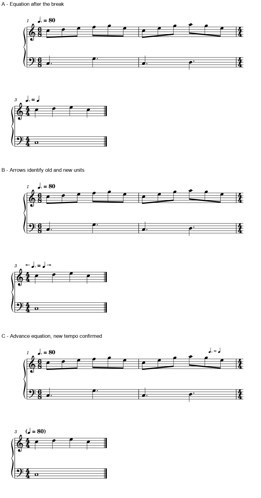

# 速度等式怎样让读者提前准备

2026-11-02。**本例优先“上一行预告关系、下一行确认速度”；前行拥挤时比较带方向提示的新行写法。** 两种方案都先要求关系本身已确认。Madoka m92仍缺作者意图证据，本批只把结构上较连贯的解释列为优先核对，未改官谱。

## 1. 回到m92：从两种读法推到可核对的音乐关系

复看A085《Madoka Magica - Piano Suite Medley》p1–4四完整页及m87–96旧细图。m20的Molto mosso是四分154，p2–3继续3/4；m91有rit.，下一行m92换C，Calando后印**二分＝附点二分**，没有方向箭头。m94有cresc.，m95有accel.，m96的E另给附点八分164。后者仍是四分123／附点四分82，不能改读成附点四分164。

以下用`T旧`表示进入转换前的四分速度。因rit.已经生效，不能把m20的154直接当作这个边界的实速。

| 等式的归属 | 新四分速度／旧四分速度 | 新4/4小节时长／旧3/4小节时长 | 可听／可核对的结构关系 |
| --- | ---: | ---: | --- |
| 旧二分＝新附点二分 | 3/2 | 8/9 | 新小节略短于旧小节；旧两拍相当于新三拍 |
| 新二分＝旧附点二分 | 2/3 | 2 | 新半小节承接旧整小节，两个新二分各占一个旧3/4的长度 |

这不是凭表情词猜方向：原来的连续八分伴奏在m92转为二分音符的疏缓材料。**本批优先核对“新二分＝旧附点二分”这条解释**，因为它把旧整小节的时间单位带进新的半小节，也顺于疏缓后再accel.的结构。Calando／rit.并不单独排除另一种解释，局部弹性也会影响实速；不能因此发布音值互换或新BPM修订。

后续有同版本音源或作者说明时，重点核新二分与转换前拍感的关系，而不只比较整段的平均快慢。渐慢中的整小节平均时长并非边界瞬时拍速，也不能拿后来E的123倒推中间每一拍。当前收获是把未知拆成有音乐意义、可继续核对的两条假设。

## 2. 规范为什么关心等号、方向和换行

完整复读Gould p184–186三页。p185说明旧式新左旧右与现代旧左新右会造成相反解释，因此建议让等号跨转换小节线，使两边音值各靠所属音乐；p186用指向两侧的箭头明确归属。整串放在新行也可以，方向提示便有实际用途。

跨系统时，p186优先在前行结束前提供关系，让读者尚在旧脉冲中时准备转换；新行可确认新速度。另一选择是整串放在新行并消歧；也有分写在两行的办法。提前量、可见性和当前行剩余空间共同决定布局，不必全谱只用一种坐标。

p184关于速度标记的高度也有条件：同系统的标记对齐有助于识别，但与各处谱面保持适当距离更重要，不能为了水平齐线把文字孤立到远处。渐变延续的虚线保持水平；斜箭头表达速度方向又是另一种图形约定，不能混成同一条延续线。

## 3. 原创原生比较：含义已确定时怎样写清

独立CC0三小节钢琴短谱，前两小节6/8、附点四分80，第三小节4/4、四分80。**实际大拍始终0.75秒**；对应的四分BPM从120变80。这个构型与Madoka的未定方向分开，不是官谱转写或替换。

三段来自MuseScore原生PDF，相同比例与裁框，标签位于谱面外，没有移动单个符号。第一行末的4/4预告和下一行表头都保留。

| 版本 | 读者获得的信息 | 本例的判断与代价 |
| --- | --- | --- |
| A，新行只写等式 | 进入新行才看到两种音值的关系 | 作为原始对照；方向不熟悉时仍需推断 |
| B，新行加左右方向提示 | 左音值属前段，右音值属后段 | 紧凑、归属清楚；准备仍到新行才发生，略增宽度 |
| C，前行预告＋新行数值确认 | 先建立转换关系，到达时直接读新四分80 | 本例优先；多一次确认并占前行末上方空间，密集处不机械套用 |

图C的预告是贴近前行末的说明，独立于实际新速度事件；不能把文字的提前摆放同时变成播放提前换速。另行、再分页或音乐变密后，需要重新核前行末、标题与弧线的通道。本批没有替用户工程或Madoka生成对应整曲候选。

## 4. 实际验证及首轮输入失败

有效原生条件**3/3版**，B保存重载**1/1**。每版21个音符与独立分数时间配方一致，共**63条记录**；音高、拼写、书面类型、附点、实际时值及谱表分别核。三份完整MIDI **310字节**相同，另核21个起音；四分单位0处为500,000μs、6处为750,000μs，对应120／80 BPM。B重载SVG除文件名`title`外相同。

实际CLI **24次**：前12次属于失败输入探针，修正后12次才构成上述有效核查。首次生成器对富文本做XML缩进，引入可见换行；又把`dots`写在`durationType`之后，原生回读出现带附点外形、实际仅四分的下表音符，并补出休止。按正确顺序重建并清除富文本内的非意图空白后，独立配方核查通过。失败输出保留本机，不列作可用输入或软件缺陷结论。

这增加了一条后续数据处理经验：**可见附点、常规时值字段和实际duration必须分别核对。** 不从外观或单个XML字段推定播放；富文本内空白也可能有排版含义。输入错误与宿主局限分别定位，再决定是否需要开发。

本机有效音乐字体为Leland；输入依赖冻结宿主的默认文字样式，不声明跨版本像素一致。固定运行时1936文件前后保持，原PDF／MSCZ和教材只读。没有导回MusicXML、试听、打印或用户采用成绩，无MCP／插件／本体适配。

可直接打开：[A原始对照](fixtures/tempo-equation-plain.mscx)、[B方向提示](fixtures/tempo-equation-arrows.mscx)、[C提前预告](fixtures/tempo-equation-advance.mscx)。[本批证据](tempo_equation_evidence.json)保留调用、配方、失败与真实范围。

## 后续审谱怎样应用

先问音值各属哪一侧，以及图面和实际tempo事件是否同一意图；含义未定就列出候选解释。含义确定后，按前行末空间、换行／翻页、下一入口和标记通道选择预告或新行提示。数字相同也须连单位一起读；BPM换算、脉冲保持和作者的弹性速度分别检查。

本轮复查官谱4/4页、Gould3/3页，均不重加首次覆盖。固定资料保持16/25，余九项；研究成果可直接通过skill检索，完整路线见[进度](STATUS_AND_ROADMAP.md)。
