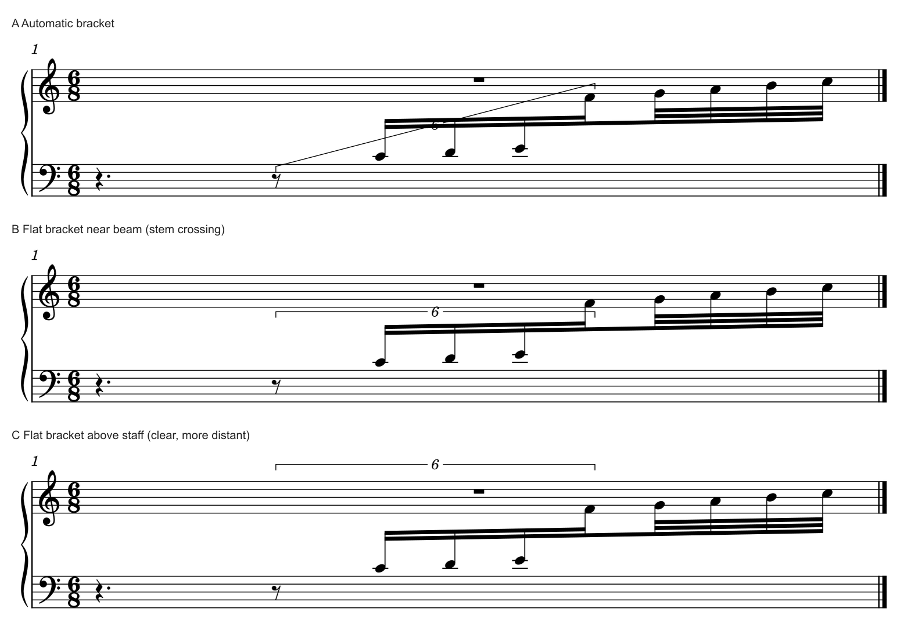

# 跨表连音：数字、括号通道与穿干问题

2026-10-31。**五处实际情境复核5/5，原创原生条件3/3。** 三处官谱保留，A005一处解释纠正；撤回此前对用户m97“仅伸长右端”候选的采用倾向。范围变清楚后仍须检查线条和声部归属。本批是0.21固定版之后的工作分支补充，未另发固定版本；[证据](tuplet_channel_evidence.json)保留实际来源、比较和边界。

## 1. 官谱为什么把数字放在那里

**A013《青之栖身》p5末系统：把重复运动的识别成本压低。** 每束上行六连在两谱表间相接，前半上干、后半下干，数字6连续放在梁下。每根完整梁已经划定一个六连组，短数字足够说明分法，额外括号只会增加一排黑线。数字留在相同侧，让眼睛沿连续动作追踪；这里没有把每个6都搬到远处的谱表外。上方大弧、局部八度线和下方的loco／力度仍各说明自己的范围，不能把它们与连音范围合并。

**A076《君の知らない物語》p6末系统末小节：长梁本身是范围提示。** 完整22组沿一根下降梁跨向低表，22置于梁下；上方长弧说明大动作，数字说明时间分法。完整梁、单一连续运行和清楚的数字共同降低范围歧义，因此保留无括号。若把22抬到整组上方，会扩大数字与主要运动之间的距离，并与长弧争空间；这里没有看到足以支付这些代价的收益。

**A088《人生的旋转木马》p4 F两处下降17：给不同信息留各自的阅读通道。** 连音数字在梁下，长弧在音头外侧的上方，渐强／渐弱线在梁的下方更远处。相邻13／15与17组的数字保持相似关系，帮助读者辨认一串连续动作中的分法变化。好看来自这些层次有秩序地共存：梁跟随组形，数字靠组，弧连接动作，发夹保留可辨的上下边。将所有线压进最窄的谱表间距会破坏这套分工。两处17是完整组；上行13／15的实际占时另按上下文计量，不能因数字位置相似就套同一比例。

上述三例的“保留”依据是完整组、可追踪的连接和清楚通道。混合干向不强制数字一律朝外；Gould p319同时考虑醒目度、中央干向和内声部归属。官谱的侧别是具体取舍，不能做成全谱固定Y值或“全放梁下”的模板。

**A005《200 Anime Songs Medley》PDF p123第四系统前两小节：括号还在说明梁外成员。** 本次扩大图看清11组从起首休止开始，休止在实际梁之外，后面还有另梁的短组。短括号使读者知道休止也受11支配；上层持音和组内slur另有功能。此前[逐谱笔记](corpus/READING_MEDLEY_200.md)用“运行有梁、多层仍可保括号”解释得过宽，漏讲这项具体必要性。它不适合充当“完整组全在梁内仍保括号”的实例；本批修正这条理由。一般的歧义例外仍可查Gould p200。

## 2. 规范怎么帮助判断，哪些条件不能混用

本批完整复看Gould印刷p195–200、319–320，物理页均加20；都是已有覆盖的复读，新增阅读覆盖0。

| 判断 | 本次归纳与阅读理由 | 来源／边界 |
| --- | --- | --- |
| 先定范围 | 首尾通常覆盖实际音头／休止；末值较长时可延到假想末细分，以接近节奏中心 | p195；不能把前置变音和装饰音一起圈进来，也不等于所有括号必须按物理宽度居中 |
| 先定是否需要括号 | 完整组由梁清楚覆盖时可以省；仅部分梁属于连音，或梁外有组内休止时须说明范围 | p199–200；梁已延伸覆盖端部休止又可有不同处理，“含休止必加”过宽 |
| 再选可读的一侧 | 混合干向允许按具体通道选侧；数字附近的梁、中央干、其它独立层都影响归属 | p198、319；内声部数字应留近所属梁，不能仅按远处空白最大决定 |
| 坡度服务识别 | 相随的梁可给括号参考，但当内部方向变化、斜线穿入谱线等情况出现时，可改平放 | p196–198；不要求跨表高低音头决定一条很陡的括线 |
| 弧与括号分层 | 长短及所属对象决定弧内外；若线会混在一起，要重新安排通道 | p198–199；完整slur没有自动提供连音计量范围 |
| 外置有代价 | 外置更醒目；近梁更容易归属于内层。跨表不同端点／无梁组另有处理 | p319–320；本批原创例只有一条运行，没有验证独立上方旋律下的最优外置方案 |

这里的通道指读者能把数字和线认作哪个组、又能顺着它读下去的空白区域。检查相交只是其中一项；谱线相交、必要的干／弧交叉各有条件，不能建立“所有交点都是错误”的规则。

## 3. m97：修正此前的推荐

[原研究](BEAM_SCOPE_TRANSFER.md)核清m97后半拍的实际结构：八分休止＋四个十六分构成6:4，随后四个普通三十二分与其共主梁。原手调右端过短，容易漏掉最后连音B4；仅恢复`p2.x=0`的私有候选让范围更明确，音乐和其它谱面保持。这是此前的范围结果；本次撤回采用倾向，原因如下。

**本次近看和原生几何复核确认了跨表连音括号穿干：伸长后的右侧横线穿过B4向下符干。** 交点约为SVG `(2508.930, 401.545)`，位于该干的`y=359.912–446.899`范围内；原短端没有这个交点。线头、梁及干向变化在同一处拥挤，新增交叉削弱了刚获得的范围提示。

因此撤回“本线倾向这个候选”的结论，现记为**范围诊断有效、排法尚未完成的中间候选**。此前3次CLI、3203对象／完整MIDI保持及8页差异检查仍成立；它们验证了修改范围，没有验证全部可读性。旧证据与0.21标签保留，本页给出后续判断。

下一步须带m97独立上方旋律一起比较：外绕是否误归上层，梁旁能否找到清楚通道，是否确有必要另提局部重分梁。最后一项会改变记法组织，须单独说明，不能夹在括号坐标修正里。用户原谱和原PDF未改，本批也没有生成新的私有m97候选。

## 4. 原创原生三条件：清楚和靠近为何会冲突

复用上一批[原创八音配方](fixtures/mixed-beam-exchange-source.mscx)，不复制用户音乐。保留完整主梁、两段第二层、后四音第三层及6:4范围；仅给Tuplet添加两个端点的竖向偏移。字体、页面、音头、干、梁及休止均保持。

| 条件 | 实际图面与判断 | 取舍 |
| --- | --- | --- |
| A 原自动 | 陡括线穿过组内符干，并与梁／数字混在一起；保留为失败基线 | 外音高低不能独自决定跨表括号通道 |
| B 梁旁平放 | 数字更易认，仍穿过最后连音F4的下干；不作为完成候选 | “平放”和“靠梁”各自正确，组合后仍须检查连接 |
| C 上表之外平放 | 此例0处括线／符干交点，范围仍含起首休止且排除普通尾音；本小样本优先比较这一版 | 数字离运行更远，需要上方空间；未加入独立上方旋律，不能据此宣布m97已解决 |

可编辑输入：[B近梁平放](fixtures/tuplet-channel-near-beam-flat.mscx)、[C上方外置](fixtures/tuplet-channel-outside-above-flat.mscx)。均为原创CC0，保留原完整字库和原生字形，不含原谱或书籍图像。偏移值由本次特定谱面坐标校准，仅用于复现，不是样式预设。

### 实际验证范围

- 新增8次CLI：两候选各SVG／MXL／MIDI，再将C另存MSCX并重载导SVG。A复用旧结果，未重复生成整套输出。
- 三条件各11个音符／休止记录与基线相同；每份完整195字节MIDI相同，全部非Tuplet绘图相同。两输入去掉新增端点偏移后与原创源文本相同。
- 括线与符干中心线相交：A为2，B为1，C为0；这是本例的几何定位，不是整体审美分数。A另有可见梁／数字冲突，未靠交点计数冒充完整避碰检查。
- C保存重载55个带类名绘图中54个属性完全相同；剩余数字轮廓有最大0.001 SVG单位的坐标量化差，约0.000045sp。两段括线及其它对象完全相同。未导出保存后MIDI、未MusicXML导回、未打印或用户采用。
- 私有增量96,149字节，预算192KiB；新增公开两输入＋一图135,902字节。原PDF／书页只在内存看，复用宿主及旧整谱，未删除文件，未重新声称全缓存精确总量。

## 5. 知识怎样用于后续净书

遇到类似情境，先读出真实时间和组内休止，再比较连音成员与梁成员。需要括号时，先保护范围，再检查数字是否能认、是否归对层、括线是否与干／梁／弧混读，最后才比较统一侧别、坡度和留白。

本机现有端点属性足以生成本例的两种外观候选；不需要为了开始净书先开发MCP。本例揭示的后续引擎研究方向是：**跨表括号默认布局应同时考虑完整组、休止、混合干和可读通道**。先以本页的失败基线及反例形成诊断和预览需求；有独立上层的原生情境仍须补齐，届时再判断插件或最小本体接口。更换字体可改变轮廓和余量，不能独自解决范围与归属。

本次没有新增官谱／Gould首次覆盖或资源完成项：官谱146/146份、1135/1135页，Gould696/696查阅覆盖，资料16/25余9项；20个skill入口继续可用。后续完整计划见[进度报告](STATUS_AND_ROADMAP.md)。
