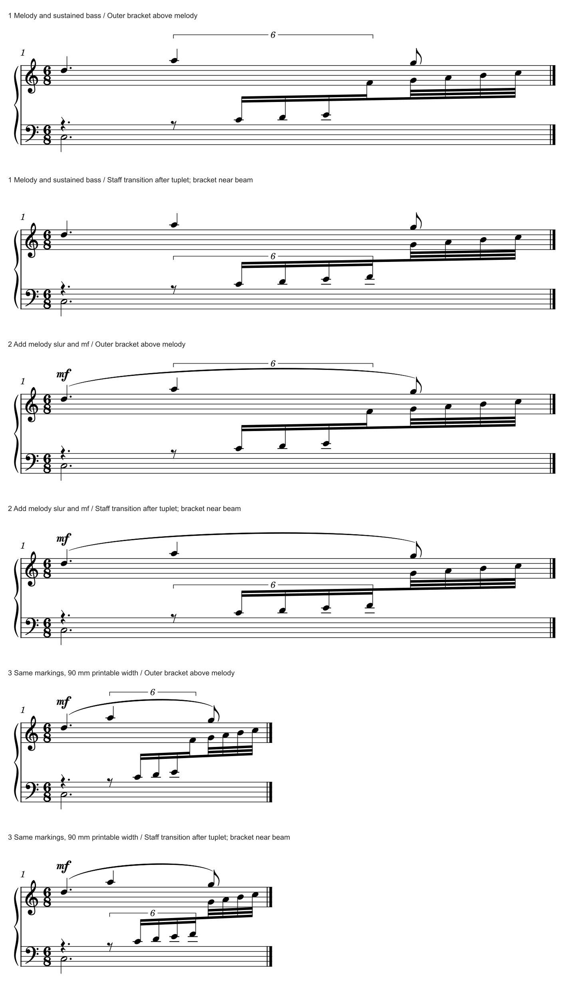

# 连音属于哪一层：换表点、加线与括号通道

当前另有[渐强局部候选1/1](M97_DIRECTION_FEEDBACK.md#hairpin-channel)：保原方向与原六连，只改发夹的竖向通道，穿干6→0；尚未采用，完整六连避让后继仍0/1。

2026-10-31已收到m97反馈：“可能喜欢原来方向感，但避让不是很好”。局部优先保原方向；[后续外置／下侧三探针](M97_DIRECTION_FEEDBACK.md)均未推荐，下一步先用原创例比较明确组界的记法方案。旧迁移验证保留，不再标作用户选择待回复。

后续[m97实曲迁移](M97_TUPLET_TRANSFER.md)已完成1/1：实际B4需要四条加线，局部端点会反馈到整页间距；原件与音乐保持，新比较候选待视觉选择。本页原来的下一步计划现已完成。

2026-10-31。**上一轮计划的三种情境完成3/3，六版原生比较6/6，紧行宽候选保存重载1/1。** 加入独立上方旋律、上层弧线／力度，再收紧行宽后，本例优先比较“连音末音仍留在下表、普通尾音再换表”的方案。六版都没有括线穿干，归属和读法仍有明显区别。[证据](tuplet_ownership_evidence.json)记录27次CLI、实际差异与未验范围。

这是[上一批通道研究](TUPLET_CHANNEL_STUDY.md)的补缺；新增原生情境不计为新官谱、教材掌握率或用户偏好。固定0.21标签保留，本批继续更新工作分支；用户原谱只读，本次没有新增m97私有候选或软件适配。

## 1. 先从官谱看归属，而不只找空白

**A027《Call of Silence》p5 G：慢层和快层各有可跟踪的路线。** 上方较大音头、向上符干和较慢的梁组继续旋律；密集运行沿跨表梁前进。12／14等数字贴近快层梁，读者无需越过慢旋律去寻找它们。下降含休止的局部组又用下侧括号，说明哪些成员受数字支配。这里的两种位置各有任务，不宜把所有数字拉到同一高度。

下侧的排法也需要判断：第一系统下降9组的括号从梁外休止开始，主体有一段进入低谱表的线间。它明确范围，却与Gould p199“括号主体放在谱表外”的要求有差别。**保留范围提示的作用，同时把线与谱线混读列为可改进点。** 不能因这是参考官谱便将整套位置照搬，也不能据PDF推断作者为何保留了这项折衷。

**A064《in the pool》p1 A：数字和大弧指向不同的阅读层。** 上方慢旋律有自己的长弧；下方11组由完整梁界定，11留在梁下。运行的局部弧、前后发夹及低部换谱号各有端点。把11移到旋律大弧之上，虽然可以找出空白，却增加了数字与快层的联系距离。保留近梁位置更直接；不能用最长弧来定义11的成员范围。

本次两页均完整复看，A027另近看G首系统。它们已在全目录覆盖中，不重复增加146份／1135页成绩。

## 2. 哪些规范条件帮助作选择

本次完整复看Gould印刷p199、319、320，物理页均加20，新增覆盖0。

- p319在混合干向组中兼顾醒目度与中央干；当跨表运行夹在其它独立层之间时，数字须靠近所属梁。上方有空白仍不足以决定把它移上去。
- p199把独立声部的节奏提示、括号主体与谱线的区分一并考虑；端钩或数字边缘偶有入线，与整段主体落在谱内不同。
- p320给外置及连续同侧的醒目方案，也另讲无梁跨表组的端点。专门针对无梁组的例图不能直接套给本例完整共同主梁＋部分连音的结构。

由此，本批先判断数字归哪个动作，再比较能否靠近、范围是否完整、线条是否清楚，以及加线和竖向空间的代价。零交点只解决了其中一项。

## 3. 原创三层配方与两种候选

沿用前批原创C大调运行，加入新写的上层D5–A5–G5慢旋律，以及下层持续C3，形成真正夹在两层之间的快运行。6/8后半拍的八分休止＋四个十六分构成6:4；之后四个普通三十二分继续同一主梁。上层和低音在三个情境中保持同一配方；第二情境只加上层弧线及mf，第三在此基础上把可打印宽度改为90mm。

| 排法 | 具体改法和阅读结果 | 代价／判断 |
| --- | --- | --- |
| 上方外置 | 保留连音末音F4显示在上表，将完整短括号放在慢旋律及其弧线上方；范围含休止、排除普通尾音，且不穿干 | 数字在另一条独立旋律的外侧，容易先被归到慢层；本例不优先采用 |
| 换表点后移、近梁 | 仅让F4留在下表，普通尾音G4起再移到上表；短括号放在梁上方的谱表间空白中 | F4增加两条加线笔画、干向转上，梁形随之重排；连音整体与谱表转换点更一致，本例三种情境均优先比较这一方案 |

这是显示谱表分配与局部几何的联合提议。F4的音高、时值和逻辑voice保持，显示staff和干向有意改变；未重新指定实际用哪只手。不能把它描述成只改括号坐标，也不能以MIDI相同证明所有记法属性相同。

mf在本批用于上表的可见通道比较；没有单独验证它的播放作用范围，不能将其当成仅控制上方声部的播放认证。

### 三个情境分别说明了什么

1. **独立慢旋律＋固定低音。** 上方外置可以避碰，数字却离中层最远。近梁版把六连完整放在下侧上干组内；主梁继续向上表的普通尾音，既保动作连续，也清楚退出连音。
2. **再加上层弧线和力度。** 外置6与上层长弧邻近，进一步争夺慢层的阅读区域。近梁版把连音提示留在自己的通道，上层弧线／mf位置保持。本例有足够谱表间空间，不能推成压缩任意系统都能这样放。
3. **再收紧到90mm可打印宽。** 两版实际谱线末端均约x1487.99，未通过缩放符号制造“更紧凑”。近梁括号仍能含首休止和末F4，普通G4在外；F4的两条加线仍可分辨。现有三种情境支持这项局部取舍，尚未验证其它音区、变音列和更窄预算。

另作一个**下侧自动探针**：保原换表点，仅将Tuplet方向转下。括号主体落在低谱表最后两线之间，约y720.055；避开上层后仍与谱线混读，故不采用。它只导了SVG，不借六版的MXL／MIDI检查认证该探针。A027的下侧实例启发了这个方向，实际结果仍由当前谱面决定。

## 4. 已有控制能做什么，为什么还要看原生图

六份输入用已有Tuplet端点偏移及F4的`staffMove`，没有增加插件或本体接口。端点偏移参与原生布局，不是最终页面绝对坐标：本次近梁版请求约y480的校准值，最终宽行主体约y486.786，窄行为y484.807。应读回实际绘图，不能只看保存的偏移就认定位置和净空已经相同。

本例说明一种值得后续诊断的情境：**当局部坐标避碰始终损害归属时，应重新比较显示谱表的分界是否适合音乐分组。** 先给出有理由的备选，再比较加线、声部和整行；不要自动移动所有跨表组的末音。更换字体会改变余量，无法独自决定这些分界。

可直接使用的输入：

| 情境 | 外置对照 | 近梁／换表点候选 |
| --- | --- | --- |
| 独立旋律与低音 | [melody-above](fixtures/tuplet-ownership-melody-above.mscx) | [melody-near](fixtures/tuplet-ownership-melody-near.mscx) |
| 加弧与mf | [marked-above](fixtures/tuplet-ownership-marked-above.mscx) | [marked-near](fixtures/tuplet-ownership-marked-near.mscx) |
| 紧行宽 | [narrow-above](fixtures/tuplet-ownership-narrow-above.mscx) | [narrow-near](fixtures/tuplet-ownership-narrow-near.mscx) |

## 5. 验证和下一步

- **27次CLI**：六个自动校准SVG、六版各SVG／MXL／MIDI、一个下侧SVG及一次保存／重载。完整宿主复用；未为此再导用户整谱。
- 六版共**72/72有声音符、84/84音符／休止记录**符合独立配方；每对的书面音高、真实时值、逻辑voice和连音比例保持。对应的完整**223字节MIDI相同**；显示F4的staff／stem变化单列，没有称MusicXML音符子树完全相同。
- 六版各有4块梁、无括线／符干中心线交点；后两情境各保一条上层SlurSegment和一个Dynamic。两输入移除明确的Tuplet坐标及F4显示staffMove后，其余源树相同。
- 紧行宽近梁版保存重载**70个绘图对象**：7个属性有数值差，最大0.01 SVG单位约0.000449sp；先前0.005单位检查失败后已逐项核对。保存宽度与端点有十进制舍入，未称逐字节或逐像素相同。未做保存后MIDI、MusicXML导回、打印或用户采用。
- 私有批次**476,426字节／512KiB预算**；公开六份原创输入＋一图322,783字节。原书页和官谱只在内存看，未增加原PDF／宿主副本，无删除；全缓存准确总量仍未知。

**后续实曲迁移已完成1/1：** [m97新比较候选](M97_TUPLET_TRANSFER.md)已核实际谱号、四条加线和上下层／整页，音乐保持；视觉选择待回复。原端点候选的采用倾向继续撤回。

后续也保留不可避免组内换号的正面例、九项未闭合资料及完整软件适配路线，见[进度与完整计划](STATUS_AND_ROADMAP.md)。累计官谱146/146份、1135/1135页，Gould696/696查阅覆盖，资料16/25余9项、20个skill入口保持；本阶段软件适配0。
