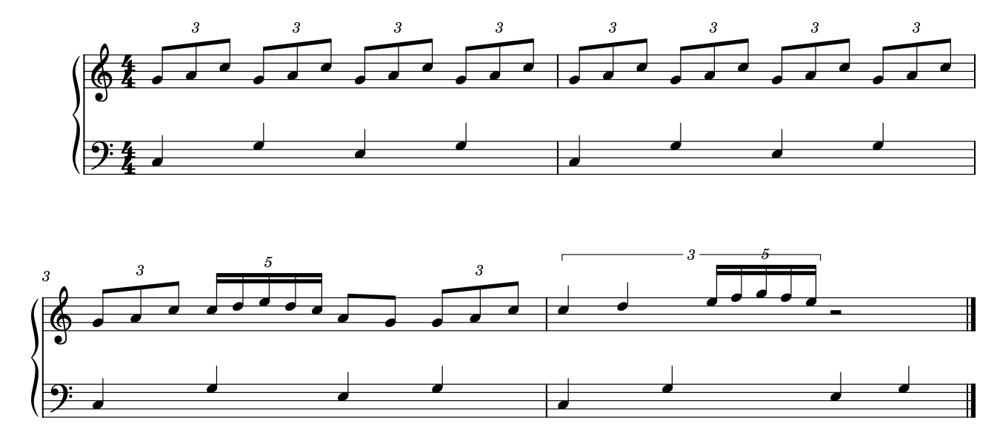
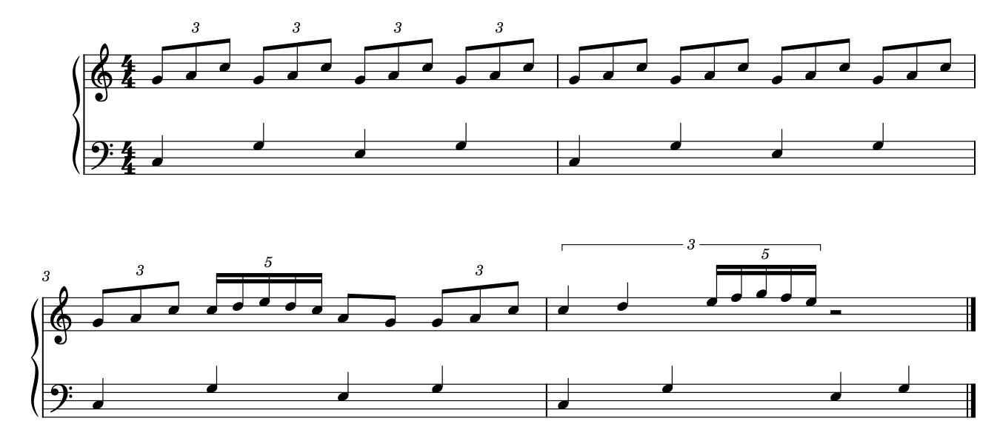

# 连音的简洁与层级：让读者知道怎样数，而不是只减少数字

2026-10-24补[T03的Again](SKILL_TRANSFER_RHYTHM.md)：p6第三系统首小节三颗三十二分3:2占1/4四分，起点11/4、17/6、35/12，组后3处上下共列；下层5/2到3保持八分。先核局部时段与完整小节，再求有理共同点，不能按三颗头找三个下层配对。A007五音拱形普通值已填满，不擅补五连比例。

2026-10-23[独立12／11原生例](POLYRHYTHM_SPACING_STUDY.md)明确写11:6、保33音与共同到达，MusicXML以divisions=88精确表示时间；480 PPQ的实际MIDI另有最大5/11 tick舍入。隐藏换号虽保MIDI仍误示谱位，单头左移也破坏汇合；不能由播放、字段写入或较小间距比率单独采用试排。默认及两列留白试排已原生重载，未作实曲迁移。

2026-10-23[My Dearest P](INTEGRATED_READING_MY_DEAREST.md#1-p段十二个普通快音对十一连组)补七处12／11共同跨度：上方十二个普通三十二分、下方十一个连组十六分，占同一附点四分长度；按整小节推下方11:6而非从数字自动补11:8。132份共同细分仅供核时位，不强迫所有纸面间隔线性；先保护共同到达，再看换号与局部均衡。首处到达错列有候选，后六处对齐；没有原工程比例或实际演奏验证。

2026-10-21续例见[Connect整首](INTEGRATED_READING_CONNECT.md)：H的7:4八分每音2/7四分，6:4与3:2八分则都每音1/3四分；梁组数字不同，不必意味着每音时长不同。两类反复型末尾还有普通八分对，收束处又改四分，不能机械复制。实际可见的simile与数字保留各有作用对象，规范对力度、省奏法和省连音数字也不同。本例没有原工程或原生替代版，不把PDF读法当作已核内部比例字段。

2026-10-20。此次补看Gould印刷p208–209的完整正文和表图，复看p213–215与三份官谱的四页，再用原创四小节作原生应用。得到一个有条件的省数字候选、一处可用现有属性解决的嵌套括号干扰，以及播放相同但读法信息不足的反例。[证据](tuplet_reading_evidence.json)记录精确时值、结构和输出；没有修改参考谱、用户工程或软件。

## 1. 连音标记同时交代单位、范围和分法

同一个“3”可能表示三份等分，也可能出现在包含更多实际起音的混合时值组上。先读写出音值、比例的单位、全组跨度和内部层级，再看数字是否足够清楚。可见音头数还会被和弦、共头、tie及内层细分影响，不能直接当分子。

Gould p208–209的表格尤其补足了此前的文字认识：5/8里三个等分四分音符，可以用“3”与全小节范围表达分法；按八分音符单位计算时，却是6:5。表中另有两音、四音等分，以及7/8、9/8的不同写法。“3个头，所以必定是普通3:2八分组”在这里就错了。完整比例若采用不同的计量音值，还须说明单位，不能只增加两个整数就假定歧义消失。

p208还反对在组前另添一个看起来像音乐声部的音符来表示全组时长；需要的换算说明应当清楚属于连音标记。表中显拍的拆分／tie写法有助于慢速计数或精确配合，连续等分的简写则较流畅、符号较少。按演奏任务选择，不能机械地将表格所有写法互相替换。

这两页完成了此前未看表图的明确缺口，未据此声称全书记法都已掌握。p216／217只得到空白／下一章标题的文字定位，未计作实质学习；p213–215是复看。

## 2. 官谱中为什么有的省、有的一直印

| 定位 | 可见组织 | 阅读收益与取舍 |
| --- | --- | --- |
| A116《Sparkle》p1第一系统及后续 | 首小节四个三音梁组各印3，后面同形组不逐组重复；慢层与新增旋律另有干向 | 先建立规则，再让重复轮廓承担识别，减少持续出现的数字。不能据此删除真正的连音数据，也不从PDF断言后面每个未标组的内部比例 |
| 同曲p6第一系统、第四系统第三小节 | 开头混合四分／八分的组重新用3及必要括号交代；后文含休止的组也重新明确范围 | 读者遇到不同音值组合或休止时，需要重新确认分法。不能把p1“连续省写”推广到全曲所有相似旋律；括号还说明休止属于哪组 |
| A006《lit》五变奏p2，Variation 3至页末 | 连续快速组中5、6交替，下部运行和上部保持／分句共存 | 数字说明相近组形中的变化，避免靠逐颗数音找区别；长弧组织更大动作，不替代各组范围。少印数字会增加猜测，而不是自动变得精练 |
| A081《Kuusou Mesorogiwi》p5第三系统 | 上部6组与下部5组相对，随后仍有多组运行和保持层 | 共同组边界是配合参照，内部不同细分不应按第几个头一一拉齐。保留各层数字帮助确认当前分法；不依据这页单独推定所有未写出的分母或软件对象 |

Gould p215允许相同节奏型建立一两小节后省数字，前提是分组仍清楚；复杂合奏／对齐情境又倾向一直显示。钢琴两手虽不是指挥总谱，也可能有需要持续确认的异分层，故用“熟悉程度、组形是否变化、同步任务”判断，不能用“同一个数字连续出现几次”单独决定。

以上四页均为已有材料定向复看，没有增加历史379页近读计数。阅读机制是本研究的解释，并非出版者亲述制作原因。

后续[旗尾与长短型](RHYTHM_READING.md)复看A109开头的四分＋八分3及simile，纠正“后页未连梁可直接按拍连”的误判。原创原生两版表明：省数字仍保留真实组；要换完整三音梁，须拆长音并加tie。简洁、显细分与数据身份应分别判断，也与A074十六分swing的演奏等式区分。

## 3. 原创四小节：有意同时放入可省和不可省的情境

原创双谱表4/4，固定Leland／Leland Text、spatium 1.57mm和同一版心，音符固定上干，m2后换行。干向与两小节一系统是隔离问题的输入条件，不是全曲默认排法。下部每拍一个四分音符，提供共同拍点；上部安排如下：

1. m1：四组三连八分，建立组形与分法。
2. m2：逐组重复同一音高／时值型，候选只在这里省四个3。
3. m3：3连八分、5连十六分、普通两个八分、3连八分；比例变化和恢复都显示。
4. m4：外层3:2、以四分为基准，占两个四分音符的时间；前两份各一个四分，第三份再由5:4十六分填入，后接二分休止。外层括号须清楚包住内层。

m4两颗外层四分的实际时长各2/3个四分音符；内层每音是`1/4 × 4/5 × 2/3 = 2/15`个四分音符。不能只取内层5:4，把它当一组普通占一拍的五连；也不能把七个可见起音误认成7连。重导MusicXML在内层各音上给出的合成time-modification为15:8，而外／内两层的notations仍分别存在，读结构时要区分合成时值和各层标记。

## 4. 先解决层级干扰，再比较省写

当前固定`7b4e6fbf…`宿主在这组上干条件下自动计算的m4外层括号，横线正好穿过内层数字5。它破坏了内外层关系，值得处理；这里已经是可见墨迹干扰，不只是两个外框相交的筛查结果。

先只省m2四个数字，m4干扰仍在，说明省写不能解决它。再只给m4外层Tuplet增加`p1=(0,-1.2)`、`p2=(0,-1.2)`，单位sp，让外层括号及其3远离内层5；后者、所有音符和其它对象不动。与Gould p213–214“同侧时外层更远、全组范围明确”的条件一致。这个位移只解决当前输入，不能成为所有嵌套组的固定值。

原排法含13个数字，外层括号线穿内层5：

候选只省重复小节的四个数字，并分开m4内外层：

这一候选的收益分别是减少已建立重复型的视觉负担、消除数字与括号干扰。代价是m2依靠前文建立的分法；若换成陌生片段、剪出独立谱例、复杂对位或改变节奏，就需重新判断。没有据此确认用户偏好或测出读谱速度提升。

## 5. 全删数字的反例：播放一样，纸面信息不足

[全隐藏版](fixtures/tuplets-all-hidden.mscx)去掉所有连音数字和括号显示，完整MIDI仍与原版相同；但第一小节不再建立3分，m3的5与普通二分区别需要推算，m4更失去外层占两个拍的明确范围。它不作为通用美化方案。

实际采用显示策略时保留13个真实Tuplet与其比值、基准值和嵌套结构。省数字不通过删除Tuplet对象、缩短跨度、增加隐藏发音或改变时值实现。[中间仅省数字版](fixtures/tuplets-selective.mscx)也保留，便于分别复现两步因果；它尚未解决m4干扰，不作为本例最终候选。

## 6. 检查证明了什么

- 独立按音乐配方列出有理数起点和时长，再与原生Tuplet栈及重导MusicXML比较：四版均60音、1休止、13组，每谱表每小节都占4个四分音符；内层2/15等精确时值通过核对。
- 省写版只改m2四个numberType；最终候选再增加m4外层p1／p2；其它原生XML完整结构保持。四版完整MIDI逐字节一致。
- 四版同为一页两系统。仅省写版少四个Tuplet数字绘制；最终候选在其上只移动外层数字和两段括号线。所有非Tuplet SVG元素及顺序相同，音符和共同时间列未动。
- 最终候选原生保存重载后，13组的比值、嵌套与时长、局部端点保持，SVG（除文件标题）、PNG像素和完整MIDI相同。MusicXML仅归一化列明的位置／日期及目标show-number／bracket差异后整树相同，没有整块忽略notations。

**另一个格式边界：** 只省数字版与最终抬括号版导出的m4 MusicXML整棵树原样相同，尽管原生图面有明确差异。本例的局部括号端点调整没有体现在这份输出中。因此MusicXML相同不能证明原生几何相同；本轮未做MusicXML重导入，也不泛称所有连音布局都不能往返。

图像只合白底、采用相同裁框保留完整两系统，公开图未缩放或移动符号。自制音乐与渲染采用CC0，参考官谱和教材图仍只在本机私有缓存。没有试听、打印、演奏或用户审美验收；固定宿主的复现不自动代表当前安装版、最新源码或其它版本都有同一问题。

## 7. 对后续自主净书的要求

遇到重复连音，先确认分法建立、组形未变及读者是否需要同步提醒，再提出省显示；遇到混合或嵌套，先核总时长与层级，再评价括号与数字通道。当前已经能在这个例子中区分可省、须保留和可局部修正，并给出原生验证。

未来Muse适配可用本fixture复现“外层括号穿内层数字”，研究是否需要自动避让；当前已有局部属性可处理，先记录输入和代价，不先开发新接口或全局预设。按需读取[数字／比例笔记](NOTATION_DETAILS.md#5-连音数字不是完整的时值数据)、[显拍与流动](NOTATION_DETAILS.md#7-连音怎样让拍子可读又不破坏流动感)和本例；未知PDF分母、任意跨小节嵌套、复杂异分同步与实际印刷仍不能由这四小节代替验证。

## 2026-10-23：括号的端点、侧别与数字中心

补完整图文p193、195–199，p194沿用已核页，原先文字／部分图的范围现与p200–215连接。新增的是完整谱例核查，不能把旧正文阅读又算一次。

| 情境 | 为什么如此处理；适用边界 |
| --- | --- |
| 数字定位 | p193以视觉中心归组，区别斜体连音数字和正体指法／人数。偶数、奇数及中间值被细分时，视觉中心不由“第几个头”一个公式包办 |
| 首尾与长末值 | p195通常从首头／休止左沿到末头／休止右沿，不把前置变音、装饰音或琶音一起圈进组。末值长时可延到假想末细分，使数字更接近节奏中心；没有空间时也有保留较短跨度的例外 |
| 多部范围 | p196同分法的范围可对应；末值细分不同又允许端点不同，或统一到最长者以帮助对齐。不同分法不能仅为整齐拉成同一长度，更不能顺手移动真实起音 |
| 倾角与通道 | p196–198允许无梁组随外音小倾斜，连续起伏也可平放；单一梁方向时相平行，内部梁方向不同或会斜入谱线时可平放。先确保读者能识别范围，再谈统一坡度 |
| 谱表侧与弧线 | p197–199通常在干侧读节奏，留头侧给奏法／弧；大量加线、混合干向、双声部又有明确例外。数字放头侧时须加括号使其醒目；长短关系决定弧内外，若会交叉则外绕。不能做成全谱数字一律上方或一律弧外 |

[ninelie整曲第9节](INTEGRATED_READING_NINELIE.md#9-j为什么整齐保住真实单位而非所有头等距)提供实际单位的例子：J首个两拍单元15个快音头，两个5组与普通三十二分并置，最后又是十六分。两段5组近乎稳定，另一层按中间真实时位进入；外层slur并非整个连音的括号。这里保留数字和组形，尚未做同构MuseScore候选，不将教材位置建议称为本机通用自动能力。

## 2026-10-22：端部休止、梁覆盖与实际单位

完整复核Gould印刷p200–207图文；p200并非要求所有含休止组都加括号：梁若延伸并清楚覆盖整组及端部休止，可以省；只有部分梁属于连音或范围易误会时须明确。p202按实际最短单位处理混合时值的对齐，p203–207又要求把比值单位和体例读清；不能只乘两个显示分子建立均匀画面。

[unravel整首案例](INTEGRATED_READING_RUMBLING_UNRAVEL.md)F首5组是八分休止＋三个十六分，下降末5组是四个十六分＋十六分休止；括号把梁外休止纳入，20／19个快层头仍各为四拍。这里分法可由上下文核清，不因混合时值就强制每次全写5:4。含休止、梁是否覆盖全组、比例单位与读者任务一起判断；该PDF读法没有借用旧原创例的原生保持结果。

2026-10-22[Mixed Nuts末小节](INTEGRATED_READING_MIXED_NUTS.md#4-末小节五连八度与最后一个动作要分开)校正旧“8组”：实际为两个标5的十六分组，8与虚线属局部八度线。连同普通八分／十六分及尾部休止可核满4/4；各五连按常规读法占一拍，不反推工程Tuplet字段或实际演奏等长。最初紧裁漏前缀，扩大到完整小节／系统后才作计数。

## 2026-10-23：非整齐跨度与图证补齐

完整看图p208–209，补此前仅文本定位；旧连续账本已含两页，因此只修复证据，不重复加累计。组跨度不规则时应说明所占时值，不能在前面加一个像新部的长音作标尺；慢速／合奏需要时可以展开真实计数。

[lit整曲](INTEGRATED_READING_LIT.md)保留Variation3五／六组的比例说明疑问；末7组则为五个三十二分加十六分休止，共七份单位，不按七个发声音等距。[Owari](INTEGRATED_READING_OWARI.md)中五／七组与下部参照改变、6对3的真正共列又是不同情况。不同作品同一个数字不提供可直接复制的ratio。

## 2026-10-26：数字范围、普通侧翼与小头计量

[Butter-Fly／Call of Silence](INTEGRATED_READING_BUTTERFLY_SILENCE.md)补三种实际取舍：末页一拱形只有中间六音受6约束，两侧普通十六分及休止仍按自身音值；F首小节27个小头在后3拍，九组三音中三连十六分／三十二分不同长；G的9括形包含起首休止及八个音头。数字、梁层、Rest和端点一起计量，不按外弧或音头数量套倍率。p6华彩64个普通六十四分名义合4拍，既有自由表情不要求新增64连音；工程播放未核。

## 2026-10-26：相似大弧内，计量已经改变

[Change the World J](INTEGRATED_READING_CATCH_CHANGE.md#2-j段先数时间再判断哪种间距应稳定)首小节为八分休止、三颗十六分三连、十颗普通十六分及末八分，共四拍／14运行头；后续可变为13头普通细分，末型再变八颗十六分加附点四分。三连起点步长8.136–8.154pt，普通十六分10.620–10.800pt；实际时值比1:1.5没有强制空间同比。先核数字、梁及末值，再比较各组稳定度；大弧不建立全程相同比例，省数字也不能越过分法变化。Gould p200、490复读支持保复杂层的可读步长和其它层真实对应；本轮未制作原生替代。

## 2026-10-27：数字居中于前组，主梁却延伸到普通末音

[departure!两处15／16](INTEGRATED_READING_DEPARTURES.md#3-梁连着不保证都属于同一个连音)实见前15／16双梁头加一个单梁八分，共16／17头。Gould p200要求部分梁内连音明确括号；先比较圈前组，必要时给比例或分主梁，不能先按可见总头数等分。若末八分普通且小节严格四拍，前组重建为15:14／16:14；这是条件读法，分母／作者自由处理未确认，不写成已核播放值。

## 2026-10-27：先导普通值、五次起音的六份与混合组

[Euterpe p2–3](INTEGRATED_READING_EONIAN_EUTERPE.md#4-数字梁和长弧各有范围)把普通32分前导、八分＋四16分的六份、tie接收、6／7和普通4音／三连混合分读。p3第5系统后小节先八个普通32分，再四个5:4的32分组，共三拍；内梁4＋4断口不改变普通值。p5三连局部一条梁旁还有slur，放大已核为八分休止＋两个八分；不要把弧误作第二梁后发明新比例。

## 2026-10-27：五连对八分与自由路线

[Everyday／Extra](INTEGRATED_READING_EVERYDAY_EXTRA.md)：A043末页每拍5:4十六分对两个普通八分，共20对8，不能误套20对6；真正半拍夹第3／4头之间。K局部书面值5拍且无行末小节线，后续ad lib.与行中L恢复分读；不自动按4/4补删。

## 2026-10-27：相同10组不固定占一个四分单位

[Fate／Frieren](INTEGRATED_READING_FATE_FRIEREN.md)：A045 p1末4/4首小节的10:8与12:8三十二分各占1四分单位；P在6/8前半由休止、普通32和三连16组成1.5单位，十音上行再占1.5，推得10:12。分母未显式印出，按完整计量／范围核，不能只认数字。A044 p8特定9组范围仍保疑问。

## 2026-10-27：完整梁七连与部分梁三连分判

[吹雪／无限城](INTEGRATED_READING_FUBUKI_CASTLE.md)：A048 J七个7:4十六分后接梁外普通四分，随后6:4及普通尾组；初看普通四分误作八分已校正。p5s2尾部三连十六分加普通八分共主梁，3仅覆盖前三；A046短2/4同型。按Gould200比较短括号，整梁7／6不必一起补；具体范围先于比例。
