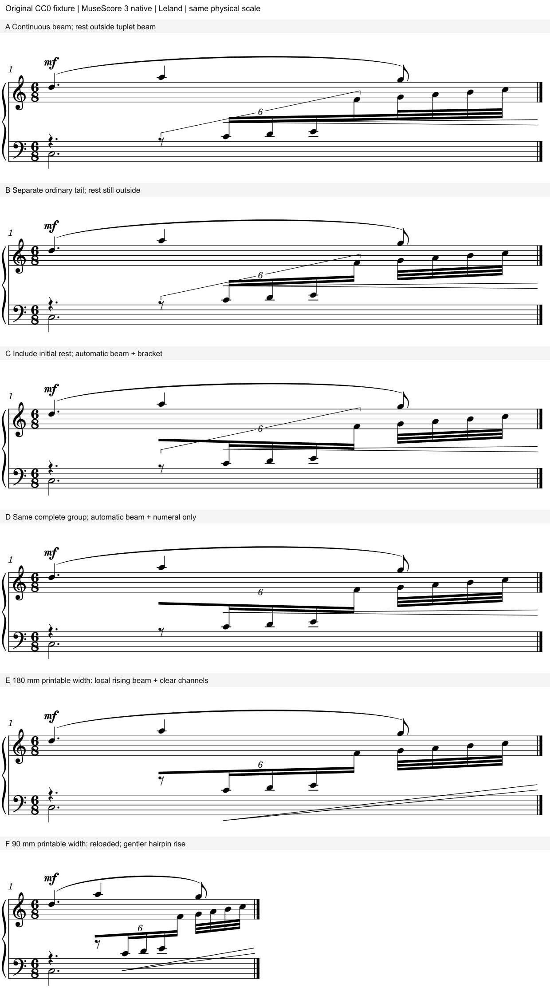

# 含休止的六连：先读清组界，再安排梁与力度通道

2026-10-31。**这份原创三层例倾向E／F：六连含起首休止独立成束，普通三十二分尾音另束；保留上行梁坡，把数字、休止和渐强一起避让。** 它读清了六连的起止，保住原来的音高走向和显示谱表，代价是连续主梁被分开。可作为记法候选；尚未迁移回用户m97。

本批承接[m97方向反馈](M97_DIRECTION_FEEDBACK.md)，没有新增用户审美定论。用户的“可能喜欢原来方向感，但避让不是很好”支持继续保方向、改善避让；它尚未指定某个分梁方案。原件只读，音乐全部来自既有CC0原创样本。

## 1. 读者要一次认清什么

同一6/8小节有三个层次：上方D5–A5–G5慢旋律及弧／mf；下方C3保持；中间一串C4–D4–E4–F4，随后G4–A4–B4–C5。F4及其后的尾音显示在上表，逻辑上仍属下表第一声部。

这串运行从第二个附点四分拍的八分休止开始：**八分休止＋四个十六分是6:4六连，共占一个普通四分；随后四个普通三十二分共占八分。** 因而“6”不能只包住四个发声音，也不能延伸到后四个普通音。运行与上方最后一个G5在普通尾音起点共同进入；上表并非这串运行的延续。

读者需要同时认出两件事：整串向上流动，内部从六连变回普通细分。贯穿的梁有助于第一件事，明确的组界有助于第二件事。须按实际歧义决定取舍。

## 2. 四个原始条件，分别揭示什么

图保完整三层及上方弧／mf，同一字体、谱间和物理比例；F保留其较窄的实际宽度，右侧空白没有拉伸填满。字母对应以下条件，校准中的失败不伪装成可用候选。

| 条件 | 改动与可见结果 | 判断及阅读代价 |
| --- | --- | --- |
| A 连续主梁 | 休止在梁外，八个音头相连；另有完整六连括号 | 整串方向清楚，但必须借括号识别六连与普通音的交界。自动括号斜穿组形，渐强穿干；保留作诊断 |
| B 普通尾音另束 | 只在G4处重起主梁，休止仍在梁外 | 后四音归属更清楚；休止仍须由括号包含，原来的括号／渐强通道问题没有消失 |
| C 六连梁延到起首休止 | 在B上只改起首Rest及首Chord的BeamMode，仍显示括号 | 主梁确实覆盖整个六连，但自动梁反向下倾；括号仍斜穿，休止距梁远。不能因组界正确就接受 |
| D 完整组梁＋裸数字 | 在C上只取消括号 | 可少一条解释范围的线，但自动“6”贴到上表底线附近，梁仍反向，渐强仍穿干；不能直接采用 |

A→B把一条持续运行的视觉线拆开，属于记法分组提议。B→C使起首休止也得到梁的范围提示；C→D才有条件讨论省略括号。**只隐藏括号，并没有处理好范围与归属。**

四版的音头／音高／声部／显示谱表均保持，MusicXML逐音干向也相同。C／D下倾来自起首休止加入共梁这一受控输入变化，不能归因于音型变成下行。

## 3. 为什么E／F更容易读

E在D的分组上使用现有局部属性，联合处理四个依赖：

1. 主梁恢复上行，使读者沿梁看到的趋势和实际升高音型一致。保留F4的显示谱表，没有为放数字增加加线。
2. 把起首休止移近自己的梁。它仍是清楚可见的八分休止，梁未切入字形；后面四个十六分的第二层梁另从第一个音头开始，保留两种时值的区别。
3. 数字靠近完整六连的梁，离开上表谱线／慢旋律；它与普通尾音的梁之间有明确断口。裸数字因此有可追踪的作用范围。
4. 渐强保住逻辑起止与作用层，另走低音谱表的通道，让运行的干和六连数字留在上方。五线可被发夹穿过，音头、加线、数字及其它音乐墨迹须避开；开口仍在谱表外。

E为180mm可打印宽，实际谱线跨度约169.95mm。F缩到90mm可打印宽，实际约79.95mm，字号和谱间不变。两版主梁高差均约1sp，横距缩小后角度约1.45°→3.43°；方向仍清楚。宽版渐强的150 SVG单位升幅直接照搬会显得更陡，F改为90单位，让起端进入低音表、右端开口仍在表外。**宽度改变后应重新看整条通道，不能只缩短横向长度。**

本线倾向E／F用于这个构型。它保留三层读法，又把“六连结束、普通细分开始”变成看得见的边界。若真实乐句特别依赖连续梁提示动作，A的连续性仍有价值，可以继续寻求保梁的括号方案；本例没有证明所有这类运行都应分梁。

## 4. 规范怎样支持判断，哪些属于体例选择

本轮完整复读Gould印刷p36、163–165、199–200、315–317（物理页＋20），共9页，均为已覆盖材料复读；发夹穿表条件沿用已读p323。

- **p199–200，范围先于省线。** 部分共梁、无梁或只是整条梁一部分的连音需要清楚括号，范围包含休止。整个连音被梁覆盖、数字贴近该梁时可以省括号；包含首／尾休止的完整组也有对应条件。因此A／B不适合直接删括号，D只是具备讨论省略的结构前提。
- **p36、164–165，梁和休止一起表达拍组。** 适当越过休止能帮助读拍；休止可移近周围音，但不能被梁切入。Gould完整拍延伸梁的例子使用休止短符干，不能把书中这个具体图式悄悄省略后仍宣称完全照搬。
- **p315–317，共梁要帮助读音型。** 梁向应支持音高趋势；同时检查两向最短干、梁层及独立层，避免只追求斜度。E／F的运行音头基准至主梁中心、按实际干轴测量，最短约3sp；两向最短干仍有约0.35sp差异，未把本例称为全部比例已优化的最终成品。
- **p323，力度通道有空间取舍。** 发夹可在合适条件下穿过谱线，避免妨碍其它记谱。F保右开口在谱外，通过局部斜度使它仍像作用于这一段运行的力度指示。

### 休止短符干需要另作判断

补读[LilyPond 2.26 Stemlets](https://lilypond.org/doc/v2.26/Documentation/snippets/rhythms-_002d-stemlets.html)完整目标正文、页面显示源码及一图；另读Dorico Pro6.2的[休止处连梁](https://www.steinberg.help/r/dorico-pro/6.2/en/dorico/topics/notation_reference/notation_reference_beaming/notation_reference_beaming_rests_c.html)、[stemlets说明](https://www.steinberg.help/r/dorico-pro/6.2/en/dorico/topics/notation_reference/notation_reference_beaming/notation_reference_beaming_stemlets_c.html)、[显示操作](https://www.steinberg.help/r/dorico-pro/6.2/en/dorico/topics/notation_reference/notation_reference_beaming/notation_reference_beaming_stemlets_showing_t.html)三页正文及其有／无短符干两图。

LilyPond图将单纯越过休止的梁、带短符干的梁、隐藏休止的另一种现代写法分开，说明存在体例选择。Dorico明确允许按flow或局部控制；短符干帮助标出休止所在的时间位置，也有长度和休止间隙参数。故此处保留可见休止、使用无短符干的完整梁，可以作为一种出版体例候选；不能说Gould要求的细节与其它软件惯例完全相同。

这份MuseScore输出没有画出该休止处的独立短符干，**尚未检查所有可能属性，不能推成软件全局不支持。** 后续若真实谱中休止位置容易误认，再比较带短符干的实现与阅读收益。短符干是休止上方的竖段，不能与部分水平梁／断梁混为一谈。本例没有隐藏休止，也没有本机编译LilyPond或运行Dorico。

这些补读不属于固定25项中的新完成范围；资源计数仍16/25，余R07–R15九项。

## 5. 能复用的判断顺序

| 触发情境 | 候选动作及依据 | 例外／拒绝条件 |
| --- | --- | --- |
| 连音包含梁外休止、或普通尾音和连音共梁 | 先标清完整组界，保括号；若改为完整组独立梁，再评估省括号 | 不按可见音头数量猜分子，不丢首休止，不把重分梁混成纯坐标美化 |
| 起首休止纳梁后梁向突然逆转 | 比对不含休止的受控版，核音型／干向，再试局部端点 | 要保护最短干、内梁和另一层；不能全曲强设上斜 |
| 裸数字离自己的梁远、贴到另一层 | 把数字与完整组梁一起安排，保时间／范围 | 仅无碰撞仍可能归错层；部分梁的组不能只靠数字猜范围 |
| 梁、数字和渐强争用同一空间 | 先保护组形和归属，再按作品层次分配力度通道；必要时发夹穿表 | 避开音头等音乐墨迹；不得借此改力度生效时段或隐藏其它层 |
| 换成紧行宽 | 重新看梁坡、休止间隙、数字和发夹斜度 | 本例局部offset依赖布局；不能直接发布成全谱预设 |

## 6. 核查范围与软件观察

[证据](tuplet_rest_scope_evidence.json)及六份[可编辑输入](fixtures/README.md#含起首休止的完整六连梁)可直接用于后续审谱。四个原始条件4/4，宽候选1/1、窄宽度迁移1/1、原生保存重载1/1；另保留三个校准输出。共24次成功CLI，复用旧宿主和独立配置，无当前GUI操作。

六版各14个音符／休止、12次有声起音：源工程与MusicXML的84条记录符合独立分数配方，音高、拼写、声部、显示谱表及干向保持；预期连梁层级分别核对。六版加重载的完整MIDI相同，12个起音另独立解码核对。该例导出音速均80，未出现渐强播放斜坡；发夹的作用层和q11/6→q3时段另由结构保护，播放相同只验证已有导出未变。

E／F及重载图的数字、休止、发夹已作墨迹初筛：2采样／SVG单位、alpha>32的条件下，发夹与其它音乐墨迹、休止与梁、数字与其它墨迹相交采样均0；允许的谱线交叉分开处理。原始A／B发夹与干轴相交6次，C／D为7次，E／F为0。F原生保存重载68个带class图元的结构保持，最大数值差0.01 SVG单位，不能写成像素完全相同。未做MusicXML导回、打印、试奏或用户采用。

本地只读`libmscore/beam.cpp`的跨表分支提供机制线索：音高极值循环跳过休止，梁坡符号却取首个ChordRest的`up()`；首项由音符变休止时可能改变符号。原生B→C确实产生该方向翻转。当前源文件SHA及两次读取HEAD记在证据中；与实验exe的构建对应尚未确认。后续开发可用这对输入复现，再判断是否应从首个实际音符及整体轮廓决定坡向；本轮未写补丁。

本批私有文件**453,314字节／768KiB预算**，公开六输入及一图348,085字节；原书／参考图只在内存看，没有原PDF、运行时副本或删除。完整六连实曲后继仍**0/1**；之前的渐强局部候选反馈仍待答。下一步只在有阅读收益时迁移m97，单列分梁提议，核原方向、邻近系统及整页联动。
