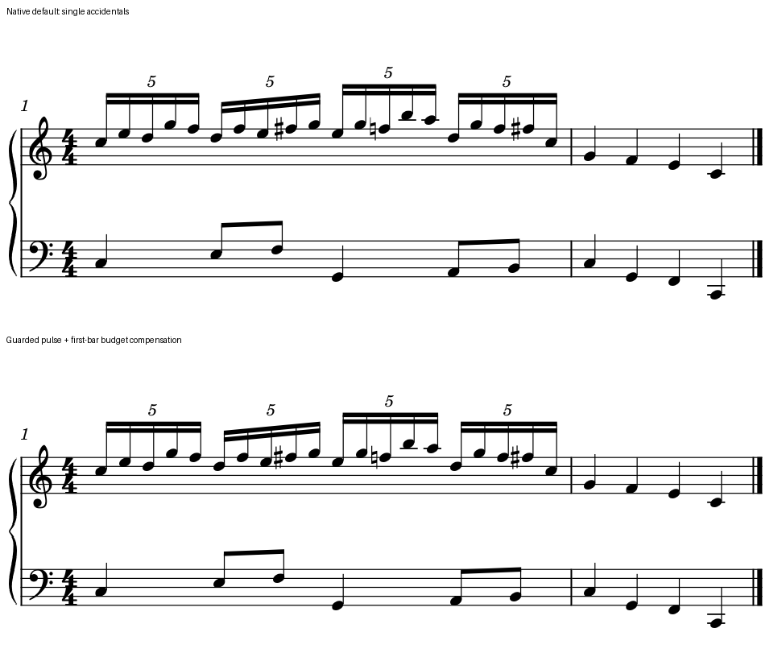
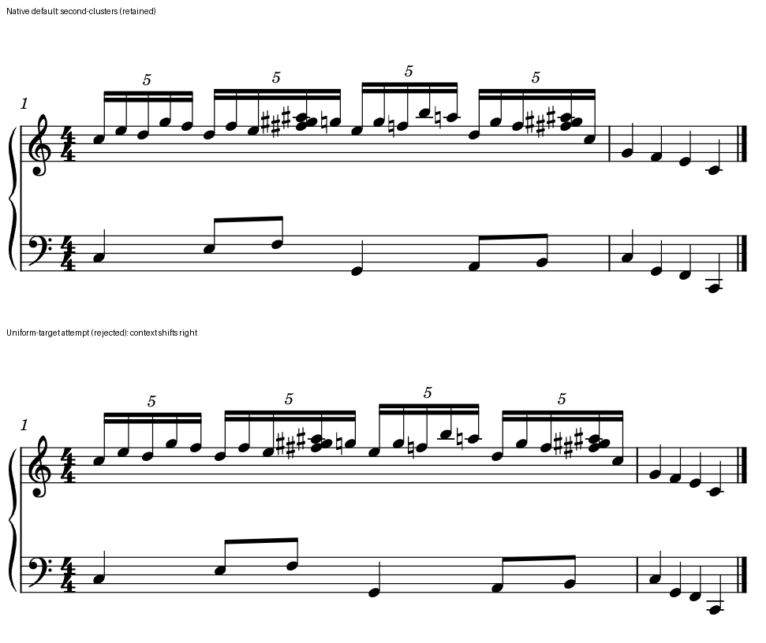

# 20对6遇到变音：留下该留的宽度，再判断余白

2026-10-26。**单变音版保留局部候选，密集二度和弦版保留默认。** 相同节奏里的宽格可以承担不同任务：一个只是中间进入放大的空白，另一个还要放下变音列、错头及后续还原号。净书需要看清这些区别，才知道哪里值得收。

本例接[无变音的20对6研究](TWENTY_TO_SIX_SPACING_STUDY.md)，新增两份原创CC0音乐条件；每种条件内部保持音高、拼写、时值、声部与梁组，固定Leland／Leland Text、sp1.57mm、140mm版心和同一冻结宿主。没有读取或修改用户PDF、MSCZ及教材，没有新增阅读覆盖或软件适配。[完整配方、实测及保存记录](twenty_to_six_occupancy_evidence.json)可追溯这次判断。

## 1. 为什么增加这些符号

两小节4/4，上表第一小节四组5:4十六分，下表仍在q0、1、1½、2、3、3½进入；第二小节两表各四个四分，检查局部改动有没有向后挤。四个整拍真正共时，两处半拍落在相邻五连音之间，都须保住。

单变音版将上表q1.6与q3.6改成F♯5，共34次音符起音。q2.4的F5需要还原，因此实际有三个变音；只数两处修改会漏掉读者必须看到的第三个符号。密集版把这两处扩为F♯5／G♯5／A♯5相邻二度和弦，共38次音符起音；三升号、后来的G／F／A还原号和末组三升号共九个。二者都只有34个Chord时点，不能把和弦内错头数成新的节奏列。

这两份音乐的音高本来就不同，不互相证明“音乐相同”。保护依据是导入前各自写定的独立配方，再核MusicXML实际时值、拼写与声部，以及MIDI实际On／Off、音高、门限和力度。F♯的谱位仍按书写F计算，不能拿MIDI音级给它套上G的位置。

## 2. 原先担心的碰撞没有出现，代价发生在别处

先分别尝试照搬旧无变音候选的偏移、按各自新基线重算全区均匀目标。实际原生输出没有把必要符号全部挤进去；部分宽格仍保留，宽度转移到了其它间隔和后续小节。

| 同一140mm条件 | 16个组内正常侧头距最大／最小 | 下一小节头的最大位移 |
| --- | ---: | ---: |
| 单变音默认 | 1.25026 | 基线 |
| 单变音照搬旧候选 | 1.03454 | 0.38244sp |
| 单变音重算均匀目标 | 1.03665 | 0.29930sp |
| 单变音保护占位后补预算，最终候选 | **1.04838** | **0.00045sp** |
| 密集和弦默认 | 2.18837 | 基线 |
| 密集和弦照搬旧候选 | 2.14756 | 0.62017sp |
| 密集和弦重算均匀目标，拒绝 | 2.06826 | **3.17455sp** |

表中16距为每个五组内部四距，另逐一保存含组界的19距。密集二度和弦按本例上干的正常侧符头原点匹配，下手同拍与它对齐；整组外框中心随错头右移，不能据此判时间错列。详见[变音与正常头](ACCIDENTAL_SPACING.md)。

这些是该宿主对该输入的实测，尚未证明理论最小占宽或精确源码分支。预期碰撞未发生，应保留这一结果，不能事后编一个“挤出了碰撞”的失败故事。**这次拒绝密集候选的原因是收益小、空间转移不合算。**

## 3. 单变音：三处略宽，其余运动更稳

[默认可编辑谱](fixtures/twenty-to-six-single-default.mscx)与[局部候选](fixtures/twenty-to-six-single-candidate.mscx)。上图默认，下图候选；两手、四个5与下一小节均完整，180dpi原生图同裁框拼接，没有缩放或重画符号。

默认普通格约2.572sp，两处半拍与升号共处的宽格约3.215sp。新目标保护三个变音前的已观察占位，将其余16个间隔按余下预算分配，目标普通格约2.628sp；变音前仍可略宽。这里的占位来自原生试排观察，附加0.01sp只是本练习的诊断缓冲，不能当作规范安全距或通用参数。

23个Chord偏移会牵动第一小节预算，仅保护首尾的目标坐标仍让下一小节移动约0.171sp。再用一次stretch探针补偿，最终第一小节stretch约0.993613445；首尾、两表后续四个四分及小节线最大变化均小于0.001sp。四个整拍共列和两处半拍插入误差也小于0.001sp。

收益是连续五连的轮廓更稳，变音前仍有可读净空，下手的中间进入也没有被吸到上音。代价是两升号前的空间比默认紧：前音墨迹至升号轮廓的采样最近距离由约0.697sp降为约0.243／0.244sp；还原号前约0.419sp保持。完整图中三个符号仍可辨认，保留为可比较的候选。净空数字仅描述当前轮廓，不给任意曲线／干／加线作安全保证，也不代表用户已经认可这种疏密。

## 4. 密集和弦：不为降低比率再挤一次

[保留的默认](fixtures/twenty-to-six-cluster-default.mscx)、[拒绝的均匀目标输入](fixtures/twenty-to-six-cluster-uniform-rejected.mscx)。下图第一小节明显向右多占空间，下一小节缩短；两图全行宽度相同，不能只裁出五连组比较。

默认空闲普通格已约2.508sp。约5.488sp的两处宽格容纳三升号和错头，随后的还原号也有自己的占位；这些格不能与无符号格一概求平均。按同一保护占位办法估算，空闲格只需变至约2.503sp，最大建议改动仅约0.032sp，尚不足以构成值得制作的另一候选。因此没有再渲染“密集保护版”，保留默认。

全区均匀目标则需要最大约3.039sp的输入偏移，最终宽格仍在，后续头右移约3.175sp。组内比率2.188降至2.068并没有使符号组织明显更清楚；大幅修改后的更低比率，不是本例的采用理由。默认在此有合理的宽窄分工。

## 5. 这次验证到哪里

- 共10个完整输出条件、1次SVG预算探针、2次原生首次保存和10次再保存／导出，共53次成功CLI调用。每个完整条件分别核独立音乐配方、两手时间关系和实际一系统布局。
- 发布的单变音默认／候选均经过原生保存，再保存后SVG全部有类绘图、原始RGBA尺寸与字节、完整MIDI、MusicXML除日期精确保持。候选第一次保存有5项绘图的微小序列化差异，发布的是保存后稳定版，不称首次图像完全相同。
- 两份密集输入均已有原生SVG／PNG／MusicXML／MIDI核查，未做保存重载；不借单变音结果替它们认证。两种条件内部的Note、Accidental字形路径与缩放分别保持。
- 10个条件的实际Accidental与Note填充轮廓按0.01sp网格、三次曲线每段32份采样，未发现填充相交。它仅辅助实际图的判断，未覆盖全部对象对、理论最小净空或打印。

## 6. 如何成为后续审谱经验

遇到“变音加两手进入造成忽宽忽窄”，先辨真实共同列与正常侧符头，再分出符号占位格和余白格。默认若已把必要宽度局部化、其余组形稳定，就有理由保留。若宽格兼有可回收空白，可提出保护占位的局部候选，并连同下一拍／小节检查。

均匀目标、输入offset与最终印出坐标须分开记录。没有碰撞也可能因预算转移而拒绝；有较高比率也可能因符号任务明确而保留。这个经验已接入[间距取舍](SPACING_DECISIONS.md)和skill的spacing入口。接下来回到官谱与规范的剩余情境，用同样的方法检查实际问题，暂不扩展成全谱优化器。
