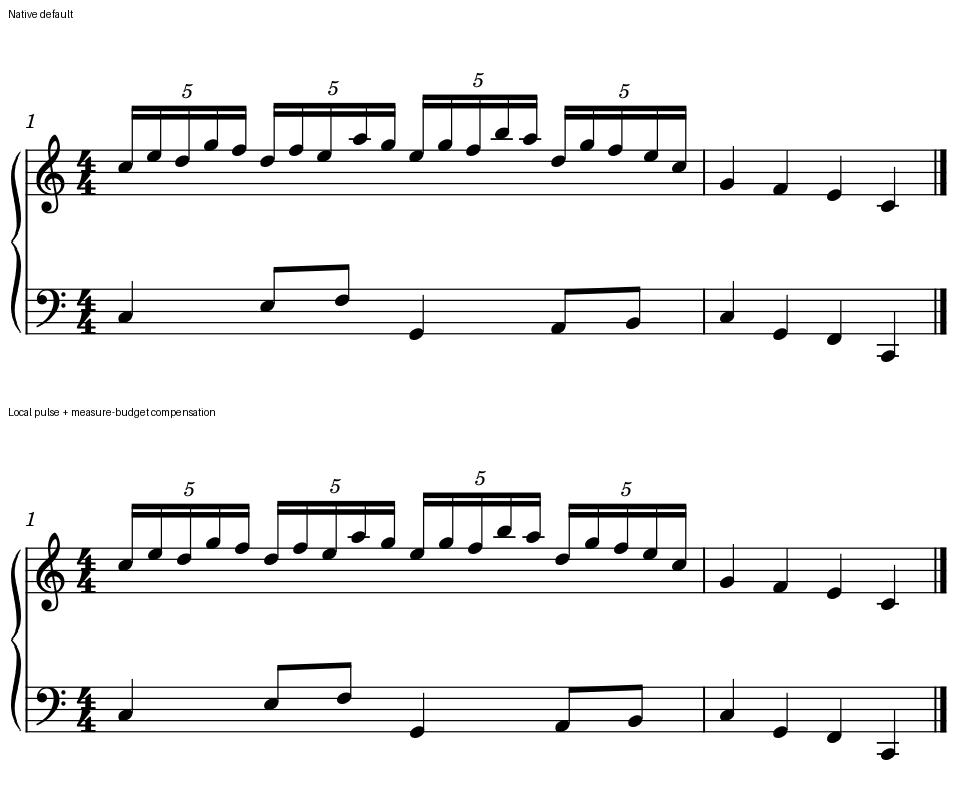

# 20对6间距：保护快层轮廓，也保护整行预算

2026-10-26。判断：这份无变音、单音双层的原创练习中，保留局部脉冲候选。默认版的两手共同拍点本来正确；另一手的两次半拍进入却各撑宽了快层一格。候选减少这种无助于辨认五连组的突变，同时保留真实进入、组形和下一小节的位置。

本例落实[Brave Shine的20对6观察](SKILL_TRANSFER_PAGES.md#4-稳定的密集层怎样容纳另一手)，音高与后续小节独立创作，未转写官谱旋律。它补一个原生可编辑情境，不增加官谱／教材已读页或固定8类迁移成绩；本阶段仍不开发MuseScore／MCP／插件适配。配方、三档宽度、尝试与重载见[证据](twenty_to_six_spacing_evidence.json)。

## 1. 先固定两层各自要读什么

两小节4/4、双谱表，34次起音。第一小节上层四组5:4十六分，每组五音、占一四分；下层六次进入在四分时位：

`0、1、1½、2、3、3½`

下层时长依次为一拍、半拍、半拍、一拍、半拍、半拍，合四拍。第二小节两表各四个四分，提供必须一起检查的后续内容。固定Leland／Leland Text、sp1.57mm、minNoteDistance0.2sp及同一台冻结宿主。全部材料为原创CC0，原谱、用户工程与字体均未改动。

下层1½落在上层1.4与1.6之间，3½落在3.4与3.6之间；没有某颗上音与它同时。净书要同时提供两种线索：上层五连运动容易认成一组，下层仍能在组中间正确进入。不能把下音吸到最近的上音，也不能用去掉这两次进入来换取稳定。

## 2. 默认版的共同点正确，局部轮廓仍有问题

名义版心100／140／180mm分别研究。页宽为版心加30mm、左右各15mm，是受控空间条件；不同宽度不拼成同预算比较。

| 版心 | 默认16个组内头距的最大／最小 | 最终候选同口径 | 默认／候选系统数 |
| --- | ---: | ---: | --- |
| 100mm | 1.27589 | 1.00002 | 2／2 |
| 140mm | 1.24998 | 1.00017 | 1／1 |
| 180mm | 1.25007 | 1.00016 | 1／1 |

五颗头内部只有四个间隔，四组共16个；另核全部20头之间19个间隔，包含三处组界。在本构型两种统计的最大／最小恰好相同，不能据此把组界从其它谱例的统计里省掉。

140mm默认正常格约2.551sp，两个异常宽格约3.189sp。它们分别位于第二／第四个5组的第三、第四音之间，正好夹住下层半拍进入。四个整拍共同起点对齐，两处半拍又几乎在邻近上音的中点；因此问题不能概括为左右手时间错列。

[先前五连研究](FIVE_FOUR_SPACING_STUDY.md)已将同类现象与联合事件轴的非线性弹性及最低宽度相联系。一个上层0.2拍间隔被另一表拆成两个0.1拍列，分别分配后再相加，可比未拆的间隔宽。本次三档结果与该机制相容；没有重做完整源码公式拟合，也未证明当前源码对应冻结二进制的构建提交。

为什么值得改：连续五连组和梁已经清楚交代节奏，额外宽格没有表示上层新时值、分组或必要变音。把这类孤立空白分回同一运动区域，可减少快层轮廓的停顿感；下层的时位仍有独立保护。这是本线对跟读任务的判断，数值改善不等于用户已经选择或所有音乐都应等距。

## 3. 候选究竟固定了哪些边界

可编辑输入：[默认版](fixtures/twenty-to-six-default.mscx)、[局部脉冲候选](fixtures/twenty-to-six-pulse-candidate.mscx)。两图均为140mm版心、180dpi原生输出，白底合成与同裁框拼接；标签在音乐外，没有移动或缩放图中符号。四个5、两表和第二小节完整保留。

目标区域是第一音q0至最后一个五连音q3.8，两端保持原位置；将其19个等时差间隔分配得稳定。同时调整下层q1、1½、2、3、3½，让四个整拍继续共列，两次半拍保持正确的中间进入。下一小节和小节线另核，不把q3.8到下一小节q4之间含小节边界的距离也强拉成内部一格。

原始候选只加18个上层及5个下层Chord的x偏移，共23处，三宽度最大约0.512／0.503／0.629sp。**它们没有完全独立于布局。** 100mm两行条件的两端／后续位置恰好不动；140mm第一小节变窄约1.22tenths，下一小节首音左移约0.122sp；180mm约1.52tenths、0.152sp。移头看似只是显示调整，实际仍能改变小节分配。

所以不能把第一版写成“固定后续内容的成功候选”。也不能拿变化不大或MIDI相同略过这一点：真实长谱里的标记、段落和后续布局可能把小变化放大。

## 4. 小节预算补偿解决了什么

140／180mm各补一次第一小节的原生stretch控制。先用1.01作探针，量其对下一小节首音的实际影响，再按两个测点估计一个补偿值，约1.00467241／1.00468793。它们只用于这两份输入，不能作为通用默认值。

这是**Chord偏移与Measure stretch的联合候选**：内部位置的目标仍来自默认版的两端，补偿只控制小节分配，没有逐格改变音乐或另拟合19个目标。最终：

- 140mm内部格约2.618sp；19距最大／最小约1.00017，四组及其组界均稳定。
- 两端和下一小节音头最大位移约0.00045sp；没有称完全零变化，原生序列化／绘图精度继续保留在记录中。
- 四个真正共同拍点继续对齐；两个半拍相对相邻上音中点的最大误差小于0.00023sp。
- 140mm相邻黑头的保守水平净空至少约1.318sp。这个检查仅覆盖本例同字形单音，不冒充变音、密集和弦及所有墨迹的碰撞检验。

因此本线保留140mm发布候选：区域内更稳，两手对应和后续内容也得到约束。这个例子还说明，分组边界可由梁和数字承担；不必为了证明有四组，在每个组界刻意加出很大的空隙。其它织体若需要边界留白，须重新判断。

100mm候选依然是两行。内部移位没有让原生最低小节宽度下降到可把第二小节装回第一行；局部跟读改善与分行能力仍是两项问题。不能承诺这种处理会减少页数，或把窄版两行当作候选失去音乐内容。

## 5. 音乐、记法与原生重载分别核过

十个完整输出条件：三默认、三初步移位、两预算补偿，以及140mm两份原生保存后的发布基线。两份stretch探针只输出SVG用于测预算，不作为另外两个完整音乐核查条件。

全部十条件的MusicXML对独立配方核34音的音高拼写、谱表、voice、实际起点／时长、干向、梁层与四组5:4；MIDI的34次起音及释音也独立核对，480PPQ下起点精确、音长为配方减默认1tick门限、力度80。完整MIDI字节相同。原始手写候选的XML除23个Chord offset和补偿版的一个Measure stretch外相同。

发布采用实际原生保存过的140mm两版，再各保存一次并重新导出：SVG全部带class绘图、RGBA原始尺寸／字节、完整MIDI，以及除日期外完整MusicXML都与各自保存前一致，23处偏移仍在。重载稳定指每份方案自身保持，不表示两版图形相同。

原生保存省略了默认字体和部分默认样式字段；不能把缺标签读成换字体。本次核原始输入显式Leland／Leland Text，以及保存前后实际字形路径、尺度与绘图。默认版首次保存完全同图；候选首次保存有小于0.001sp的位置／路径坐标变化，故选保存后的稳定版本发布，不声称首次输入序列化逐像素相同。具体像素差保留在证据中。

最初自动裁框把部分5的上沿切掉，已扩大共同裁框，实际看最终同框图及其它宽度后才发布。量第四组“整拍中点”时也发现下一颗可见头已属于下一小节，在窄版甚至换行；已取消那个无效比较，半拍仍用同组内两侧真实头核查。它们是本次测量／呈现纠正，不归咎于宿主净书。

冻结宿主EXE SHA-256为`7b4e6fbfdee1863a4801f018535fa6b2082500d9a2b851dc79579b9ace95aa25`，沿用[既有完整资源运行时](NATIVE_EXPORT_ENVIRONMENT.md)，1936文件导出前后大小／哈希保持。配置目录事先建立并实际生成workspaces内容；本轮未复制宿主、未操作当前GUI。54次独立CLI调用包含54个实际成功结果，分类保存在证据中。

未做MusicXML导回、音响试听、打印、用户偏好选择或真实官谱／用户工程迁移。本例没有变音、和弦、额外声部、八度线、曲线和动态通道，下一步先加这些约束，检验什么时候稳定脉冲必须让位给真正的占位；不直接把本次参数用于全谱。

## 6. 怎样用于后续自动净书准备

1. 先分别检查共同时间关系、每层连续脉冲与实际符号占位。对齐正确仍可能不好跟读；某格变宽也可能是必要空间。
2. 只有目标和可移动范围明确时，才提出局部重分；同步处理另一层的共同点和中间进入，保护区域外音乐。
3. 原生渲染后重新量小节线／后续行页。Chord offset不是不参与布局的覆盖层；必要时在已授权的副本中明确比较联合预算控制。
4. 保存重载和音乐保持通过之后，再判断阅读收益。遇密集符号冲突或整体代价更大时保留默认，不能为了使均匀度指标变好降低验收范围。

本轮新增的是一个可复现、可继续加约束的布局判断。官谱回查26/146、Gould403/696、资料11/25、固定迁移8/8及用户组合0/1均未增加，完整学习目标继续。

## 原创材料许可

本页公开的两份MSCX和原生对照PNG按**CC0-1.0**提供。参考官谱、教材、嵌入字体和用户音乐不在此许可中；发布内容不包含它们的页面或旋律摘录。可用相同宿主按[原生比较方法](../../skills/piano-engraving/references/native-review.md)重画，实际程序、资源及参数应重新记录。
