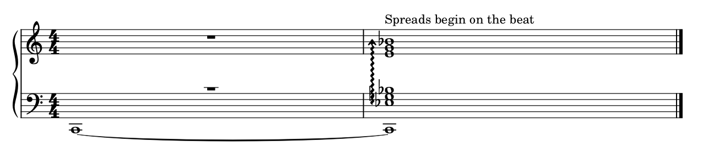
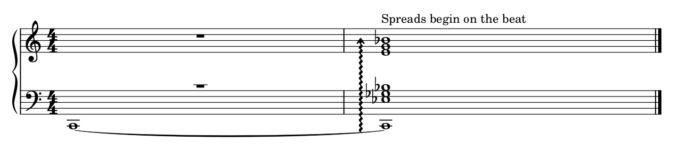

# 1.0首版：怎样试，以及一份实际判断示范

先用一份完整钢琴谱作只读审查，看它能否抓住最值得处理的位置，解释阅读收益，并有理由保留其它排法。需要试排时再要求独立副本的原生候选。[使用提示与安装](../ENGRAVING_SKILL.md)。

## 示范：线更长、间距更齐，不一定更好读

下面是本项目CC0原创例，同一字体和音乐。低音C从前小节保持，第二小节其它音作一次连续展开；本例明确在拍上开始。这是已研究案例的首版流程复核，未计作陌生谱盲评或新的阅读覆盖。

**A：自动跨表线。** 我会建议处理下表降号与波线的相交。先保一根连续线和真实成员，给变音单元留空间；不把两手拆成独立滚奏。

**B：本例优先比较的改善。** 共同时间列留白配合线位，降号与波线分开，低音保持仍在展开范围之外。代价是小节预算和其它曲线会连带调整；不能把偏移量当全曲预设。

**C：拒绝。** 下图的线延到保持低音，会让人以为低音也要重新展开。它与B的完整MIDI相同，仍应拒绝作为等价美化；显示也在传递音乐含义。

原生输入、保存／交换与MIDI范围见[跨表研究第5–7节](CROSS_STAFF_STUDY.md#5-琶音线为什么连续分开又不一定对齐)及[证据](arpeggio_reading_evidence.json)。首版包提供原创例与图，私有官谱／教材不打包。

## 回到你的谱子：先保留有理由的方向和宽格

本轮又看了既有《如果有来生》原生副本第5页整页与m49–52完整两手裁图，未改原件，也未新增试排。透明原生PNG直接显示为黑底，未用于判断；改读已有白底页图。

| 位置 | 当前判断 | 为什么及下一步 |
| --- | --- | --- |
| m97上行跨表组 | 保住你初步喜欢的上行方向；处理范围与避让时一并看梁、数字、发夹和独立层 | 完整组界候选已存在，但分梁／浅尾梁有代价，渐强作用层还未确认，不自动采用。见[m97平衡版](M97_GROUP_BOUNDARY_TRANSFER.md) |
| m50–52相邻小节 | m50与m52的整体粒度可以比较；m51不因此自动拉成等距 | m51后部上层有十六分细分，低部多出的空间有共同时间列原因；必要加线、旗尾及提示音也须保留。见[组合判断](USER_COMBINED_REVIEW.md)与[间距应用](USER_SPACING_APPLICATION.md) |

这类输出应把明确干扰、风格备选和音乐含义分别说清。已有源工程核查可作为本例保护依据，本轮复看不新增准确率或采用成绩。

## 你怎样反馈就够了

可以换一首谱试“找最影响阅读的3–5处”，也可只问“这一行为什么不稳，哪些宽格应该留”。看重三个结果：问题是否真实、理由是否讲通、改法是否更合你的读谱习惯。

直接给具体反馈即可，例如“这里可以收紧”“方向保留”“这处不用改”“没有抓住我觉得难看的地方”。原生重载、音乐保护和来源核查由agent负责；打印／试奏留到准备采用。效果合适后，再从实际反复出现的问题选首批开发。
